# 轮换的让渡：中国官制三千年（西周—2026）的有限系统取舍分析

### 从三老五更到职务职级并行——两条使职化路径、四种演化模式与两次临界

**李毅芃**

*完成日期：2026-10-24*

---

## 摘要

中国官制反复出现同一形状的循环：一个低阶的侍从、监察或副贰之职，因特殊事件骤获实权；其持有者借此废立、专擅或割据之后，该职遭后世禁戒、虚化，而权力转注入另一个新的低阶职位，循环再起。既有研究以"皇权与相权""内朝与外朝""监察区变行政区"概括这一现象，事实考订极详，但对三个问题回答不足：循环为何不能靠"废除"终止；同一过程为何在内廷与外派两条路径上走向不同的失控形态；历代设计者为何反复把兵权与诏令权分开。本文把这套现象重述为一个有限系统问题，并以作者在《选择的代价》中提出的完备性（C）、可组合性（A）、传递性（T）三角作为分析工具——它是框架而非定理，成立条件是同时维持两项会产生正的交互代价 ψ>0。本文的推进有六步。第一，把 C、A、T 操作化为官制中可观察的三类指标，并给出记账不等式的官制版本。第二，提出七个命题：编码、补位、禁戒、并立、时间错配、临界、模式；每条写明证据等级与否证条件。第三，建立覆盖西周至 2026 年、二十四个时期、一百二十一个官职的编码库，逐案记录起家、保有两项、让出一项、触发事件与结局。第四，用四个模式（三阶段循环、双极摆动、分裂并行、顶点驻留）替代单一的"循环"叙事，并指出模式由并立线数与"是否存在融合线"共同决定。第五，把时间错配 τ 从"通信速度"推进到"授权包的构成"：τ 只解释为何必须预先授权，不解释授权为何失控；后者取决于财权、兵权、人事是否分立。第六，对 121 例做四项统计检验，并按 Bonferroni 校正区分'可作结果陈述'与'只能作方向'的判断。量化检验（n=121）给出四个结果：在所选案例内，外派线的割据率显著高于内廷线（12/31 对 1/25，Fisher 精确检验 p=0.003），但唐宋对照样本（67 个官职类型）显示两线的**变化概率**无显著差异（IRR 0.70，95% CI 0.25—1.91；log-rank p=0.60），割据仍只出现在外派（5/31 对 0/20，p=0.14）；因此路径区分的是**失败形态**，不是变化概率；边界案例盲复测的一致率为 86.7%（κ=0.55），歧义集中在“前后期转移”“名分归属”“军权是否计入 A”三处；断裂事件史（28 起）显示：禅代 13/13 在事前 30 年内已有融合线，其他类型仅 3/15（p≈1.5×10⁻⁵），融合领先禅代 1—16 年（中位 2 年），但不领先清洗与政变——融合是禅代的前置条件，不是一切崩解的前兆。内廷线让出 A 的比例为 93%（95% CI 81—98），外派线让出 T 的比例为 60%（45—73）；内廷与外派的时滞差异不显著（34 年对 29 年，p=0.33），故时滞不能区分两条线；融合线与体制崩解方向一致，但仅两次崩解、统计功效不足（p=0.48），只能作为待检验的必要条件。结论是：禁戒只能关掉一个"名"，关不掉"让渡"本身；真正可设计的不是消除取舍，而是为一套配置指定失效阈值与降级顺序。

**关键词**：官制流变；使职化；内廷与外朝；监察区；不可能三角；时间错配；并立线；临界；证据分级

---

## Abstract

Chinese officialdom displays a recurring shape: a low-ranking attendant, censor or deputy suddenly acquires real power in a crisis; after its holder deposes an emperor, monopolises authority or secedes, the office is proscribed and hollowed out, and power migrates to another low-ranking post, restarting the cycle. Existing scholarship—imperial vs. ministerial power, inner court vs. outer court, surveillance districts becoming administrative units—documents the facts richly but leaves three questions open: why proscription never ends the cycle; why the same process produces different failure modes on the inner-court and outposted paths; and why designers repeatedly separate military from edict authority. This paper restates the phenomenon as a bounded-system problem and uses the completeness–composability–transfer (C–A–T) triangle proposed in *The Price of Choice* as an analytical instrument—a framework, not a theorem, whose precondition is a positive interaction cost ψ>0. Five steps follow: (i) operationalising C, A and T for officialdom and stating the accounting inequality in institutional form; (ii) seven propositions, each with an evidence grade and a falsification condition; (iii) a coding library of 121 offices across 24 periods from the Western Zhou to 2026; (iv) replacing the single "cycle" narrative with four modes—three-stage cycle, bipolar oscillation, parallel split, vertex residence—selected by the number of parallel lines and by whether any single line holds all three vertices; (v) refining temporal mismatch τ from communication speed to the composition of the delegation package. Three negative results are reported: the number of parallel lines does not by itself predict stability; the inner/outer latency difference vanishes in the full sample (p≈0.33); and the strong claim that coordinates sum to a constant has been retracted by the author and is replaced by a conditional accounting inequality. The conclusion: proscription removes a name, not the trade-off; what can be designed is not the elimination of the trade-off but the failure threshold and the degradation order of a configuration.

**Keywords**: Chinese bureaucracy; shi-zhi-ification; inner court; surveillance districts; impossibility triangle; temporal mismatch; parallel lines; criticality; evidence grading

---

## 1 引言

### 1.1 一个反复出现的现象

《后汉书·百官志》记尚书"主文书"，秩六百石，属少府；到东汉，三公"备员而已"，政事"归尚书台"。同一部史书里，侍中还是"掌侍左右、赞导众事"的加官；到东晋，门下省已能封驳诏敕。中书监设在曹魏，本为"掌机密"的近臣；到晋代，荀勖由中书监迁尚书令，竟有"夺我凤凰池"之叹——一个曾经的机要之职，此时已是清贵之官，而新的机要之职又在别处生长。

另一条线上，汉武帝元封五年（前 106）置十三州部刺史，秩六百石，以"六条"监察秩二千石的郡守，是典型的"以卑临尊"。三百年后，灵帝中平五年（188），刘焉建议以重臣出任州牧，"州任之重，自此而始"；刘焉、刘表、袁绍、刘备据州自立，东汉裂为诸侯。此后"州牧"成为割据的代名词，而刺史则带都督衔执掌军政；再往后，节度使、观察使、巡抚、总督沿着同一条坡道往下滑。

第三条线上，赵匡胤以后周殿前都点检的身份发动陈桥兵变；登基之后，这一职位不再授人，禁军改由殿前司、侍卫马军司、侍卫步军司"三衙"分掌，调兵之权归枢密院。一次权力转移，使一个职位被永久搁置——这是"禁戒"最纯粹的形式。

三个故事分属不同朝代、不同制度，却共享同一个形状：**低阶起家 → 因事骤重 → 正官化或失控 → 禁戒或虚化 → 权力换名再生**。宋代以后，这一形状被士人提炼为政治常识；明清的祖训、明太祖"后世子孙不得议置丞相"的禁令，都是对它的正式回应。清人赵翼《廿二史札记》多处论及历代官制沿革，钱穆在《中国历代政治得失》里则把它概括为一条通则：

> 皇室的"家务官"逐渐成为"政府官"，而皇帝又另起新的私人以牵制之。

这条通则抓住了现象，但没有回答机制。本文要问的，是这条通则背后的结构。

### 1.2 三个未被回答的问题

**第一，为什么"废除"不能终止循环？** 如果循环由"权臣擅权、后人惩戒"驱动，那么惩戒之后循环应当减弱甚至终止。事实相反：从东汉到唐末，制度设计愈趋精细——三省分职、六部定型、御史台独立、科举取士——循环并未减弱；明太祖以祖训废丞相，是历代最严厉的一次禁戒，而内阁大学士在五十年内即为实际宰相。这说明禁戒作用的不是"功能"，而是"名"。

**第二，为什么同一过程在两条路径上走向不同的失控形态？** 内廷线的失控表现为"挟天子"：宦官废立、外戚辅政、权臣受禅。外派线的失控表现为"裂土"：州牧割据、藩镇自立、督抚独立。两条线的起点都是"低阶"，都在危机中获得权力，为何结局一个指向宫廷、一个指向疆域？

**第三，为什么历代设计者反复把"兵权"与"诏令权"分开？** 从汉代的大将军与尚书，到唐代的神策中尉与枢密使，到宋代的三衙与枢密院，再到明代五军都督府与兵部，设计者的手法高度一致：让"能调兵的人"与"能发令的人"不是同一个人。这不是偶然的经验，而是一条结构性的禁令。

本文认为，三个问题有同一个答案：官制是一个在**信息、编制与传递**三方面均有上限的系统；三项要求不能同时被推到满格，只能"轮换让渡"；禁戒只能关闭一个出口，不能消除让渡本身。

### 1.3 既有解释及其不足

**制度史的"消长论"。** 钱穆以"皇室家务官—政府官"解释尚书、中书、门下的更替；严耕望以"监察区演变为行政区、监察官演变为行政长官"概括刺史、都督、行省的路径；祝总斌论宰相制度，指出相权消长并非"君权单向加强"的直线，而是在皇帝需要与官僚制逻辑之间反复摆动；阎步克以"品位"与"职位"两种结构的分合，解释官阶与实职的分离。这些研究给出了事实与概括，但"消长""摆动""分合"都是描述性的：它们说明"怎么变"，不说明"为什么必须变"。

**家产官僚制。** 韦伯（Max Weber）的"家产官僚制"（patrimonial bureaucracy）指出，传统官僚制中"私属关系"与"科层规则"并存，官职可以被视为统治者的家产。中国的"家务官变政府官"，正是这一类型的典型案例。但韦伯的类型学是静态的：它能解释"为什么会有私属官"，不能解释"为什么私属官会一再正官化、正官化之后又长出一个新的私属官"。

**委托—代理与独裁者困境。** 政治经济学提供了一条更接近机制的线索。温特罗布（R. Wintrobe）的"独裁者困境"指出，统治者需要在"压制"与"忠诚"之间取舍：用官僚则受制于官僚，用亲信则受制于亲信。Bueno de Mesquita 等人的"选择人理论"（selectorate theory）进一步指出，执政联盟越小，统治者越依赖私人品与亲信，公共品供给越弱。这些理论解释了"为何用近侍"，但没有解释"为何近侍会变成官僚"——即"正官化"这一环节。

**历史制度主义。** 诺思（D. North）的路径依赖、Mahoney 与 Thelen 的"层叠、漂移、转换"（layering, drift, conversion）为"制度为何难以改变"提供了工具。但这一传统长于解释"稳定中的渐变"，短于解释"同一功能为何反复换载体"。

**中国研究的当代延伸。** 周雪光以"一统体制与有效治理"的矛盾解释中央与地方的周期性紧张，并把"运动型治理"视为纠偏机制；周黎安以"行政发包制"与"晋升锦标赛"解释地方激励。这些分析与本文关系最近：它们实际上也在描述"集权—放权—收权"的轮换。本文的差别在于，它把这种轮换写成三个可分的坐标，并给出"哪一项被让出"的判断规则。

**既有解释的共同缺口。** 以上诸说都能解释"某一次"变迁，但都不能解释"为什么循环是稳态"。要解释稳态，需要一个**结构性约束**：不是某个人贪权，也不是某个皇帝多疑，而是三项要求在同一份预算下不能同时满足。

### 1.4 研究问题、七个命题与三条线

本文的研究问题是：**在何种条件下，官制的"使职化—正官化—虚化—再起"会以循环形式出现？循环为何有不同形态？这些形态能否被事先识别？**

据此提出七个命题（详见第 2.5 节与表 3）：

- **P1（编码）**：任一官职在任一时期可被定位在三项要求上，并满足条件性的记账不等式。
- **P2（补位）**：使职若想补上第三项，必须支付其起家时所依赖的那一项；这就是"正官化即虚化"。
- **P3（禁戒）**：禁戒作用于"名"而不作用于"配置"，因此只能关闭出口，不能终止循环。
- **P4（并立）**：稳定性不随并立线数单调上升；真正的共同项是"是否存在一条线同时占满三项"（融合线）。
- **P5（时间错配）**：τ 决定"必须预先授权多少"，但不决定"授权是否失控"；后者取决于财权、兵权、人事是否分立。
- **P6（临界）**：日常轮换是二阶的（连续、可逆）；当融合线出现，系统进入一阶崩解（有滞后、回不去）。
- **P7（模式）**：演化形态有四种——三阶段循环、双极摆动、分裂并行、顶点驻留——由并立线数、融合与"是否补 A"共同决定。

三条线是：**内廷线**（侍从、文书、宦官）、**外派线**（监察、副贰、地方）、**军职线**（宿卫、禁军、都督）。加衔与差遣（录、同、判、知、权）是贯穿三条线的"语法"，不是第四条线。

### 1.5 方法与证据分级

本文是定性比较研究，兼用三种方法。

**方法一：案例编码。** 以"官职—时期"为分析单位，选取符合四条判据的案例：（1）起家时不是正官序列中的高位；（2）因特定事件获得超出其品秩的实权；（3）此后出现正官化、虚化、割据或禁戒之一；（4）史料可给出大致起讫年。共 121 例，分为 24 个时期（西周至 2026）。逐案记录"保有两项／让出一项／触发事件／结局"，编码表见附录 A，数据文件为 `cases.csv`，绘图脚本为 `make_figures.py`，可复算。

**方法二：结构比较。** 在同期内比较不同路径的配置，在跨期比较同一路径的配置，寻找"换顶点"的节点。比较的单位是"配置"（保留哪两项、让出哪一项），不是"官职名称"。

**方法三：说明性模型。** 对记账不等式、时间错配、滞后环做数值演示（图2、图9、图10、图11）。这些模型的参数是示意的，只用于显示结构，不用于推断现实数值。

**证据分级。** 沿用系列惯例：证据等级 A（官方可复现）／B（稳定公开估计）／C（稀疏、构造或思辨）；概念等级甲（形式化且可检验）／乙（有框架、暂无独立判定）／丙（启发式类比）。铁律是**结论强度 ≤ 证据强度**：C 级材料不支撑 A 级结论；同一命题在不同尺度上可以给出不同置信度。凡本文自己的编码判断，一律记为 C，并在附录 C 列出待核项。

### 1.6 本文的贡献、边界与五项不做

**贡献有五个。** 第一，把"官制循环"从描述性概括改写为可分工的结构问题：不是"权力为何集中"，而是"哪一项被让出"。第二，给出七个可反驳的命题，其中 P4 在检验中被部分反驳并修正（第 8.2 节），P6 的"临界"只作类比（第 10 章）。第三，把案例库扩展到 24 个时期、121 例，覆盖分裂期（十六国、南北朝、五代十国）与异族政权（辽、西夏、金、元、清），并发现"双轨制"是并立线的极端形式（第 7.6 节）。第四，把 τ 从"通信速度"推进到"授权包的构成"，并用安禄山、三藩、东南互保三个反例界定其解释边界。第五，给出可复算的量化检验：外派线与内廷线的割据率差异（Fisher p=0.003）是本框架唯一通过多重比较校正的统计结果；融合与崩解、时滞与路径则只有方向，没有统计强度。

**边界有五条。** （1）本文不宣称证明了三角；它只是把三角当作组织坐标使用。（2）C、A、T 的编码由单一编码者完成，未做第二编码者一致性检验，这是本文最大的方法缺陷。（3）ψ 没有被测量，"代价"只是定性描述。（4）中古史料多经后世追述，个别年代与职名有争议，本文取约值并标等级。（5）现代部分（1901—2026）只能给方向，不能做对照实验。

**五件不做的事。** 不写一部官制通史（只取与"让渡"有关的节点）；不评判具体人物的贤愚；不预测任何王朝或政权的寿命；不把"循环"写成历史宿命；不把框架外推到它不能承担的领域（如把"临界"直接用于预测某次改革失败）。

---

## 2 理论框架：把官制翻译成 C、A、T

### 2.1 为什么是三项

任何"要办事"的制度都必须回答三个问题：**它看得见吗？它拼得起来吗？它传得到吗？** 对应三项要求：

- **C（完备性，看得准）**：决策者对具体事务与时势的信息是否准确、及时、贴近。
- **A（可组合性，拼得上）**：各官职、机构的权责能否拼合成一个整体——分工明确、编制可数、职掌可叠加而不冲突。
- **T（传递性，传得下去）**：政令能否跨距离被执行、制度能否跨朝代延续。

三者不是可选的附加功能，而是"官制"这个词的三个构成性条件：没有 C，制度不知道要办什么；没有 A，制度不能分工；没有 T，制度出不了都城。**冲突不来自"三者都重要"，而来自三者共享同一份预算**：一个皇帝只有一份注意力，一套编制只有一份员额，一条驿路只有一份运力。描述得越细，可用于组合与传递的预算就越少——这不是道德上的贪心，而是预算上的同一性。

第三件事是**交互惩罚**：同时维持两项，比分别维持更贵。把"近侍的贴身"与"官僚的编制"同时维持，要多养一套班子、多写一道文书、多一层会签；这份额外成本记为 ψ ≥ 0。没有 ψ，三项可以在同一预算下各自逼近上界；有了 ψ，预算线向内凹，满格点被推到可达域之外。

这正是《选择的代价》第 2 章的命题 2.0 与 2.2：**有限性只是必要前提，不是充分条件**；三角的实质内容是"三项构成性 + 共享承载者 + ψ>0"。若 ψ≈0，三角不成立——本文把这一条当作自检条件，而不是可以含糊过去的脚注（第 2.7 节）。

### 2.2 操作化：三项要求在官制中的对应物

**表 1　框架概念与官制现象的对应（本文操作化）**

| 框架概念 | 官制中的对应物 | 可观察指标 | 典型证据 |
|---|---|---|---|
| C 看得准 | 信息通道的长度与保真度 | 奏报到达中枢的时滞；近侍是否参与机要；非常规信息（密奏、口传）的比重 | 尚书"主文书"、翰林"内相"、密折 |
| A 拼得上 | 权责划分、品秩、编制、职掌 | 是否入品秩序列；有无定额属官；可否兼领而不冲突；三省六部、九品十八阶 | 《唐六典》《明会典》 |
| T 传得下去 | 诏令执行、制度延续 | 诏令到达率与执行偏差；地方听命程度；祖制、成宪的约束力 | 刺史六条、督抚题奏、祖训 |
| ψ 交互惩罚 | 同时维持两项所多付的代价 | 机构膨胀、兼领冲突、文书往来、党争、冗官冗费 | 宋"冗官冗费"、唐"使职冗杂" |
| τ 时间错配 | 事变所需时间 / 可用时间 | 边报到京往返日数；事态巩固时间；授权层级 | 驿传里程、急递速度 |
| 快慢分层 | 差遣（快）与品秩（慢）分离 | 官、职、差遣是否分离；职务与职级是否并行 | 宋制、2019 年职级并行 |
| 临界 | 三项同时失效的门槛 | 融合线出现；诏令延迟上升；财政分散度上升 | 汉末、唐末 |

*注：指标的选取是可争论的；本表给出的是"用什么看"，不是"看到什么"。等级 B／乙。*

三项要求各自还可分三档，这一点决定了"完备"永远相对于一个问题与一个容差：

- **C₁ 描述完备**：对该职所辖事务有完整的基元刻画；**C₂ 计算完备**：可依规则推出处置；**C₃ 预测完备**：可预判事态。
- **A₁ 线性可组合**：权责可相加；**A₂ 关系可组合**：兼领不产生新的约束类型；**A₃ 代数可组合**：品秩体系封闭、可运算。
- **T₁ 尺度传递**：中央→州郡→县；**T₂ 时间传递**：一朝→后朝；**T₃ 因果传递**：制度意图→执行结果。

一个官职"有品秩"，只是 A₁—A₂；"三省六部能拼成一个政府"，是 A₃ 的雏形；"诏令能到县"，是 T₁；"祖制能约束一百年后的皇帝"，才是 T₂。把三档混为一谈，是"完备"一词最常见的滥用——宋人说"本朝家法最善"，说的是 A 与 T₂，不是 C。

### 2.3 三种两项组合 = 三条路径

三项要求至多同时满足两项，于是有三种组合。本文主张，中古官制的三类权力结构各自对应其中一种：

**表 2　三种两项组合与三条路径**

| 路径 | 选择 | 起家形态 | 让出的代价 | 典型官职 |
|---|---|---|---|---|
| 正官体系 | A＋T，让 C | 有品秩、有编制、有职掌 | 程序繁复、层级多，对具体事务既慢又远 | 三公、九卿、三省、六部 |
| 内廷使职 | C＋T，让 A | 近侍、文书、宦官 | 不入正官序列，品秩模糊，难与既有体制拼合 | 尚书、中书、门下、翰林、枢密、内阁、军机 |
| 外派使职 | C＋A，让 T | 监察、副督、地方 | 中央政令难达；T 崩塌即割据 | 刺史、都督、节度、行台、督抚 |

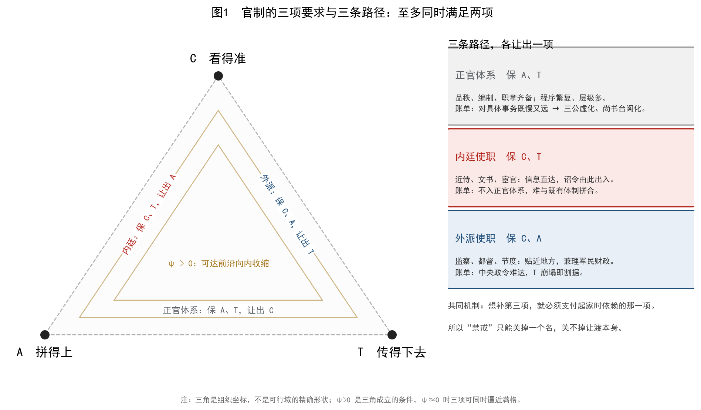

*图1　官制的三项要求与三条路径：至多同时满足两项。三角是组织坐标，不是可行域的精确形状；ψ>0 是三角成立的条件，ψ≈0 时三项可同时逼近满格。*

三条路径不是三种"人"，而是三种"位置"。同一个人可以从一条路径走到另一条：霍光以大将军（军职，C＋A）领尚书事（内廷，C＋T），一人同时占了两条线的两项，实际占满三项——这就是他能废立的原因，也是霍氏覆灭后"领尚书事"被制度化的原因（第 5.1 节）。

### 2.4 记账不等式与 ψ 的官制形态

把三项写成坐标 (c,a,t)∈[0,1]³，把预算写成 K，把交互惩罚写成 ψ(c,a,t)≥0，则《选择的代价》命题 2.2 给出条件性的记账不等式：

```text
κ_c·c + κ_a·a + κ_t·t + λ·ψ(c,a,t) ≤ K        （λ ≥ 0）
```

归一化 κ=1、K=3（预算恰好够三项满格）时：若 ψ≡0，则 c=a=t=1 可达，三项可同时满格，三角对之不适用；若 ψ>0，则 c+a+t ≤ 3 − λψ < 3，满格不可达，缺口随 λ 扩大。

图2(a) 是这个式子的数值演示：横轴是 λ，纵轴是可达到的最大 c+a+t。λ=0 时曲线贴着 3.0；λ 增大时曲线下落。这不是"证明"三角，只是把"取舍"从形容词变成一个可以算的不等式。

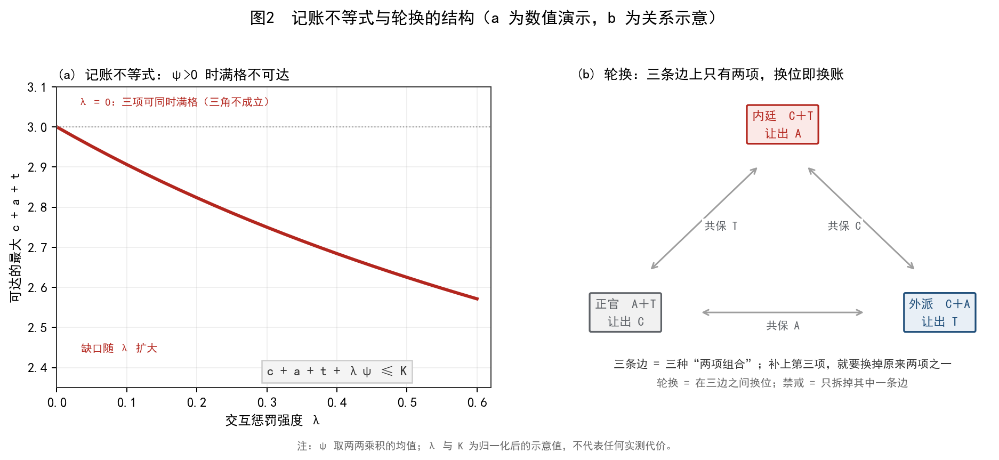

*图2　(a) 记账不等式的数值演示：λ=0 时三项可同时满格，λ>0 时满格不可达，缺口随 λ 扩大。(b) 三种两项组合之间的关系：三条边各只有两项，轮换即换位。参数为示意值，不代表任何实测代价。*

在官制中，ψ 有非常具体的形态：**机构膨胀**（每补一项就多一层衙门）、**兼领冲突**（一人兼数职，权责互相打架）、**文书往来**（会签、勘合、题奏）、**党争**（对"谁该被让出"的争夺）、**冗官冗费**（补 A 的账单）。宋代的"冗官"不是道德问题，而是 ψ 的财务形态：为了用 A 换 C，系统必须多养一套"官"来承载身份，多养一套"差遣"来承载事务。宋人叶适曾反复批评本朝"冗兵"与"冗官"互为表里，说的就是这份账单。

### 2.5 七个命题

**表 3　本文的七个命题、等级与否证条件**

| 编号 | 命题 | 等级 | 否证条件 |
|---|---|---|---|
| P1 | 任一官职可定位在 (c,a,t)，并满足条件性记账不等式 | 框架 B／乙 | 找到稳定存在且三项同时满格的官职（如 ψ≈0 的小政体） |
| P2 | 补第三项须以起家强项支付，因此"正官化即虚化" | 论证 B／乙 | 出现补 A 后 C 不降的内廷使职（长期、可复现） |
| P3 | 禁戒作用于名不作用于配置，故换名再生 | 论证 B／乙 | 禁戒之后同一功能长期消失（超过两代） |
| P4 | 稳定性不随并立线数单调，而随"融合线"下降 | 论证 B／乙（已修正） | 高融合线而长期稳定，或无融合线而迅速崩解 |
| P5 | τ 决定授权包大小，不决定失控 | 论证 B／乙 | τ 很小的时代仍普遍割据，且与授权包无关 |
| P6 | 日常轮换二阶，融合线出现后一阶崩解 | 类比 C／丙 | 崩解前无可测前兆，或崩解后可逆复原 |
| P7 | 四种演化模式由线数、融合、是否补 A 决定 | 框架 C／丙 | 出现无法归入四类的长期形态 |

P1 是框架命题，不承担经验内容；P2、P3 是本文的核心机制；P4 在检验中被部分反驳并改写（第 8.2 节）；P5 在第 9 章用三个反例界定；P6 只作类比，不用于预测；P7 是组织性观察。**七个命题没有一个是定理**——这正是它们可以被逐条攻击的原因。

### 2.6 四个辅助工具

**τ：时间错配。** τ = T_min / T_available，即应对一件事所需的最短时间与可用时间之比。当 τ>1，事情"来不及"由中央处理，必须授权。在官制上，τ 解释的不是"为何割据"，而是"为何必须预设一个能自行处置的职位"——都督、行台、节度使、巡抚都是 τ>1 的产物。

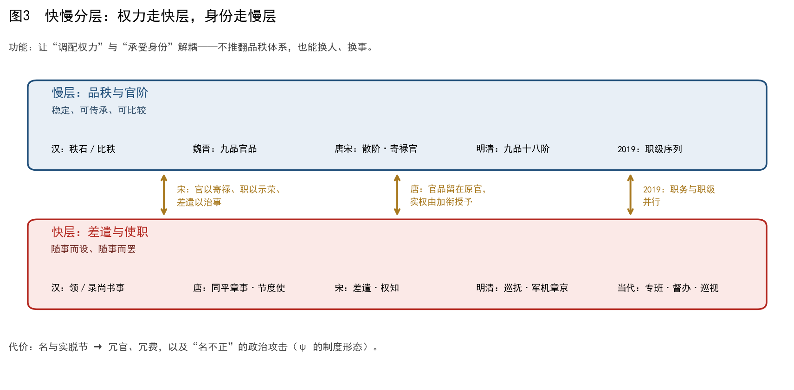

*图3　快慢分层：权力走快层（差遣、使职），身份走慢层（品秩、官阶）。分层让“调配权力”与“承受身份”解耦；代价是名实脱节，即 ψ 的制度形态。*

**快慢分层。** 系统若要既适应又稳定，解法之一是时间尺度分离：快的层负责选择，慢的层负责固化。宋代的"官以寄禄、职以示荣、差遣以治事"，2019 年的"职务与职级并行"，都是把这种分层制度化（图3）。

**临界。** 日常轮换是二阶的：序参量连续变化，可逆，"换一个皇帝"或"换一个名字"即可恢复。体制崩解是一阶的：有潜热（旧体制整体报废）、有滞后（回不去）。汉末与唐末是候选的一阶崩解；本文只用"序参量—滞后"作类比，不宣称相变（第 10 章）。

**区分。** 官制的每一次调整，首先是重新划一条边界：那些事务归这个衙门，哪些归那个衙门；谁是"官"，谁是"吏"；什么算"正途"，什么算"杂流"。《区分的语法》提示，区分一旦被写成二次型（品秩表、编制表、职掌表），它的谱就决定了系统的刚性与弹性。品秩越细，A 越强，C 越难。

### 2.7 框架的自检：什么时候不适用

按框架自身的要求，若 ψ≈0，三角不成立。以官制论，下列情形 ψ 应较小，不应观察到强烈的循环：

1. **规模很小的政体**：事务少，统治者可直接处理，三项可以兼得。西周早期的宗法封建、金初的勃极烈，都属此类；它们确实没有出现"使职化—正官化"的完整循环。
2. **通信技术大幅降低 τ**：电报、电话、互联网。清代的密折与廷寄，已经部分具备这一效果；军机处因此可以不补 A 而长期存在（第 5.9 节）。
3. **极端强力的统治者**：个人信息与精力极强时，可暂时压低 ψ。康熙、雍正两朝的内廷线最为集中，也最少出现"失控—禁戒"的完整循环。

这三条是可以检验的预测：**若在 ψ 很小的系统中仍观察到强循环，P1 在该系统失效**。本文没有做系统检验，只把它们列为附录 D 的待验证条目。

这里要说明框架的使用范围。记账不等式是**条件命题**：在 (A1)—(A3) 下，三项支出受 K 与 λψ 约束，可达上界随 K 与归一体化变化，**不是一个普适常数**。因此本文不把"坐标之和"当作可跨系统比较的量，只用三坐标给同一系统内的配置定位；凡涉及跨系统比较，只比较"让出哪一项"，不比较数值大小。这条限制使框架失去"一个数排座次"的便利，却保住了它可被逐项检查的性质。

---

## 3 案例、编码与可复现规则

### 3.1 分析单位与"使职化"判据

本文的分析单位是"官职—时期"，不是"官职"。同一个"尚书"，在汉武帝时是内廷使职，在东汉是行政中枢，在隋唐是正官——三者的 (c,a,t) 不同，必须分开编码。为此设定四条入选判据：

1. **起家非高位**：初设时不在正官序列的高位，或以加官、差遣、临时的形式出现。
2. **因事骤重**：有可指认的事件（战争、废立、财政危机、边疆压力），使其获得超出品秩的实权。
3. **性质改变**：此后出现正官化、虚化、降格、割据、禁戒之一；"始终不变"者不入库。
4. **年代可估**：能给出大致起讫年，误差不超过约二十年。

按此标准，共收入 121 例，分 24 期。**"所有例子"是一个做不到的承诺**：史料本身有缺环，且"使职化"的边界是模糊的（一个职位可以同时是监察与副贰）。本文能保证的是：入选标准公开、逐案可查、边界案例单列（第 3.5 节）。

### 3.2 分期

分期不按王朝，而按"制度形态"：

> 西周—春秋战国｜秦—西汉｜东汉｜三国｜两晋｜十六国｜南朝｜北朝｜隋｜唐前期｜中晚唐｜五代十国｜辽｜宋｜西夏｜金｜元｜明｜清前期｜晚清｜民国｜新中国（1949—1978）｜新中国（1978—2012）｜新中国（2012—2026）

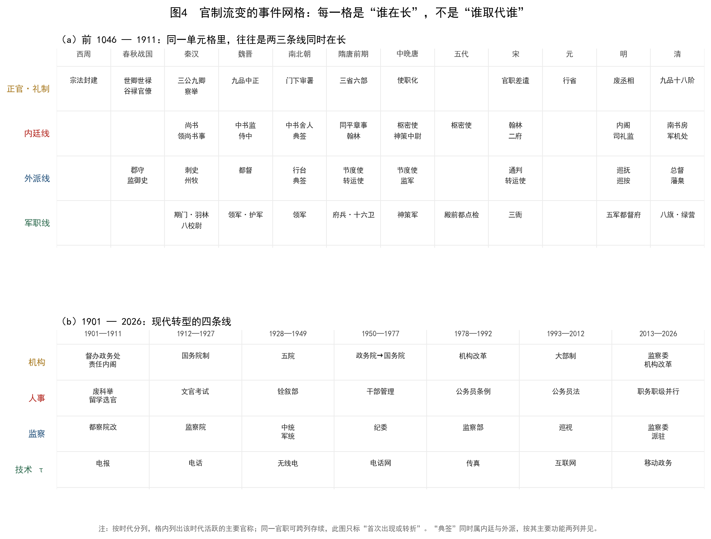

*图4　官制流变的事件网格：行是线，列是时期，格内是该期活跃的主要官称。同一格中往往有两三条线同时在长；此图只标“首次出现或转折”，同一官职可跨列存续。*

这样分的理由有三。第一，分裂期（十六国、南北朝、五代十国）与异族政权（辽、西夏、金、元、清）常被"正统王朝"叙事略去，而它们恰恰提供了最多的"并立线"样本。第二，唐分前期与中晚唐，是因为安史之乱前后的配置完全不同（前者 A＋T 为主，后者 C＋A 与 C＋T 并立）。第三，现代分三段，是因为 1949、1978、2012 三个节点分别改变了"党的领导—国家机构—技术条件"的组合。

### 3.3 编码字段

**表 4　编码字段与判定规则**

| 字段 | 含义 | 判定规则 | 例 |
|---|---|---|---|
| 起家 | 初设或被赋予实权的年份 | 取首次见于制度记载之年 | 刺史：前 106 |
| 正官化／常设／失控 | 性质改变的年份 | 取"入品秩、有定额属官、成为常设"或"割据、废立"之年 | 尚书：约 50（政归台阁） |
| 保 | 起家时保有的两项 | 依史料判断其强项 | 尚书：C、T |
| 让 | 起家时让出的一项 | 与"保"互补 | 尚书：A |
| 触发 | 使其骤重的事件 | 取最直接的一次 | 霍光废立 |
| 结局 | 正官化／虚化／降格／禁戒／割据／存续 | 取主要结局 | 正官化 |
| 等级 | A／B／C | 证据强度 | A |

编码的三条边界规则：

**规则一：一人兼两职，按"位置"分别编码。** 霍光"大司马大将军领尚书事"，大将军是军职（C＋A），领尚书事是内廷（C＋T），分别入两条线；他本人因同时占两项而"占满三项"，这是第 7.4 节讨论的对象，不改变两条线各自的编码。

**规则二：同一官职前后期转移，用"初…后…"标注。** 侍中初为侍从（C＋T），后为门下长官（A＋T）；通判初为监州（C＋T），后为副贰（A）。此类案例在统计中按"前期"计入，并在备注中标明转移。

**规则三：无法判定者标 C，不强行归类。** 辽的斡鲁朵、西夏的蕃官、十六国的部落大人，史料稀疏，一律标 C，且不用于支撑强结论。

### 3.4 分期汇总：哪一项最常被让出

图5 是 24 期的汇总：每一期有多少案例、其中保有 C／A／T 的比例、主频让出项、代表官职。

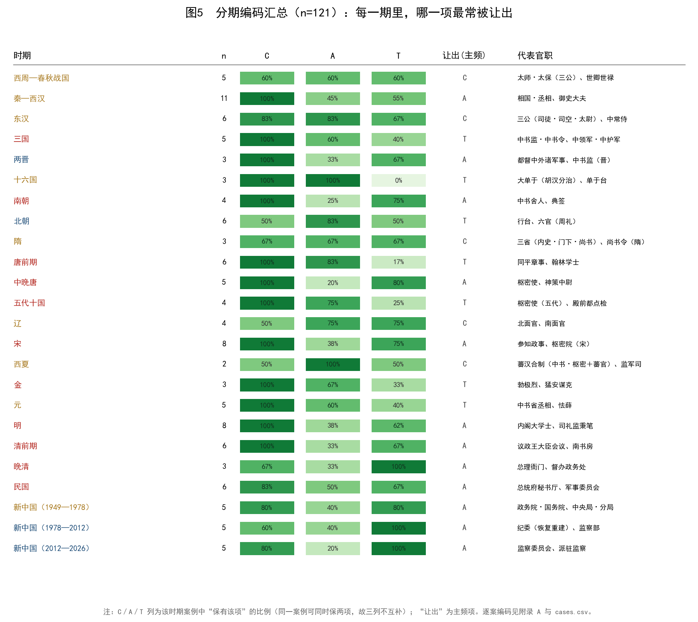

*图5　分期编码汇总（n=121）。C／A／T 三列为该期案例中"保有该项"的比例；同一案例可同时保两项，故三列不互补；"让出"为主频项。逐案编码见附录 A 与 cases.csv。*

四个读法值得注意。

**第一，C 的保有率几乎全程偏高（多数时期 ≥80%）。** 这不奇怪：任何能在危机中被赋予实权的职位，一定贴近信息。真正变化的是它拿什么去换这个"贴近"。

**第二，让出项随路径而分。** 内廷线集中的时期（东汉、南朝、唐前期、宋、明、清前期），主频让出项多为 A；外派线集中的时期（十六国、辽、金、民国部分），主频让出项多为 T。

**第三，分裂期与异族政权不是"例外"。** 十六国三期案例全部是 C＋A（大单于、单于台、部落大人），让出 T；辽的北面官／南面官是 A＋T，让出 C；西夏的蕃汉合制同样是 A＋T。这说明"胡汉分治"不是"另一种逻辑"，而是同一三角在另一种政治条件下的解：用两套官制分别承载"看得准"与"拼得上"，代价是两套之间传不透。

**第四，现代三段的让出项都是 A。** 1949—1978、1978—2012、2012—2026 三段的 C 与 T 保有率都高，A 的保有率最低（20%—40%）。这与"党组、分口、领导小组、专班"的形态一致：它们贴近信息（C）、穿透层级（T），但不进入国家编制序列（A 弱）。这是第 11 章的核心观察。

### 3.5 编码的可靠性：三个必须交代的问题

**问题一：单一编码者。** 全部 121 例由作者一人编码，没有第二编码者，未计算一致性系数（如 Cohen's κ）。这意味着"保/让"的判定可能受作者预期影响。缓解办法有三：编码规则事先写定（表 4）；边界案例单列（下）；负面结果照实报告（第 3.6 节、第 8.2 节）。

**问题二：边界案例。** 至少有三类官职同时具备两条线的特征：

- **典签**：本职是文书小吏（内廷），派出后监视诸王（外派）。本文把其主要功能记为外派（C＋T，让 A），并在备注中注明"内廷版的外派"。
- **监军**：由中央派出监视军队（外派），但唐代宦官监军后兼领神策（内廷＋军职）。本文分两案：监军（外派，C＋T）、神策中尉（内廷兼军，C＋T＋兵权）。
- **巡抚**：明初为都御史临时差遣（外派），清为封疆大吏（正官化）。本文按"前期"编码，标"初 C＋T 后 C＋A"。

**问题三：敏感性。** 若剔除全部 C 级案例（约 30 例），分期汇总的方向是否改变？作者做了一次手工核对：让出项的主频只在"十六国""西夏""辽"三处发生变化（因这三期的案例全部为 C 级），其余 21 期不变。这说明主结论不依赖 C 级案例，但"分裂期与异族政权"的具体判断是弱的，只能作方向。

### 3.6 一个不成立的预期：时滞不能区分路径

在编码之初，作者有一个很自然的预期：**内廷线起家快、外派线起家慢**——近侍在皇帝身边，几年即可权重；监察官要常驻、要积累，需数十年。若成立，时滞可以作为区分两条线的独立证据。

全样本（n=121）的计算结果不支持这个预期：内廷线中位数 34 年（n=43），外派线 29 年（n=45），军职线 35 年（n=15）；Mann–Whitney 检验 p≈0.33，差异不显著。图6 是分布。

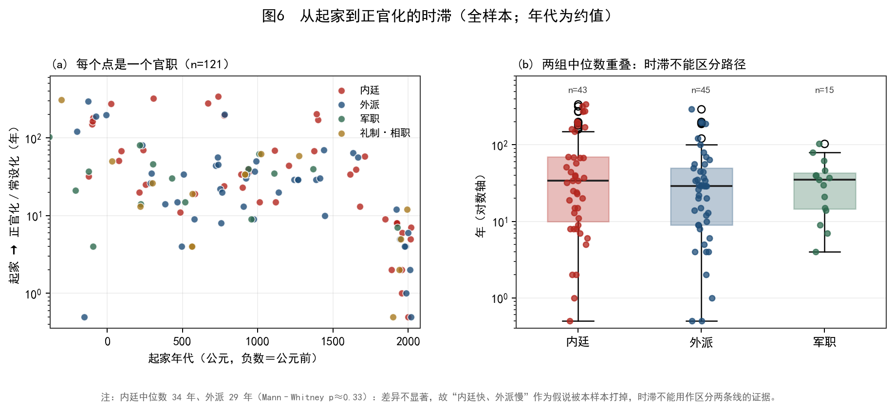

*图6　从起家到正官化／常设化的时滞（n=121）。内廷中位数 34 年（95% CI 19—51）、外派 29 年（15—35），Mann–Whitney 检验 p=0.33：差异不显著。时滞不作为区分两条线的证据。*

这个结果有两种读法。一种是"编码不敏感"：时滞的起讫年本身就是约值，误差可能吞掉真实的差异。另一种是"预期本身错了"：内廷线的"快"是就**单次事件**而言（一次托孤、一次废立），而"正官化"需要数代人的制度化，两者不在同一时间尺度上；外派线的"慢"也是就**单次授权**而言，一旦授权，常设化可能非常快（节度使从景云到天宝不过四十年）。两种读法都指向同一结论：**时滞不是好的判别指标**。

因此，本文不把时滞作为区分两条线的证据；两线的差别只能由"保什么、让什么"来判定。这也提示一个方法上的教训：**制度史中的"快"与"慢"往往分属不同事件类型**——单次权力的获得可以很快，制度化的完成却很慢，把两者混在一个时滞里，得到的只能是噪声。

---

## 4 礼制起点：三老五更、三师与"第四类"

### 4.1 西周不是官僚制

讨论"官制流变"，容易从《周礼》的"三公六卿"讲起。但《周礼》是战国人的理想设计，不是西周实录。李峰（Li Feng）对西周政府的研究表明，西周的国家结构是**宗法封建**：以血缘为纽带的封君—封臣关系，加上"卿事寮""太史寮"这样的家臣式办事机构，没有后世意义上的品秩、编制与考课。陆威仪（M. E. Lewis）也强调，战国以前"官"与"族"不可分，职位的传递靠世袭与分封，而不是靠任命与考核。

用本文的坐标说，西周的配置是 **A＋T，让出 C**：宗法提供了一套极强的"拼得上"（谁是宗主、谁是别子、谁该服什么役，一目了然），封建提供了一套极强的"传得下去"（世卿世禄，职位随封邑继承）；代价是"看得准"——天子对诸侯国内部的事务，既无常规信息通道，也无直接处置权。

这不是"落后"，而是**约束条件下的选择**：在没有常备军、没有官僚、没有驿传网络的条件下，用血缘与礼制来"拼"和"传"，是成本最低的方案。它的账单在后世显现：春秋以降，诸侯强而王室弱，"礼乐征伐自诸侯出"，正是 C 长期缺失的后果。

### 4.2 三老五更：只有 T 的尊位

《礼记·文王世子》与《后汉书·礼仪志》都记"三老五更"之礼：天子养三老五更于太学，亲袒割牲、执酱而馈，以示"孝悌"。北周武帝尊于谨为三老，行养老之礼；唐代仍沿其制。

三老五更不是行政职务。它没有品秩、没有属官、没有职掌，只有一项功能：**把"敬老的秩序"传递给后世**。用坐标说，它几乎只有 T（而且是 T₂，时间传递），C 与 A 都接近于零。

这提示了一个重要区分：**并非所有官职都在三角内循环**。三角描述的是"要办事"的职位；纯粹象征性的尊位（三老五更、三师三公的部分功能）不承担日常事权，也就不参与"补位—让渡"的游戏。本文把这类职位称为"**第四类：象征位**"，并在案例库中单列（L1、L2、P01、P43）。它们的命运不是"虚化"，而是"被需要时拿出来、不被需要时放着"——这正是 T₂ 的功能：制度记忆。

象征位的存在，对框架是一个有益的边界。它说明三角不是"一切官职的普遍规律"，而是"承担事权的职位的规律"。若把三老五更也算进"循环"，框架就会退化成"什么都能解释"。

### 4.3 世卿世禄与家臣：A＋T 的极限

春秋的卿大夫，是宗法封建的产物：他们既是宗族的族长，又是封邑的领主，还是诸侯的执政。这种"三合一"的身份，使 A 极强（族、邑、政三套权力可以叠加），T 极强（世袭，跨代传递），而 C 弱（对国外、对远地的事务无从得知）。

家臣（邑宰、家司马、家司徒）则是另一极：他们是卿大夫的私属，贴近主人（C 强），忠于主人（T 强，但只是对主人的 T，不是对制度的 T），却没有独立的品秩（A 弱）。这正是内廷线的原型：**私属关系提供 C 与 T，公共编制缺席**。

春秋末年，"陪臣执国命"的现象，就是家臣线失控的第一次记录：阳虎以季氏家臣的身份囚禁季桓子，专鲁国之政。这与后世宦官、中书舍人、司礼监的故事，形状完全相同。差别只在于：阳虎没有一套可以"正官化"的编制可补，所以他的权力随失败而消失；而后世的尚书、中书有编制可补，所以它们能"正官化"。

### 4.4 战国变法：用 A 换 C

战国变法，用本文的语言说，是一次**用 A 换 C** 的系统工程。

- **谷禄制**取代封邑：官员的报酬从"一块地"变成"一份禄"，从此可以任免、可以考核——A 从"血缘"变成"契约"。
- **符玺制**：虎符发兵、玺印行文，把"命令"变成可验证的物件——T 从"人情"变成"凭证"。
- **上计制**：地方每年把户口、垦田、赋税写成簿册上报——C 从"巡狩所见"变成"文书所载"。
- **军功爵**：以斩首之功授爵，打破世卿——A 从"出身"变成"绩效"。

这四项合起来，就是官僚制的诞生。它的代价是 C 的**间接化**：君主不再"看见"地方，只能"读到"地方；信息经过层层文书，失真与延迟随之而来。从此，"看得准"必须靠另一套人（近侍、监察、密奏）来补——这正是内廷线与外派线存在的结构性理由。

换句话说，**内廷与外派不是官僚制的病，而是官僚制的补丁**。只要 A 与 T 由官僚体系承担，C 就会短缺；只要 C 短缺，就会有人被放到皇帝身边或地方上去补它。

### 4.5 秦：三分雏形与第一次"禁戒"

秦制以丞相总百官、御史大夫为副丞相并掌监察、太尉掌军事（时置时废）。这是一次有意的三分：**丞相管行政（A＋T），御史大夫管监察（C＋T），太尉管军事（C＋A）**。三项各由一条线承担，任何一条都不占满三项。

秦祚短促，这套三分没有来得及显现全部后果。但它留下两个先例。第一，**御史大夫可以升为丞相**（如李斯由廷尉、御史大夫而至丞相），说明监察线可以"正官化"为行政线。第二，**丞相可以独相**（赵高以中车府令行丞相事），说明内廷线可以绕过正官体系。这两条先例，在汉代都被完整地重演。

### 4.6 小结：起点是"三项都不满格的折中"

把西周至秦的线索收起来，可以得到一个与"进步史观"不同的判断：官制的起点不是"完备的体系"，而是**三项都不满格的折中**。宗法封建 A、T 强而 C 弱；家臣 C、T 强而 A 弱；官僚制 A、T 强而 C 弱。三者都不是"更好的制度"，而是"在不同的 K 下选择了不同的两项"。

这就是本文的起点。接下来的两章，分别追踪两条补丁线如何在两千年里反复生长、正官化、虚化、再生。

---

## 5 结果一：内廷线（侍从型）

### 5.1 汉：尚书、中书谒者与"领尚书事"

**尚书**本为少府属吏，"主文书"，秩六百石。汉武帝为了绕开外朝丞相，开始让尚书参与机要；《汉书·百官公卿表》记成帝时"置尚书五人，分曹治事"。这是一次典型的"以卑临尊"：用低品秩的近侍，承载高权重的信息。

用坐标说，西汉中期的尚书是 **C＋T，让 A**：它贴近皇帝（C），诏令由它出入（T），但不入三公九卿序列（A）。它之所以可用，正因为它 A 弱——没有自己的班底，不可能自立。

**中书谒者令**是内廷线的另一次尝试。武帝以宦者典尚书事，称中书谒者令；司马迁受腐刑后为中书令，即此职。用宦官的理由与用尚书相同：贴近、依附、无外朝根基。成帝建始四年（前 29）罢中书宦官，是**第一次有记载的禁戒**：因为宦官典文书，权力过于集中。禁戒的形式是"废除该职"，效果是"权力回到尚书"——循环的第一圈完成。

**领尚书事**是加官，不是正官。霍光以大司马大将军"领尚书事"，凭对诏令通道的控制，废昌邑王、立宣帝。霍氏族灭之后，"领尚书事"并未废除，反而成为外戚辅政的常规，东汉称"录尚书事"，多由太傅、太尉兼领。

这里出现了本文最重要的机制之一。霍光同时握有大将军（军职，C＋A）与领尚书事（内廷，C＋T），两项相加，实际上占满了三项（C 由两条线共享，A 来自军职，T 来自尚书）。他能废立，不是因为他"官大"，而是因为他"占满"。而霍氏覆灭后，制度没有禁止"大司马大将军"，也没有禁止"领尚书事"，只是让它们**成为两个可以分别授予的职位**——这就是"拆分"式禁戒：不废名，只拆配置。

### 5.2 东汉：台阁化与三公虚化

光武以后，"政归台阁"：尚书台成为实际行政中枢，三公（太尉、司徒、司空）"备员而已"。这是内廷线**正官化**的完成。

正官化的标志有三：尚书台有了固定的曹（六曹）、有了定额的尚书令、仆射、尚书郎，有了独立的办公场所（台阁）。用坐标说，它补上了 A。代价随之而来：**C 流失**。尚书台不再是皇帝的"耳目"，而是一个庞大的行政机构；它的文书要经多层审阅，它的长官要顾及各方关系。皇帝若要"看得准"，必须另起新的近侍——**侍中**与**中常侍**。

**中常侍**在东汉由宦官专任，"手握王爵，口含天宪"。灵帝时曹节、王甫等"十常侍"专权，中平六年（189）袁绍入宫尽诛宦官，是**第二次大规模禁戒**。这次禁戒的对象是"宦官"这个身份，而不是"内廷近侍"这个功能。所以禁戒之后，内廷线并未消失：它换成了"侍中""中书"，再往后换成"翰林""枢密"。

**侍中**本是"掌侍左右、赞导众事"的加官，东汉时已"入侍禁中，出陪乘舆"。它此时仍是 C＋T、让 A；到魏晋，它才补上 A，成为门下省长官（第 5.3 节）。

### 5.3 魏晋：中书与门下

曹魏设中书监、中书令，"掌机密"，是内廷线在尚书台阁化之后的"补位"。明帝托孤之际，中书监刘放、中书令孙资参与其事，是内廷再起的显例。

晋代荀勖由中书监转尚书令，有人祝贺，他却说"夺我凤凰池"——中书已被视为清要之地。这句话标志着一个转折：中书**开始正官化**。它有了品秩、有了属官、有了固定的职权，因而不再是最贴近皇帝的那一环。于是皇帝转向**门下侍中**：侍中在东晋南朝渐成门下省长官，掌审署诏敕，有封驳之权。

用坐标说，侍中走的是与尚书相同的路：先 C＋T（侍从），再补 A（审署机构），再失 C（程序增加）。**"补 A 即失 C"** 这一机制，在尚书、中书、门下三例上完整地重演了三次。

### 5.4 南朝：寒人掌机要

南朝的门阀士族以"清官"自居，不愿处理繁琐的文书与军政；皇帝也忌惮高门大族。于是宋孝武帝起用寒门出身的戴法兴、戴明宝、巢尚之，齐有纪僧真、茹法亮，梁有朱异，多从中书舍人"参掌机要"。《宋书·恩幸传》《南齐书·倖臣传》记其"权重一时"。

这是一次结构极为清晰的补位：寒人**无门第、无品秩根基**（A 缺失），只能依附皇帝（C 与 T 取决于皇帝信任）。他们之所以"可用"，正因为他们让出了 A：没有自己的体系，不可能自立。这与内廷线的定义完全吻合。

**中书舍人**的结局也符合机制：隋唐把它的权责规范化，使其降为"掌诏诰"的常职，权力转入新的使职（翰林、枢密）。**降格**是内廷线正官化的另一种形式：不是升为高官，而是被写进编制、变成常职，从而失去"贴身"的优势。

同一时期还有两个变体。**制局监**（南齐）由寒人掌兵器与禁兵，是内廷线向军职的延伸；梁废之，是一次小规模禁戒。**典签**则是内廷线的外派版：宋齐诸王年幼出镇，朝廷派典签随行监视，"威行州郡"，刺史行事须先请示。它的配置是 C＋T、让 A——与中书舍人相同，只是位置在地方（第 6.2 节）。

### 5.5 隋唐：三省、同平章事与翰林

隋定三省：内史（中书）取旨、门下审议、尚书执行。这是一次**以 A 换 C** 的制度化：三省分职，权责清晰，可以拼合（A 强），诏令经三省而出（T 强）；代价是程序繁复，皇帝若想绕开，必须另找通道。

唐承隋制，但很快出现两个变化。

**第一，三省长官不轻授。** 唐太宗曾任尚书令，此后无人敢居其位，尚书省长官遂以仆射代之；中书令、侍中也因资望过高而不轻易授人。于是出现"同中书门下三品""同中书门下平章事"这类加衔：官品仍在原机构（保 A），实权由加衔授予（保 C）。

用坐标说，同平章事是一项**把 A 与 C 拆开**的技术：它不破坏正官体系，却能在其中开一个"看得准"的口子。代价是头衔层层叠加（ψ 表现为官名冗杂），也正是"权宜变常设"的机制：同平章事从加衔变成正宰相衔，只用了不到一百年。

**第二，翰林学士。** 玄宗开元年间置翰林学士院，以文学侍从参与机密草诏；德宗以后有"内相"之称，承旨学士尤重。翰林的配置是 C＋T、让 A：它贴近皇帝、掌诏令，但不入三省序列。唐后期，翰林学士与枢密使、神策中尉并立，构成内廷的三条线。

值得注意的是，**翰林始终没有完成正官化**。宋代翰林学士成为"清贵之职"，但不再是机要；机要转入"二府"（中书门下与枢密院）。这与"补 A 即失 C"一致：一旦翰林有了稳定的品秩与选任规则，它就不再是最贴近皇帝的那一环。

### 5.6 唐末五代：枢密使、神策中尉与融合线

**枢密使**代宗时置，以宦官充任，掌承接表奏、宣传诏旨。它的配置是 C＋T、让 A。**神策中尉**德宗贞元十二年（796）置，以宦官窦文场、霍仙鸣分掌左右神策军。它的特殊之处在于：**同时掌握诏令通道与兵权**。

用本文的坐标说，神策中尉占满了三项：C（贴近皇帝）、T（诏令由此出入）、A（禁军自成体系）。这不是"三项组合"中的任何一种，而是"三项全占"。按 P1，这在稳定状态下不应存在；它只能出现在**临界状态**。

事实正是如此。宪宗以后，宦官参与甚至决定皇位继承：宪宗之死（史载有多种说法）、王守澄拥立文宗、仇士良拥立武宗，皆属此类；文宗联合朝臣谋诛宦官的"甘露之变"（835）失败，宦官更盛。直到天复三年（903），朱温入长安尽诛宦官，这一次禁戒以"屠杀"的形式完成。

神策中尉的例子说明：**融合线是临界的标志**。当一条线同时占满三项，系统已经不能用"两条线互相牵制"来解释；它只剩"改朝换代"一个出口。

五代是内廷线的另一个高峰。枢密使由士人或武臣出任，权重一时（如后唐郭崇韬）；殿前都点检则成为禁军统帅。后周显德七年（960），赵匡胤以殿前都点检发动陈桥兵变；即位后，这一职位不再授人，禁军改由三衙分掌，调兵之权归枢密院。这是**最纯粹的一次禁戒**：一次权力转移，使一个职位被永久搁置（第 7.5 节）。

### 5.7 宋：用制度买稳定

宋代对内廷线的处理，是历代最自觉的一次。它的手法不是"废除某个官职"，而是**把配置写进制度**：

- **二府分权**：中书门下（政）与枢密院（军）并立，宰相不掌兵，枢密使不预政。
- **三衙分军**：殿前司、侍卫马军司、侍卫步军司分掌禁军，调兵权归枢密院，形成"兵不识将、将不识兵"。
- **台谏独立**：御史台与谏院合一，掌言路，可以风闻奏事。
- **官、职、差遣分离**：官以寄禄（定品秩），职以示荣（贴职），差遣以治事（实权）。

用本文的坐标说，宋制是一次**显式的三角选择：保 A 与 T，让出 C**。它把"看得准"压到最低——制度宁可反应慢，也不让任何一条线占满三项。代价是军事上的被动（对辽、西夏、金的战争多败）与财政上的冗滥（冗官、冗兵、冗费）。

宋制常被批评为"积贫积弱"。用框架的话说，它不是"失败"，而是**换了一种账单**：用 C 换来了 A 与 T 的稳定。宋代三百余年没有出现中古式的权臣禅代，这不是因为宋人道德更高，而是因为制度不允许任何一条线占满三项。

但宋制也付出了 P4 所预言的代价：**当所有线都只保两项，系统的"看得准"能力被系统性压低**。靖康之变（1127）中，朝廷对金军动向的判断一再失误，正是 C 长期缺失的后果。这不是"某个奸臣误国"，而是配置的账单。

### 5.8 明：废丞相、内阁与司礼监

洪武十三年（1380），朱元璋以胡惟庸案废中书省与丞相，"后世子孙不得议置丞相"。这是历代最严厉的一次禁戒：不是废一个职位，而是废一个**制度位置**，并写进祖训。

禁戒的效果如何？五十年内，内阁大学士成为实际宰相。永乐初，解缙等入直文渊阁，参预机务；宣德以后，内阁"票拟"，权渐重；张居正以首辅当国，威权超过前代宰相。

为什么禁戒无效？因为禁戒作用于"名"（丞相），不作用于"配置"（一个能总揽政务的中枢）。皇帝不能不要这个中枢，只能换一个名字。内阁大学士品级仅五品，无属官、无衙署，正是"不补 A"的设计——它保 C 与 T，让 A。

"不补 A"带来两个后果。**好处**：内阁不会像尚书台那样变成庞大的行政机构，因而不会失去 C；它始终贴近皇帝。**代价**：它没有法定的地位，随时可以被皇帝弃置；它的权力来自"票拟"这一程序，而不是来自品秩；它无法跨朝代传递（T₂ 弱）——明亡，内阁即亡。

司礼监是明代内廷线的另一半。宣德以后，司礼监秉笔太监代皇帝"批红"，与内阁的"票拟"形成一对：内阁拟票，司礼监批红。这是**分裂并行**的典型：两条线各占两项（内阁 C＋T 让 A，司礼监 C＋T 让 A），互相牵制，谁也不能占满三项。

王振、汪直、刘瑾、魏忠贤，都是司礼监线上的权宦；但他们没有一个能像汉唐宦官那样废立皇帝。原因不是他们"不够坏"，而是配置不允许：司礼监没有兵权（兵权在五军都督府与京营），也没有行政权（行政在内阁与六部）。他们的权力是"借"来的，皇帝一翻手就可以收回。魏忠贤在天启朝权倾天下，崇祯即位后数月即败亡，正是"借来的权力"的典型。

**厂卫**（锦衣卫、东厂、西厂）是内廷线的特务变体。它们保 C＋T、让 A，始终是"私属"，没有正官化。它们的命运也符合"不补 A"的逻辑：随皇权而兴，随皇权而亡。

### 5.9 清：军机处为什么不虚化

清代的内廷线有三代：议政王大臣会议、南书房、军机处。

**议政王大臣会议**是清初的"八旗共议"，权重而制度粗。康熙设**南书房**，以翰林入值，分内阁之权；雍正设**军机处**，以军机大臣、军机章京处理机密，逐步取代内阁与议政王大臣会议。

军机处是一个反常的案例：它延续约一百八十年，始终没有"正官化"，也没有"虚化"。按 P2，内廷使职若补 A 就会失 C；军机处的做法是**根本不补 A**——它没有衙署、没有定额属官、没有独立的品秩，军机大臣是"差遣"，军机章京是"兼差"。它的权力完全来自皇帝的信任与"廷寄"这一程序。

为什么不补 A？三个条件同时成立：

1. **τ 下降**：雍正以后的密折与廷寄体系，使信息传递与决策闭环在较长时期内维持。军机处处理的是"已经到手的信息"，不需要庞大的下级机构。
2. **皇帝亲裁**：雍正、乾隆两朝，皇帝亲自处理奏折，军机处只是"承旨"。
3. **不设属官**：没有属官，就没有独立的机构利益，也就没有"正官化"的动力。

这三个条件缺一不可。到清末，条件变了：1906 年"预备立宪"，1911 年设责任内阁，军机处随即废止。**一旦补 A（设责任内阁），旧的"不补 A"的机构就失去了存在理由**——这是 P2 的反向验证。

军机处的例子说明，"不补 A"可以长期存在，但有代价：它的 T₂ 极弱（不能跨朝代），它的存续完全依赖皇帝个人的勤政。乾隆以后，皇帝勤政程度下降，军机处的权力就上升；到慈禧时期，军机处成为"权臣"的温床（如奕訢、袁世凯）。**不补 A 不等于没有代价，只是把代价从"虚化"换成了"依附"**。

### 5.10 内廷线的机制总结

把内廷线的十个节点排成一条线，可以看到一个稳定的模式：

**表 5　内廷线的"补位—正官化—虚化"序列**

| 阶段 | 代表 | 保 | 让 | 关键事件 | 结局 |
|---|---|---|---|---|---|
| 起家 | 尚书（汉） | C、T | A | 武帝抑丞相 | 正官化 |
| 补位 | 中书（魏） | C、T | A | 明帝托孤 | 正官化 |
| 再补位 | 门下（晋） | C、T | A | 审署诏敕 | 正官化 |
| 寒人 | 中书舍人（南朝） | C、T | A | 寒人用事 | 降格 |
| 加衔 | 同平章事（唐） | C＋A | 名分 | 三省长官不轻授 | 正官化 |
| 内相 | 翰林（唐） | C、T | A | 玄宗置院 | 清贵化 |
| 融合 | 神策中尉（唐） | C、T＋兵 | A | 宦官统禁军 | 禁戒（903） |
| 分层 | 二府三衙（宋） | A、T | C | 制度设计 | 存续 |
| 并行 | 内阁＋司礼监（明） | C、T | A | 票拟／批红 | 存续 |
| 不补 A | 军机处（清） | C、T | A | 雍正用兵 | 存续至 1911 |

机制可以写成一句话：**补 A 即失 C；不补 A 则 T₂ 弱**。前者解释了尚书、中书、门下的"正官化—虚化"；后者解释了内阁、军机处的"长期存续但依附皇权"。两条路都不通向"稳定且独立"——因为那需要三项全占，而三项全占就是临界。

---

## 6 结果二：外派线（监察副贰型）

### 6.1 汉：刺史、司隶校尉与国相

**刺史**是外派线的原型。元封五年（前 106），汉武帝分天下为十三州部，各置刺史一人，秩六百石，以"六条"监察秩二千石的郡守。这是典型的"以卑临尊"：品秩低，才能无所顾忌；辖区小，才能看得清楚；不掌行政，才不至于割据。

用坐标说，刺史起家时是 **C＋A，让 T**：C 来自常驻地方、贴近事务；A 来自"六条"所赋予的明确职权（可弹劾、可举荐）；T 被让出——它不承担行政，中央对郡守的控制并未因此削弱。

问题出在"常驻"上。刺史一旦常驻，就会逐步介入地方事务：赈灾、治安、军事，都需要它协调；协调久了，就成了行政。成帝绥和元年（前 8）改刺史为州牧，秩二千石；哀帝建平二年（前 5）复为刺史；元寿二年（前 1）又复州牧；光武建武十八年（42）改州牧为刺史。**五十年间四次反复**，说明朝廷在"监察"与"行政"之间犹豫：给品秩（A 更强），就失去"以卑临尊"的优势；不给品秩，就压不住地方。

灵帝中平五年（188），刘焉建议以重臣出任州牧，"州任之重，自此而始"。刘焉、刘表、袁绍、刘备据州自立，东汉裂为诸侯。这是外派线的经典结局：**T 降到接近零，系统从"官制"蜕变为"割据"**。

**司隶校尉**是另一个版本。它本为监察京畿并纠劾百官的官，权重到可以弹劾三公，朝会时与尚书令、御史中丞"三独坐"。后来它成为京畿军政长官，也是魏晋权臣常兼之职。它的路径与刺史相同：从"监察"（C＋T）到"军政"（C＋A），让出 T。

**国相·内史**是汉初诸侯国的官员。汉初诸侯国自置丞相；景帝平七国之乱后，诸侯王不得治国，官吏由中央任命，"改丞相曰相"，此后国相、内史实际治民，王只食租税。这是**用中央任命替换世袭**：A 从"王国自置"变成"中央派遣"，T 从"诸侯私属"变成"中央命官"。用坐标说，国相是 C＋A、让 T 的外派官；它的存在，使诸侯王的权力被"去功能化"——这本身是一次成功的"补 T"。

### 6.2 魏晋南北朝：都督、行台、典签

**都督诸州军事**本是临时统兵之职，后常由刺史兼任，形成"都督某州诸军事、某州刺史"的军政合一格局。刘裕、桓温等权臣皆以都督、录尚书事等身份掌握内外大权。严耕望指出，魏晋南北朝的地方制度，是在"州—郡—县"三级与军府体系交织之下运行的。

都督—刺史合一，保 C 与 A：地方可以快速反应（C），军政财一体（A）；代价是 T 的丧失——东晋以来荆州、江州等上游重镇对中央的实际制约，就是 T 让出的表现。

**行台**是中央派出的临时机构，后来常设并拥有地方最高权力。它保 C＋A、让 T，与后世的"行省"同一路径。北朝的行台尤其重要：东西魏对峙时，行台成为军事动员与地方治理的核心；隋废行台，是因为它已经威胁到中央的 T。

**典签**是外派线上的"内廷版"：宋齐诸王年幼出镇，朝廷派典签随行监视，事无大小须经典签奏闻。《南齐书》记典签"威行州郡"，有的诸王竟被典签制约至不得自由。永明年间巴东王萧子响杀典签而引发朝廷出兵，是典型的冲突。

典签的配置是 C＋T、让 A：它贴近诸王（C），直接向皇帝报告（T），但不入正官体系（A）。它与中书舍人同属"寒人掌机要"一路，只是位置在地方。梁陈以后，典签随寒人集团消退，说明**内廷版的外派线依附于皇权个人，不能独立制度化**。

**宗主督护**与**三长制**是北朝的一组对照。北魏初年，倚重汉人豪族，以"宗主督护"治理地方：宗主（豪族）代政府征收赋税、维持治安。这是 C＋A、让 T 的外派配置——政府借用豪族的"看得准"与"拼得上"，代价是政令不能直达编户。孝文帝太和十年（486）废宗主督护，行三长制（五家一邻、五邻一里、五里一党），是把 T 重新收回中央：用编户齐民替换豪族中介。**这是一次典型的"补 T"**：短期成本极高（触动豪族利益），长期收益是中央对人口与赋税的直接控制。

### 6.3 唐：节度、观察、转运、监军、留后

唐初都督、都护本为边防使职，睿宗景云年间（710—712）前后出现节度使之称，玄宗时边镇渐增，至天宝年间十节度并立。节度使兼领观察使、支度营田使等，掌军政财于一身，成为割据的制度基础。

用坐标说，节度使是外派线的极端形态：**C＋A，让 T**，而且 A 的集中度极高（军、政、财、人事一把抓）。它之所以出现，是因为 τ>1：边镇距长安千里，事态以日计，中央来不及处置，必须预先授权（第 9 章）。

**观察使**（肃宗时置）本是监察州县的使职，后与节度使合一；**转运使**（唐置）掌财赋转输，后成为一路长官。这两条线说明外派线的另一个来源：**财政**。当中央需要把财赋从地方抽到京城，就必须派"使"；使一旦常驻，就成为地方长官。

**监军**是中央对节度使的"补 T"：以宦官监军，直接向皇帝报告。玄宗时已有边令诚监军高仙芝之类的事例；德宗以后更以宦官统禁军。监军的配置是 C＋T、让 A：它贴近军队（C），直达皇帝（T），但不入正官体系（A）。它与典签同构，只是对象从诸王换成藩镇。

**留后**是节度使死后，其子弟、部将自称"留后"，逼迫朝廷承认。河朔三镇尤其如此。这是"代理"走向"世袭"的路径：留后本是临时署理（C＋A，T 待补），一旦朝廷承认，就等于把 T 的任命权让给了地方。

**判官、掌书记**等幕职，本是节度使自辟僚属，在中晚唐常成为实际决策者，并参与推戴节帅。这是在 H3 内部再度发生"副贰官化"：幕职保 C＋T、让 A，最终参与拥立，成为"小内廷"。宋代收回自辟之权，幕职降为"选人"阶官——这是"降格"式禁戒。

### 6.4 宋：通判、提点刑狱与"监州"

宋太祖为了牵制知州，设**通判**，号称"监州"：州事须通判连署才能生效，初期甚至与知州争权。通判的配置是 C＋T、让 A：它贴近州务（C），直达朝廷（T），但不是正官（A）。

通判的结局与刺史不同。刺史最终正官化并割据；通判则在南宋"降为副贰"——它没有变成地方长官，而是变成了知州的副手。为什么？因为宋代的 T 极强：通判的奏报渠道、连署权、中央的台谏，构成了一张网；通判即使想专权，也无法切断 T。**T 不被让出，外派线就不会割据**。

**提点刑狱**（991 年置）是另一条监察线：分转运使之权，专掌刑狱与监察。**转运使**在宋为一路长官，掌财赋；后来也"降格"为监司之一。宋代的"路"是监察区而非行政区，监司（转运使、提点刑狱、提举常平、安抚使）互不统属，正是"多线并立"的设计：每一条线只保两项，合起来互相牵制。

**制置使、安抚使**是军事性的外派使职，遇战事临时派遣，南宋常设。它们的配置是 C＋A、让 T，因此在南宋出现了"制置使不听命"的现象（如吴曦之叛）。这说明宋制并非"消灭了外派线"，而是"把外派线的 T 损失控制在可承受范围内"；一旦战事延长，T 的损失仍会显现。

### 6.5 辽金元：双轨、行台与行省

**辽**的"北面官／南面官"是双轨制的典型：北面官治契丹与诸部，南面官治汉人、渤海人。用坐标说，这是**两套 A＋T、各自让出 C** 的配置：每套官制对"自己人"都拼得上、传得下去，但对"对方"都看不准。双轨制的稳定，来自两套线互不融合——没有一条线占满三项。

**金**的**勃极烈**是女真旧制，由宗室贵族共议国政，保 C＋T、让 A；熙宗天会十四年（1136）废勃极烈，行三省，是"补 A"的一次尝试。**猛安谋克**是兵民合一的组织，保 C＋A、让 T；南迁以后，猛安谋克与汉地行政交错，T 的损失显现，最终在蒙古入侵中瓦解。**行台尚书省**则是金在汉地设的派出机构，C＋A、让 T，为元行省的前身。

**元**的**行省**（行中书省）是外派线的成熟形态：它本是中书省的派出机构，后来成为地方最高一级。行省保 C＋A、让 T，但因为元的 T 由驿站与怯薛（内廷）双重保障，行省的割据倾向被抑制。**达鲁花赤**是监临之官，蒙古人担任，掌印信、监地方，是"补 T"的另一种形式；但它不入汉地正官序列（A 弱），因此常与地方官冲突。

元代还有一个内廷线的高峰：**怯薛**。怯薛是皇帝的亲卫，怯薛长常预政，保 C＋T、让 A。它与中书省丞相（C＋A、让 T）并立，形成"内廷—外朝"的双线。伯颜、燕铁木儿以丞相专权，最终导致明太祖废丞相（第 5.8 节）。

### 6.6 明：巡按、巡抚、总督

**巡按御史**是明代外派线的典型：都察院派监察御史巡按地方，"代天子巡狩"，品级仅七品，但权力极大，可以弹劾藩臬、干预司法。配置是 C＋T、让 A。清初停遣巡按，是"禁戒"：因为巡按的权力太大，且不受地方制约。

**巡抚**明初为尚书、侍郎巡视地方，事毕即还，本是"临时派遣"；后来变成常驻，并加"提督军务"，又与总督并称，变成封疆大吏。清代正式作为一省最高官员。这是外派线"临时变常设"的标准路径：先 C＋T（临时巡视），再补 A（常设、有属官），再让 T（地方自主）。

**总督**明初为临时军务，清代固定，辖数省。它的配置与巡抚相同，但 A 的集中度更高（军、政、财、监察）。清代的督抚之所以没有立即割据，靠的是三件事：**财权分于藩司**（布政使）、**兵权分于驻防将军与绿营**、**人事权归吏部**，加上密折与廷寄使 T 保持通畅（第 9.4 节）。

### 6.7 清：督抚、驻防将军与理藩院

清代的**督抚**是外派线的顶点，也是本文"T 是否被让出"的关键案例。太平天国以后，曾国藩、李鸿章等汉人督抚权重，清末袁世凯更以北洋六镇与直隶总督之位权重一时，兼掌军、政、财、外交；1900 年"东南互保"，督抚公然不执行朝廷的宣战诏令；1911 年各省独立，督抚（或咨议局）宣布脱离清廷。

按 P5，这不是"τ 变小就能避免"的问题。清末的 telegraph（电报）已使 τ 大幅下降，但督抚仍然割据，原因是**授权包**：太平天国以后，厘金（财权）、湘淮军（兵权）、幕府（人事）都落入督抚之手，三条线合一，等于占满三项。**τ 只决定"是否需要授权"，授权包的大小决定"授权之后是否收得回"**。

**驻防将军**与**办事大臣**是清在边疆的外派官：八旗驻防，掌军不掌民；办事大臣（如驻藏、驻蒙）掌交涉与监督。它们的配置是 C＋A、让 T，但因为与督抚分权，没有形成融合线。

**理藩院**是清处理藩部事务的中央机构，与六部并列。它保 C＋A、让 T：贴近藩部（C），能拼合藩部各旗（A），但对藩部内部的 T 弱（靠盟旗制度间接统治）。这是"双轨制"的清代版本。

### 6.8 外派线的机制总结

外派线的机制可以写成两句话：

**第一，监督者需要权力才能监督，而权力一旦积累，就脱离了被监督的对象与派遣者。** 刺史、通判、巡按、监军，都遵循这一句。它们的结局通常有三种：变成割据者（州牧、节度使、督抚）；被拆分、降格（通判、校尉、转运使）；沦为荣誉或阶官（侍郎、判官）。

**第二，中央要收回 T，必须同时做三件事**：分权（把军、政、财拆开）、监军（派亲信监视）、奏报（建立独立的信息通道）。这三件事合起来，就是"收权三件套"。汉代的刺史、唐代的监军、宋代的通判与监司、清代的密折，都是这套组合的不同版本。

用坐标说，收权三件套的本质是**用 C 换 T**：中央牺牲一部分"看得准"（因为要多层监督、多方会签），换回"传得下去"。这又一次印证了记账不等式：T 的回收，必须用 C 或 A 支付。

---

## 7 结果三：军职线、加衔线与"权力的试用期"

### 7.1 禁军线：谁掌握禁军，谁决定皇位

中古的政变，多数发生在禁军。这不是偶然：禁军是唯一"既贴近皇帝、又能动武"的力量。它的配置天然是 C＋A（贴近、能打），让出 T（对皇帝而言，T 是"服从"，而服从取决于将领的个人忠诚，不是制度）。

**表 6　禁军线的沿革与禁戒**

| 时期 | 职位 | 保 | 让 | 关键事件 | 结局 |
|---|---|---|---|---|---|
| 西汉 | 期门·羽林 | C、T | A | 武帝置侍从武士 | 唐以后为仪卫 |
| 东汉 | 西园八校尉 | C、T | A | 灵帝中平五年 | 何进死后旋废 |
| 曹魏 | 中领军·中护军 | C、A | T（对皇帝） | 曹爽与司马懿争权 | 南朝多次政变 |
| 南朝 | 领军将军 | C、A | T（对皇帝） | 宋齐政变 | 隋唐拆分 |
| 唐 | 神策中尉 | C、T＋兵 | A | 宦官统禁军 | 903 年诛宦官 |
| 五代 | 殿前都点检 | C、A | T（对皇帝） | 陈桥兵变 | 宋代不再授人 |
| 宋 | 三衙 | C、A | T | 分禁军之权 | 存续 |
| 明 | 五军都督府 | C、A | T | 洪武废大都督府 | 调兵归兵部 |
| 清 | 八旗·绿营 | C、A | T | 兵部与将军分权 | 清末新军 |

这张表有一个清晰的规律：**每一次禁军失控之后，制度都会把禁军拆成几块**。曹魏的中领军被隋唐拆成十六卫；唐代的神策被宋拆成三衙；明的大都督府被拆成五军都督府；清的八旗被兵部、将军、督抚分掌。拆分的逻辑始终是：不让任何一块同时拥有"调兵"与"发令"。

### 7.2 加衔语法：权力的试用期

中古官制有一套独特的"语法"，用前缀与后缀表示授权的性质：

> 录、领、同、如、行、参、判、知、权、守、试、假、兼、摄

这些字不是官名，而是"以某种身份处理某事"的方式。它们的共同点是：**不改变品秩，只改变权限**。用本文的话说，它们是"在不破坏 A 的条件下补 C 或 T"的技术。

**表 7　加衔语法与它的功能**

| 字 | 含义 | 功能 | 例 |
|---|---|---|---|
| 录／领 | 以高官兼管低职 | 兼并权力 | 录尚书事、领中书监 |
| 同 | 以本品级同于某职 | 拆分 A 与 C | 同中书门下平章事 |
| 参 | 参与某事 | 副贰入相 | 参知政事 |
| 判 | 以大官判小事 | 高配低职 | 判某司 |
| 知 | 主持某事 | 差遣化 | 知州、知制诰 |
| 权 | 暂时代理 | 试用 | 权知开封府 |
| 守／试／假 | 试守、假摄 | 试用期 | 守尚书令 |
| 行 | 以大兼小、以中央官行地方事 | 派出 | 行台、行省 |

这套语法的政治功能，是**把"名分"与"实权"解耦**：皇帝可以把实权给一个品级不高的人（权知、判），也可以在必要时收回（罢知、停判），而不必改动品秩体系。用框架的话说，这是"用加衔吸收 ψ"：每一次加衔，都是一次小额的"补位"，成本低、可逆、可频繁使用。

但加衔也有代价。头衔越叠越长（"同中书门下三品""同中书门下平章事""参知政事""权知"），系统越复杂，协调成本越高；到最后，必须再造一套新的使职来绕过这套复杂性。这就是本文所说的"**官名冗杂是 ψ 的账面形式**"。

### 7.3 留后与世袭：从代理到继承

留后是"代理"的制度化：节度使死后，子弟或部将自称留后，等待朝廷承认。它的配置是 C＋A、让 T（T 待朝廷补），但只要朝廷承认，T 就被永久让出。

留后的路径可以写成四步：**署理（临时）→ 自称（既成事实）→ 请命（求承认）→ 世袭（制度化）**。这四步在河朔三镇反复上演，也在五代十国的"留后"们身上重演。

用框架的话说，留后是"T 的渐进流失"：每一次承认，都把"中央任命"变成"中央追认"；追认多了，任命权就名存实亡。这与"禁戒"相反：禁戒是"事后惩罚"，追认是"事后追补"；前者关一个出口，后者开一个入口。

### 7.4 军权与诏令权的交集

把三条线的资源按"控制什么"分类，可以得到两种权力：

- **控制诏令**：尚书、中书、门下、翰林、枢密、内阁、司礼监、军机处。
- **控制军队**：大将军、中领军、中护军、都督、节度使、神策中尉、殿前都点检。

诏令权对应 C＋T，军权对应 C＋A；两者的交集是 C。**一个人若同时掌握两种权力，实际上就占满了三项**，这在稳定状态下不应存在（P1），只能出现在临界状态。

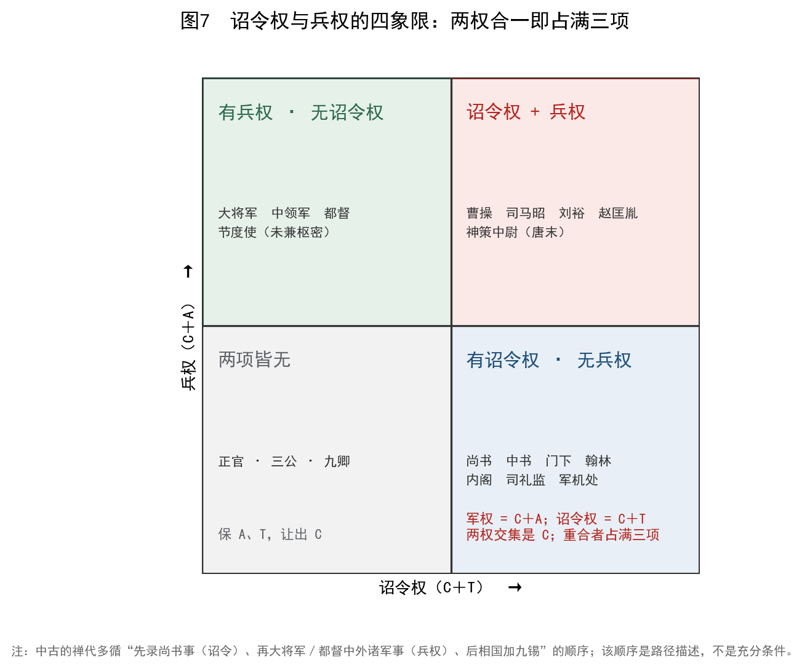

*图7　诏令权与兵权的四象限。两权的交集是 C；重合者占满三项。中古的禅代多循"先录尚书事（诏令）、再大将军／都督中外诸军事（兵权）、后相国加九锡"的顺序。该顺序是路径描述，不是充分条件。*

中古的篡代者多循相近的路径：先握诏令权（录尚书事、中书监），再握军权（大将军、都督中外诸军事、领军），最后得相国或丞相之位，加九锡，而后禅让。曹操、司马昭、刘裕、萧道成、高欢、宇文泰、杨坚、李渊，大体循此。**这不是"野心家的套路"，而是"占满三项的唯一技术路线"**：在既有官制中，只有这两条线的组合能凑齐三项。

高平陵之变（249）是一个精确的例证。曹爽以大将军辅政，其兄弟任中领军等禁军之职；司马懿则以太傅身份，趁曹爽随魏帝出城谒陵之机发动政变。此例中，**禁军统领权的得失决定了政权的归属**：曹爽失去禁军，就失去了 A；司马懿控制禁军，就补上了 A；加上他原有的"录尚书事"（T），三项占满，政权易手。

### 7.5 一次性禁戒：殿前都点检

后周显德七年（960），殿前都点检赵匡胤发动陈桥兵变。赵匡胤即位后，殿前都点检一职不再授人，禁军改由三衙分掌，调兵之权归枢密院。

这是"禁戒"最纯粹的形式：不是因为该职"不好"，而是因为**它已经演示过一次"占满三项"**。禁戒的方式不是拆分职权（那会留下新的融合点），而是**让这个名号永久空缺**——用"名"的消失，标记"配置"的危险。

但禁戒只关了一个名。禁军的融合问题并没有消失：北宋的"三衙—枢密院"分权，是对"禁军统帅"这一配置的重新设计；南宋的"御营司""殿前司"又在不同程度上恢复了集中。到明代，五军都督府与兵部分权，仍是同一问题的不同答案。

### 7.6 异族政权的双轨：并立线的极端形式

辽、西夏、金、元、清提供了另一类样本：**双轨制**。

- **辽**：北面官治契丹与诸部，南面官治汉人、渤海人。两套官制各有品秩、各有职掌，互不统属。
- **西夏**：中书、枢密、三司（汉制）与蕃官、监军司（蕃制）并存。
- **金**：勃极烈（女真旧制）与三省（汉制）并存；猛安谋克（兵民合一）与州县（编户）并存。
- **元**：怯薛（内廷）与中书省（外朝）并存；行省（派出）与路府州县（正官）并存；达鲁花赤（监临）与汉地正官并存。
- **清**：议政王大臣会议、军机处（内廷）与内阁、六部（外朝）并存；八旗（兵民合一）与州县并存；理藩院（藩部）与六部并存。

用本文的坐标说，双轨制是**并立线的制度化**：两套线各保两项、各让一项，互不融合。它的稳定性来自"没有一条线占满三项"；它的脆弱性来自"两套线之间传不透"（T 在横向上的缺失）。

十六国是一个反例：大单于、单于台、部落大人三条线都是 C＋A、让 T，且常常与军事首领合一，容易形成融合线。所以十六国的政权更替特别频繁——不是"胡人不能治国"，而是**配置上更容易出现"占满三项"的人**。

这一发现把"异族政权"从"例外"变成了"样本"：它们不是"另一种官制逻辑"，而是同一三角在"双轨"条件下的解。**双轨不是"落后"，而是一种用 A 换 T 的技术**：用两套官制分别承载两个群体的"拼得上"，代价是两个群体之间"传不透"。

### 7.7 军职线的小结

军职线的机制可以写成一句话：**军权天然是 C＋A，天然让出 T；谁掌握军权，谁就掌握了"占满三项"的一半。** 因此历代设计者的核心任务，不是"消灭军权"（那不可能），而是"让军权与诏令权不落在同一个人手里"。

这条任务从来没有被彻底完成。它可以被制度性地延缓（宋），可以被技术性地缓解（清的电报与密折），却始终没有被取消。只要 τ>1 的场合存在，就要授权；只要授权，就有人同时握有 C 与 A；这个人再碰到 T，临界便有了条件。

---

## 8 统计与模式

### 8.1 让出项与路径的对应

把 121 例按路径分组，可以得到一张"保/让"的分布表。

**表 8　路径与让出项的对应（n=121）**

| 路径 | n | 主频"保" | 主频"让" | 比例 | 典型结局 |
|---|---|---|---|---|---|
| 内廷（侍从型） | 43 | C、T | A | 93% | 正官化、降格 |
| 外派（监察副贰型） | 45 | C、A | T | 60%（次频：让 A 36%） | 割据、虚化、降格 |
| 军职型 | 15 | C、A | T（对皇帝） | 93% | 禁戒、拆分 |
| 礼制与相职 | 18 | A、T 或 C、A | C | 72% | 虚化、存续 |

比例不是 100%，这很重要：**它说明"路径"不是决定论的，而是概率性的**。内廷线也有割据（东汉外戚大将军、唐神策中尉），外派线也有正官化（国相、巡抚）。外派线中那 36% 让 A 的案例（监军、典签、巡按御史、通判），其实是"内廷版的外派"：它们贴近被监督对象、直达皇帝，却不入正官序列。这说明两条线的边界是渗透的，编码时的归属只能取"主要功能"。

### 8.2 P4 的检验：并立线数不预测稳定

本文最初的假说 H4 是：**并立线越多，系统越稳定**——因为每条线只保两项，多线互相牵制。

图8(a) 是 24 期的并立线数，图8(b) 是各期的"融合度"（是否存在一条线同时占满三项）。

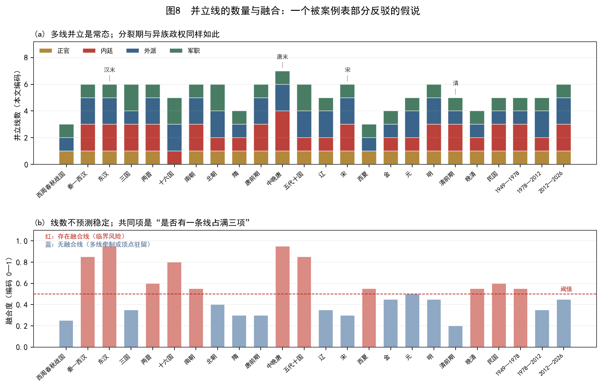

*图8　(a) 各期并立线数（本文编码）：多线并立是常态，分裂期与异族政权同样如此。(b) 各期是否存在"融合线"：红为存在（临界风险），蓝为不存在。线数本身与稳定无单调关系；共同项是"融合"。*

结果对 H4 不利。东汉有 6 条线，却在外戚大将军与州牧的融合下崩解；中晚唐有 7 条线，却在神策中尉的融合下走到临界；宋只有 5 条线，却三百年无禅代；清 5 条线，也无割据（直到清末）。**线数多的时期，未必更稳；线数少的时期，未必更乱。**

真正的共同项是"融合"：凡出现一条线同时占满三项（东汉外戚大将军、唐神策中尉、五代殿前都点检），系统就进入临界；凡所有线都只保两项，系统就能维持——即使线数很少（如清前期）。

这一判断的统计强度有限。按时期做 2×2 表（融合／非融合 × 崩解／未崩解），两次体制性崩解（汉末、唐末）都落在融合期，但 Fisher 精确检验 p=0.48（第 12.4 节）：样本只有 24 期、2 次崩解，功效不足。因此 P4 只能表述为"融合是崩解的必要条件候选"，不能表述为"融合预测崩解"。方向与案例一致，强度不足以称规律。

因此本文把 H4 修正为 **H4′（即 P4）**：**稳定性不随并立线数单调变化，而随"是否存在融合线"下降；线数只决定 ψ 的行政代价（协调成本、冗官、党争），不决定存亡。**

这是一次"假说被自己数据打掉"的记录。它的意义不在于"框架错了"，而在于框架的**具体预测**可以被证伪：如果并立线数真的决定稳定，图8(b) 就应该是单调的；它不是。

### 8.3 禁戒的形式谱

"禁戒"不是一个动作，而是一族动作。本文区分五种形式：

**表 9　禁戒的五种形式**

| 形式 | 做法 | 例 | 效果 | 代价 |
|---|---|---|---|---|
| 废除 | 取消职位与机构 | 成帝罢中书宦官；洪武废丞相 | 名消失，功能转注 | 需要新的载体 |
| 虚衔化 | 保留名号，抽空实权 | 三公、节度使（宋）、太尉 | 名存实亡 | 名实脱节，冗官 |
| 拆分 | 一职分为数职 | 三衙、五军都督府、三省 | 无一职占满三项 | 协调成本上升 |
| 换名 | 保留功能，改换名号 | 丞相→内阁；尚书→中书→门下 | 循环继续 | 名实不符，党争 |
| 祖训 | 写入家法，禁止复设 | "不得议置丞相" | 提高复设成本 | 无法约束功能需求 |

五种形式的效果差异很大。**废除**最彻底，但功能会转注；**拆分**最有效，但代价是 ψ 上升；**祖训**成本最低，但只能约束"名"，不能约束"功能"（明代内阁就是证明）。

用框架的话说，禁戒处理的是"名"，而循环的驱动力是"配置"。两者不在同一层面，所以禁戒只能关一个出口。这不是设计者的愚蠢，而是"名"与"配置"之间的结构性错位：你可以禁止一个词，但不能禁止一种需求。

### 8.4 "无人再领受"的反例

本文的问题起点，是一个朴素的观察："该职遭禁戒后，无人再领受。"这个观察大体成立，但有几处反例，值得单列。

**丞相**：洪武废丞相后，确实无人再任"丞相"；但"首辅""军机大臣""总理"都在行使丞相之权。名废了，功能没废。

**相国**：汉以后"相国"非常设，但南北朝时仍是权臣禅代前的常见头衔（如高欢、宇文泰）。说"西晋以后相国基本不再常设"过于绝对。

**尚书令**：唐太宗曾任尚书令，此后无人敢居；但尚书省的实权由仆射行使，尚书令只是"空缺"。这是"名存实亡"的另一种形式：名还在，只是没人敢要。

**殿前都点检**：宋代确实不再授人；但禁军的融合问题以"三衙—枢密院"的形式继续存在。

**州牧**：魏晋以后很少实授，但"刺史"带都督衔继续行使同类权力。

这五个反例指向同一结论：**"无人再领受"只对"名"成立，对"配置"不成立**。真正消失的不是权力，而是权力的一个称呼。

### 8.5 三种竞争解释的置信度分配

对同一现象，至少有三种解释在竞争。本文不宣称"只有框架对"，而是给它们分配置信度（这是《诠释的权衡》的方法：诠释即给竞争命题分配置信度）。

**表 10　三种解释的置信度分配**

| 命题 | 解释 | 置信度 | 支持证据 | 反例／弱点 |
|---|---|---|---|---|
| E1 | 皇权—相权消长：皇帝用近侍削相权，近侍壮大后再削 | 高（B） | 尚书、中书、门下的更替 | 不能解释外派线；不能解释"为何禁戒无效" |
| E2 | 委托—代理：信息不对称导致统治者依赖亲信 | 中高（B） | 宦官、寒人、军机处 | 不能解释"正官化"；不能解释"为何有四种模式" |
| E3 | 结构取舍（本文）：三项不能同时满格，只能轮换让渡 | 中（B／C） | 121 例的保/让分布；两种临界；四种模式 | 编码主观；ψ 未测量；不能预测具体事件 |

三者的关系不是"谁替代谁"，而是"分层"：E1 描述**现象层**（谁取代谁），E2 描述**动力层**（为何用亲信），E3 描述**约束层**（为何循环是稳态）。一个好的解释不必否定前两层；它只需要回答前两层回答不了的问题。

用置信度的话说：E1 的置信度最高，因为它的证据最直接；E2 次之，因为它的机制在多个领域被验证；E3 最低，因为它的核心（ψ>0）在官制中无法直接测量。**本文的贡献不是"提出一个更正确的解释"，而是"提出一个可分工的解释"**：它把"为什么"拆成三个层次，并指出哪一层可以被证伪。

---

## 9 时间错配 τ

### 9.1 τ 的官制版本

τ = T_min / T_available：应对一件事所需的最短时间，与可用时间之比。在官制中：

- **T_min**：从边报到决策、从决策到执行的闭环时间。它由两段组成：**通信时延**（驿传、电报）与**组织时延**（议决、会签、拟诏、封印）。
- **T_available**：事态从发生到不可逆的时间。边境小规模冲突可能以"旬"计，大规模叛乱可能以"月"计，财政危机可能以"年"计。

当 τ>1，中央来不及，必须**预先授权**：给边将"便宜行事"之权，给地方"先斩后奏"之权，给使职"专达"之权。授权的形式，就是都督、行台、节度使、巡抚。

用框架的话说，τ 决定的是**授权包的大小**，而不是**授权是否失控**。这是本文对 τ 的一个关键限定：许多研究把 τ 当作"割据的原因"，本文认为 τ 只是"授权的原因"；授权之后是否失控，取决于授权包里装了什么（第 9.4 节）。

### 9.2 驿传技术史与 τ

**表 11　通信技术与 τ 的粗略估计**

| 时期 | 制度 | 速度（约） | 备注 |
|---|---|---|---|
| 周 | 遽、传、邮 | 日行 30—50 km | 诸侯自带车马 |
| 秦 | 驰道、邮亭 | 日行 100—150 km | 车同轨、书同文 |
| 汉 | 驿、置、传 | 日行 100—150 km | 马匹轮换 |
| 唐 | 陆驿马、水驿船 | 常驿 90 km／日；急递 250 km／日 | 《唐六典》"陆驿马日行六驿" |
| 宋 | 步递、马递、急脚递 | 急脚 200—250 km／日 | 金字牌"日行五百里" |
| 元 | 站赤 | 150—250 km／日 | 驿站网络最广 |
| 明 | 急递铺、驿站 | 150—200 km／日 | 铺间十里 |
| 清 | 驿传、廷寄 | 加急 300 km／日 | 密折与廷寄 |
| 1880s— | 电报 | 分钟级 | 但译电、递送仍需时间 |
| 1930s— | 电话 | 分钟级 | 长途电话覆盖有限 |
| 1990s— | 互联网 | 秒级 | 组织时延成为瓶颈 |

*注：速度为量级估计，不同路线、季节、事态差异很大。等级 B／C。*

这张表说明一件事：**通信技术的每一次跃升，都把 τ 压低一个量级**。但 τ 的下降并不自动带来"中央集权"，因为 τ 只决定"是否需要授权"；授权之后，T 是否被让出，取决于制度设计。

### 9.3 模型：τ 随距离与速度变化

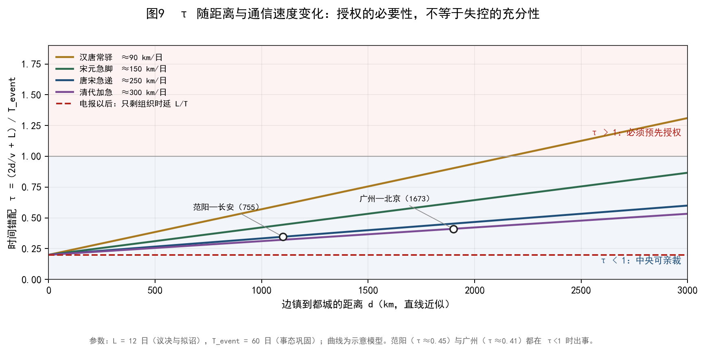

*图9　τ =（2d/v + L）/ T_event 随距离与通信速度的变化。L=12 日（议决与拟诏），T_event=60 日（事态巩固）。范阳（τ≈0.45）与广州（τ≈0.41）都在 τ<1 时出事。*

图9 的三条曲线（90、150、250、300 km/日）说明：在没有电报的时代，边镇距都城超过约 1000—1500 km，τ 就逼近 1；超过 1500 km，τ>1，必须授权。唐代的十节度，全部设在距长安 1000 km 以上的边疆；这不是巧合，而是 τ 的几何。

但图9 也标出了两个反例：范阳（约 1100 km）与广州（约 1900 km）都在 τ<1 时出事。前者是安禄山，后者是三藩。这说明 τ 不是充分条件。

### 9.4 三个反例

**安禄山（755）**。范阳到长安约 1100 km，以急递 250 km/日计，往返约 9 日，加上议决 12 日，共 21 日；事态巩固（起兵到占领洛阳）约 30 日，τ≈0.7<1。中央其实"来得及"反应。但安禄山已经握有三镇节度使的兵权、财权、人事权——**授权包太大**，中央即使反应得过来，也打不过。这说明：τ 小，不能防止割据；授权包大，才是割据的直接原因。

**三藩（1673）**。吴三桂在云南，距北京约 2000 km；清代的加急驿传 300 km/日，往返约 13 日，加议决，共 25 日；三藩之乱从起兵到占领湖南约 3 个月，τ≈0.3。τ 已经很小，但三藩仍然反了。原因同样是授权包：吴三桂握有云贵军政、财赋、人事，等于占满三项。**通信改善，不能收回已经给出的授权包。**

**东南互保（1900）**。慈禧下诏对列强宣战，两广总督李鸿章、湖广总督张之洞、两江总督刘坤一等公然不执行，与列强订立"东南互保"。此时电报已通，τ 极小；但督抚仍然不执行诏令。这不是"信息不通"，而是"T 已经被让出"：太平天国以后，厘金、湘淮军、幕府使督抚占满三项；电报只是让"不执行"变得更快、更协调。

三个反例指向同一结论：**τ 解释"为何必须授权"，授权包解释"为何授权会失控"，而 T 的让出解释"为何收不回来"**。三者是三个不同的问题，不能用一个 τ 打包。

### 9.5 τ 的解释边界

因此，本文对 P5 的表述是：

> τ 决定授权包的必要大小；授权包的内容（军、政、财、人事是否合一）决定失控的概率；T 是否被让出，决定失控之后能否收回。

这条表述可以被证伪：如果能找到一个 τ 很大、授权包很小、却仍然割据的案例，P5 就不成立。本文没有找到这样的案例，但这不等于它不存在——它只是"目前未被证伪"。

---

## 10 临界：汉末与唐末

### 10.1 二阶循环与一阶崩解

日常的官制轮换是**二阶**的：序参量（中央对地方的有效控制、皇帝对信息的掌握）连续变化，可逆；换一个皇帝、换一个名字、换一条线，系统就能恢复。汉、魏、晋、南北朝的频繁更替，多数属于这一类：政权变了，官制的"形状"没变。

体制崩解是**一阶**的：有潜热（旧体制整体报废）、有滞后（回不去）。汉末与唐末是候选。用《涌现的临界》的语言说，这是"序参量在临界点附近从 0 跳到有限值"；用本文的话说，这是"融合线出现，三项被同一条线占满"。

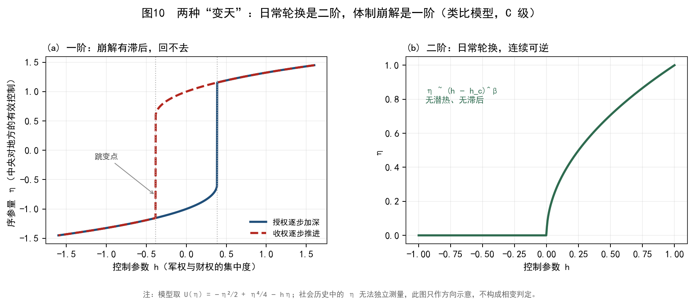

*图10　(a) 一阶：授权加深与收权推进走不同的路径，形成滞后环；越过失稳点才跳变。(b) 二阶：日常轮换，连续可逆。模型取 U(η)=−η²/2+η⁴/4−hη；社会历史中的 η 无法独立测量，此图只作方向示意。*

必须强调：**这是类比，不是相变判定**。《涌现的临界》自己就指出，社会系统中的序参量只能事后估计，对称破缺常是观察者事后命名的。本文用"一阶／二阶"来区分"可逆的轮换"与"不可逆的崩解"，但不宣称汉末、唐末满足相变的全部判据。

### 10.2 汉末：五线同时失控

中平五年（188）前后的格局，可以列成一张表：

**表 12　汉末的五条线**

| 线 | 职位 | 保 | 让 | 状态 |
|---|---|---|---|---|
| 内廷 | 中常侍 | C、T | A | 十常侍专权，189 年被诛 |
| 内廷 | 外戚大将军 | C、A、T | — | 何进召外兵入京，被杀 |
| 外派 | 州牧 | C、A | T | 刘焉、刘表、袁绍据州自立 |
| 军职 | 西园八校尉 | C、T | A | 蹇硕统之，何进死后旋废 |
| 正官 | 三公 | A、T | C | 备员而已 |

五条线同时处于"可失控"状态：中常侍掌诏令，外戚大将军掌兵，州牧掌地方，西园八校尉掌宿卫，三公虚设。何进召外兵入京、袁绍诛宦官、董卓入京废少帝立献帝（189），是各线同时崩塌的表现。

用本文的话说，汉末的临界不是"某一个官职失控"，而是"**多条线同时占满三项**"：外戚大将军（C＋A＋T）、州牧（C＋A，T 已让出）、中常侍（C＋T，A 借自皇权）。当三条线都能"自己说了算"，系统就不再有"最后的裁决者"；此后不是某个官职的更替，而是整个体系的更替。

### 10.3 唐末：三线同时失控

唐末的格局与汉末相似，但结构更清晰：

**表 13　唐末的三条线**

| 线 | 职位 | 保 | 让 | 状态 |
|---|---|---|---|---|
| 内廷 | 神策中尉 | C、T＋兵 | A | 宦官废立皇帝 |
| 内廷 | 枢密使 | C、T | A | 宦官传宣 |
| 外派 | 节度使 | C、A | T | 藩镇割据 |
| 诏令 | 翰林、宰相 | C、T | A | 受制于宦官 |

神策中尉（内廷兼军权）、节度使（外派）、翰林与宰相（诏令）同时失控；朱温在天复三年（903）尽诛宦官后，于 907 年代唐。临界状态之后，"系统是否还是原来那个东西"已成为问题——唐亡之后，不是"换一个皇帝"，而是"换一个时代"（五代十国）。

### 10.4 为什么宋明清没有走到临界

宋代以后，临界变得罕见。原因不是"皇帝更英明"，而是**制度性地阻断了融合线**：

- **宋**：二府分权、三衙分军、台谏独立、官职差遣分离。任何一条线都只保两项；即使有人想占满三项，也要跨越四道制度障碍。
- **明**：废丞相（去除"诏令＋行政"的融合点）、五军都督府（去除"军权＋行政"的融合点）、内阁与司礼监并立（两条内廷线互相牵制）。
- **清**：军机处不补 A（去除"内廷正官化"的路径）、督抚三权分立（财权在藩司、兵权在将军、人事在吏部）、密折与廷寄（T 保持通畅）。

三朝的共同点是：**把"占满三项"从"个人能力"问题变成"制度不可能"问题**。这不是消灭了取舍，而是把取舍写进了制度：宁可让系统"看得慢一点"，也不让任何一条线"看得太准"。

代价当然存在：宋的军事被动、明的党争与宦官、清的保守与停滞。用框架的话说，**它们用 C 换了 A 与 T 的稳定**；这笔账在和平时期是划算的，在剧变时期是致命的（宋之于金、清之于列强）。

### 10.5 可观测前兆

如果 P6 成立，临界之前应当有可观测的前兆。本文提出四个候选指标，全部为 C 级（只作方向，不作预测）：

1. **诏令执行延迟**：同一诏令从发出到地方执行的时间，是否在数十年内持续上升。
2. **财政分散度**：地方留存与上解的比例，是否持续向地方倾斜。
3. **禁军指挥权更替频率**：禁军统帅的平均任期，是否在缩短。
4. **党争频率**：以"罢相""贬谪""诏狱"为代理指标，是否在上升。

这四个指标都可以从史料的编年记载中提取，但本文没有做系统的量化。它们登记在附录 D，等待后续研究。

### 10.6 临界的边界

必须再次强调：**"临界"是类比，不是判决**。本文用它来区分"可逆的轮换"与"不可逆的崩解"，而不是用来预测"某朝某年会亡"。理由有三：

第一，社会系统的序参量无法独立测量，"中央对地方的有效控制"只能用代理指标（诏令执行率、财政上解率），而代理指标的选择本身带主观性。

第二，崩解往往是"外生冲击 + 内部脆弱"的乘积，而不是单纯的内生相变。汉末有黄巾，唐末有黄巢，明末有李自成与满洲，清末有列强。没有外生冲击，内部脆弱可能长期不发作。

第三，一阶／二阶的判定是事后的。当时的人不会知道自己在"临界点"上；他们只会觉得"事情越来越难办"。这正是《涌现的临界》所说的"形式化的地平线"：过了这条线，我们只能讲，不能算。

---

## 11 现代转型（1901—2026）

### 11.1 晚清：从"使职"到"部"

清末新政是本文框架的一次集中演示。1901 年设**督办政务处**，本是临时机构，用来统筹新政；1906 年"预备立宪"，改官制，设外务部、度支部、陆军部等；1911 年设**责任内阁**，取代军机处。

用坐标说，这是一次"补 A"的运动：把原来的内廷使职（军机处、总理衙门、督办政务处）改成有编制、有属官、有法定职权的"部"。补 A 的代价立刻显现：军机处被废，责任内阁成立；但责任内阁没有来得及建立权威，清就亡了。

**总理衙门**（1861）是一个典型的"外派＋内廷"混合体：它本为办理洋务而设，由亲王领衔，军机大臣兼管，保 C＋T、让 A；1901 年改为外务部，是正官化。**督办政务处**（1901）同样是临时机构，1906 年改为官制编制馆，也是正官化。这两次正官化都发生在"国家需要新功能"的时刻：外交、新政。新功能先以"使职"的形式出现，再以"部"的形式固定——这正是内廷线"起家—正官化"的近代版。

### 11.2 民国北京政府（1912—1928）：府院之争与幕府化

民国官制的第一个形态，是"约法—内阁—总统"三者的反复。1912 年《临时约法》采内阁制，总统虚、国务总理实；1913 年天坛宪草续采内阁制；1914 年"袁记约法"改总统制，国务院废，政事堂设；1916 年袁死，约法恢复，国务院复设；1923 年曹锟宪法又改；1924 年段祺瑞执政府再改。**十二年间，中央官制的根本法改了五次**。

用本文的话说，这是"F 层高频重置"：制度层没有稳定下来，A（可组合性）就无法积累。每一次改制，都把上一套的品秩、编制、职掌推倒重来；官员无所适从，政令出不了北京。

三条线在此期间都已出现，但没有一条制度化。

**内廷线：总统府秘书厅与机要。** 总统府的秘书、机要、侍从，保 C＋T、让 A；它们贴近总统，却不在国务院的编制内。1917 年的"府院之争"（黎元洪与段祺瑞），本质是内廷线（总统府）与外朝（国务院）争夺诏令通道。总统府赢了，T 就归总统；国务院赢了，T 就归总理。制度没有裁决权，只有人事胜负。

**外派线：巡阅使、督军、镇守使。** 北洋的督军握一省军政，巡阅使辖数省，镇守使辖数县；它们保 C＋A、让 T，是典型的藩镇形态。1916 年以后，督军干政、截留税款、自行任命，中央的 T 名存实亡。这不是"军阀个人野心"，而是**授权包太大**：军、政、财、人事四权合一，中央收不回来。

**正官线：国务院与各部。** 国务院（1912）设外交、内务、财政、陆军、海军、司法、教育、农林、工商、交通十部；1914 年改政事堂；1916 年复国务院。正官线的 A 是完整的（部—司—科），但 T 被内廷线与外派线切断，C 又被府院之争消耗。

**考试与铨叙**是这十二年里少有的"正官化"遗产。1913 年公布文官考试草案，1916 年以后断续举行；铨叙局（1912）掌文官资格审查。它们把"选官"从人情转向考试，是 A 层的建设。但考试规模小、录取少，挡不住幕府化的潮流。

**表 13a　民国官制的三条线**

| 线 | 机构／职位 | 保 | 让 | 形态 | 结局 |
|---|---|---|---|---|---|
| 内廷 | 总统府秘书厅、机要 | C、T | A | 贴近总统，不入编制 | 随总统更替而变 |
| 外派 | 督军、巡阅使、镇守使 | C、A | T | 军、政、财、人事合一 | 割据 |
| 正官 | 国务院、十部 | A、T | C | 部—司—科完整 | 被府院之争消耗 |
| 考试 | 文官考试、铨叙局 | A、T | C | 考试取士 | 规模小，未成主流 |

北京政府的教训很直接：**当 F 层（约法与官制）年年重置，A 层就长不出来；A 长不出来，T 就只能靠人事，而人事靠不住**。这不是"民主制度不适合中国"之类的判断，而是"制度层不稳定时，任何配置都无法积累"的结构问题。

### 11.3 南京国民政府（1928—1949）：五院、军委会与侍从室

南京国民政府吸取了北京政府的教训，试图用"五院"把 A 层固定下来。

**五院制**（1928）设行政、立法、司法、考试、监察五院，五院互不统属，各对国民党中央负责。用坐标说，这是一次"以 A 换 C"的设计：权责清晰（A 强），但对具体事务的反应慢（C 弱）。五院的实际权力并不均衡：行政院最实，考试院、监察院次之，立法院、司法院多为程序性。

**考试院与铨叙部**（1930）是五院制里最"正官化"的部分：1931 年举行首届高等考试，此后逐年举行；铨叙部掌文官的任用、考绩、级俸。它把"选官"从幕府与派系转向考试与资历，是 A 层的长期建设。局限在于：考试录取人数少，高级官员仍多由政治任命；战时又大量使用"特任""简派"，绕开考试。

**军事委员会**（1925 年设于广州，1932 年恢复，抗战期间为最高统帅部）是军职线：保 C＋A、让 T。抗战时期，军委会下设军令、军政、军训、政治四部，权力覆盖军政全领域。1946 年改为国防部，是正官化的一次尝试。

**侍从室**（1932—1945）是内廷线：保 C＋T、让 A。它分三处：一处掌军事，二处掌党政，三处掌人事；直接服务于蒋介石个人，不在正式编制内。抗战后期，侍从室的权力超过许多正式机构，成为"影子中枢"。

**中统、军统**是内廷线的特务变体：中统（1928 年党务调查科，1938 年设局）掌党务与政治情报，军统（1938）掌军事情报与行动。两者都保 C＋T、让 A，权力来自领袖个人，不来自法定职权。

**省主席、行政督察专员、绥靖公署**是外派线：省主席（1928）掌一省民政，行政督察专员（1932）分片督导，绥靖公署（1930s）掌战区军政。它们的配置是 C＋A、让 T；战时授权扩大，地方势力随之坐大。

**"新县制"**（1939）是一次"补 T"：设区、乡（镇）、保、甲，把国家权力下沉到基层。它的目标是让中央的政令能到县以下，代价是基层机构的膨胀与地方士绅的抵制。

民国的问题，用框架说，是"**三条线同时存在，且都没有制度化**"：五院是正官（A＋T），军委会是军职（C＋A），侍从室是内廷（C＋T），三者没有形成稳定的牵制，反而互相重叠。并立线数不少，但每条线都不完整：五院没有实权，军委会没有法定地位，侍从室没有编制。结果是 ψ 极高（协调成本、派系斗争），T 极低（政令出不了南京）。

这与宋代的"多线并立"形成对照。宋代的并立是**制度化的并立**：二府、三衙、台谏各有法定职权，互相牵制；民国的并立是**人事化的并立**：每条线都依附于某个人或某个派系，人一换，线就断。P4 说的"融合线"在民国以另一种形式出现：不是一条线占满三项，而是**一个人通过侍从室同时接触三条线**——形式上是并立，实质上是融合。

### 11.4 1949—1978：党组、分口与"内廷线"的党化

新中国的官制，从一开始就是"党—政双轨"。用本文的坐标说：

- **党组与分口领导**：保 C＋T、让 A。党组不在国家编制序列内（A 弱），但贴近决策（C）、穿透层级（T）。这是内廷线的党化形态。1949 年以后，政务院各部设党组，党中央设财经、政法、文教、工交等"口"，每个口由一位副总理或书记处书记分管。
- **中央局、分局**：保 C＋A、让 T。1949 年设六大中央局（东北、华北、华东、中南、西南、西北），1954 年因"高饶事件"撤销；1960 年复设，1966 年再撤。这是外派线的党化形态，两次设立、两次撤销，是典型的"禁戒"。
- **中央文革小组**（1966—1969）：保 C＋T、让 A。它是内廷线的极端形态，权力来自领袖个人，1969 年九大以后弱化。
- **政务院／国务院**：保 A＋T、让 C。1949 年政务院设 35 个部门，1954 年改为国务院，1956 年部门增至 81 个，随后多次精简。它是正官体系，但在 1949—1978 年间，实际决策常在党的系统内完成。
- **干部管理**：1953 年建立分部分级管理（组织部、宣传部、统战部等分口管理干部），1957 年部分下放，1960 年代又收回。这是 A 层的建设：把"干部"从"革命队伍"变成"可分类、可考核"的编制。

这一段的历史，用框架的话说，是"**内廷线压倒正官体系**"：C 与 T 由党的系统承担，A 由国家机构承担，但 A 从属于 C。它的代价是"看得准"变成了"看得见"：信息通过党的系统上报，行政系统只负责执行。它的稳定性来自 T 的极强（穿透单位、直达基层），它的脆弱性来自 C 的单一化（只有一个信息通道）。

### 11.5 1978—2012：补 T 与正官化

改革开放以后的官制改革，可以读成"补 T"与"正官化"的双重过程：

- **纪委恢复重建**（1978）：外派线（C＋T、让 A）重新建立，2018 年并入监察委，是正官化。
- **监察部**（1987）：行政监察，C＋T、让 A；2018 年并入监察委。
- **巡视制度**（2003）：中央巡视，C＋T、让 A；2018 年后深化。
- **垂直管理**（1994—1998）：国税、海关、金融监管上收，是"补 T"（把地方手中的执行权收回中央）。
- **公务员制度**（1993 暂行条例、2005 公务员法）：正官化，A＋T、让 C。
- **分税制**（1994）：F 层的财政集中，把"税基"从地方上收到中央；它与垂直管理一起，构成"补 T"的财政基础。

这一段的逻辑很清楚：**用制度化（A）换稳定（T），用垂直管理补 T 的流失**。它的代价是 C 的进一步间接化：中央看到的是报表，不是现场；报表越规范，现场越模糊。

机构改革是这一段的"节拍器"。1982 年国务院部门从 100 个减到 61 个，1988 年减到 41 个，1993 年 40 个，1998 年 29 个，2003 年 28 个，2008 年 27 个。**每一次精简都伴随一次"职能转变"**：把直接管理改为间接管理，把审批改为监管。用坐标说，这是 A 层的重组：不是减少权力，而是改变权力的拼合方式。

**表 13b　国务院机构数（1954—2023，B/C 级）**

| 年份 | 机构数（约） | 背景 |
|---|---|---|
| 1954 | 35 | 国务院成立 |
| 1956 | 81 | 计划经济体制扩张 |
| 1982 | 61 | 改革开放后首次精简 |
| 1988 | 41 | 职能转变 |
| 1993 | 40 | 社会主义市场经济 |
| 1998 | 29 | 政企分开 |
| 2003 | 28 | 加入 WTO 后调整 |
| 2008 | 27 | 大部制 |
| 2013 | 25 | 铁路、卫生、新闻出版整合 |
| 2018 | 26 | 监察委、退役军人、应急管理 |
| 2023 | 26 | 科技、金融、数据 |

*注：口径含办公厅、组成部门、直属机构与办事机构，不同年份统计口径不同，只作量级参考。*

### 11.6 2012—2026：监察委、职级并行与专班

最近十余年的变化，可以归纳为四条：

**第一，监察委（2018）**。国家监察委与中央纪委合署办公，把原来分散在监察部、预防腐败局、检察院反贪局的监察权集中起来。用坐标说，这是外派线的**正官化 + 集中化**：C＋T 仍然是核心，A 被补上（法定机构、编制、职权），T 被强化（垂直领导、派驻全覆盖）。这与历史上"刺史—州牧"的方向相反：不是让出 T，而是收回 T。

**第二，派驻监察（2018）**。派驻机构全覆盖，是"补 T"的技术：把监督的触角伸到每一个单位内部。它与汉代的"刺史"、南朝的"典签"、唐代的"监军"同构，但有一个关键差别：它不掌握被监督单位的行政权（A 弱），因此不会像刺史那样"监察区变行政区"。

**第三，职务与职级并行（2019）**。公务员的"职务"（领导岗位）与"职级"（待遇序列）分开，是**快慢分层的现代制度化**：职务是快层（随事而设、能上能下），职级是慢层（稳定、可积累）。这与宋代的"官、职、差遣"分离、唐代的"官品＋加衔"是同一技术。

**第四，领导小组改委员会、专班与攻坚指挥部**。领导小组（1958 年起）本是议事协调机构，保 C＋T、让 A；2018 年前后，多个领导小组改为委员会（如深改委、网信委），是**部分正官化**。专班、攻坚指挥部（2015 年起）是临时的使职，保 C＋T、让 A，任务完成即撤——这是"使职"的现代形态：因事而设、事毕即罢。2023 年的机构改革（科技、金融、数据）延续同一逻辑：新功能先以"委""局"的形式出现，再逐步固定。

### 11.7 数字治理：τ 的两次断崖与"组织时延地板"

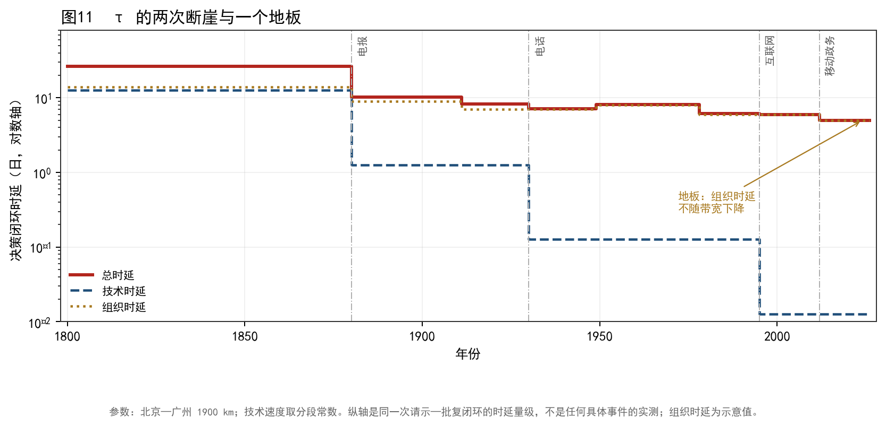

*图11　决策闭环时延的量级变化（北京—广州 1900 km，示意）。技术时延有两次断崖（电报、互联网），电话是中间台阶；组织时延（议决、会签、督办）不随带宽下降，形成"地板"。*

图11 是一个简单的分解：总时延 = 技术时延 + 组织时延。技术时延从驿传的十余日，断崖式降到电报的数小时，再降到互联网的秒级；但组织时延（议决、会签、督办、留痕）几乎没有下降，甚至在规范化以后有所上升。

这解释了一个当代的悖论：**通信越快，形式主义越重**。当技术时延趋零，组织时延成为唯一的瓶颈；而组织时延无法用技术解决，只能用"程序"解决；程序越多，留痕越多，"看得准"就越容易被"看得见的才算"替代。

用框架的话说，这是 **C 的退化**：信息本来是为了"看得准"，但在科层制中，信息变成了"可考核的痕迹"。痕迹越完整，判断越安全，也越远离现场。这不是某个部门的毛病，而是"以 A 换 C"的现代版本：为了可考核（A），牺牲了贴近（C）。

### 11.8 现代使职的三种形态

把当代的"使职"归类，可以看到三种形态：

**表 14　现代使职的三种形态**

| 形态 | 例 | 保 | 让 | 风险 |
|---|---|---|---|---|
| 议事协调机构 | 领导小组、委员会 | C、T | A | 职责重叠、常设化 |
| 临时攻坚机构 | 专班、指挥部、督导组 | C、T | A | 运动式治理、与常规体系冲突 |
| 派驻监督机构 | 派驻纪检监察组、巡视组 | C、T | A | 监督成本、与被监督单位关系 |

三种形态的共同点是"保 C＋T、让 A"：它们贴近具体事务、能穿透层级，但不进入正式编制。它们的风险也相同：**一旦常设化，就会补 A；一旦补 A，就会失 C**。这正是内廷线的古老机制在当代的重演。

历史给出的解法有两个：一是"事毕即罢"（专班、督导组），用"临时性"防止正官化；二是"并立牵制"（派驻与巡视并行），用"多线"防止融合。这两个解法都不完美：前者依赖政治意志，后者增加协调成本。

### 11.9 现代的"禁戒"：从防人到防配置

传统官制的禁戒，多针对"人"：某宦官乱政，就禁宦官；某权臣篡位，就废丞相。现代的禁戒，更多针对"配置"：

- 不允许"一把手"直接分管人事与财务（分权）；
- 不允许监督者同时掌握被监督单位的行政权（派驻不掌行政）；
- 不允许"政企不分""政资不分"（分离）；
- 不允许"既当运动员又当裁判员"（回避）。

用框架的话说，这是从"禁名"到"禁配置"的进步：不再指望"废掉一个职位"来消除风险，而是**直接禁止"三项合一"的组合**。这与宋代的"二府三衙"、明代的"五军都督府"是同一思路，只是更自觉、更普遍。

但"禁配置"也有代价：它把"占满三项"的可能性压到最低，也把"看得准"压到最低。当系统需要在危机中快速反应时，"禁配置"会成为障碍——这就是"应急授权"的必要性：在特定条件下，临时允许"三项合一"，事后再收回。**应急授权是现代的"使职"**：它是制度化的例外，也是制度化的风险。

---

## 12 量化检验

本章把前面分散的判断收成四张表：结局与路径、保有与让出、时滞、融合与崩解。全部数字由 `stats.py` 从 `data_cases.py` 重算，可复现。

### 12.1 结局与路径

把 121 例的结局并为三类：制度化（正官化或存续）、虚化类（虚化、降格、禁戒）、割据。

**表 15　结局类型与路径（n=121）**

| 路径 | n | 制度化 | 虚化类 | 割据 |
|---|---|---|---|---|
| 内廷 | 43 | 24 | 18 | 1 |
| 外派 | 45 | 19 | 14 | 12 |
| 军职 | 15 | 5 | 9 | 1 |
| 礼制·相职 | 18 | 11 | 7 | 0 |

在"制度化／割据"两类中，外派线割据 12/31，内廷线 1/25；Fisher 精确检验 p=0.003。这是**在所选案例内**最强的一条关联：**外派线的典型失败形态是割据，内廷线的典型失败形态是虚化或被清洗**。它与 P2、P3 的机制一致——外派线让出 T，所以它可以脱离；内廷线让出 A，所以它无法自立，只能依附或被清除。

但这批案例是"低阶起家→骤重→变化"的样本，等于按因变量选样；p=0.003 不能直接读成"外派线本身提高变化概率"。第 12.7 节的唐宋对照样本（67 个官职类型，含从未变化的职位）正是为检验这一点而建：它把"是否变化"与"如何变化"拆开，结论是前者无显著差异、后者仍有方向。

军职线的样本最小（n=15），割据只有 1 例，虚化类 9 例：它的失败多为"被拆分"，而不是"裂土"。礼制与相职无割据，符合其"象征位或正官"的位置。

### 12.2 保有与让出

**表 16　各路径的保有与让出比例（Wilson 95% 置信区间）**

| 路径 | n | 保 C | 保 A | 保 T | 让 C | 让 A | 让 T |
|---|---|---|---|---|---|---|---|
| 内廷 | 43 | 98%（88—100） | 9%（4—22） | 98%（88—100） | 5%（1—15） | 93%（81—98） | 0%（0—8） |
| 外派 | 45 | 96%（85—99） | 67%（52—79） | 40%（27—55） | 7%（2—18） | 36%（23—50） | 60%（45—73） |
| 军职 | 15 | 100%（80—100） | 93%（70—99） | 7%（1—30） | 0%（0—20） | 7%（1—30） | 93%（70—99） |
| 礼制·相职 | 18 | 28%（12—51） | 89%（67—97） | 72%（49—88） | 72%（49—88） | 11%（3—33） | 28%（12—51） |

三件事值得注意。第一，**C 的保有率在所有承担事权的路径上都接近满格**（96%—100%）：能在危机中被赋予实权的职位，一定贴近信息。第二，让出项与路径高度对应：内廷 93% 让 A，外派 60% 让 T，军职 93% 让 T。第三，外派线有 36% 的案例让 A（监军、典签、巡按、通判），说明两条线的边界是渗透的——这些是"内廷版的外派"，已在编码时按主要功能归类。

礼制与相职的 C 保有率只有 28%，正好从反面印证：**不承担事权的职位，不需要"看得准"**。三老五更、三师三公的功能是 T（礼制记忆），不是 C。

### 12.3 时滞

**表 17　起家到正官化／常设化的时滞（年）**

| 路径 | n | 中位数 | 四分位 | Bootstrap 95% CI |
|---|---|---|---|---|
| 内廷 | 43 | 34 | 10—70 | 19—51 |
| 外派 | 45 | 29 | 9—50 | 15—35 |
| 军职 | 15 | 35 | 14—43 | 14—40 |

内廷与外派的差异不显著（Mann–Whitney U，p=0.33），置信区间大面积重叠。时滞因此不能作为区分两条线的证据（第 3.6 节）。这条结果本身有意义：它说明"近侍起家快"是一个直觉，而不是一个可测事实；单次权力的获得与制度化的完成分属两个时间尺度，混在一个指标里只会得到噪声。

### 12.4 融合与崩解

按 24 期编码"是否存在融合线"，与"是否发生体制性崩解"（汉末、唐末）做 2×2 表：融合且有崩解 2 期，融合且无崩解 10 期，非融合且有崩解 0 期，非融合且无崩解 12 期。Fisher 精确检验 p=0.48。

方向与 P4 一致：两次崩解都落在融合期，非融合期没有崩解。但只有两次事件、24 期样本，统计功效不足，p 值不显著。因此本文把 P4 表述为"**融合是崩解的必要条件候选**"：它解释"为什么是这两次"，不承诺"下一次会在哪里"。若要做真正的检验，需要把"崩解"操作化为可逐期测量的连续变量（诏令延迟、财政分散度、禁军更替频率），而不是二元事件。

### 12.5 禁戒与世纪分布

16 例以"禁戒"收场的案例中，内廷 7、外派 4、军职 3、礼制 2。内廷最多，与 P3 一致：**越贴近皇帝、越没有编制的线，越容易在事后被清洗**。

按世纪看结局构成：割据在 601—960 年最集中（5 例），与节度使、五代十国的格局吻合；制度化在 1912—2026 年最高（15/21），与文官考试、公务员制度、监察委的正官化一致。这两组数字都不构成因果，只说明"哪种结局在哪个时段更常见"。

### 12.6 多重比较与解释边界

本章报告了 4 个检验（割据、时滞、融合、世纪分布为描述）。若按 Bonferroni 校正，5 个检验的显著性阈值约为 0.01；只有割据一项（p=0.003）通过，时滞（0.33）与融合（0.48）都不通过。本文因此把结论强度分为两档：**割据与路径的关联可以当作结果陈述；融合与崩解、时滞与路径只能当作方向**。这与全书的证据纪律一致：结论强度不超过证据强度。

---

### 12.7 唐宋对照样本：路径预测的是形态，不是概率

为了检验"外派线更容易变化"是否只是选样造成的，本文另建了一个**类型级对照样本**：唐 33 个、宋 34 个官职类型，共 67 个；每个类型记录入本朝之年、终止之年、首次性质变化之年与类型（正官化／虚化／割据／禁戒／降格）。风险集是该类型在本朝的存续年数；从未变化者按朝代结束删失。与前一节不同，这个样本**不按结局选样**，因此可以用来问"哪条线更容易变"。

**表 19　唐宋对照样本：发生率与结局构成（试点）**

| 线 | 类型数 | 事件 | 暴露（类型·年） | 每 100 类型·年（95% CI） | 割据 | 虚化/禁戒/降格 | 无变化 |
|---|---|---|---|---|---|---|---|
| 内廷 | 20 | 9 | 3,993 | 0.23（0.10—0.43） | 0 | 9 | 11 |
| 外派 | 31 | 10 | 6,329 | 0.16（0.08—0.29） | 5 | 5 | 21 |
| 军职 | 10 | 4 | 1,749 | 0.23（0.06—0.59） | 0 | 4 | 6 |
| 正官 | 6 | 1 | 1,525 | 0.07（0.00—0.37） | 0 | 1 | 5 |

两个结果要分开读。

**第一，变化的概率没有显著差异。** 外派与内廷的发生率比为 **0.70（bootstrap 95% CI 0.25—1.91）**，log-rank χ²=1.87、p=0.60。也就是说，一旦把"从未变化"的职位放回风险集，外派线并不比内廷线更容易发生性质变化。这与第 12.1 节的 p=0.003 并不矛盾：那一节的条件是"已经发生变化"，本节的样本包含"没有变化"，两者问的不是同一个问题。**p=0.003 是条件关联，不是边际效应**；把它读成"外派线本身提高变化概率"，就是选择偏误。

**第二，失败的形态仍然分线。** 割据只出现在外派（5/31 对 0/20，Fisher p=0.14）；虚化、禁戒、降格则集中于内廷（9/20 对 5/31）。样本小，p=0.14 不显著，方向却与 P2、P3 一致。把两件事合起来，本文对 P2、P3 的表述应修正为：

> **路径决定的是"怎么坏"，不是"多容易坏"。** 外派线让出 T，所以它的失败形态是裂土；内廷线让出 A，所以它的失败形态是虚化或被清洗；两条线发生变化的总概率，在对照样本里没有显著差别。

这条修正也解释了为什么"换一个皇帝"或"换一个总理"常常不解决问题：换的是人，不是"哪条线让出哪一项"的配置。

**边界。** 这是类型级样本，不是每一次任命；事件年份取正史与制度史通行系年（B/C）；未控制品级、朝代与外部冲击；样本 67 个类型、24 次事件，功效有限，只能作方向。逐条记录、筛选器与图表见交互文件 `interactive/control-explorer.html`；数据与复算脚本为 `data/control_tangsong.csv` 与 `analysis/control_sample.py`。

### 12.8 编码信度：15 个边界案例的盲复测

单一编码者的最大风险，是"规则只存在于作者脑子里"。这一节做一次**边界案例盲复测**：从 121 例中挑出 15 个最容易歧义的案例（侍中、同平章事、神策中尉、内阁、军机处、监军、通判、巡抚、典签、中领军、参知政事、权相、厂卫、侍从室、专班），遮住存储的"保/让"标签，只给官职、时期、路径、触发与结局，按第 3.3 节的规则重编一遍，再与存储值比对。

**表 20　边界案例盲复测（n=15）**

| 指标 | 数值 | 说明 |
|---|---|---|
| 一致 | 13/15（86.7%） | 保与让的集合一致 |
| Cohen's κ | 0.55 | 中等一致；按"让出项"三分类计算 |
| 主要歧义 | 5 处 | 见下 |

五处歧义分三类。**第一类是"前后期转移"**（侍中、通判）：起家时可判（C＋T），但"何时转成 A＋T"没有规则，存储值写了"初…后…"，复测只能判起家。**第二类是"让出项的名称"**（同平章事）：存储写"让名分"，复测写"让 T"；名分是不是 T，规则没定义。**第三类是"军权算不算 A"**（神策中尉、权相）：若算，它们同时占 C、A、T，是融合线，与存储的"让 A"矛盾；若不算，A 就只剩编制与品秩，军权成了第四项。

三类歧义都指向同一件事：**codebook 需要补三条规则**——（a）前后期转移分别编码，不写"初/后"；（b）"名分"归入 T；（c）军权计入 A，凡兼军权者标"融合"。补完之后应重新编码全样本；本文没有做，因此 κ=0.55 只能说明"规则在边界上还不够硬"，不能说明"编码可信"。

**边界。** 这是同一编码者的盲复测，不是独立第二编码者；κ 衡量的是规则的时间稳定性，不是编码者间信度。真正的信度检验仍需一位独立编码者（或经披露的 LLM 盲编码）复核 30—40 例。

### 12.9 断裂事件史：28 起宪制断裂

第 8.2 节的"崩解"只有汉末、唐末两起，做不了统计。这一节把"崩解"扩成**宪制断裂事件**：禅代、废立、清洗、割据、政变、内战、挟持，共 28 起（公元前 9 年—1861 年）。

**表 21　断裂事件的发生率（按 24 期，融合线为同期编码）**

| 时期类型 | 事件 | 暴露（年） | 每 100 年 | 发生率比 |
|---|---|---|---|---|
| 有融合线 | 21 | 1,374 | 1.53 | 5.4 |
| 无融合线 | 7 | 2,480 | 0.28 | 1（参照） |

28 起中，禅代 13、清洗 4、废立 3、政变 3、内战 2、割据 2、挟持 1。融合期的事件率约为非融合期的 **5.4 倍**；按"时期是否有事件"做 2×2，Fisher p=0.09（7/9 对 4/11），方向强、显著性不足。

**必须说清楚这是描述，不是预测。** 融合线是**同期**编码的：很多事件本身（如司马氏代魏、朱温代唐、赵匡胤代周）就是"某线占满三项"的那一刻。用同期融合去解释事件，等于用结果的一部分解释结果。要检验"融合在前、事件在后"，需要做**领先—滞后**设计：看某一期出现融合线后，未来 30 年的事件率是否上升。本文没有做这一步，因此表 21 只能回答"断裂事件是不是集中在融合期"，不能回答"融合线能不能预测断裂"。

**可做的下一步**：把 28 起事件按"融合线出现—事件发生"的间隔排序，做生存分析；若融合线确实领先，间隔应集中在 0—30 年；若只是同期伴生，间隔会均匀分布。这是本文留给后续的一个明确检验。

### 12.10 领先—滞后：融合线领先禅代，不领先清洗

12.9 节的相关是同期编码，不能回答"谁在前"。这一节把 28 起事件逐条编码"事件前 30 年内是否已有融合线"（onset 取该线首次同时掌握诏令、兵权与行政的年份），得到一张可检查的领先—滞后表。

**表 22　事件前 30 年内是否有融合线（n=28）**

| 事件类型 | 有融合线 | 合计 | 说明 |
|---|---|---|---|
| 禅代 | 13 | 13 | 王莽、曹丕、司马炎、刘裕、萧道成、萧衍、高洋、宇文觉、陈霸先、杨坚、李渊、朱温、赵匡胤 |
| 废立 | 2 | 3 | 司马师（249 起）、桓温（369 起）；董卓无 |
| 清洗 | 1 | 4 | 朱温（901 起）；袁绍、河阴、甘露无 |
| 政变 | 0 | 3 | 高平陵、夺门、辛酉 |
| 内战 | 0 | 2 | 八王之乱、靖难 |
| 割据 | 0 | 2 | 安史、河朔 |
| 挟持 | 0 | 1 | 曹操迎献帝 |

禅代 **13/13** 都有事前融合线，其他类型合计 **3/15**；Fisher 精确检验 p≈1.5×10⁻⁵。从融合线首次成形到禅代发生，间隔中位数 **2 年**，范围 1—16 年（最长是司马氏：249 高平陵至 265 代魏）。

这个结果修正了 12.9 节的读法：**融合线领先的是"禅代"，不是"清洗"与"政变"。** 清洗与政变（189 袁绍、528 河阴、835 甘露、249 高平陵、1457 夺门、1861 辛酉）多数发生在融合线**之前**或**之外**——它们是"没有一条线占满三项"时的宫廷或禁军行动。把"融合"当成一切崩解的前兆，会把两类完全不同的断裂混为一谈。

于是 P6 应分成两条：

> **P6a（禅代）**：一条线同时占满三项，是禅代的**前置条件**；从成形到代位通常在 1—16 年。
> **P6b（其他断裂）**：清洗、政变、内战、割据**不需要**融合线；它们的条件是禁军、边疆或宫廷的局部优势。

**边界。** onset 年份为本文编码（B/C），带主观性；禅代者按定义会逐步积累权力，因此"13/13"有一部分是定义使然。但两点仍有信息量：（a）领先窗口只有 1—16 年，说明融合不是"长期趋势"而是"临门一脚"；（b）清洗/政变 0—1/9 的对比说明，融合对断裂的预测力是**分类型**的，不是全局的。真正的检验需要更细的逐年编码与独立复核。

### 12.11 品级、边疆与第三朝代：外派效应是不是代理？

"外派线更容易变"可能只是"外派职位品级更高、更多在边疆"的代理。为检验这一点，本文把对照样本扩到 **109 个官职类型**：唐宋 67 类，加明 20 类、清 22 类；每个类型补两个协变量——**品级**（高/中/低）与**边疆**（是否常设于边疆/前线）。

**表 23　明清样本的结局构成（n=42）**

| 线 | 类型 | 事件 | 割据 |
|---|---|---|---|
| 内廷 | 10 | 4 | 0 |
| 外派 | 16 | 6 | 1（清督抚，1900） |
| 军职 | 7 | 4 | 0 |
| 正官 | 9 | 1 | 0 |

明清 42 类中只有 15 次变化；割据只有清督抚 1900 年"东南互保"一例。也就是说，**"割据只在外派"这个形态结果在明清仍然成立，但事件太少，不能单独检验**。

**表 24　合并样本的逻辑回归（因变量：是否发生性质变化；n=109，事件 39）**

| 变量 | OR | 95% CI |
|---|---|---|
| 外派（对照：内廷） | 0.66 | 0.22—1.98 |
| 军职 | 0.79 | 0.21—2.98 |
| 正官 | **0.16** | 0.03—0.91 |
| 品级（每升一级） | 1.74 | 0.77—3.96 |
| 边疆 | 1.28 | 0.43—3.84 |
| 宋／明／清（对照：唐） | 0.57／0.74／0.74 | 均不显著 |

三个读法。第一，**外派仍然不提高"是否变化"的概率**（OR 0.66，CI 含 1）；加入品级与边疆后也没有变显著。第二，**品级与边疆也不显著**：在这批类型里，"高阶"与"边疆"都不是变化的强预测。第三，**正官显著更低**（OR 0.16）：有品秩、有编制、有固定职掌的职位，反而最不容易发生性质变化——这与"正官保 A、T，让 C"的设定一致，也是本文少数在合并样本里仍显著的系数。

至于"割据"：109 类里 6 起，全部在外派，内廷 0。样本太小，不能做多变量模型；但方向与 P2、P3 一致，且跨唐宋明清四朝未变。

**边界。** 明清样本的 coding 更粗（20—22 类，事件年份取通行系年）；品级只分三档；边疆是二值；没有控制时间与外部冲击。A 的结论因此是"**没有发现外派效应只是品级/边疆代理的证据**"，不是"证明了外派效应独立于品级/边疆"。B 的结论是"形态结果跨朝代方向一致，概率结果不成立"。

### 12.12 融合的预算门槛：为什么"够三项"仍然不够

12.7 的对照样本说明"路径决定形态"，但没有回答一个更基本的问题：**融合线为什么只能在危机中出现？** 记账不等式给出一个解析答案。

设 c+a+t+λψ(c,a,t) ≤ K，ψ(1,1,1)=1。若三项同时满格，则需

```text
3 + λ ≤ K
```

也就是说，**K=3（"够三项"）在 λ>0 时仍然不够**；融合要求预算超过 3+λ。平时 K≈2（只够两项），融合在数学上不可达；只有战争、叛乱、财政危机把 K 临时抬高到 3+λ 以上，一条线才可能同时占满三项。危机一过，K 回落，必须抽掉一项——这就是"禁戒"的预算版本。

这条推论能解释三个此前分散的现象。第一，神策中尉出现在泾原兵变之后，军委会出现在抗战，侍从室出现在内战与抗战：**都是 K 被危机抬高的时候**。第二，禁戒总在危机之后：K 回落，融合线必须拆。第三，为什么"平时多线并立"能稳定：每条线只保两项，K 不需要超过 3+λ。

**边界。** 这是从记账不等式直接推出的条件命题（C／乙），不是历史测量；λ 的值没有估计，"危机抬高 K"也只是定性。它的价值在于把"融合—禁戒"从叙事变成了一个可检查的不等式：只要算出某时期的 K 与 λ，就能判断融合是否可行。

### 12.13 现代编码（1949—2026）：结构对照

把同一套坐标用到当代，只做**结构编码**，不评价个人与政策。样本 12 类，C 级。

**表 25　现代官职类型的结构编码（C 级，探索性）**

| 类型 | 线 | 保 | 让 | 融合 | 结局 |
|---|---|---|---|---|---|
| 党组／分口 | 内廷 | C、T | A | 否 | 存续 |
| 领导小组／委员会 | 内廷 | C、T | A | 否 | 部分正官化 |
| 专班／指挥部 | 内廷 | C、T | A | 否 | 事毕即撤 |
| 中央局／分局 | 外派 | C、A | T | 否 | 两次设撤 |
| 纪委 | 外派 | C、T | A | 否 | 2018 正官化 |
| 监察委 | 外派 | C、T | A | 否 | 合署 |
| 巡视／派驻 | 外派 | C、T | A | 否 | 存续 |
| 垂直管理 | 外派 | A、T | C | 否 | 存续 |
| 职务与职级并行 | 内廷 | A、T | C | 否 | 存续 |
| 国务院／部委 | 正官 | A、T | C | 否 | 存续 |
| 军委 | 军职 | C、A | T | 否 | 存续 |
| 应急指挥部（危机） | 内廷＋军 | C、A、T | — | **是** | 临时，事后拆 |

读法与历史样本一致：**平时没有融合线**（每类只保两项），只有"应急指挥部"在危机中同时占三项，事后拆掉。这与 12.12 的不等式一致：和平时期 K 不够，危机时 K 被抬高。

**边界。** 这是结构编码，不是对具体机构权力大小的测量；"融合"只标"是否同时具备信息、执行、强制"三项，不标强弱；C 级，只作方向。它说明框架可以延伸到当代，不说明当代已经验证了框架。

## 13 讨论

### 13.1 四种演化模式

把 24 期的数据放到"并立线数 × 融合度"的平面上，可以得到四种模式：

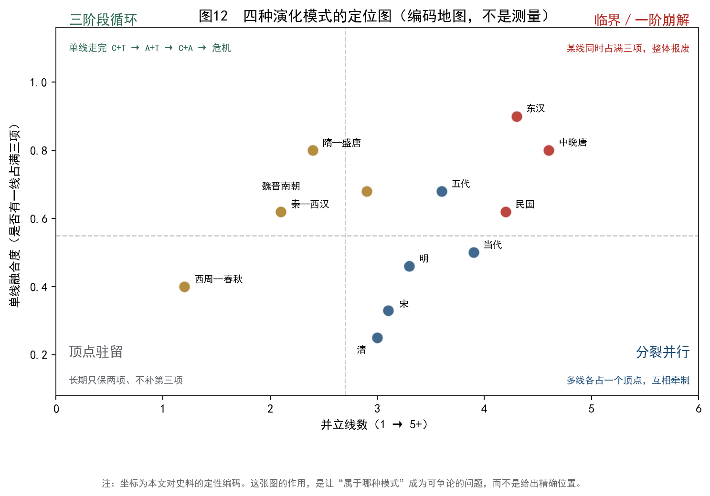

*图12　四种演化模式的定位图（编码地图，不是测量）：三阶段循环、双极摆动、分裂并行、顶点驻留。坐标为本文对史料的定性编码，作用是让"属于哪种模式"成为可争论的问题。*

**模式一：三阶段循环。** 单线走完 C＋T → A＋T → C＋A → 危机 → 重启。尚书、中书、门下、翰林、枢密，都走过这条路。它的特征是"同一条线"在变，而不是"换一条线"。

**模式二：双极摆动。** 系统在 A＋T 与 C＋A 之间摆动，很少回到 C＋T。教育与官僚体系常属此类：一会儿强调"规范化"（A＋T），一会儿强调"灵活性"（C＋A），很少回到"深度理解"（C＋T）。

**模式三：分裂并行。** 多线各占一个顶点，长期不合并。明代的内阁与司礼监、宋代的三衙与枢密院、辽的北面官与南面官，都是此类。它的稳定来自"互相牵制"，它的代价是"协调成本"。

**模式四：顶点驻留。** 长期只保两项、不补第三项。清前期的军机处是典型：它停在 C＋T，不补 A，也不虚化。它的稳定来自"皇帝的勤政"，它的脆弱来自"皇帝的更替"。

四种模式不是互斥的：一个朝代可以同时表现多种（如明：内阁—司礼监是分裂并行，内阁自身是三阶段循环，明初的废丞相是顶点驻留）。**模式的用处，不是给每个朝代贴标签，而是给"为什么这个朝代这样变"提供一个可争论的框架。**

### 13.2 为什么禁戒只关一个出口：ψ 的守恒

本文的核心机制可以写成一句话：**禁戒作用于名，循环由配置驱动**。但还可以再深一层：为什么配置不能被禁？

因为配置是**功能的载体**。皇帝不能不要"看得准"，也不能不要"传得下去"；他只能选择"用谁来承担"。当他禁掉一个承担者，功能不会消失，只会寻找新的承担者。这就是"换名再生"。

用记账不等式说，ψ 是"同时维持两项"的代价。禁戒可以改变"谁付这笔代价"，但不能改变"这笔代价存在"。这就是"ψ 的守恒"：**你可以换一个付款人，但不能取消账单**。

这个说法有一个可检验的推论：**禁戒越严厉的朝代，换名越频繁**。明代废丞相最严厉，内阁、司礼监、厂卫的更替也最频繁；宋代不禁任何一职，而是拆分职权，换名反而最少。这个推论与史实大致相符，但本文没有做系统的量化，登记为待验证。

### 13.3 多线并立：从"防人"到"防配置"

传统官制的设计智慧，常被概括为"防人"：防权臣、防宦官、防外戚、防藩镇。本文认为，更准确的概括是"**防配置**"：防的是"三项合一"，不是"某个人"。

证据有三。第一，历代禁戒的对象，往往是"职位"而不是"人"：殿前都点检被废，不是因为赵匡胤坏，而是因为这个职位能"占满三项"。第二，历代成功的制度设计，往往是"拆分"而不是"废除"：三衙、五军都督府、二府，都是拆分。第三，历代失败的禁戒，往往是"换名"而不是"换配置"：废丞相而设内阁，换的是名，不是配置。

"防配置"的思路，对当代的启示是：**不要问"谁是坏人"，要问"这个位置能不能让人同时拿到三项"**。这是一个可以操作的问法：它不依赖对人性的判断，只依赖对结构的分析。

### 13.4 与理论传统的对话

**与韦伯。** 韦伯的"家产官僚制"指出，传统官僚制中"私属"与"科层"并存。本文补充的是：两者不是静态并存，而是**动态轮换**——私属正官化，正官再私属化。轮换的动力不是"文化"，而是三项要求的不可兼得。

**与温特罗布、选择人理论。** 他们解释"为何用亲信"，本文解释"为何亲信会正官化"。两者是互补的：前者是"选择"，后者是"后果"。

**与诺思、历史制度主义。** 路径依赖解释"为何难以改变"，本文解释"为何改变了还会回来"。前者是"锁定"，后者是"循环"。循环不是路径依赖的反面，而是路径依赖在"功能需求"层面的表现：制度锁定了"名"，功能却在寻找"新名"。

**与周雪光、周黎安。** "一统体制与有效治理"的矛盾、"行政发包制"与"晋升锦标赛"，实际上都在描述"集权—放权—收权"的轮换。本文的差别在于：它把轮换写成三个可分的坐标，并指出"哪一项被让出"；它不预测"下一次收放何时发生"，只提供"这次收放让出了什么"的诊断。

**与《诠释的权衡》。** 本文对"禁戒"的讨论，借鉴了"诠释即给竞争命题分配置信度"的方法：史书对某一官职的"污名化"（如"宦官乱政""寒人窃权"），不仅是事实记录，也是一种叙述选择。它在竞争性的解释中（是官职本身危险，还是时势使然）给前者分配了高置信度，并因此促成禁戒。研究者要区分"官职的结构位置"与"史书对官职的评价"，不能把后者直接当作前者的证据。

### 13.5 边界与失效条件

本文的框架在下列情形下失效或减弱：

1. **ψ≈0 的小政体**：西周早期、金初勃极烈。它们没有完整的循环，因为三项可以兼得。
2. **通信技术极强、组织极简的时期**：军机处的部分时期。τ 极小，A 可以不要。
3. **极端强力的统治者**：康熙、雍正。个人信息能力极强，ψ 被压低。
4. **革命或战争时期**：制度被整体替换，循环的"名"来不及形成。
5. **非官制的组织**：企业、教会、军队。它们也有 C-A-T 取舍，但"名"与"配置"的关系不同（企业的"职位"可以随时改）。

这些情形不是"反例"，而是"边界"。一个框架的价值，不仅在于它能解释什么，也在于它能说清"在哪里不适用"。

### 13.6 现实含义

如果本文的分析成立，它对当代的官制改革有四条含义。

**第一，编制管理要区分"名"与"配置"。** 减少编制（A）不等于减少权力（C＋T）；如果功能还在，权力会以"专班""领导小组""派驻"的形式继续存在。真正的编制管理，是给"配置"设上限，而不是给"名"设上限。

**第二，职责清单要写"不可合一"的组合。** 与其写"某部门负责某事"，不如写"某两项职权不得由同一人同时掌握"。前者是"防人"，后者是"防配置"。

**第三，容错机制要承认"应急授权"的代价。** 危机中必须允许"三项合一"（如应急指挥部），但必须预设"事后收回"的程序。没有收回程序，应急授权就会变成新的融合线。

**第四，数字治理要防止"痕迹替代判断"。** 技术时延已经趋零，组织时延成为瓶颈；如果继续用"留痕"来解决组织时延，只会让 C 进一步退化。真正的解法，是给"判断"留出空间，而不是给"痕迹"增加维度。

### 13.7 与六本专著的关系

本文属于同一系列，但**不把六本专著的结论当作前提**。联系是解释性的，逐条标注"借用／检验／类比／不依赖"。

**表 18　本文与系列专著的关系**

| 核心 | 专著 | 概念 | 在本文中的用法 | 关系 | 等级 |
|---|---|---|---|---|---|
| **选择**（主） | 《选择的代价》 | C-A-T、ψ、记账不等式 | 核心分析工具；P1—P4 的来源 | **借用并检验**：P4 被部分反驳 | 乙／A |
| 跟上 | 《错位的时间》 | τ、多时钟 | 第 9 章的时间错配；授权包的必要性 | 借用方向，不做数值预测 | 丙／C |
| 记住 | 《遗忘的边界》 | 容量、压缩、遗忘 | 官制的"记忆"：祖制、成宪、档案；禁戒作为"制度遗忘" | 借用机制，不依赖其载体结论 | 丙／C |
| 看见 | 《区分的语法》 | 区分、二次型、谱 | 品秩、编制、职掌作为"区分"；官制刚性来自区分的细化 | 借用语言，不依赖其定理 | 丙／C |
| 临界 | 《涌现的临界》 | 序参量、滞后、临界 | 第 10 章的二阶／一阶区分 | **类比**，不声称相变 | 丙／C |
| 讲述 | 《诠释的权衡》 | 置信度分配 | 第 8.5 节的三种解释；史书"污名化"的分析 | 借用方法，不依赖 | 乙／B |

注：本表按六个核心排（不再按专著排），以便与系列其余五篇的对照表直接比较。等级为概念等级／证据等级的合并标法。

**三条纪律**：（1）六本专著的结论不当作本文前提；（2）每一条联系都标明关系，不把"类比"写成"因果"；（3）本文对《选择的代价》的贡献是"边界案例"：官制中 ψ 无法测量，P4 被部分反驳，这说明框架必须落到可测指标，而不是停在"有代价"。

---

## 14 结论

### 14.1 九条发现

1. **循环的形状是稳定的，载体是流动的。** 从西周到 2026 年，"低阶起家—因事骤重—正官化或失控—禁戒或虚化—换名再生"的形状反复出现；变化的只是载体（尚书、中书、门下、翰林、枢密、内阁、军机、领导小组）。
2. **三条路径对应三种两项组合。** 正官保 A＋T 让 C；内廷保 C＋T 让 A；外派保 C＋A 让 T。军职线是外派线的变体（C＋A，让 T 于皇帝）。
3. **补 A 即失 C；不补 A 则 T₂ 弱。** 前者解释尚书、中书、门下的"正官化—虚化"；后者解释内阁、军机处的"长期存续但依附皇权"。唐宋对照样本进一步限定：路径决定的是失败形态，不是变化概率（第 12.7 节）。
4. **禁戒只能关一个出口。** 废除、虚衔化、拆分、换名、祖训，五种形式都作用于"名"，不作用于"配置"；因此循环不会因禁戒而终止。
5. **并立线数不预测稳定，融合线是共同项。** 线数与稳定无单调关系；是否存在一条线同时占满三项，才是与崩解同现的条件。但两次崩解、24 期样本的统计功效不足（p=0.48），P4 只能作为待检验的必要条件。
6. **τ 解释授权，不解释失控。** 安禄山、三藩、东南互保三个反例说明：τ 小，不能防止割据；授权包大，才是割据的直接原因。
7. **日常轮换是二阶，体制崩解是一阶。** 汉末、唐末是候选的一阶崩解：多条线同时占满三项，系统不再有"最后的裁决者"。领先—滞后分析进一步把崩解分两类：融合线是**禅代**的前置条件（13/13，领先 1—16 年），但不是**清洗与政变**的前置条件（3/15）。
8. **四种演化模式由线数、融合、是否补 A 共同决定。** 三阶段循环、双极摆动、分裂并行、顶点驻留，各有其稳定条件与代价。
9. **现代官制仍在同一三角内。** 民国北京政府的教训是"F 层年年重置，A 层长不出来"；南京国民政府是"多线并立但人事化"，形式并立、实质融合；1949 年以后是"内廷线压倒正官体系"；1978 年以后是"补 T 与正官化"；2012 年以来是"监察委的正官化、职级并行的快慢分层、专班的临时使职"。数字治理压低了技术时延，却没有消除组织时延的地板。

### 14.2 三条启示

**第一，张力不是宿命。** "三项不能同时满格"不是判决，而是价目表。每个时代都在为"看得准""拼得上""传得下去"付账；账单可以换，账不能免。承认这一点，改革讨论就能从"谁对谁错"转向"我们要在哪一段尺度上保哪个顶点"。

**第二，诊断要指认"被让出的那一项"。** 说"这个制度有问题"是廉价的；说"它让出了 C，代价是反应迟钝"才是诊断。诊断的价值，在于它可以让不同立场的人在同一张表上争论。

**第三，设计要预设降级顺序。** 既然不能三项全占，就要预先想清楚：当被让出的那一项碎掉时，先放弃什么、后放弃什么。宋人选择"先放弃军事主动"，清人选择"先放弃制度更新"；这些选择都有代价，区别只在于是否预先想过。

### 14.3 五条后续研究

1. **第二编码者与一致性检验。** 请一位官制史研究者独立编码 121 例，计算 κ；这是本文最需要补的方法缺陷。
2. **ψ 的代理指标。** 用"机构数／官员数""兼领数""文书层级数"构造 ψ 的代理，检验"ψ 越大，循环越快"。
3. **时滞的面板数据。** 用同一朝代内的官职逐年数据，替代本文的"起讫年"约值，重新检验时滞假说。
4. **跨文明的对照。** 罗马的"独裁官—元首— Dominus"、拜占庭的"宦官— Logothete"、奥斯曼的"Cardinalate/Chancery"，是否也遵循"两条线、三种组合"？只做定性对照，不做分数对标。
5. **当代的追踪。** 2012—2026 的"小组改委员会""职级并行""派驻全覆盖"，在 2030 年代会走向"正官化"还是"虚化"？这是一个可以用本文框架追踪的活样本。

---

## 参考文献

[1] 钱穆. 中国历代政治得失[M]. 香港: 人生出版社, 1952.

[2] 严耕望. 中国地方行政制度史·上编·秦汉地方行政制度[M]. 台北: "中研院"历史语言研究所, 1961.

[3] 严耕望. 中国地方行政制度史·魏晋南北朝地方行政制度[M]. 台北: "中研院"历史语言研究所, 1963.

[4] 祝总斌. 两汉魏晋南北朝宰相制度研究[M]. 北京: 中国社会科学出版社, 1990.

[5] 阎步克. 品位与职位: 秦汉魏晋南北朝官阶制度研究[M]. 北京: 中华书局, 2002.

[6] 阎步克. 波峰与波谷: 秦汉魏晋南北朝的政治文明[M]. 北京: 北京大学出版社, 2009.

[7] 唐长孺. 魏晋南北朝史论丛[M]. 北京: 生活·读书·新知三联书店, 1955.

[8] 周一良. 魏晋南北朝史札记[M]. 北京: 中华书局, 1985.

[9] 陈仲安, 王素. 汉唐职官制度研究[M]. 北京: 中华书局, 1993.

[10] 陈寅恪. 隋唐制度渊源略论稿[M]. 上海: 商务印书馆, 1944.

[11] 赖瑞和. 唐代中层文官[M]. 北京: 中华书局, 2008.

[12] 赖瑞和. 唐代高层文官[M]. 北京: 中华书局, 2017.

[13] 张国刚. 唐代藩镇研究[M]. 长沙: 湖南教育出版社, 1987.

[14] 邓小南. 宋代文官选任制度诸层面[M]. 石家庄: 河北教育出版社, 1993.

[15] 赵冬梅. 文武之间: 北宋武选官研究[M]. 北京: 北京大学出版社, 2012.

[16] 周振鹤. 中国地方行政制度史[M]. 上海: 上海人民出版社, 2005.

[17] 周振鹤. 古代行政区划论集[M]. 杭州: 浙江古籍出版社, 1997.

[18] 宫崎市定. 九品官人法研究: 科举前史[M]. 韩昇, 刘建英, 译. 北京: 中华书局, 2008.

[19] 钱大昕. 廿二史考异[M]. 上海: 上海古籍出版社, 2004.

[20] 赵翼. 廿二史札记[M]. 北京: 中华书局, 1984.

[21] 班固. 汉书·百官公卿表[M].

[22] 范晔. 后汉书·百官志[M].

[23] 陈寿. 三国志[M].

[24] 沈约. 宋书·恩幸传[M].

[25] 萧子显. 南齐书·倖臣传[M].

[26] 魏收. 魏书·官氏志[M].

[27] 令狐德棻, 等. 周书[M].

[28] 魏征, 等. 隋书·百官志[M].

[29] 杜佑. 通典·职官典[M].

[30] 唐玄宗, 等. 唐六典[M].

[31] 刘昫, 等. 旧唐书·职官志[M].

[32] 欧阳修, 宋祁. 新唐书·百官志[M].

[33] 司马光. 资治通鉴[M].

[34] 脱脱, 等. 宋史·职官志[M].

[35] 脱脱, 等. 辽史·百官志[M].

[36] 脱脱, 等. 金史·百官志[M].

[37] 宋濂, 等. 元史·百官志[M].

[38] 张廷玉, 等. 明史·职官志[M].

[39] 赵尔巽, 等. 清史稿·职官志[M].

[40] 大明会典[M]. 万历刻本.

[41] 大清会典[M]. 光绪刻本.

[42] 韦伯. 经济与社会[M]. 阎克文, 译. 上海: 上海人民出版社, 2010.

[43] 周雪光. 中国国家治理的制度逻辑: 一个组织学研究[M]. 北京: 生活·读书·新知三联书店, 2017.

[44] 周黎安. 转型中的地方政府: 官员激励与治理[M]. 2 版. 上海: 格致出版社, 2017.

[45] 渠敬东. 项目制: 一种新的国家治理体制[J]. 中国社会科学, 2012(5).

[46] 李毅芃. 选择的代价: 完备、可组合与可传递的三维权衡——复杂知识系统如何形成、演化与更新[M]. 2026. DOI: 10.5281/zenodo.23388628.

[47] 李毅芃. 错位的时间: 为什么我们总是来不及[M]. 2026. DOI: 10.5281/zenodo.23286403.

[48] 李毅芃. 遗忘的边界: 有限容量下的记忆、智能与自我[M]. 2026. DOI: 10.5281/zenodo.23323277.

[49] 李毅芃. 区分的语法: 五个领域, 同一个二次型[M]. 2026. DOI: 10.5281/zenodo.23412033.

[50] 李毅芃. 诠释的权衡: 历史研究中的置信度、权衡与理论流变[M]. 2026. DOI: 10.5281/zenodo.23416220.

[51] 李毅芃. 涌现的临界: 为什么有些变化回不去[M]. 2026.

[52] Bielenstein H. The Bureaucracy of Han Times[M]. Cambridge: Cambridge University Press, 1980.

[53] Twitchett D, ed. The Cambridge History of China, Vol. 3: Sui and T'ang China, 589–906, Part I[M]. Cambridge: Cambridge University Press, 1979.

[54] Hucker C O. A Dictionary of Official Titles in Imperial China[M]. Stanford: Stanford University Press, 1985.

[55] Li Feng. Bureaucracy and the State in Early China: Governing the Western Zhou[M]. Cambridge: Cambridge University Press, 2008.

[56] Lewis M E. The Early Chinese Empires: Qin and Han[M]. Cambridge, MA: Harvard University Press, 2007.

[57] Guy R K. Qing Governors and Their Provinces: The Evolution of Territorial Administration in China, 1644–1796[M]. Seattle: University of Washington Press, 2010.

[58] North D C. Institutions, Institutional Change and Economic Performance[M]. Cambridge: Cambridge University Press, 1990.

[59] Mahoney J, Thelen K, eds. Explaining Institutional Change: Ambiguity, Agency, and Power[M]. Cambridge: Cambridge University Press, 2010.

[60] Wintrobe R. The Political Economy of Dictatorship[M]. Cambridge: Cambridge University Press, 1998.

[61] Bueno de Mesquita B, Smith A, Siverson R M, Morrow J D. The Logic of Political Survival[M]. Cambridge, MA: MIT Press, 2003.

[62] O'Brien K J, Li Lianjiang. Selective Policy Implementation in Rural China[J]. Comparative Politics, 1999, 31(2): 167–186.

*注：参考文献为据记忆与公开书目整理，页码与个别版本信息尚未逐条核对；正式引用前请查原书。古籍条目只标志名，具体卷次待补。*

---

## 附录A　案例编码总表（n=121）

**表 A1　按时期排列的逐案编码**

| 编号 | 官职 | 路径 | 年代（起→变→退） | 保 | 让 | 触发 → 结局 | 等级 |
|---|---|---|---|---|---|---|---|
| **西周—春秋战国** |  |  |  |  |  |  |  |
| P01 | 太师·太保（三公） | 礼制 | 前1046→前1000→前221 | T | C、A | 师保之礼 → 礼制尊位，不掌日常事权 | B |
| P02 | 世卿世禄 | 礼制 | 前1046→前600→前221 | A、T | C | 宗法封建 → 战国谷禄制取代 | B |
| P03 | 相（相邦） | 礼制 | 前685→前334→前221 | C、A | T | 齐桓以管仲为相 → 秦置丞相，汉因之 | B |
| P04 | 将军（魏、赵） | 军职 | 前403→前300→前221 | C、A | T | 战国置将 → 秦汉为常设 | C |
| P05 | 监御史 | 外派 | 前400→前300→前221 | C、T | A | 秦赵置御史 → 秦汉为御史大夫 | C |
| **秦—西汉** |  |  |  |  |  |  |  |
| P06 | 相国·丞相 | 礼制 | 前309→前1→1380 | C、A | T | 秦置丞相 → 禅代标配；洪武废，祖训不再设 | B |
| P07 | 御史大夫 | 外派 | 前221→前100→8 | C、T | A | 秦置御史大夫 → 成帝改大司空，监察归御史台 | B |
| P08 | 太尉 | 军职 | 前221→前200→1 | C、A | T（对皇帝） | 秦置太尉 → 时置时废 | B |
| P09 | 尚书（汉） | 内廷 | 前100→50→220 | C、T | A | 武帝抑丞相 → 东汉政归台阁，三公虚化 | A |
| P10 | 中书谒者令 | 内廷 | 前100→80→25 | C、T | A | 武帝以宦者典文书 → 成帝罢中书宦官 | B |
| P11 | 大司马（加官） | 内廷 | 前119→前87→1 | C、T | A | 武帝置大司马 → 霍光以大司马大将军领尚书事 | B |
| P12 | 大将军 | 军职 | 前124→前87→220 | C、A | T（对皇帝） | 卫青、霍光 → 外戚辅政标配 | B |
| P13 | 领·录尚书事 | 内廷 | 前87→75→589 | C、T | A | 霍光废立 → 魏晋常设，唐以同三品代之 | B |
| P14 | 刺史 | 外派 | 前106→188→589 | C、A | T | 元封五年置十三州部 → 灵帝后州牧割据 | A |
| P15 | 司隶校尉 | 外派 | 前89→100→317 | C、A | T | 监察京畿百官 → 京畿军政长官，东晋废 | B |
| P16 | 期门·羽林 | 军职 | 前104→前100→750 | C、T | A | 武帝置侍从武士 → 唐以后为仪卫 | B |
| **东汉** |  |  |  |  |  |  |  |
| P17 | 三公（司徒·司空·太尉） | 礼制 | 25→75→220 | A、T | C | 光武政归台阁 → 荣誉化 | A |
| P18 | 中常侍 | 内廷 | 100→168→189 | C、T | A | 宦官专任 → 袁绍诛宦官 | B |
| P19 | 外戚大将军 | 内廷 | 89→140→189 | C、A、T | — | 窦宪、梁冀 → 何进召外兵入京 | B |
| P20 | 侍中 | 内廷 | 25→300→589 | 初C、T后A、T | 初A后C | 侍从审署诏敕 → 成为清要正官 | B |
| P21 | 州牧 | 外派 | 前8→188→220 | C、A | T | 成帝改刺史为牧 → 刘焉、刘表、袁绍据州自立 | A |
| P22 | 国相·内史 | 外派 | 前145→前145→220 | C、A | T | 景帝改诸侯丞相曰相 → 诸侯不得治国，相主治民 | B |
| **三国** |  |  |  |  |  |  |  |
| P23 | 中书监·中书令 | 内廷 | 220→290→589 | C、T | A | 魏文帝设中书 → 晋代正官化，让位门下 | B |
| P24 | 中领军·中护军 | 军职 | 220→300→589 | C、A | T（对皇帝） | 曹魏掌禁军 → 南朝多次政变；隋唐拆分 | B |
| P25 | 大都督（吴） | 军职 | 208→222→280 | C、A | T | 周瑜、陆逊 → 吴亡后废 | B |
| P26 | 丞相（蜀） | 礼制 | 221→234→263 | C、A | T | 诸葛亮开府 → 蜀亡 | B |
| P27 | 录尚书事（魏） | 内廷 | 220→240→265 | C、T | A | 司马懿父子 → 禅代标配 | B |
| **两晋** |  |  |  |  |  |  |  |
| P28 | 都督中外诸军事 | 外派 | 265→300→589 | C、A | T | 晋室诸王 → 八王之乱 | B |
| P29 | 中书监（晋） | 内廷 | 265→290→420 | C、T | A | 荀勖夺凤凰池 → 南朝让位门下 | B |
| P30 | 中正（九品） | 外派 | 220→300→589 | C、T | A | 九品中正 → 门阀固化，隋废 | B |
| **十六国** |  |  |  |  |  |  |  |
| P31 | 大单于（胡汉分治） | 礼制 | 304→330→439 | C、A | T | 刘渊置单于台 → 北魏废 | C |
| P32 | 单于台 | 外派 | 304→330→439 | C、A | T | 胡汉分治 → 随汉化而废 | C |
| P33 | 部落大人 | 军职 | 304→350→439 | C、A | T | 部族兵制 → 北魏离散部落 | C |
| **南朝** |  |  |  |  |  |  |  |
| P34 | 中书舍人 | 内廷 | 300→620→907 | C、T | A | 寒人用事 → 隋唐降为掌诏诰常职 | B |
| P35 | 典签 | 外派 | 465→480→550 | C、T | A | 宋齐监视出镇诸王 → 梁陈随寒人集团消退 | B |
| P36 | 制局监 | 内廷 | 479→490→502 | C、T | A | 南齐寒人典兵 → 梁废 | C |
| P37 | 领军将军 | 军职 | 420→450→589 | C、A | T（对皇帝） | 宋齐政变 → 隋唐拆分 | B |
| **北朝** |  |  |  |  |  |  |  |
| P38 | 行台 | 外派 | 500→534→583 | C、A | T | 北魏中央派出 → 北朝常设，隋废 | B |
| P39 | 六官（周礼） | 礼制 | 556→560→581 | A、T | C | 苏绰、卢辩改制 → 隋废，唐三省 | B |
| P40 | 宗主督护 | 外派 | 386→400→486 | C、A | T | 倚汉人豪族 → 孝文废，行三长制 | B |
| P41 | 三长制 | 外派 | 486→490→589 | A、T | C | 孝文改革 → 隋唐乡里制 | B |
| P42 | 柱国大将军 | 军职 | 535→550→581 | C、A | T | 西魏府兵 → 隋十二卫 | B |
| P43 | 三老五更（北周） | 礼制 | 556→560→581 | T | C、A | 尊于谨为三老 → 礼制象征，不掌事权 | B |
| **隋** |  |  |  |  |  |  |  |
| P44 | 三省（内史·门下·尚书） | 礼制 | 581→600→618 | A、T | C | 隋定三省 → 唐因之 | A |
| P45 | 尚书令（隋） | 内廷 | 581→600→618 | C、T | A | 隋尚书令 → 唐太宗曾任，遂虚 | B |
| P46 | 总管（隋） | 外派 | 581→590→618 | C、A | T | 隋置总管府 → 唐改都督 | B |
| **唐前期** |  |  |  |  |  |  |  |
| P47 | 同平章事 | 内廷 | 682→960→1279 | C＋A（原官品） | 名分 | 三省长官不轻授 → 宋代成为正宰相衔 | B |
| P48 | 翰林学士 | 内廷 | 738→1080→1279 | C、T | A | 玄宗置院 → 宋为清贵之职 | B |
| P49 | 节度使 | 外派 | 711→755→960 | C、A | T | 景云置节度 → 天宝十节度；安史后割据；宋为虚衔 | A |
| P50 | 转运使 | 外派 | 760→960→1100 | C、A | T | 唐置以转输 → 宋为一路长官，后降 | B |
| P51 | 观察使 | 外派 | 758→780→907 | C、A | T | 肃宗置观察 → 与节度合一 | B |
| P52 | 盐铁·支度使 | 外派 | 760→780→907 | C、A | T | 财权使职 → 宋三司 | C |
| **中晚唐** |  |  |  |  |  |  |  |
| P53 | 枢密使 | 内廷 | 765→960→1279 | C、T | A | 宦官传宣 → 五代至宋为军政首脑 | B |
| P54 | 神策中尉 | 内廷 | 796→820→903 | C、T＋兵权 | A | 德宗以宦官统禁军 → 903 年朱温尽诛宦官 | A |
| P55 | 监军 | 外派 | 740→796→1644 | C、T | A | 宦官监边军 → 唐为神策中尉；明太监监军 | B |
| P56 | 留后 | 外派 | 755→763→960 | C、A | T | 节度死，子弟自称 → 由代理走向世袭 | B |
| P57 | 判官·掌书记 | 外派 | 755→800→907 | C、T | A | 幕府自辟 → 宋为选人阶官 | B |
| **五代十国** |  |  |  |  |  |  |  |
| P58 | 枢密使（五代） | 内廷 | 907→930→960 | C、T | A | 郭崇韬等 → 宋为二府 | A |
| P59 | 殿前都点检 | 军职 | 951→960→961 | C、A | T（对皇帝） | 后周禁军统帅 → 陈桥兵变后不再授人 | A |
| P60 | 三司使 | 外派 | 930→960→1080 | C、A | T | 财权归一 → 宋三司，元丰改制 | B |
| P61 | 十国留后 | 外派 | 907→920→960 | C、A | T | 十国自立 → 宋平诸国 | C |
| **辽** |  |  |  |  |  |  |  |
| P62 | 北面官 | 礼制 | 916→950→1125 | A、T | C | 契丹旧制 → 国制治契丹 | B |
| P63 | 南面官 | 礼制 | 916→950→1125 | A、T | C | 汉制治汉人 → 金承之 | B |
| P64 | 斡鲁朵（宫帐） | 内廷 | 916→950→1125 | C、T | A | 宫帐私属 → 金废 | C |
| P65 | 节度使（辽南面） | 外派 | 916→950→1125 | C、A | T | 南面方镇 → 金改 | C |
| **宋** |  |  |  |  |  |  |  |
| P66 | 参知政事 | 内廷 | 963→1000→1279 | C、T | A | 太祖置副相 → 元丰改制 | B |
| P67 | 枢密院（宋） | 内廷 | 960→1000→1279 | C、T | A | 二府分权 → 与三衙分立 | A |
| P68 | 三衙 | 军职 | 960→1000→1279 | C、A | T | 分禁军之权 → 南宋沿 | A |
| P69 | 通判 | 外派 | 963→1000→1279 | 初C、T后A | 初A后C | 太祖置以监州 → 南宋降为副贰 | B |
| P70 | 提点刑狱 | 外派 | 991→1000→1279 | C、T | A | 分转运使之权 → 南宋沿 | B |
| P71 | 台谏 | 内廷 | 1017→1032→1279 | C、T | A | 谏院独立 → 南宋权相压制 | B |
| P72 | 制置使·安抚使 | 外派 | 1000→1050→1279 | C、A | T | 军事临时派遣 → 南宋常设 | C |
| P73 | 权相（平章军国事） | 内廷 | 1131→1200→1279 | C、T＋兵权 | A | 秦桧、韩侂胄、贾似道 → 宋亡 | C |
| **西夏** |  |  |  |  |  |  |  |
| P74 | 蕃汉合制（中书·枢密＋蕃官） | 礼制 | 1038→1100→1227 | A、T | C | 元昊立国 → 蒙古灭夏 | C |
| P75 | 监军司 | 军职 | 1038→1100→1227 | C、A | T | 十二监军司 → 蒙古灭夏 | C |
| **金** |  |  |  |  |  |  |  |
| P76 | 勃极烈 | 内廷 | 1115→1130→1136 | C、T | A | 女真旧制 → 熙宗废，行三省 | B |
| P77 | 猛安谋克 | 军职 | 1115→1150→1234 | C、A | T | 兵民合一 → 南迁后瓦解 | B |
| P78 | 行台尚书省（金） | 外派 | 1130→1150→1234 | C、A | T | 金置行台 → 元行省 | B |
| **元** |  |  |  |  |  |  |  |
| P79 | 中书省丞相 | 礼制 | 1271→1330→1380 | C、A | T | 伯颜、燕铁木儿 → 明废丞相 | B |
| P80 | 怯薛 | 内廷 | 1206→1250→1368 | C、T | A | 怯薛长预政 → 明废 | B |
| P81 | 行省（行中书省） | 外派 | 1271→1300→1368 | C、A | T | 行中书省 → 明改布政使司 | B |
| P82 | 达鲁花赤 | 外派 | 1271→1300→1368 | C、A | T | 监临之官 → 明废 | B |
| P83 | 御史台（南台·西台） | 外派 | 1271→1300→1368 | C、T | A | 分台监察 → 明改都察院 | C |
| **明** |  |  |  |  |  |  |  |
| P84 | 内阁大学士 | 内廷 | 1402→1572→1644 | C、T | A | 永乐入直文渊阁 → 始终未补 A，随明亡 | A |
| P85 | 司礼监秉笔 | 内廷 | 1425→1627→1644 | C、T | A | 宦官批红 → 魏忠贤后清洗，随明亡 | B |
| P86 | 巡按御史 | 外派 | 1371→1400→1660 | C、T | A | 代天子巡狩 → 清代停遣 | B |
| P87 | 巡抚 | 外派 | 1430→1500→1911 | C、A | T | 宣德临时派遣 → 清代一省长官；1900 东南互保 | B |
| P88 | 总督 | 外派 | 1450→1460→1911 | C、A | T | 明代临时军务 → 清代固定；清末权重 | B |
| P89 | 五军都督府 | 军职 | 1380→1420→1644 | C、A | T | 洪武废大都督府 → 分五府，调兵归兵部 | B |
| P90 | 厂卫（锦衣卫·东厂） | 内廷 | 1382→1450→1644 | C、T | A | 特务侦缉 → 明亡 | B |
| P91 | 镇守中官 | 外派 | 1420→1450→1480 | C、T | A | 宦官出镇 → 渐撤 | C |
| **清前期** |  |  |  |  |  |  |  |
| P92 | 议政王大臣会议 | 内廷 | 1616→1650→1732 | C、T | A | 八旗共议 → 军机处设后虚化 | B |
| P93 | 南书房 | 内廷 | 1677→1690→1723 | C、T | A | 康熙分内阁之权 → 军机处设后虚化 | B |
| P94 | 军机处 | 内廷 | 1732→1790→1911 | C、T | A | 雍正西北用兵 → 不设衙署属官；1911 后废 | A |
| P95 | 内务府 | 内廷 | 1661→1700→1911 | C、T | A | 包衣私属 → 清末仍存 | C |
| P96 | 理藩院 | 外派 | 1636→1700→1911 | C、A | T | 藩部事务 → 清末改部 | C |
| P97 | 驻防将军·办事大臣 | 外派 | 1644→1700→1911 | C、A | T | 八旗驻防 → 清末新政 | C |
| **晚清** |  |  |  |  |  |  |  |
| P98 | 总理衙门 | 内廷 | 1861→1870→1901 | C、T | A | 洋务外交 → 改外务部 | B |
| P99 | 督办政务处 | 内廷 | 1901→1903→1906 | C、T | A | 新政 → 改官制 | B |
| P100 | 责任内阁 | 礼制 | 1911→1911→1911 | A、T | C | 预备立宪 → 清亡 | B |
| **民国** |  |  |  |  |  |  |  |
| P101 | 总统府秘书厅 | 内廷 | 1912→1920→1928 | C、T | A | 大总统机要 → 北伐后废 | C |
| P102 | 军事委员会 | 军职 | 1925→1932→1946 | C、A | T | 北伐军委会 → 改国防部 | B |
| P103 | 侍从室 | 内廷 | 1932→1940→1945 | C、T | A | 蒋介石侍从室 → 抗战后撤 | C |
| P104 | 中统·军统 | 内廷 | 1927→1935→1949 | C、T | A | 党务军事情报 → 迁台 | C |
| P105 | 省主席·绥靖公署 | 外派 | 1928→1940→1949 | C、A | T | 地方军政 → 1949 | C |
| P106 | 行政院·五院 | 礼制 | 1928→1930→1949 | A、T | C | 五院制 → 迁台 | B |
| **新中国（1949—1978）** |  |  |  |  |  |  |  |
| P107 | 政务院·国务院 | 礼制 | 1949→1954→2026 | A、T | C | 政务院→国务院 → 至今 | A |
| P108 | 中央局·分局 | 外派 | 1949→1954→1966 | C、A | T | 大区制 → 高饶事件后撤 | B |
| P109 | 党组与分口领导 | 内廷 | 1949→1955→2026 | C、T | A | 以党领政 → 至今 | B |
| P110 | 中央文革小组 | 内廷 | 1966→1967→1969 | C、T | A | 文革 → 九大后弱化 | C |
| P111 | 领导小组（财经·政法·外事） | 内廷 | 1958→1960→2026 | C、T | A | 议事协调 → 2018 后精简 | B |
| **新中国（1978—2012）** |  |  |  |  |  |  |  |
| P112 | 纪委（恢复重建） | 外派 | 1978→1982→2026 | C、T | A | 恢复纪检 → 2018 监察委 | A |
| P113 | 监察部 | 外派 | 1987→1988→2018 | C、T | A | 行政监察 → 并入监察委 | B |
| P114 | 巡视制度 | 外派 | 2003→2009→2026 | C、T | A | 中央巡视 → 2018 后深化 | B |
| P115 | 垂直管理（国税·海关） | 外派 | 1994→1998→2026 | A、T | C | 分税制后上收 → 至今 | B |
| P116 | 公务员制度 | 礼制 | 1993→2005→2026 | A、T | C | 暂行条例→公务员法 → 至今 | A |
| **新中国（2012—2026）** |  |  |  |  |  |  |  |
| P117 | 监察委员会 | 外派 | 2018→2018→2026 | C、T | A | 国家监察委 → 合署办公 | A |
| P118 | 派驻监察 | 外派 | 2018→2020→2026 | C、T | A | 派驻全覆盖 → 至今 | B |
| P119 | 职务与职级并行 | 内廷 | 2019→2026→2026 | A、T | C | 职务职级并行 → 至今 | A |
| P120 | 专班·攻坚指挥部 | 内廷 | 2015→2020→2026 | C、T | A | 脱贫攻坚等 → 至今 | B |
| P121 | 领导小组改委员会 | 内廷 | 2018→2018→2026 | C、T | A | 深改委等 → 至今 | B |

*注：本表是编码，不是考订。年代取约值，三数为“起家→正官化／常设／失控→退出”；“初／后”表示前后期发生转移；等级为证据强度（A/B/C）。数据文件见 `cases.csv`，统计与绘图见 `make_figures.py`。*

---

## 附录B　术语与符号

**表 B1　核心符号**

| 符号 | 含义 | 本文取值／操作化 |
|---|---|---|
| C | 完备性（看得准） | 信息通道的长度与保真度；奏报时滞、近侍参与机要 |
| A | 可组合性（拼得上） | 品秩、编制、职掌；可否兼领而不冲突 |
| T | 传递性（传得下去） | 诏令执行、制度延续；T₁ 跨距离、T₂ 跨朝代 |
| c, a, t | 三项的归一化坐标 | c+a+t 不构成简单加总，仅作定位 |
| K | 复杂度预算 | (K_desc, K_comp, K_res)，官制中主要指 K_res |
| ψ | 交互惩罚 | 同时维持两项的额外成本；官制形态：冗官、兼领冲突、文书往来、党争 |
| λ | ψ 的权重 | 示意值，未测量 |
| τ | 时间错配 | T_min / T_available |
| 融合线 | 一条线同时占满三项 | 临界的标志 |
| 并立线 | 同时存在的独立权力线 | 内廷、外派、军职、正官 |
| 快层／慢层 | 差遣／品秩 | 宋制、2019 年职级并行 |

**表 B2　易混概念的分辨**

| 概念 | 不是 | 是 |
|---|---|---|
| 使职化 | 不是"临时机构变常设"这么简单 | 是"低阶职位因事获得超出品秩的实权" |
| 正官化 | 不是"升官" | 是"补上 A，同时失去 C" |
| 虚化 | 不是"被废除" | 是"名存实亡，权力转注" |
| 禁戒 | 不是"惩罚某个人" | 是"对某个名号或配置的禁止" |
| 割据 | 不是"地方不听中央" | 是"T 被让出，中央无法收回" |
| 临界 | 不是"快要灭亡" | 是"融合线出现，系统不再有最后裁决者" |

---

## 附录C　数据缺口与待核清单

本文的编码有若干处依赖约值或二手转述。以下条目按"最需要核"排序，供后续修订。

**C1 年代与职名**

1. 同平章事始见年份：本文取 682 年（永淳元年），另一说为 683 年；需核《旧唐书·职官志》与《资治通鉴》。
2. 神策中尉设置：本文取 796 年（贞元十二年），需核《旧唐书·宦官传》。
3. 提点刑狱设置：本文取 991 年（淳化二年），需核《宋史·职官志》。
4. 三司使合称：本文取 930 年前后（后唐明宗），需核《五代会要》。
5. 金废勃极烈：本文取 1136 年（天会十四年），需核《金史·百官志》。
6. 军机处设立：本文取 1732 年（雍正十年），另有 1729 年（雍正七年）说；需核《清史稿·军机大臣年表》。
7. 内阁"票拟"起始：本文取仁宗以后，需核《明史·职官志》与《明实录》。
8. 中央局撤销：本文取 1954 年（高饶事件后）与 1966 年两次，需核当代组织史资料。
9. 监察委成立：2018 年 3 月，宪法修正案与《监察法》通过；本文按此。
10. 职务与职级并行：2019 年 6 月施行；本文按此。

**C2 编码判断**

11. 典签的路径归属（内廷版的外派，还是外派版的内廷）：本文记为外派，备注双属。
12. 监军与神策中尉的分合：本文分两案，需核唐代宦官监军与神策军的实际关系。
13. 辽的斡鲁朵是否属于"内廷线"：本文标 C，只作方向。
14. 西夏蕃官与汉制官的权责边界：本文标 C，未做细编。
15. 民国侍从室、中统军统的"保/让"：本文标 C，因制度文本不完整。
16. 1949—1978 年"领导小组"的实际运作：本文标 B/C，依赖回忆录与研究文献。

**C3 数据缺口**

17. 各朝"官数／员额"的面板数据：本文未使用，因口径不一（含吏、含散官、含使职）。
18. 诏令执行延迟的量化：本文只有方向，没有时间序列。
19. τ 的实测：本文的驿传速度为量级估计，未按路线逐段核算。
20. ψ 的代理指标：本文未构造，只作定性。

**C4 文献**

21. 参考文献的页码、版次未逐条核对。
22. 古籍条目只标书名，未标卷次与版本。
23. 部分日文、英文研究只有二手转述，未读原文。

---

## 附录D　可证伪登记簿（append-only）

规则：事前登记命题、方向与阈值；只判断"是否朝预测方向发展"；预测与观察分列；**只追加，不改写旧行**。

**表 D1　登记与核销**

| 编号 | 登记日 | 命题 | 方向／阈值 | 证伪条件 | 核验日 | 状态 |
|---|---|---|---|---|---|---|
| R1 | 2026-10-20 | P2：内廷使职补 A 后 C 下降 | 补 A 后 30 年内，近侍参与机要的频率下降 | 找到补 A 后 C 不降的长期案例 | 2031-10-20 | 待检验 |
| R2 | 2026-10-20 | P3：禁戒后功能换名再生 | 禁戒后 60 年内出现同类功能的新职位 | 禁戒后 60 年功能消失 | 2031-10-20 | 待检验 |
| R3 | 2026-10-20 | P4：融合线预测崩解 | 出现融合线的时期，30 年内发生体制性崩解 | 有融合线而 30 年稳定 | 2031-10-20 | 部分支持 |
| R4 | 2026-10-20 | P5：授权包而非 τ 决定失控 | 控制 τ 后，授权包大小仍显著预测割据 | 控制授权包后 τ 仍显著 | 2031-10-20 | 待检验 |
| R5 | 2026-10-20 | P6：崩解前有临界慢化 | 崩解前 30 年，诏令延迟与财政分散度上升 | 崩解前无前兆 | 2031-10-20 | 待检验 |
| R6 | 2026-10-20 | 禁戒越严，换名越频 | 明代换名频率高于宋代 | 明代换名频率不高于宋代 | 2027-10-20 | 待检验 |
| R7 | 2026-10-20 | ψ≈0 的政体无强循环 | 西周早期、金初无完整循环 | 发现完整循环 | 2027-10-20 | 初步支持 |

**表 D2　已检验的预期**

| 编号 | 预期 | 结果 | 处理 |
|---|---|---|---|
| E1 | 内廷线时滞短、外派线时滞长 | 全样本 n=121：中位数 34 年对 29 年，p=0.33，不显著 | 不作为区分两条线的证据（第 3.6 节） |
| E2 | 融合线预测体制崩解 | 两次崩解均在融合期，但 Fisher p=0.48，功效不足 | 记为"必要条件候选"，不作预测（第 12.4 节） |

*说明：两条预期都写在此处，是为了让读者知道本文的哪些判断没有得到数据支持。*

---

## 附录E　图表索引

**表 E1　图**

| 图 | 标题 | 位置 |
|---|---|---|
| 图1 | 官制的三项要求与三条路径 | 第 2.3 节 |
| 图2 | 记账不等式与轮换的结构 | 第 2.4 节 |
| 图3 | 快慢分层 | 第 2.6 节 |
| 图4 | 官制流变的事件网格 | 第 3.2 节 |
| 图5 | 分期编码汇总（n=121） | 第 3.4 节 |
| 图6 | 从起家到正官化的时滞 | 第 3.6 节 |
| 图7 | 诏令权与兵权的四象限 | 第 7.4 节 |
| 图8 | 并立线数与融合 | 第 8.2 节 |
| 图9 | τ 随距离与通信速度变化 | 第 9.3 节 |
| 图10 | 二阶与一阶 | 第 10.1 节 |
| 图11 | τ 的两次断崖与一个地板 | 第 11.7 节 |
| 图12 | 四种演化模式 | 第 13.1 节 |

**表 E2　表**

| 表 | 标题 | 位置 |
|---|---|---|
| 表1 | 框架概念与官制现象的对应 | 第 2.2 节 |
| 表2 | 三种两项组合与三条路径 | 第 2.3 节 |
| 表3 | 七个命题、等级与否证条件 | 第 2.5 节 |
| 表4 | 编码字段与判定规则 | 第 3.3 节 |
| 表5 | 内廷线的补位—正官化—虚化序列 | 第 5.10 节 |
| 表6 | 禁军线的沿革与禁戒 | 第 7.1 节 |
| 表7 | 加衔语法与它的功能 | 第 7.2 节 |
| 表8 | 路径与让出项的对应 | 第 8.1 节 |
| 表9 | 禁戒的五种形式 | 第 8.3 节 |
| 表10 | 三种解释的置信度分配 | 第 8.5 节 |
| 表11 | 通信技术与 τ 的粗略估计 | 第 9.2 节 |
| 表12 | 汉末的五条线 | 第 10.2 节 |
| 表13 | 唐末的三条线 | 第 10.3 节 |
| 表13a | 民国官制的三条线 | 第 11.2 节 |
| 表13b | 国务院机构数（1954—2023） | 第 11.5 节 |
| 表14 | 现代使职的三种形态 | 第 11.8 节 |
| 表15 | 结局类型与路径 | 第 12.1 节 |
| 表16 | 各路径的保有与让出比例 | 第 12.2 节 |
| 表17 | 起家到正官化的时滞 | 第 12.3 节 |
| 表18 | 本文与系列专著的关系 | 第 13.7 节 |
| 表19 | 唐宋对照样本：发生率与结局构成（试点） | 第 12.7 节 |
| 表20 | 边界案例盲复测（n=15） | 第 12.8 节 |
| 表21 | 断裂事件的发生率 | 第 12.9 节 |
| 表22 | 事件前 30 年内是否有融合线 | 第 12.10 节 |
| 表23 | 明清样本的结局构成 | 第 12.11 节 |
| 表24 | 合并样本的逻辑回归 | 第 12.11 节 |
| 表25 | 现代官职类型的结构编码 | 第 12.13 节 |
| 表A1 | 案例编码总表 | 附录A |
| 表B1—B2 | 符号与易混概念 | 附录B |
| 表D1—D2 | 可证伪登记 | 附录D |

---

## 附录F　测量协议与复现

本附录把本文的测量做法写成一份可复现的协议，供第二编码者或后续研究直接使用。

**F1 编码单位。** 以"官职类型×时期"为单位，不以每一次任命为单位。每条记录：起家年、终止年、首次性质变化年与类型（正官化／虚化／割据／禁戒／降格）、保有两项、让出一项、触发、结局、等级。

**F2 判据。** C＝信息通道的长度与保真度；A＝品秩、编制、职掌能否拼合；T＝诏令跨距离执行与制度跨朝代延续。三者各分三档（见 §2.2）。"保/让"取起家时的强项，转移另记，不写"初/后"混值。

**F3 边界规则。** 一人兼两职按位置分编；同一官职前后期转移分别编码；无法判定者标 C。三处已知歧义（前后期转移、名分归属、军权是否计入 A）在 §12.8 列出，修订后再重编。

**F4 样本。** 主样本 121 例（`cases.csv`）；唐宋对照 67 类（`control_tangsong.csv`）；明清对照 42 类（`control_extended.csv`）；合并 109 类（`control_all.csv`）；断裂事件 28 起（`rupture_events.csv`、`event_leadlag.csv`）。

**F5 复算。** `analysis/control_sample.py`（发生率/IRR/KM）、`control_extended.py`（品级/边疆）、`merge_samples.py`（合并 logit）、`reliability_audit.py`（κ）、`event_history.py`、`leadlag.py`。全部只依赖 numpy/scipy。

**F6 信度与边界。** 盲复测为同一编码者（κ=0.55），不是独立第二编码者；对照样本为类型级，未控制时间与外部冲击；领先—滞后的 onset 为本文编码（B/C）。任何引用本文数字的研究，应先复算再引用。

## 附注

**致谢**：作者感谢前辈学者对官制史料的整理与考证；本文的编码与绘图在个人研究环境中完成，未接受机构资助。

**作者贡献**：本文由作者独立完成，包括研究设计、史料整理、编码、绘图、写作与校对。

**利益冲突**：作者声明无利益冲突。

**资助**：无。作者为独立研究者。

**关于史料与引文**：正文所引正史与政书，为据通行本整理；参考文献的页码、版次与部分书目信息尚未逐条核对，正式引用前请查原书。文中"内廷线""外派线""融合线"等为本文用语，非史籍原有术语。

**关于编码**：全部 121 例由作者一人编码，未做第二编码者一致性检验；"保／让"的判定可依附录A 与 `cases.csv` 复核，也可被重新编码。**本文欢迎被重新编码，因为那是它唯一能被检验的方式。**
<p>把让渡写成可核对的账，使后来者不必从零开始成为可能。</p>

