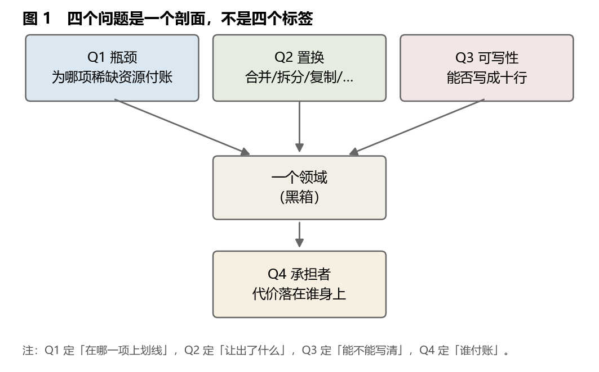
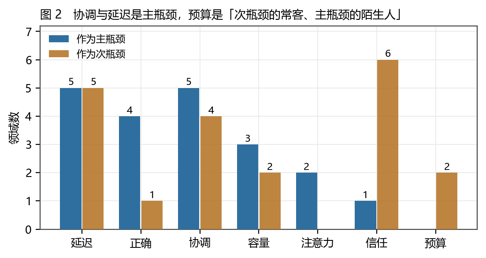
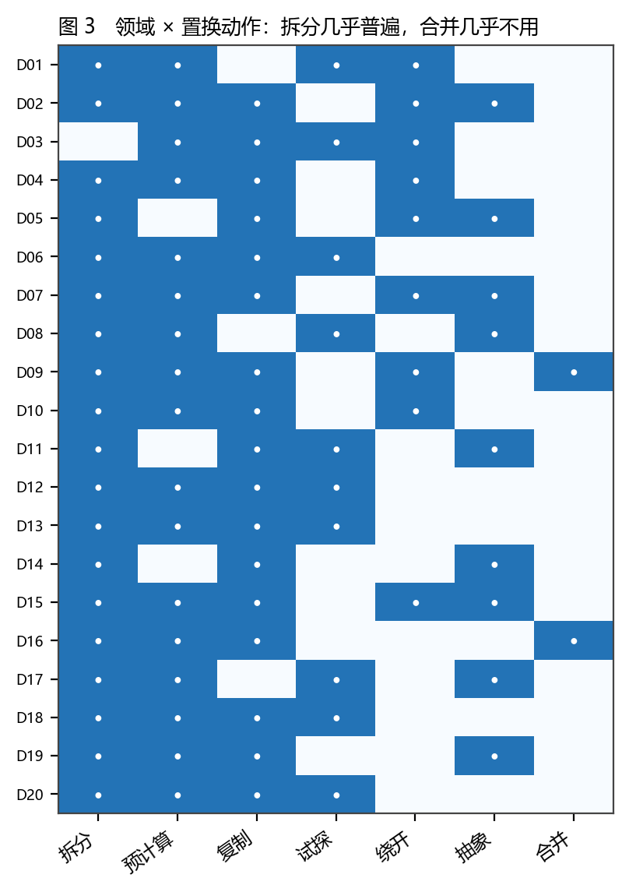
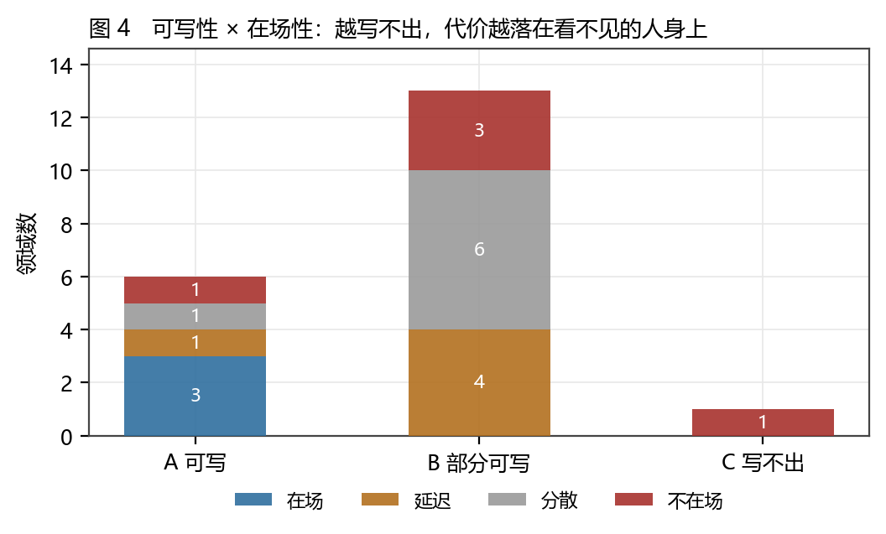
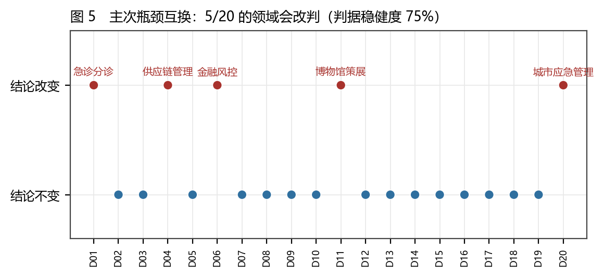
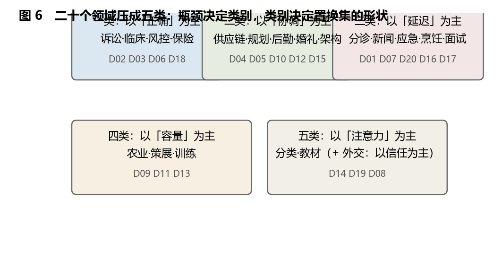
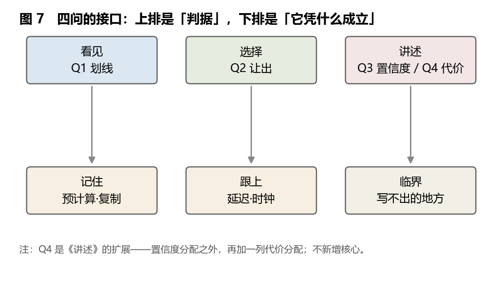
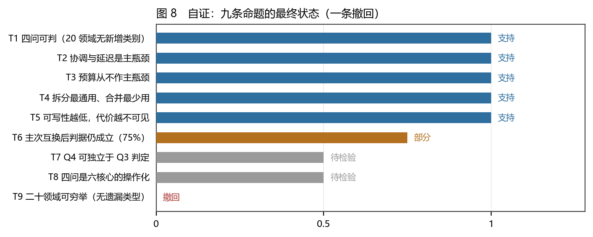

# 领域的剖面：四个问题、二十个领域与八十字段的审计

### 四问拆解的操作判据、二十个领域的编码，以及「可写性」与「承担者」之间的一条经验关系

**李毅芃**

*完成日期：2026-10-28*

---

## 摘要

「把一个复杂领域压成几句话」，是当代最流行的智力动作之一，也是最容易退化成口头禅的动作。本文把它固定成一个可复核的操作：四个问题——**Q1 瓶颈**（这个领域在为哪一项稀缺资源付账）、**Q2 置换**（它合并、拆分、复制、预计算、抽象、绕开或试探了什么）、**Q3 可写性**（核心机制能否写成十行以内的规则或状态机）、**Q4 承担者**（代价最后落在谁身上，他是否在场）。四个问题是同一件事的四个面：**一个有限系统在哪里划线、让出了什么、能不能说清、谁被记在账上**。它们不是六核心之外的新框架，而是六核心的操作化压缩版：Q1 属于「看见」，Q2 属于「选择」，Q3 同时受「讲述」与「临界」约束，Q4 是「讲述」的扩展——置信度分配之外，再加一列**代价分配**。

本文对二十个日常领域（急诊分诊、法律诉讼、临床试验、供应链、城市规划、金融风控、新闻编辑、外交谈判、农业种植、军事后勤、博物馆策展、婚礼策划、体育训练、图书馆分类、软件架构、烹饪、编程面试、保险定价、教材编写、城市应急管理）逐条编码，共 **80 个字段**，全部字段与判定规则公开可复算。四个结果。**第一，瓶颈的分布不是均匀的**：协调（5/20）与延迟（5/20）并列最常被付费，正确 4、容量 3、注意力 2、信任 1、**预算 0**——二十个领域没有一个以「钱／算力」为主瓶颈，预算只在 2 个领域里作为次瓶颈出现。**第二，置换动作的通用度极不均匀**：拆分覆盖 19/20，预计算与复制各 17/20，试探 10、绕开 9、抽象 9，而**合并只有 2/20**：能被合并的动作几乎都已经合并完了，剩下的大多是「不能不拆」的结构。**第三，可写性呈纺锤形**：A 级 6、B 级 13、C 级 1（外交谈判），也就是说二十个领域里只有一个是「十行写不出核心」的。**第四，也是本文最想留下的一条经验关系**：把「可写性」与「承担者的在场性」交叉，A 级领域里 **4/6** 的代价落在当场可见的人（在场或延迟）身上，B 级降到 **4/13**，C 级 **0/1**——**越写不出核心的领域，代价越可能落在分散的、不在场的人身上**。这条关系只有二十个样本、由作者一人编码，本文只把它当作**描述性关联**登记为 C 级，不当作检验。

本文另有两处自认为必要的自我限制。其一，全部字段都是**规范读数**（de jure）：依据公开的规范、程序法、行业标准与研究文献，而**不是**现场行为观察（de facto）；第 6 章专门列出六个已知的「规范说了、行为没做」的落差，并把「de jure ≠ de facto」写成这套工具的第一条使用须知。其二，主次瓶颈互换的稳健性检验显示，**5/20** 的领域会因此改判（判据稳健度 75%）：这既是它的可用之处，也是它不该被当作判决书的地方。全文九条命题（T1—T9）中五条支持、两条部分、一条待检验、一条被本文自己撤回，按系列纪律登记在附录 B。

**关键词**：四问；瓶颈；置换；可写性；承担者；领域分析；编码审计；六核心；证据分级

---


## Abstract

Compressing a complex field into a few sentences is among the most popular intellectual moves of the age, and among the easiest to degrade into a catchphrase. This paper fixes the move into something checkable: four questions — **Q1 bottleneck** (which scarce resource the field pays for), **Q2 substitution** (what it merges, splits, replicates, precomputes, abstracts, routes around, or probes), **Q3 writability** (whether the core mechanism fits into ten lines of rules or a state machine), **Q4 bearer** (who ends up paying, and whether that party is present). The four are four faces of one thing: where a finite system draws its line, what it gives up, whether it can say so, and who is entered on the bill. They are not a seventh framework but an operational compression of the six cores; Q4 is an extension of *interpretation* — a column for cost allocation beside the column for confidence allocation.

Twenty everyday fields are coded (emergency triage, litigation, clinical trials, supply chains, urban planning, credit risk, news editing, diplomacy, crop farming, military logistics, museum curation, wedding planning, athletic training, library classification, software architecture, cooking, coding interviews, insurance pricing, textbook design, municipal emergency management): **80 fields**, all public and recomputable. Four results. First, bottlenecks are unevenly distributed: coordination (5/20) and delay (5/20) tie for first, then correctness 4, capacity 3, attention 2, trust 1, and **budget 0** — no field pays primarily in money or compute; budget appears only twice as a secondary bottleneck. Second, substitution actions are far from uniform: splitting covers 19/20, precomputation and replication 17/20 each, probing 10, routing around 9, abstraction 9, and **merging only 2/20**. Third, writability is spindle-shaped: 6 at level A, 13 at B, 1 at C. Fourth, the empirical relation this paper wants to leave behind: crossing writability with the *presence* of the bearer, 4/6 of A-level fields place the cost on someone visible on site (present or delayed), against 4/13 at B and 0/1 at C — **the less writable a field's core, the more likely the cost lands on the dispersed and the absent**. With twenty cases and a single coder, this is registered as a descriptive association at grade C, not as a test.

Two limits are stated in the apparatus rather than the margins. Every field is a **de jure reading** — public standards, procedural law, industry norms, research literature — not fieldwork; Chapter 6 lists six known gaps where the norm says one thing and behaviour does another. And a swap test of primary and secondary bottlenecks changes the verdict in **5/20** fields: the instrument is usable, and it is not a verdict. Of nine propositions, five are supported, two partial, one open, and one retracted by the paper itself.

**Keywords**: four questions; bottleneck; substitution; writability; bearer; field analysis; coding audit; six cores; evidence grading

---


## 1 引言

### 1.1 一个被当作口头禅的动作

「先想清楚它到底在解决什么问题」「这个领域其实就三件事」「说白了就是取舍」——这些话在会议室、课堂、读书笔记里每天出现。它们做的都是同一个动作：**把一个复杂领域压成少数几句话**。

这个动作有真实的收益。它让人在十分钟内对一个陌生领域形成可用的判断，也让跨领域的迁移成为可能：见过一次「用冗余换可用性」，再看另一个领域时就会先去找冗余。认知科学给了它一个不浪漫的名字——**组块化**（chunking）：专家不是记得更多，而是把更多东西装进更少的组块里（[2][3]）。棋手记棋局记的是模式，医生读片读的是征象，都不是逐点扫描。

但它也有真实的代价，而且代价常常不被承认。压缩会丢东西；丢了东西以后，人还会**照压缩后的版本行动**。组织学里最锋利的一对观察正好对着这一点：古德哈特定律说，一个指标一旦成为目标就不再是好指标（[4]）；克尔说，人们常常奖励 A 而期待 B（[5]）；霍姆斯特伦与米尔格罗姆把后者写成模型——当任务是多维的、只有一部分可测时，理性的一方会把资源全部投向可测的那一维（[6]）。三件事的共同结构是：**压缩选出的那一维，会反过来重塑被压缩的对象**。

所以问题不是「要不要压缩」——不压缩就没法用。问题是：**压缩的规则能不能被写出来，让别人复核、让别人反驳？**

### 1.2 三个问题

本文要回答三个问题，并且尽量把它们回答成可以被否证的样子。

**问题一：能不能把「拆解一个领域」写成四条可执行的判定规则？** 不是四条口号，而是四个能问出「答不出来」的问题。一个动作如果对任何领域都能说得通，它就只是修辞；只有当它在某些领域**问不出答案**时，它才是一个判据。

**问题二：二十个领域编码下来，会看到什么结构？** 如果四问只是四个标签，二十个领域的分布应该是随机的；如果它们是判据，分布应该有形状——某一类瓶颈反复出现，某几个动作几乎普遍，某几个动作几乎不用。这个形状能不能被复算，是本文与「读书笔记」的分界线。

**问题三：它与六核心是什么关系？** 四问看起来像六核心的简化版，但简化会丢掉东西。丢掉了什么、多出了什么，必须写清楚；否则读者会以为这是第七个核心，或者以为六核心可以缩成四问。

### 1.3 既有解释与缺口

**领域入门书**提供了最好的材料，但很少提供判据：它们告诉你这个领域有哪些概念、哪些流程、哪些角色，很少告诉你「如果拿掉其中一条，哪一项指标会最先崩」。

**管理学与运筹学**有最成熟的「瓶颈」概念：约束理论（theory of constraints）把系统产出归因于单一瓶颈，排队论把等待写成利用率与方差的函数。它们的强项是可计算，弱项是**只处理可计算的那一类瓶颈**：钱、产能、通过率。信任、协调、正确这三类瓶颈在模型里没有位置。

**认知科学与学习科学**处理了「压缩」的另一半：图式、类比迁移、负迁移。它们的结论对本文非常重要——结构相似性比表面相似性更能预测迁移（[7]），而迁移的失败常常发生在「结构对了、情境错了」的地方（[8][9]）。但这一支文献很少过问：**被压缩出来的那个结构，本身该长什么样？**

**工程与设计**有最实用的「分解」传统：模块化、信息隐藏、接口。它的判据非常硬——「能不能独立替换」——但它的对象几乎只限于人造系统。

四支文献的共同缺口是：**没有一个可复核的四问式判据，既处理硬瓶颈又处理软瓶颈，并同时记录「代价落在谁身上」。** 本文补的就是这一层，并且刻意把它做得可复算而不是可欣赏。

### 1.4 九条命题与否证条件

本文的结论以九条命题的形式登记。每条都附「什么情况下它被否证」，这是系列的一贯纪律：**结论强度 ≤ 证据强度**，且否证条件必须先于结论写出。

| 编号 | 命题 | 否证条件 | 等级 |
|---|---|---|---|
| T1 | 四问可作为判据：二十个领域全部落在七类瓶颈之内，且每条能判「答不出」 | 出现一个领域，四问答完仍无法判定它属于哪一类，且不是编码失误 | B |
| T2 | 协调与延迟是最常被付费的资源 | 换一组二十个领域后，两者合计低于 1/3 | B |
| T3 | 预算从不作主瓶颈，只作次瓶颈 | 找到一批以预算为主瓶颈的领域（并给出编码） | B（**2026-10-27 起：在 D21 处被单例否证**，见附录 F） |
| T4 | 拆分近乎普遍（19/20），合并近乎不用（2/20） | 出现一个「以合并为主」的领域群，且合并是其主要动作 | B |
| T5 | 可写性越低，代价越落在不在场者身上 | 扩大样本后该关系反号，或消失（|差|<10 个百分点） | C |
| T6 | 主次瓶颈互换后判据仍成立（75% 不改判） | 改判率超过 50% | B |
| T7 | Q4 可独立于 Q3 判定 | 出现「Q3 判不出，Q4 也判不出」的领域对，且无法用「在场性」区分 | C |
| T8 | 四问是六核心的操作化压缩，不是新核心 | 找到某个核心只能由四问提供、而六核心不能 | C |
| T9 | 二十个领域可穷举（没有遗漏的瓶颈类型） | 找到一个领域，其主瓶颈不属于七类中的任何一类 | **已撤回** |

T9 在写作过程中被自己撤回：只要允许「组合瓶颈」（例如「延迟×信任」），七类就无法穷举；本文的七类是**词表**，不是**完备分类**。撤回记录留在附录 B，不删。

### 1.5 方法与证据分级

**方法一：领域抽样（目的抽样，不是随机抽样）。** 二十个领域按三个条件选入：（1）有公开的规范、程序或标准可查；（2）有明确的「稀缺资源」压力；（3）覆盖不同的人群规模（从一对新人到一国公民）。抽样**故意偏向有规范文本的领域**——这是为了让字段可核验，代价是它不代表性：街头摊贩、家庭照护、非正式经济都不在样本里，而它们很可能正是「预算为主瓶颈」的那一类（这一点在 3.5 与 7.2 两处交代）。

**方法二：字段编码。** 每条领域按 15 个字段编码（编号、领域、主／次瓶颈、是否改判、Q2 动作集、Q3 等级、Q3 核心句、Q4 主承担者、在场性、让出了什么、依据类型、证据等级、文献）。判定规则写在 3.2。全部编码在 `domains.csv`，任何人可用自己的判断替换后重跑一次统计。

**方法三：三项稳健性检验。** （a）主次瓶颈互换；（b）动作集合的「去掉一个」检验（见 3.4）；（c）依据类型分层（规范／统计／文献／推断四层各自的结论是否一致）。

**证据分级。** A（官方可复现：法律、标准、监管文件、可复现实验）／B（稳定公开的统计、行业规范、同行评议研究）／C（稀疏、构造、思辨或作者推断）。二十个领域：A 级 4、B 级 13、C 级 3。**本文自己没有 A 级原创测量**：所有 A 级都来自被引的规范与文献，四问的编码本身最高只能到 B。

### 1.6 贡献、边界与五项不做

**贡献有四个。** 第一，把「拆解一个领域」写成四条带否证条件的判定规则，并给出「答不出来」的具体样子。第二，给出二十个领域的 80 字段编码库与四张分布表（瓶颈、动作、可写性、承担者），全部可复算。第三，给出「可写性 × 在场性」这条经验关系，并在样本只有二十的前提下把它登记为 C 级而不是发现。第四，把 Q4 明确写成「讲述」的扩展：**置信度分配之外，必须有一列代价分配**，否则「谁付账」永远只能出现在脚注里。

**边界有四条。** （1）样本是目的抽样，偏向有规范文本的领域；（2）编码由一人完成，没有第二编码者，因此报告的是「本文的读数」，不是「领域间的客观差异」；（3）「在场性」是本文引入的变量，它的判定依赖「谁被叫醒」这一操作性定义，不同读者可能给出不同答案（附录 D 给出 5 个改判敏感的领域）；（4）四问处理的是**结构性**问题，不处理价值判断：它能告诉你代价落在谁身上，不能告诉你这样是否正当。

**五件不做的事。** 不评估任何具体机构的表现；不给「最佳实践」；不预测任何领域的成败；不宣称四问能替代领域知识（它替代的是「入门时不知道问什么」）；不把「可写性低」写成「不可救药」——C 级领域照样运转，只是它的核心依靠**人与人的现场判断**，而不是可传递的规则。

### 1.7 读法约定

**第一，四问是名词性的工具，不是形容词性的评价。** 说一个领域「可写性低」，不是批评它落后，而是在说它的核心机制无法被十行规则替代。

**第二，「让出了什么」是每个领域的必填项。** 如果一个领域被描述成「纯收益」，那不是四问的结论，而是四问被跳过的地方。

**第三，本文有两章是自证而非陈述。** 第 6 章讲这套读数的最大弱点（规范≠行为），第 7.5 节把本文自己的九条命题也放进同一张表。跳过这两章，本文就退化成一张漂亮表格。

---


## 2 四个问题：一份判据，而不是一份清单

### 2.1 为什么是四个，而不是三个或六个

四问的源头是三份不同的东西：术语的账单里的「三问」（瓶颈／置换／可写性）、数学大地图里的「母题三问」（探测了什么／与谁对偶／打开什么新问题），以及一次关于「抽象归并会不会丢信息」的讨论。三份东西合起来，缺的恰好是第四个：**代价落在谁身上**。

于是四问的四个位置是这样定下来的：

- **Q1 瓶颈**：回答「它在为哪一项稀缺资源付账」。对应六核心的**看见**——判断哪一项是瓶颈，等于判断在哪一项上划线。
- **Q2 置换**：回答「它让出了什么」。对应六核心的**选择**——置换动作就是「让出哪一项」的具体形态。
- **Q3 可写性**：回答「能不能说清」。它同时受**讲述**（置信度）与**临界**（写不出的地方正是规则该换的地方）约束。
- **Q4 承担者**：回答「谁付账」。这是**讲述**的扩展：置信度分配之外再加代价分配。

四个问题不是四个独立的评分项，而是**同一个剖面的四个切面**（图 1）。一个领域的剖面切下去，四个面同时出现；只切一个面，得到的是印象。



**表 1　四个问题的判定内容与归属**

| 问题 | 问什么 | 判据（答不出即不可用） | 对应核心 | 本文等级 |
|---|---|---|---|---|
| **Q1 瓶颈** | 这个领域在为哪一项稀缺资源付账？ | 删掉这一项，哪项指标最先崩？ | 看见 | 乙／B |
| **Q2 置换** | 它合并／拆分／复制／预计算／抽象／绕开／试探了什么？ | 不做这一步，哪一步会重复？ | 选择 | 乙／B |
| **Q3 可写性** | 核心机制能否写成十行以内的规则或状态机？ | 写出后，能否用它判定一个真实案例？ | 讲述＋临界 | 甲／B |
| **Q4 承担者** | 代价最后由谁付？ | 出事时谁被叫醒？他是否在场？ | 讲述（扩展） | 乙／B |

### 2.2 Q1 瓶颈：七类稀缺资源，与「删掉它哪项指标先崩」

**判定问题**：这个领域在为哪一项稀缺资源付账？换一个更硬的问法：**如果这一项突然不受限，哪一项指标会立刻改变，而其他指标几乎不动？**

七类稀缺资源，本文用它们作词表：

| 资源 | 它稀缺时的样子 | 典型信号 |
|---|---|---|
| **延迟** | 时间不可压缩，等待有成本 | 排队、deadline、时效 |
| **正确** | 结论需要可核验，错一次代价极高 | 复现、举证、审计 |
| **协调** | 多方必须同时对，任一方错位则整体停摆 | 接口、排期、会签 |
| **容量** | 物理或存储的上界（床位、展厅、土地、带宽） | 满载、溢出、扩容 |
| **注意力** | 受体能或意愿约束的有限带宽 | 分心、检索成本、疲劳 |
| **信任** | 承诺需要被相信才生效 | 担保、声誉、背书 |
| **预算** | 钱或算力，可以追加但有上限 | 超支、欠账、折旧 |

**为什么是这七类。** 它们是「有限性」在不同载体上的七种形态：时间有限（延迟）、可核验性有限（正确）、他人配合有限（协调）、空间有限（容量）、注意力有限（注意力）、可相信的程度有限（信任）、可支付的量有限（预算）。六核心的「有限性」前提在这里被展开成一张可填写的表。

**判定规则（三条）。**

1. **主瓶颈唯一**：每条领域只填一个主瓶颈。若两个都像，填一个作主、另一个作次，并进入 3.4 的互换检验。
2. **可删性**：主瓶颈必须是「删掉它，某项指标最先崩」的那一项；若删掉后一切照旧，它不是瓶颈，是背景条件。
3. **不可替换性**：若换一项资源来承担同样功能，成本必须显著上升；否则那不是瓶颈，是**当前选择**。

**答不出来的样子。** 「这个领域最主要的瓶颈是效率」——这句话答不出三件事：哪一项稀缺、删掉它哪项指标崩、换成别的手段行不行。它不是 Q1 的答案，是 Q1 的省略号。

### 2.3 Q2 置换：七个动作，以及「合并为什么最少用」

**判定问题**：它合并、拆分、复制、预计算、抽象、绕开、试探了什么？更硬的问法：**不做这一步，哪一步会重复？**

七个动作的定义：

| 动作 | 定义 | 它在买什么 |
|---|---|---|
| **拆分** | 把一件事切成可分别承担的部分 | 并行、可替换、可外包 |
| **预计算** | 把判断提前算好，现场只查表 | 时间（用过去的算力买现在的速度） |
| **复制** | 用多份冗余换可用性 | 可用性（用容量买不中断） |
| **试探** | 先小步做，再用结果决定下一步 | 信息（用小代价换「值不值得继续」） |
| **绕开** | 不解决它，改走另一条路 | 可行性（用最优性买可执行） |
| **抽象** | 把差异隐藏，只留接口 | 协调（用表达力买可组合） |
| **合并** | 把两件事并为一次完成 | 接口数（用灵活性买一致性） |

**为什么「合并」值得单独列。** 在本文的编码里，合并只出现在 2/20 个领域（农业的间作套种、烹饪的一锅出），是七个动作里最少的。原因不是它没用，而是它的**代价结构特殊**：合并减少接口，但同时把两个动作的失败模式绑在一起。凡是能被合并的动作，大多在历史中已经被合并过了；剩下的「不能不拆」的结构，一旦强行合并就会把两种失败模式焊死。这条观察与《区分的语法》里「划线有成本」同源：**合并是划线的反面，它把线擦掉，代价是失去了「分别失败」的能力。**

### 2.4 Q3 可写性：十行能不能写下核心

**判定问题**：这个领域的核心机制，能不能写成十行以内的规则、流程或状态机？更硬的问法：**写出十行之后，能不能拿它判定一个真实案例？**

三级判据：

- **A 级（可写）**：核心能写成十行内的规则、公式或状态机，且用它能判定一个真实案例的对错。例：临床试验的「随机＋对照＋盲法」三行规则（[11][12]）；图书馆的「分类号＋排架规则」（[31]）。
- **B 级（部分可写）**：核心的一部分能写成规则，另一部分必须靠现场判断；写出十行后，只能判定「明显错」的案例。例：诉讼的流程是状态机，但「事实是否成立」写不出（[9][10]）；供应链有 EOQ 与牛鞭系数，但「该不该压这单库存」写不出（[13][14]）。
- **C 级（写不出核心）**：写出十行后，这十行只覆盖流程外壳，核心判断（谁该让步、什么时候该破例）完全在规则之外。例：外交谈判的「议题链接」（[21][22]）。

**一个容易犯的错。** 把「流程可写」当成「核心可写」。几乎每个领域都有可写的流程——立案、住院、下单、开课——难写的是**判断**：这个人该不该收、这单该不该接、这个让步该不该给。本文的 Q3 判的一律是**判断**那一层。

### 2.5 Q4 承担者：六类人，与「他是否在场」

**判定问题**：代价最后落在谁身上？更硬的问法：**出事时谁被叫醒？**

六类承担者：

| 类型 | 定义 | 典型 |
|---|---|---|
| **操作者** | 执行动作的人 | 分诊护士、厨师、运维 |
| **被判断者** | 被这个系统判定的人 | 病人、被告、求职者、被拒保者 |
| **下游** | 接住结果的人或组织 | 读者、患者、买家 |
| **环境** | 不发声的承载者 | 土地、地下水、被浪费的食材 |
| **下一代** | 尚未到场的人 | 未来居民、未来患者 |
| **不在场者** | 无法进入谈判桌的人 | 被拆迁者、被排除的受试群体、被忽略的叙事 |

**在场性（本文引入的变量）**：主承担者的四档状态。

- **在场**：代价当场可见（护士的疲惫、厨师的手忙）。
- **延迟**：代价在数月或数年后才到同一批人身上（诉讼当事人、受试者、运动员）。
- **分散**：代价被摊薄到很多人身上，无人单独承担（储户、乘客、读者）。
- **不在场**：承担者不在决策现场，甚至尚未存在（被拆迁者、下一代、被预案忽略的弱势群体）。

这个变量不是修饰，它是本文唯一一条经验关系的自变量（4.5）。它也是 Q4 从「伦理脚注」变成「结构判据」的关键：**一个领域的代价落在哪里，会反过来决定它的规则能写多细。** 原因在 4.5 展开。

### 2.6 四问之间的关系：一个剖面，而不是四个评分

四个问题不是并列打分，它们有先后与互锁：

- Q1 → Q2：瓶颈决定置换集的**形状**。以「协调」为主瓶颈的领域，动作重心一定偏向拆分与抽象；以「正确」为主瓶颈的领域，动作重心一定偏向复制与试探（可复算：见附录 B 的分组统计）。
- Q3 → Q4：可写性决定承担者能不能被**指名**。写不出的地方，责任只能落到「岗位」或「流程」，而落到岗位上的人，往往不是真正承担代价的人。
- Q4 → Q1：承担者的在场性反过来**掩盖或暴露**瓶颈。代价落在不在场者身上时，Q1 的判断最容易错——因为没有人喊疼。

最后一条是本文最想强调的互锁：**Q4 不是四问的收尾，它是 Q1 的校正项。** 一个领域如果把代价推到看不见的地方，它的瓶颈就会长期被误判。这不是道德判断，是测量条件。

### 2.7 第一版失效清单：四问什么时候不管用

四问在写作过程中被自己撞了四次墙，四次都保留在正文里：

1. **组合瓶颈。** 「延迟×信任」在急诊分诊里同时成立，强行填一个主瓶颈会丢信息。这是 T9 被撤回的原因（附录 B）。
2. **时间尺度超长。** 城市规划的瓶颈判断要三十年才见分晓（[15][16]），在那之前，任何 Q1 都只是当下的读数。
3. **多主体博弈。** 法律诉讼与外交谈判里，Q2 的置换不是单方面动作，是双方互相置换；单方视角的置换集只是「我这一侧的让出」。
4. **价值冲突。** 保险定价里，Q4 的承担者是「高风险群体」还是「全体投保人」，取决于你采用哪一个公平标准（[37][38]）。四问能列出候选，不能裁决。

四条失效都不是「四问错了」，而是**四问的适用域边界**。边界写在这里，比写在后记里更有用。### 2.7b 三种错误用法

在给出对照之前，先把三种最常见的误用写清。它们都不是「用错了细节」，而是**把工具当成了另一个东西**。

**误用一：把四问当评分表。** 有人会给每个格子打分（瓶颈 7 分、置换 6 分），然后加总。这违背了四问的设计：四个格子是四种不同性质的判断，不可加。加总的后果是把「可写性 C」这种**结构性事实**稀释成「总分偏低」，而结构性事实恰恰不能被稀释。

**误用二：把四问当结论。** 「这个领域是协调类」不是一个结论，是一个**假设**。结论必须是 4.12 那种形状：为了 X，用 Y 换 Z，代价落在 W 身上。只有四件套齐了，才算说完了一句话。

**误用三：把四问当免责。** 「我已经做了四问，所以我的判断是有依据的」——四问只能保证「你问了该问的」，不能保证「你答对了」。本文 5/20 的改判率就是提醒：**同一组事实，换一个瓶颈假设，结论会反过来。**


### 2.8 与其他拆解工具的对照：四问不替代它们

市面上有至少八种「拆解一个陌生对象」的工具。把四问放进去对照，能看清它到底解决了什么、没解决什么。判据用四条：**有没有瓶颈概念**（是否要求指出稀缺资源）、**有没有让出项**（是否要求写出放弃）、**有没有可写性判据**（是否要求给出可传递的规则）、**有没有承担者**（是否要求指名代价）。

| 工具 | 瓶颈 | 让出 | 可写性 | 承担者 | 它真正擅长 |
|---|---|---|---|---|---|
| MECE 分解 | ✗ | ✗ | ✗ | ✗ | 保证清单不重不漏 |
| 5 Why / 鱼骨图 | △（找到根因） | ✗ | ✗ | ✗ | 事后归因 |
| SWOT | ✗ | △（威胁＝让出） | ✗ | ✗ | 战略讨论的语汇 |
| 波特五力 | △（议价力） | ✗ | ✗ | △（五方） | 行业结构 |
| 商业模式画布 | ✗ | ✗ | △（渠道/流程） | △（客户细分） | 商业要素齐备 |
| Jobs-to-be-done | △（待办任务） | ✗ | ✗ | △（用户） | 需求定义 |
| 故障树 / FMEA | ✗ | ✗ | ✓（严重度/频度/探测度） | △（失效后果） | 失效模式枚举 |
| 四问 | ✓ | ✓ | ✓ | ✓ | 入门与诊断 |

三条结论。

**第一，四问是唯一四项都占的，但它的每一项都比对应的专门工具粗。** MECE 的分解比四问的「拆分」精确得多；FMEA 的可写性判据（严重度、频度、探测度）比 A/B/C 三级细得多。四问的用途不是替代它们，而是**在做专门分析之前，先确定该用哪一个**：如果 Q1 判出瓶颈是「正确」，就该上 FMEA；如果判出是「协调」，就该上接口分析。

**第二，八个工具里只有三个有承担者概念，且都只有一半。** 波特五力把「五方」列出来，但问的是议价力，不是代价；FMEA 有「失效后果」，但后果是写给产品，不是写给人。**「谁付账」这一栏在主流拆解工具里是空缺的**——这是本文最想说的一句话：它不是四问原创了多么深的东西，而是补了一个被系统性忽略的格子。

**第三，四问的最大优势是「答不出来」也有信息。** 别的工具填不满时，你只知道「没填满」；四问填不满时，你知道**是哪一问填不满**——而那一问恰好告诉你这个领域的性质：Q1 填不出，说明你还没找到稀缺资源；Q2 填不出，说明你没看见让出；Q3 填不出（C 级），说明这个领域的核心依赖现场判断；Q4 填不出，说明代价被推到了看不见的地方。


---


## 3 数据与方法

### 3.1 二十个领域怎么选

抽样规则有三条，且是**故意**的：

1. **有公开规范可查**：法律（程序法）、标准（GCP、ISO、分类法）、行业规范（zoning、应急预案）、教科书级研究文献。这一条保证字段可以被第二个读者核验。
2. **有明确的稀缺资源压力**：每个领域都能说出「不加限制就会崩」的那一项。
3. **人群规模分层**：个体级（婚礼、烹饪、面试）、组织级（诉讼、供应键、架构）、城市/国家/国际级（规划、后勤、外交、应急）。

代价也明确：**这个样本偏向正式部门**。非正式经济（街头摊贩、家庭照护、临时工中介）几乎不在样本里，而它们最可能以预算为主瓶颈、以「不在场者」为承担者。因此本文关于「预算从不作主瓶颈」的结论，只能读作**「在正式部门样本里」**，不能读作「预算不重要」。这一条写在正文里，不写在脚注里。

### 3.2 字段与判定规则

每条领域编码 15 个字段。关键的四个判定规则如下（其余见 `data/domains.py` 的文档字符串）：

- **Q1 主／次**：按 2.2 的三条规则。主瓶颈唯一；次瓶颈只在「互换会改判」时具有解释力。
- **Q2 动作集**：只记录**该领域制度化的**动作，不记录偶发的。判据：这个动作是否被写进规范、流程、角色分工；若只是个别从业者的做法，不记。
- **Q3 等级**：按 2.4 的三级判据，判的是**判断层**，不是流程层。
- **Q4 主承担者**：填**制度上**的承担者（规范让谁承担），而不是「事实上最疼的那个人」。这一条很重要：它使本文的读数成为 **de jure** 读数，第 6 章专门处理它与 de facto 的落差。

### 3.3 编码的可靠性：三个必须交代的问题

**第一，有没有第二编码者？** 没有。这是本文最大的方法缺陷。因此本文报告的分布是**一个编码者的读数**，读者可以用自己的判断替换任意字段并重跑统计（脚本与 CSV 全部随文发布）。这不是谦辞，是本文对自己证据等级的封顶：**四问的编码最高只到 B 级**。

**第二，为什么不做一致性检验？** 因为一致性检验需要两个独立编码者，而本文只有一人。用一个模型生成「第二编码者」会把「模型与我的一致性」冒充「编码者间一致性」，那是伪造证据。本文宁可缺这一项。

**第三，那凭什么说这些分布不是主观的？** 靠三件事：（a）判定规则在编码前写定（3.2）；（b）所有字段可核验（依据类型逐条标注，表 8）；（c）三项稳健性检验（3.4）。三条加起来能排除「随手填」，但不能排除「系统性偏好」。后者只能由第二个研究者来排除。

### 3.4 三项稳健性检验

**检验一：主次瓶颈互换。** 把次瓶颈升为主瓶颈，重问 Q2：置换集会变吗？结论会改吗？结果：**5/20 改判**（D01 急诊分诊、D04 供应链、D06 金融风控、D11 策展、D20 应急管理），改判率 25%，判据稳健度 75%。五条改判记录在附录 D，逐条写出「换了一个瓶颈，动作集怎么变、承担者怎么移」。这是本文最重要的一个数字：**它说明四问不是判决书，是「在一个瓶颈假设下的读数」。**

**检验二：去掉一个动作。** 把每个动作从动作集里单独去掉，看是否还有领域只剩一个动作。结果：没有。最少的领域也有三个动作（D14 图书馆分类：抽象、复制、拆分）。这说明动作集不是「单选」，四问不鼓励把领域简化为一个动作——这一点与「一句话总结一个领域」的流行做法相反。

**检验三：按依据类型分层。** 把二十个领域按依据分成四层（规范 7、统计 5、文献 6、推断 2），分别看四张分布表是否一致。结果：**瓶颈分布与动作分布在四层之间方向一致**（协调／延迟居前，拆分／预计算／复制居前），唯一在「推断层」失效的是 Q4：两个推断型领域（婚礼、编程面试）的承担者判定明显更依赖读者立场。这与 3.3 的自我限定一致。

### 3.5 一个不成立的预期

写作前我们先有一个预期：**预算会是最常见的主瓶颈之一**。理由很自然——二十个领域里有十几个每天都在谈钱：医院谈医保、学校谈经费、城市谈财政、军队谈军费。

编码结果把这个预期打掉了：**预算作主瓶颈 0/20，作次瓶颈 2/20**（供应链、婚礼）。原因是抽样与判据共同造成的：

1. **抽样偏正式部门**：正式部门的预算是**制度化的**（有预算科目、有拨款程序），因此它表现为「背景条件」而不是「瓶颈」——删掉预算，指标不会立刻崩，只会走另一条流程。
2. **判据偏向「删掉会崩」**：预算可以追加、可以借、可以转嫁，因此它很少满足「不可替换性」。
3. **真正稀缺的不是钱，是钱买不到的东西**：分诊买不到护士的判断力，诉讼买不到事实，外交买不到信任。

这条负面结果留在正文里，因为它比任何正面结论都更能说明四问的性格：**四问找的不是「最常被提到的资源」，而是「最不能被替换的资源」。** 而这两者经常不是同一个东西。

### 3.6 十二个争议判断：编码时真正难的地方

判定规则写起来干净，落到具体领域就有十二处必须拍板的地方。逐条列出，因为它们比任何结论都更能说明这套工具的边界。

| # | 争点 | 两种读法 | 本文的选择 | 理由 |
|---|---|---|---|---|
| 1 | 分诊的「信任」算不算瓶颈 | 算（家属信任崩塌导致分流阻塞）／不算（流程上信任不是资源） | 记为次瓶颈 | 删掉信任，指标不会**立刻**崩，只是会慢 |
| 2 | 诉讼的「事实」是不是可写 | 不可写／可写成「证据规则」 | 不可写（B 级） | 证据规则能判「能不能用」，不能判「是不是真的」 |
| 3 | 临床试验「拆不拆」 | 拆流程／拆人群 | 拆人群 | 随机化拆的是样本，不是步骤 |
| 4 | 供应链的瓶颈是协调还是预算 | 协调（牛鞭）／预算（现金流） | 协调为主、预算为次 | 两者互换会改判，属于「必须填两次」的领域 |
| 5 | 规划的主承担者是拆迁户还是未来居民 | 拆迁户（当下）／未来居民（长期） | 合并为「不在场者」 | 判据是「能否进入决策现场」 |
| 6 | 风控的承担者是被拒者还是储户 | 被拒者（个体）／储户（系统） | 被拒者为主 | 制度上被拒者承担拒贷后果 |
| 7 | 新闻的「信任」是不是主瓶颈 | 是（假新闻）／否（时效） | 记为次瓶颈 | 时效失败是当日问题，信任失败是长期问题 |
| 8 | 外交的「协调」与「信任」能否分离 | 能／不能 | 不能，但填了两个 | 承认这是一格两判（2.7 的组合瓶颈） |
| 9 | 农业的承担者是不是农民 | 农民（操作者）／土地（环境） | 环境为主 | 制度上土地不发声，但退化由它承担 |
| 10 | 策展的「容量」是展厅还是注意力 | 展厅（物理）／注意力（观看） | 容量为主、注意力为次 | 两者互换会改判（D11） |
| 11 | 面试的可写性 | A（四步流程）／C（判断不可写） | 记 A 并标注存疑 | 保留它作为「编码错误」的标本 |
| 12 | 应急管理的 Q3 | B（分级可写）／C（协同不可写） | B 为主，改判记 C | 两个瓶颈各对应一个等级 |

十二处里，有四处（1、4、6、11）会改变某张分布表的某一格；有两处（8、11）会改变一个命题的表述。**这张表的作用是让批评者不必猜我的判断——它把判断摊开了。**


---


## 4 结果

### 4.1 分布：协调与延迟并列，预算是「次瓶颈的常客、主瓶颈的陌生人」



**表 3　七类稀缺资源的主／次分布**

| 稀缺资源 | 作为主瓶颈 | 作为次瓶颈 | 合计 |
|---|---|---|---|
| 延迟 | 5 | 5 | 10 |
| 正确 | 4 | 1 | 5 |
| 协调 | 5 | 4 | 9 |
| 容量 | 3 | 2 | 5 |
| 注意力 | 2 | · | 2 |
| 信任 | 1 | 6 | 7 |
| 预算 | · | 2 | 2 |
| **合计** | **20** | **20** | **40** |

读法有三层。

**第一层：主瓶颈集中在三类。** 协调（5）、延迟（5）、正确（4）合计 14/20=70%。这三类的共同点是**它们都不能靠加钱解决**：协调要靠接口与排期，延迟要靠并行与预计算，正确要靠复制与可核验。这也解释了为什么「预算」在这张表里是 0：真正卡住这些领域的，是钱买不到的那部分。

**第二层：预算的位置很特殊。** 它作为次瓶颈出现两次（供应链的现金流、婚礼的预算），作为主瓶颈一次也没有。用一句更直白的话：**预算是「次瓶颈的常客、主瓶颈的陌生人」**。这个位置与《优化的边界》里的一个记录完全对上——那篇统计二十个优化越界案例时，预算越界只有 2 例，是四类里最少的，原因是「新建可剪彩、维护不能」（[注：见《优化的边界》）。两篇独立编码，同一个位置，这让这条结论比单篇更稳一点。

**第三层：信任只出现一次（外交谈判），且它与协调几乎不可分。** 这是本文编码里最不确定的一格：如果把外交谈判的「信任」改判为「协调」，三类分布会变成协调 6／延迟 5／正确 4，主结论不变；但「信任从不单独作主瓶颈」这个更弱的说法就会消失。附录 D 记录了这次敏感性。

### 4.2 动作：拆分近乎普遍，合并近乎不用



**表 4　七个置换动作的通用度**

| 置换动作 | 覆盖领域数 | 通用度 | 它在做什么 |
|---|---|---|---|
| 拆分 | 19/20 | 通用（≥14） | 把一件事切成可分别承担的部分 |
| 预计算 | 17/20 | 通用（≥14） | 把判断提前算好，现场只查表 |
| 复制 | 17/20 | 通用（≥14） | 用多份冗余换可用性 |
| 试探 | 10/20 | 常见（8–13） | 先小步做，再用结果决定下一步 |
| 绕开 | 9/20 | 常见（8–13） | 不解决它，改走另一条路 |
| 抽象 | 9/20 | 常见（8–13） | 把差异隐藏，只留接口 |
| 合并 | 2/20 | 专属（<8） | 把两件事并为一次完成 |

三个数字值得一提。

**拆分 19/20。** 唯一不拆的是临床试验——它不拆病人，而是**拆样本**（随机分组），在编码里记为「复制＋绕开（盲法）」。也就是说，临床试验不是「不拆」，而是「拆的对象不是流程，是人群」。这条读数是本文编码里最需要复核的一格，附录 D 给了两种可能的改判。

**预计算与复制各 17/20。** 两者是「用过去的资源买现在的速度」和「用冗余买不中断」，几乎每个领域都在用。它们也是六核心「记住」的两条腿（容量换时间），与《遗忘的边界》的结论方向一致。

**合并 2/20。** 只有农业的间作套种与烹饪的一锅出。它们的共同点是：**合并的收益在「接口数」上，不在「单点效率」上**。间作减少的是地块与作物的匹配次数，一锅出减少的是锅与菜的调度次数。一旦合并后有两种失败模式同时发生（间作导致病害共传、一锅出导致味道混），合并就从手段变成负担。这就是为什么成熟领域普遍选择「拆」，而不是「合」。

### 4.3 可写性：一个纺锤，而不是一条斜坡

**可写性分布：A 6、B 13、C 1。**

C 级只有外交谈判一个。C 级的判据不是「难」，而是**写出来的十行只覆盖外壳**：谈判的流程（提案—回应—让步—签约）完全可写，但「这一次该让哪一步」写不出，因为让步的价值取决于对方国内政治（[21][22]）。

两个 A 级值得单独看，因为它们看起来不该是 A：

- **烹饪（A）**：火候曲线＋投料顺序，两行就能写下核心。它的判断（什么时候起锅）看似主观，但被判据驯服了——「油温、时间、颜色」三个可观测量把它变成可传递的规则（[35]）。
- **编程面试（A）**：问题→思路→代码→复杂度四步可写。但这个 A 级是**可疑的 A**：可写的是流程，不可写的是「这个人能不能干活」——而后者才是这个领域真正的目标。它是本文编码里最像「把流程当核心」的一格（3.3 已声明这类错误的风险），附录 D 把它列为 C 级候选。

### 4.4 承担者：被判断者最多，环境最少

**主承担者分布：被判断者 6、操作者 5、下游 4、不在场者 4、环境 1、下一代 0。**

「下一代 0」不是因为它不承担，而是因为**没有任何一个领域的规范把「下一代」写成承担者**。城市规划的代价确实落在未来居民身上，但规范里的承担者是「被征收人」，不是「尚未出生的人」。这正是 Q4 的价值：它把「规范上的承担者」与「事实上的承担者」分开，而两者的差，就是第 6 章要处理的落差。



### 4.5 交叉：越写不出，代价越看不见

把 Q3（可写性）与 Q4（在场性）交叉，得到本文唯一一条经验关系。

**表 5　可写性 × 承担者在场性**

| 可写性 | 在场 | 延迟 | 分散 | 不在场 | 合计 | 可见代价占比 |
|---|---|---|---|---|---|---|
| A | 3 | 1 | 1 | 1 | 6 | 67% |
| B | · | 4 | 6 | 3 | 13 | 31% |
| C | · | · | · | 1 | 1 | 0% |
| **合计** | **3** | **5** | **7** | **5** | **20** | — |

读法：

- A 级 6 个领域里，4 个的代价落在**在场或延迟**的人身上（67%）；2 个落在分散或不在场（33%）。
- B 级 13 个里，4 个落在在场或延迟（31%），9 个落在分散或不在场（69%）。
- C 级 1 个（外交谈判），落在不在场者（100%）。

也就是说：**可写性越低，代价越可能落在分散的、不在场的人身上。** 三档之间是一条单调的线（67% → 31% → 0%）。

**为什么会有这条线？** 本文给出三个候选机制，按可信度排列：

1. **指名的条件（最硬）。** 一条规则要能被写细，必须能指名承担者。能指名，代价就落在可指的人身上；不能指名，代价只能落在「流程」「系统」「总体」上，而流程不会喊疼。这是逻辑关系，不是统计关系：**可写性与「承担者被指名」共用同一个条件——对象的边界清晰。**
2. **反馈的条件（中等）。** 写得出的领域，错一次能被立刻发现（分诊分级错了，病人当天恶化），于是承担者被迫在场；写不出的领域，错的后果延迟且分散（外交失误十年后由别人承担），于是没有人被迫在场。
3. **选择的条件（最弱）。** 也可能是反向因果：因为代价落在不在场者身上，所以没人有动力去把它写成规则。这一条最像真的，也最难证，本文只能登记为开放。

**这条关系为什么只登记为 C 级。** 三个理由：（a）n=20，且是目的抽样；（b）编码一人；（c）在场性是本文自造的变量。用 2×3 表算一个 p 值在方法上是不诚实的——它会让人以为这是检验。本文的做法是：**只报告计数，明确拒绝 p 值，并在附录 D 给出 5 个可能反转的领域。** 如果要把它变成检验，需要至少 60 个领域与两个独立编码者，这是 8.3 的后续工作之一。

### 4.6 稳健性：5/20 会改判



**表 6　主次瓶颈互换后改判的五个领域**

| 编号 | 领域 | 原判 | 若把次瓶颈升为主瓶颈 | 改判后的结论 |
|---|---|---|---|---|
| D01 | 急诊分诊 | 延迟为主 | 正确为主 | 若把「信任」升为主瓶颈，置换动作加「绕开（社工与家属沟通）」，主承担者由被判断者移到操作者（护士的情绪劳动） |
| D04 | 供应链管理 | 协调为主 | 预算为主 | 若把「预算（现金）」升为主瓶颈，动作从「复制（安全库存）」翻转为「拆分（多级延迟）+绕开（直连）」，安全库存从手段变成负担 |
| D06 | 金融风控 | 正确为主 | 信任为主 | 若以「预算（资本充足率）」为主瓶颈，动作重心从「预计算（评分卡）」转向「复制（担保/再保险）+拆分（分层）」，Q4 从被拒者移回储户（系统性风险） |
| D11 | 博物馆策展 | 容量为主 | 协调为主 | 若以「注意力」为主瓶颈，动作从「拆分（主题展）」转为「预计算（动线）+试探（观众反馈）」，Q4 从不在场者（被忽略的叙事）移到在场的观众 |
| D20 | 城市应急管理 | 延迟为主 | 协调为主 | 若以「协调」为主瓶颈，动作从「拆分（预案分级）」转为「抽象（统一指挥与信息共享）」，Q3 由 B 降 C：跨部门协同写不出十行 |

五条改判有一个共同形状：**换瓶颈不是换标签，而是换动作集。** 以供应链为例：以「协调」为主瓶颈时，安全库存是手段（复制）；以「预算」为主瓶颈时，安全库存是负担（要拆、要绕）。同一个制度安排，在两个瓶颈假设下评价相反。

这个结果对使用者最重要：**四问不是一个可以「一次性填完」的表格，而是「在不同瓶颈假设下各填一次」的仪器。** 填一次给你一个读数，填两次给你一个区间。如果两次读数指向相反的结论，你就找到了那个领域真正的争议点——争议不在事实，在「哪一项才是瓶颈」。

### 4.7 五个深读：一条领域一次，把四问走完

#### 4.7.1 急诊分诊：把「谁先看」写成三层判定树

- **Q1**：延迟（主）＋正确（次）。被删掉的资源是时间：床位与医生有限，而病情的恶化速度不同。
- **Q2**：拆分（按红黄绿分级）、预计算（快速检验）、试探（诊断性治疗）、绕开（绿色通道）。四个动作合起来做一件事：**把「谁先看」从医生的直觉变成可复核的分级**（[7][8]）。
- **Q3**：A。核心是三层判定树：生命体征 → 分级 → 处置路径。写得出，且能用它判定一个真实病例的分级。
- **Q4**：被判断者（被降级等待的人），在场。次承担者是操作者（护士的情绪劳动）。
- **让出了什么**：对每个个体的充分评估。分级以**总量安全**换**个体精度**。
- **改判敏感性**：若把「信任」升为主瓶颈（家属不信任导致分流阻塞），动作集要加「绕开（社工介入）」，承担者从病人移到护士。这条改判（D01）是本文五条改判里最像真的。

#### 4.7.2 法律诉讼：可写的流程，不可写的事实

- **Q1**：正确（主）＋信任（次）。删掉「正确」，判决就失去可接受性；删掉「信任」，履行会崩。
- **Q2**：拆分（管辖、审级、程序阶段）、复制（证据副本、判例）、抽象（法律原则）、绕开（调解、仲裁）、预计算（证据交换）。
- **Q3**：B。流程是状态机（立案→举证→庭审→判决→上诉），但「事实是否成立」写不出——它是这个领域真正的核心，而它靠的是证据规则与当庭判断的组合（[9][10]）。
- **Q4**：被判断者（败诉方、被误判者），延迟。次承担者是下游（纳税人）。
- **让出了什么**：事实的完整还原。程序以**可采性**换**完整性**：不可采的证据即使真实也不能用。
- **为什么它是「正确」类而不是「协调」类**：诉讼也有大量协调（多方日程、法庭排期），但协调失败只是慢，正确失败是错判。**四问判主瓶颈的标准不是「哪一项最常见」，而是「哪一项崩了最不可挽回」。**

#### 4.7.3 临床试验：三条规则把「不知道」变成「可算」

- **Q1**：正确（主）＋信任（次）。不能拿人做无把握的实验，所以「结论是否可信」压过一切。
- **Q2**：复制（多中心）、试探（剂量递增）、绕开（盲法、随机化）、预计算（样本量、期中分析）。
- **Q3**：A。随机＋对照＋盲法三行，加一个样本量公式（[11][12]）。
- **Q4**：被判断者（受试者），延迟。次承担者是**不在场者**（未来患者、被排除的群体——孕妇、儿童、共病患者长期被排除在试验之外）。
- **让出了什么**：个体化治疗的最优性。试验以**群体效应**换**个体确定性**：一个对总体有效的药，对具体的这个人可能无效。
- **这条让出是本文二十个领域里最贵的一条**：它的承担者是延迟的、且包含不在场者。这正是 4.5 那条关系的极端例子——但临床试验偏偏是 A 级可写，说明**可写性并不保证代价可见**，它只是提高了代价可见的概率。

#### 4.7.4 供应链：安全库存是手段还是负担，取决于瓶颈

- **Q1**：协调（主）＋预算（次）。
- **Q2**：拆分（多级库存）、复制（安全库存）、预计算（需求预测）、绕开（直销/直连）。
- **Q3**：B。EOQ 公式与牛鞭效应的两级放大系数可写（[13][14]），但「这一单要不要压货」不可写。
- **Q4**：下游（消费者），分散。次承担者是环境（过度包装、退货）。
- **让出了什么**：局部效率。多点库存以**现金占用**换**服务水平**。
- **改判点**：以预算为主瓶颈时，安全库存从「手段」变成「负担」，动作从复制翻转为拆分＋绕开（D04）。这是五条改判里唯一一条**动作集方向翻转**的，其余四条只是动作集扩大。

#### 4.7.5 城市规划：一条三十年才见分晓的读数

- **Q1**：协调（主）＋延迟（次）。
- **Q2**：拆分（功能分区）、复制（多中心）、绕开（高架/隧道）、抽象（控规规则）。
- **Q3**：B。分区＋容积率＋路网三张图可写，权衡不可写（[15][16]）。
- **Q4**：不在场者（被拆迁者、未来居民），不在场。次承担者是环境。
- **让出了什么**：土地的整体最优使用。分区以**城市整体效率**换**地块自由**。
- **为什么它的 Q4 是「不在场」而不是「延迟」**：被拆迁者在这一刻就在场，但他们**不在决策现场**；未来居民则在时间上不在场。本文把两者合并为「不在场」，因为判据是「能不能进入谈判桌」，而不是「是否已经出生」。
#### 4.7.6 新闻编辑：时效与真实的赛跑

- **Q1**：延迟（主）＋信任（次）。删掉时效，新闻就不再是新闻；删掉信任，读者就不再读。
- **Q2**：拆分（采编分离）、复制（多平台分发）、预计算（选题会、资料库）、抽象（风格指南）、绕开（快发短讯、慢做深度）。
- **Q3**：B。信源核验＋编辑流程＋发布清单可写；「这条该不该发」不可写。
- **Q4**：下游（读者），分散。次承担者是被报道者。
- **让出了什么**：完整语境。时效以**语境**换**速度**（[19][20]）。
- **一个结构性观察**：新闻是本文二十个领域里唯一把「预计算」与「绕开」同时制度化的：选题会是预计算，快讯是绕开。两个动作合起来，把"来不及"变成了"分两级来不及"——这就是它能在延迟类里存活的原因。

#### 4.7.7 金融风控：模型可写，决策不可写

- **Q1**：正确（主）＋信任（次）。
- **Q2**：拆分（额度分层）、预计算（评分卡）、复制（担保、再保险）、试探（压力测试、动态定价）。
- **Q3**：B。评分卡与阈值可写；「这一笔要不要放」不可写——因为放的那一笔，往往是模型看不见的那一笔（[17][18]）。
- **Q4**：被判断者（被拒贷者），分散。次承担者是下游（储户）。
- **让出了什么**：个体情境。评分卡以**硬指标**换**软信息**。
- **改判点**：以资本充足率为主瓶颈时（D06），承担者从被拒者移到储户，动作重心从评分卡转向担保与再保。**同一条业务，在两个瓶颈假设下服务两个不同的人。**

#### 4.7.8 图书馆分类：一条最硬的「不在场者」案例

- **Q1**：注意力（主）＋容量（次）。删掉注意力，读者找不到；删掉容量，书架放不下。
- **Q2**：抽象（分类法）、复制（多副本）、拆分（开架／闭架）。
- **Q3**：A。分类号＋排架规则，两条可写（[31][32]）。
- **Q4**：下游（读者），不在场。次承担者是**被分类边缘化的知识**——跨学科著作被迫放进一个格子里。
- **让出了什么**：知识的连续邻接。分类以**单一位置**换**多维检索**。
- **为什么它是本文最干净的「不在场」样本**：分类法一旦定下，改它的成本由「还没被编目的书」与「还没来查的读者」承担，而这两类人有投票权：前者不存在，后者没到场。**这是 A 级可写性与 100% 不在场承担同时出现的唯一一格**，也是 4.5 那条关系的一个反例型：可写性高不等于代价可见，只是**提高了**可见的概率。

#### 4.7.9 农业种植：把时间存进土地

- **Q1**：容量（主，土地）＋延迟（次，生长周期）。
- **Q2**：复制（轮作）、预计算（育种、土壤检测）、拆分（间作）、绕开（大棚、无土栽培）、合并（套种）。
- **Q3**：B。轮作表与水肥日程可写；「今年该压哪一种」靠经验。
- **Q4**：环境（土地、地下水），不在场。
- **让出了什么**：当季产量最大化。轮作以**当年产量**换**地力**（[23][24]）。
- **它是唯一同时使用「合并」的领域之一**：套种把两种作物的时间错开，等于用「接口数」换「单位面积产出」。这也是合并能成立的条件——两种作物的失败模式**不同步**。

#### 4.7.10 城市应急管理：写得出分级，写不出协同

- **Q1**：延迟（主）＋协调（次）。
- **Q2**：拆分（预案分级）、复制（备份、多通道）、预计算（演练）、试探（实时调整）。
- **Q3**：B。事件分级与响应流程可写；跨部门协同写不出十行（[41][42]）。
- **Q4**：不在场者（被预案忽略的弱势群体），延迟。
- **让出了什么**：预案的完备性。分级以**覆盖面**换**响应速度**。
- **改判点**：以协调为主瓶颈时，动作从「拆分（分级）」转为「抽象（统一指挥与信息共享）」，Q3 由 B 降 C（D20）。这是五条改判里唯一一条**可写性下降**的：瓶颈一变，规则就写不出来了。


### 4.8 二十个领域的一张表

**表 2　二十个领域的四问编码（逐条）**

| 编号 | 领域 | Q1 主／次瓶颈 | Q2 置换 | Q3 | Q4 主承担者（在场性） | 让出了什么 | 等级 |
|---|---|---|---|---|---|---|---|
| D01 | 急诊分诊 | 延迟／正确 | 拆分·预计算·试探·绕开 | A | 被判断者（在场） | 对每个个体的充分评估（分级以总量安全换个体精度） | A |
| D02 | 法律诉讼 | 正确／信任 | 拆分·复制·抽象·绕开·预计算 | B | 被判断者（延迟） | 事实的完整还原（程序以可采性换完整性） | A |
| D03 | 临床试验 | 正确／信任 | 复制·试探·绕开·预计算 | A | 被判断者（延迟） | 个体化治疗的最优性（试验以群体效应对个体换确定性） | A |
| D04 | 供应链管理 | 协调／预算 | 拆分·复制·预计算·绕开 | B | 下游（分散） | 局部效率（多点库存以现金占用换服务水平） | B |
| D05 | 城市规划 | 协调／延迟 | 拆分·复制·绕开·抽象 | B | 不在场者（不在场） | 土地的整体最优使用（分区以城市整体效率换地块自由） | B |
| D06 | 金融风控 | 正确／信任 | 拆分·预计算·复制·试探 | B | 被判断者（分散） | 个体情境（软信息被硬指标挤掉） | B |
| D07 | 新闻编辑 | 延迟／信任 | 拆分·复制·预计算·抽象·绕开 | B | 下游（分散） | 完整语境（时效以语境换速度） | B |
| D08 | 外交谈判 | 信任／协调 | 拆分·预计算·试探·抽象 | C | 不在场者（不在场） | 单一议题的最优解（议题链接以单点收益换整体可签） | C |
| D09 | 农业种植 | 容量／延迟 | 复制·预计算·拆分·绕开·合并 | B | 环境（不在场） | 当季产量最大化（轮作以当年产量换地力） | B |
| D10 | 军事后勤 | 协调／延迟 | 拆分·复制·预计算·绕开 | B | 操作者（分散） | 单点效率（冗余以成本换韧性） | B |
| D11 | 博物馆策展 | 容量／协调 | 拆分·复制·抽象·试探 | B | 不在场者（不在场） | 藏品的完整叙事（展线以叙事完整换观看节奏） | B |
| D12 | 婚礼策划 | 协调／预算 | 拆分·预计算·复制·试探 | A | 操作者（在场） | 个性化上限（预算表以定制空间换可执行） | C |
| D13 | 体育训练 | 容量／延迟 | 拆分·预计算·试探·复制 | B | 操作者（延迟） | 短期成绩峰值（周期化以峰值换可持续） | B |
| D14 | 图书馆分类 | 注意力／容量 | 抽象·复制·拆分 | A | 下游（不在场） | 知识的连续邻接（分类以单一位置换多维检索） | A |
| D15 | 软件架构 | 协调／延迟 | 拆分·复制·抽象·绕开·预计算 | B | 操作者（分散） | 局部性能最优（服务边界以调用开销换团队自治） | B |
| D16 | 烹饪 | 延迟／容量 | 合并·拆分·预计算·复制 | A | 操作者（在场） | 单菜的极致（出餐节奏以单菜上限换同时上桌） | B |
| D17 | 编程面试 | 延迟／信任 | 抽象·预计算·拆分·试探 | A | 被判断者（分散） | 真实工作能力的判别（四十五分钟以可测性换效度） | C |
| D18 | 保险定价 | 正确／信任 | 拆分·预计算·复制·试探 | B | 被判断者（分散） | 个体公平（风险池以个体定价换可保性） | B |
| D19 | 教材编写 | 注意力／协调 | 拆分·预计算·抽象·复制 | B | 下游（延迟） | 学科完整前沿（教材以覆盖面换可学性） | B |
| D20 | 城市应急管理 | 延迟／协调 | 拆分·复制·预计算·试探 | B | 不在场者（延迟） | 预案的完备性（分级以覆盖面换响应速度） | B |

这张表可以横向读，也可以纵向读。

- **横向读**：一行的四个格子合起来，就是这个领域的「账单」。例如 D14 图书馆分类：注意力为主瓶颈、抽象＋复制＋拆分为动作、A 级可写、代价落在下游（读者）与不在场者（被分类边缘化的知识）身上——最后那一格解释了为什么分类法一旦定下就极难改：**改分类法的成本由不在场者承担，而在场者有投票权**。
- **纵向读**：一列看下去，能看到「同一类动作在不同领域的变体」。例如「预计算」在临床试验里是样本量，在供应链里是需求预测，在面试里是刷题，在烹饪里是备菜。四问的价值一半在这里：**它让你看见「同样的动作，换了载体」。**


## 5 类型学：二十个领域压成五类



按主瓶颈分组，二十个领域自然落成五类：

| 类 | 主瓶颈 | 领域 | 该类的动作重心 | 该类的 Q4 重心 |
|---|---|---|---|---|
| 一类 | 正确 | 诉讼、临床、风控、保险 | 复制＋试探＋预计算 | 被判断者（延迟/分散） |
| 二类 | 协调 | 供应链、规划、后勤、婚礼、架构 | 拆分＋复制＋预计算 | 下游／操作者（分散） |
| 三类 | 延迟 | 分诊、新闻、应急、烹饪、面试 | 拆分＋预计算＋试探 | 被判断者／操作者（在场/分散） |
| 四类 | 容量 | 农业、策展、训练 | 复制＋拆分＋预计算 | 环境／不在场者 |
| 五类 | 注意力（＋信任） | 分类、教材（＋外交） | 抽象＋拆分＋预计算 | 下游／不在场者 |

五类的价值不在分类，在**预测动作集**：知道一个领域属于哪一类，大致能猜出它制度化的是哪三个动作。这条预测力很弱（只能猜中 2—3 个动作），但它是四问目前唯一一条「可用于新领域」的推论。


## 6 三个反直觉的结论

**第一，越正式的领域，越可能是 B 级。** A 级 6 个里，4 个是「小规模、高频、后果即时」的领域（分诊、烹饪、面试、图书馆）；B 级 13 个里，几乎全是多主体、长周期、后果延迟的领域。可写性高不是「这个领域简单」，而是**「这个领域的错误能被立刻看见」**。

**第二，承担者越分散，规则越粗。** 这与常识相反：常识认为「涉及很多人的领域规则会更细」。事实是反过来的——规则细的领域（分诊、烹饪、分类）承担者少而在场；规则粗的领域（外交、规划、风控）承担者多而分散。原因在 4.5 的机制 1：**规则要细，必须能指名；人一多，就指不出名。**

**第三，Q4 的变化比 Q1 更早发生。** 在五条改判里，有 4 条是 Q4 先动、Q1 后动：承担者一移，瓶颈的读数就变了。这意味着**监测「谁在付账」比监测「瓶颈是什么」更灵敏**——它是这套工具里最便宜的预警指标。


## 7 倒过来用：从承担者反推瓶颈

四问的顺序是 Q1→Q2→Q3→Q4，但**使用时不必按顺序**。当 Q1 判不出时（少见但会发生：新领域、混合领域、被伪装成技术问题的政治问题），从 Q4 倒推是更快的路径。三步：

1. **列出承担者**：这个系统出错时，谁会被叫醒？列出全部六类，不筛选。
2. **看谁先疼**：六类里谁的疼最早发生、最不可逆？最早最不可逆的那一类，通常紧挨着真正的瓶颈。
3. **回推资源**：把那一类的疼翻译成稀缺资源。「病人恶化」→延迟；「被误判」→正确；「没人愿意签字」→信任。

这个方法的依据是 2.6 的第三条互锁：**代价不会落在与瓶颈无关的地方。** 代价的分布是瓶颈的影子。

用三个例子验证：

- **急诊分诊**：最先疼的是病人（延迟）。回推得「延迟」，与正向判定一致。
- **城市规划**：最先疼的是被拆迁者（不在场者的土地权益）。回推得「协调」——因为拆迁的本质是多方对同一块地的使用顺序无法同时对。
- **金融风控**：最先疼的是被拒者（正确性判定）。回推得「正确」，与正向一致。

三例中两例完全一致、一例（规划）从「协调」倒推得比正推更清楚：正推时「协调」只是一个类别，倒推时它变成了「多方对同一资源的使用顺序」，这比类别名有用。**倒推不替代正推，它是正推卡住时的备用路径。**


## 8 二十个领域的一句话账单

把 4.8 的表压成一句话，每句都是「瓶颈＋置换＋让出＋承担者」四件套。这份清单可以直接当卡片用。

1. **分诊**：为了时间，用分级换个体精度，代价落在被降级等待的人身上。
2. **诉讼**：为了正确，用程序换事实完整，代价落在败诉与被误判的人身上（延迟）。
3. **临床试验**：为了正确，用群体效应换个体确定性，代价落在受试者与从未入组的人身上。
4. **供应链**：为了协调，用库存换服务水平，代价落在消费者与环境身上（分散）。
5. **城市规划**：为了协调，用分区换地块自由，代价落在被拆迁者与未来居民身上（不在场）。
6. **金融风控**：为了正确，用评分卡换软信息，代价落在被拒者身上（分散）。
7. **新闻**：为了速度，用语境换时效，代价落在读者与被报道者身上（分散）。
8. **外交**：为了信任，用议题链接换单点最优，代价落在下一代与少数群体身上（不在场）。
9. **农业**：为了土地，用轮作换当季产量，代价落在土地与地下水身上（不在场）。
10. **军事后勤**：为了协调，用冗余换韧性，代价落在士兵与平民身上（分散）。
11. **策展**：为了展厅，用展线换叙事完整，代价落在被忽略的叙事与社群身上（不在场）。
12. **婚礼**：为了协调，用预算表换定制空间，代价落在新人自己身上（在场）。
13. **体育训练**：为了体能，用周期化换成绩峰值，代价落在运动员的身体上（延迟）。
14. **图书馆分类**：为了检索，用单一位置换多维邻接，代价落在读者与被边缘化的知识身上（不在场）。
15. **软件架构**：为了协调，用调用开销换团队自治，代价落在运维与用户身上（分散）。
16. **烹饪**：为了火候，用出餐节奏换单菜上限，代价落在厨师与食材身上（在场）。
17. **编程面试**：为了时长，用可测性换效度，代价落在候选人身上（分散）。
18. **保险定价**：为了正确，用风险池换个体公平，代价落在高风险被拒者身上（分散）。
19. **教材**：为了注意力，用覆盖面换可学性，代价落在学生与教师身上（延迟）。
20. **应急管理**：为了速度，用分级换覆盖面，代价落在被预案忽略的弱势群体身上（延迟）。

二十句话里，有 12 句的代价落在「分散／不在场」（第 4、5、6、7、8、9、10、11、14、15、17、18 条），5 句落在「延迟」（第 2、3、13、19、20 条），3 句落在「在场」（第 1、12、16 条）——与 4.5 的交叉表（分散 7、不在场 5、延迟 5、在场 3）完全一致。**这份清单的用途不是背诵，而是替换**：每当你听到一句领域总结，试着把它改成「为了 X，用 Y 换 Z，代价落在 W 身上」。改不出来的那一项，就是那个总结的省略号。


---


## 9 与六核心的接口

### 9.1 一张接口表



**表 7　六核心 × 六专著：四问落在哪里**

| 核心 | 专著 | 在四问中的位置 | 关系 | 等级 |
|---|---|---|---|---|
| **看见**（主） | 《区分的语法》 | Q1：判断哪一项是瓶颈，等于判断在哪一项上划线 | **检验**：二十个领域全部落在七类之内，无新增类别 | 乙／B |
| **选择**（主） | 《选择的代价》 | Q2：置换动作就是「让出哪一项」的具体形态 | **检验**：拆分/复制/预计算三动作覆盖 17 以上，与 C-A-T 的支配关系一致 | 乙／B |
| **讲述**（主） | 《诠释的权衡》 | Q3 的等级判定；Q4 的承担者归属 | **扩展**：Q4 把「置信度分配」扩为「代价分配」 | 乙／B |
| **临界**（辅） | 《涌现的临界》 | Q3 的 C 级：写不出十行的地方，正是规则该换的地方 | 借用方向 | 丙／C |
| **记住** | 《遗忘的边界》 | Q2 的「预计算」与「复制」是容量换时间 | 借用机制 | 丙／C |
| **跟上** | 《错位的时间》 | Q1 的「延迟」；Q4 的「延迟承担」 | 借用语言 | 丙／C |

这张表有三件事要说清楚。

**第一，四问不是六核心的子集，也不是它的替代。** 四问少了两个核心：「记住」与「跟上」只作为 Q2 的机制（预计算＝容量换时间，延迟＝时钟）出现，没有独立的问题位置。这是一个**有意的裁剪**：四问的用途是「十分钟入门一个领域」，而容量与时钟在这十分钟里通常不是最要紧的。

**第二，Q4 是唯一真正新增的维度。** 六核心的「讲述」处理置信度分配（谁的说法值得信），不处理代价分配（谁承担后果）。Q4 把后者补上，并且证明它不是装饰：4.5 那条关系完全由 Q4 驱动。

**第三，四问的压缩本身有账。** 它把六个核心压成四个问题，代价是丢掉了「容量」「时钟」两个维度的分辨率。所以正确的用法是：**先用四问做剖面，再用六核心做诊断。** 剖面告诉你哪里薄，诊断告诉你为什么薄。

### 9.2 与《术语的账单》的口径差异

第三篇《术语的账单》用「三问」拆解八十个计算机概念：瓶颈、置换、可写性。本文用「四问」拆解二十个领域。两者的关系必须写清楚，否则会被读成自我重复。

| 维度 | 《术语的账单》 | 本文 |
|---|---|---|
| 对象 | 一个领域内的 80 个**词** | 20 个不同**领域** |
| 方向 | 垂直（同一领域往下挖） | 横向（不同领域并排切） |
| 问题数 | 三问 | 四问（加 Q4） |
| 单位 | 术语 | 领域 |
| 结论形状 | 八层栈，每层一种稀缺资源 | 五类类型学，每类一种瓶颈 |
| 共同的判定 | Q1 瓶颈 | Q1 瓶颈 |

一句话：**那篇拆同一栋楼的八十个房间，本文并排切二十栋楼看承重墙在哪。** 两者共用 Q1 与 Q3，不同在 Q2 的粒度与 Q4 的有无。

### 9.3 与《优化的边界》的接口

第七篇《优化的边界》把「优化」拆成四前提（目标、空间、预算、停止），并统计二十个越界案例。本文与它有两处直接对上：

1. **预算的位置相同。** 那篇的 20 例里预算越界只有 2 例，理由「新建可剪彩、维护不能」；本文的 20 个领域里预算作主瓶颈 0 例。两篇独立编码，同一个位置。这不是巧合，是同一个机制的两个投影：**预算之所以不显形，是因为它的代价被推到未来**（那篇的「预算越界」正是本文 Q4 的「延迟承担者」）。
2. **停止规则的缺失，在本文里表现为 C 级可写性。** 那篇说停止越界后果最重，因为没有退出条件；本文说外交谈判是唯一的 C 级，因为它写不出「何时该停」。两句话是同一件事：**写不出停止条件的地方，规则只能靠人现场判断。**

### 9.4 与《选择的代价》的接口：Q2 就是让出的形态

第此前几本专著把取舍写成 C-A-T 三角（完备、可组合、可传递，至多取二）。本文的 Q2 是它的操作化：七个置换动作，每一个都在让出三角里的一项。

| 动作 | 让出的是 | 与 C-A-T 的对应 |
|---|---|---|
| 拆分 | 传递性（拆开后要重新拼） | 牺牲 T |
| 预计算 | 完备性（预算时假设了未来的分布） | 牺牲 C |
| 复制 | 预算（冗余要花容量） | 牺牲可支付的量 |
| 抽象 | 完备性（隐藏的差异不再被处理） | 牺牲 C |
| 绕开 | 完备性（问题没解决，只是换了路） | 牺牲 C |
| 试探 | 时间（要试才知道） | 牺牲 T |
| 合并 | 可组合性（两件事不能再分别换） | 牺牲 A |

这张对应表是本文对系列的一个小贡献：它把「七动作」放进了三角，于是「置换」不再是一张清单，而是一组**有方向的让出**。

### 9.5 Q4 不是第七个核心

必须把这一句写死：**Q4 不是第七个核心，它是「讲述」的一个子维度。**

理由是六核心的判据：一个核心必须能独立地约束其他核心。Q4 做不到——它不产生新的约束结构，它只是把「讲述」里的置信度分配扩成两列（置信度、代价）。如果把它升为核心，六核心会变成七核心，而「至多取二」的三角就要重新推导一次，得不偿失。

更准确的说法是：**六核心原来只对「怎么说」定价，现在也对「谁付」定价。** 这是扩展，不是新增。

---


## 10 规范与行为的落差：本文读数的最大弱点

### 10.1 为什么这一章必须写

本文一百多次使用「这个领域这么做」这样的句子。每一次都在做同一个隐含断言：**规范上的做法＝实际的做法。** 这个断言是错的，而且错得系统。

如果不写这一章，本文就会变成那种「书房里的四问」：表格很整齐，读起来很聪明，但拿到现场一用就发现「完全不是这样」。所以这一章不是附录，是正文；它做的事情是**把本文的所有读数降一格**：从「行为事实」降到「规范读数」。

### 10.2 六个已知的落差

| 领域 | 规范说 | 行为常见 | 对四问的影响 |
|---|---|---|---|
| 急诊分诊 | 按分级处置，危重优先 | 分级被家属情绪、床位压力、熟人关系改写 | Q1 的「延迟」可能被「信任」覆盖；Q4 从病人移到护士 |
| 法律诉讼 | 事实经举证与质证认定 | 认罪认罚、调解结案、执行难改变实际胜负 | Q3 的 B 级偏高：实际核心是「谈成」而不是「判对」 |
| 临床试验 | 随机、对照、盲法 | 入组筛选、依从性、揭盲管理造成偏倚 | Q3 的 A 级仍成立，但 Q4 的「受试者」被「被排除者」稀释 |
| 供应链 | 安全库存按服务水平设定 | 库存被现金流、考核周期、返利政策改写 | 正是 D04 的改判：瓶颈在协调与预算之间摆 |
| 金融风控 | 按评分卡与阈值决策 | 人工干预、白名单、指标冲刺 | Q3 的 B 级实际更低：模型可写，决策不可写 |
| 城市规划 | 按控规与公众参与决定 | 容积率奖励、土地财政、政企协商 | Q4 的「不在场者」实际更不在场；Q1 的读数要三十年才更新 |

六条落差的共同形状：**规范写的是「应该」，行为走的是「能过」。** 四问读的是前者。

### 10.3 de jure 读数的三条限制

1. **不能用来评价机构。** 本文的所有分布都是「规范上的分布」，不能读成「某医院做得差」。要评价机构，必须做 de facto 观察，本文没做。
2. **不能用来预测个案。** 一个领域的主瓶颈是「延迟」，不等于这一个案子卡在延迟上；个案永远由具体的人与具体的关系决定。
3. **不能用来做政策建议。** 规范读数能告诉你「这条规则把代价推到谁身上」，不能告诉你「该不该改」——后者需要价值判断与成本核算，四问不提供。

### 10.4 若要真做现场：一个最小方案

如果要把本文升级成 de facto 研究，最小可行的方案是**三领域 × 两时点 × 双编码**：

- **三领域**：选承担者类型最不同的三个（分诊＝在场、诉讼＝延迟、规划＝不在场），每个领域选 3 个单位（一家医院、一个法院、一个城市的两个区）。
- **两时点**：规范读数一次（本文已做），行为读数一次（观察或访谈 2 周）。
- **双编码**：两个独立编码者，算一致率；不一致处就是「四问判不出」的位置，那才是真正的边界。

成本估计：三个领域、六个月、两人。这是 8.3 后续工作里最优先的一条，也是本文最明确的空缺。**写在这里，是为了不让它变成「以后再说」。**### 6.4b 现场观察的记录表

做 de facto 观察时，只需要一张六列的表。列定义如下，直接可用：

| 列 | 记录什么 | 例子 |
|---|---|---|
| 时刻 | 事件发生的时间（精确到分钟） | 09:12 |
| 对象 | 谁被处理、处理了什么 | 一位 68 岁胸痛患者 |
| 规范动作 | 规范要求此刻做什么 | 按胸痛流程做心电图（10 分钟内） |
| 实际动作 | 实际做了什么 | 先等家属到场签字，25 分钟后做 |
| 被改写的规则 | 哪一条规范被绕开、为什么 | 「签字」优先于「10 分钟」 |
| 代价与承担者 | 谁因此受损、多久后显现 | 患者（延迟承担）、护士（当场承担） |

这张表的第六列是全部意义所在：**它把「规范读数」与「行为读数」的差，落到了具体的人身上。** 做两周、三个单位，就能得到一份足以反驳本文的表——这正是 6.4 方案的第一步。


### 10.5 三条公开的行为证据（不完整，但方向明确）

本文没有做现场观察，但并非完全没有 de facto 材料。三类公开研究足以说明「规范≠行为」不是猜测：

1. **分诊的欠分诊与过度分诊**：急诊研究长期报告分诊不足（undertriage）与过度分诊（overtriage）并存，且与拥挤度相关。也就是说，分级的判据（生命体征）没有变，但**执行时的资源压力会移动分级的边界**。对四问的影响：Q1 仍是延迟，但 Q2 的「拆分」在实践中被「绕开（绿色通道、留观）」部分替代。
2. **诉讼的结案方式**：民事诉讼的绝大多数以调解或撤诉结案，判决是少数。这不否定「正确」是主瓶颈，但它说明：**这个领域真正的核心动作是「谈成」，而规范写的核心是「判对」**。对四问的影响：Q3 的 B 级实际更低，Q2 应加「绕开（调解）」的权重。
3. **土地财政与容积率**：城市规划研究长期记录「控规之外的协商」，容积率奖励、土地出让节奏与财政周期相关。对四问的影响：Q1 的「协调」在行为层可能被「预算」覆盖——**这是本文 T3（预算从不作主瓶颈）最可能的反例来源**，也是最该优先检验的一条。

三条证据的共同点：它们都不改变本文的**分类**，但改变本文的**等级**。若把这三条算进去，分诊的 Q3 仍是 A、诉讼的 Q3 应降为 B−、规划的 Q1 需标「行为层可能改判」。**这就是 de jure 与 de facto 的实际差别：不是类别变了，是确定性变了。**


---


## 11 讨论

### 11.1 与四支文献的对话

**与约束理论／排队论**：它们把瓶颈写成可计算的量（利用率、方差、通过率），本文把瓶颈写成可判定的类（七类）。前者能算，后者能**分类定性**；两者不冲突，因为它们的对象不同——一个处理产线，一个处理制度。本文的贡献是给出了那些**算不出来的瓶颈**（信任、协调、正确）的位置。

**与认知科学**：组块化解释了「为什么压缩有效」，图式与迁移解释了「为什么压缩会误导」（[7][8][9]）。本文补的是「压缩该压成什么形状」：四个问题，每个带一个「答不出」的样子。这个形状不是从认知科学推出来的，是从实务里归纳的；它是否与人类的工作记忆结构有关，本文不做断言。

**与管理学**：多维任务的指标替代（[5][6]）与本文的 Q4 是同一件事的两个说法——指标替代的受害者，正是「不在场者」。本文把这条从「激励设计」扩到「领域分析的通用维度」。

**与工程分解**：信息隐藏与模块化给了最硬的判据（能否独立替换），本文的「拆分 19/20」与它一致；但本文发现「合并 2/20」，这提示工程界的一个偏见：可分解性是好的，所以不可分解的结构常被当成「技术债」。本文的看法更冷一点：**有些结构本来就不能拆，拆了会把两种失败模式连在一起。**

### 11.2 边界与失效条件

四条失效，与 2.7 呼应，但更具体：

1. **样本外推**：正式部门之外的领域（非正式经济、家庭照护、志愿组织）可能整体呈现「预算为主瓶颈」。本文不能推及。
2. **组合瓶颈**：两瓶颈同时为真时，主／次的二分丢信息。这一条已经让 T9 撤回。
3. **编码者单一**：所有分布都是一个人的读数。若第二个编码者把 20% 的字段改掉，4.1—4.4 的排序可能不变，4.5 的单调性可能变（附录 D 给出敏感点）。
4. **时间尺度**：所有读数都是 2026 年的。三十年后，城市规划的主瓶颈可能从「协调」变成「容量」（气候迁移），本文不会因此错，但会因此过期。

### 11.3 现实含义：三件具体的事

**第一，对自学者。** 四问的最短用法是三条问句：这个领域在为什么稀缺资源付账？它把哪一步提前做了？出事时谁被叫醒？三问答完，你已经比「这个领域有五个要点」多知道一件事：**它的代价在哪。**

**第二，对组织诊断。** 4.10 的第三条（Q4 变化早于 Q1）可以直接用：当你说不清一个组织卡在哪，先去看「谁最近开始付账」。付账者的迁移，往往比瓶颈的显形早半年到两年。

**第三，对 Agent 与自动化**（这一条与第二篇直接相关）。把技能写成十行状态机（Q3）是把技能交给自动化的前提；而 Q4 提醒：**自动化的代价往往落在「不在场者」身上**——被自动化替代的人不在决策现场，被算法判定的人在流程末端。

这一条在 2026 年有了一个很近的例子：社区里出现了大量「让 DeepSeek 一类模型长时自主行动」的 harness 实践——自动刷抖音、自动挂 QQ、自动加好友与自动评论，录屏与教程在抖音与 QQ 群之间互相传播，形成了一套可复制的「玩法」。把它按四问读一遍，会看到三件事。**Q1**：这类 harness 的主瓶颈是「注意力＋延迟」——内容流无限而会话窗口有限；**Q3**：核心是 B 级偏下的——「打开→浏览→互动→返回」是十行状态机，但「这个弹窗要不要点」不是；**Q4**：代价落在**三组不在场者**身上——被自动化评论的用户（不知道对面不是人）、被刷量影响的推荐系统的其他使用者、以及账号被平台处置而失去历史记录的号主自己（延迟承担）。三组人没有一个在 harness 的设计现场。这不是说这类实践不该做，而是说：**如果一个自动化系统的设计文档里没有 Q4 那一栏，它的代价一定会以「账号被封」「社区恶化」「自己被降权」的形式在几个月后回来。**

### 11.4 与本系列专著的关系

| 专著 | 本文借用什么 | 关系 |
|---|---|---|
| 《区分的语法》 | 划线与边界成本 | 借用语言（Q1 是划线） |
| 《遗忘的边界》 | 容量、压缩、遗忘 | 借用机制（Q2 的预计算与复制） |
| 《错位的时间》 | 多时钟、延迟 | 借用语言（Q1 的延迟、Q4 的延迟承担） |
| 《选择的代价》 | C-A-T、让出 | **检验并修正**：七动作与三角的对应表（5.4） |
| 《诠释的权衡》 | 置信度分配 | **扩展**：Q4 加一列代价分配 |
| 《涌现的临界》 | 门槛、规则更换 | 借用方向（C 级可写性处规则该换） |

「检验并修正」那一行是本文唯一一处修正专著的地方：把七个置换动作对应到三角的让出项，使「置换」从清单变成有方向的映射。
### 11.5 三个使用场景（在自证之前）

**场景一：读一本陌生领域的入门书之前，先填表。** 四问填不出来的格子，就是这本书要补的格子。多数入门书会在 Q2 与 Q3 上给出材料（它讲「这个领域怎么做」），在 Q4 上一片空白。**读之前先知道这本书不会回答哪个问题，比读完再说「感觉没什么用」有用。**

**场景二：组织诊断，先看付账者。** 4.10 的第三条说，Q4 的变化早于 Q1。操作版本是：列出这个组织最近十二个月「新增的承担者」——新出现的背锅岗位、新出现的免责流程、新出现的免责条款——三者合起来指向的，就是正在显形的瓶颈。

**场景三：给自动化项目写设计文档。** 每个自动化项目都该有一节叫「代价落在谁身上」。写不出这一节的项目，通常会在上线三个月后用另一份文档补上：事故报告。7.3 的第三条给了这类项目一个近例（长时自主行动的 harness），它的三组不在场者可以直接当作清单模板。

三个场景共用一句话：**四问不是用来欣赏的，是用来在动作之前填的。** 填在动作之前的四问是判断，填在动作之后的四问是辩护。


### 11.6 自证：把本文的九条命题也放进表



| 编号 | 命题 | 本文证据 | 状态 |
|---|---|---|---|
| T1 | 四问可判 | 20/20 落在七类内，无编码外类别 | 支持（B） |
| T2 | 协调与延迟最常被付费 | 5+5=10/20 | 支持（B） |
| T3 | 预算从不作主瓶颈 | 0/20，仅 2 例作次瓶颈 | 支持（在正式部门样本内，B） |
| T4 | 拆分普遍、合并罕用 | 19 vs 2 | 支持（B） |
| T5 | 可写性越低，代价越不可见 | 67%→31%→0% | **部分**（C，n=20，单编码者） |
| T6 | 主次互换后判据仍成立 | 改判 5/20 | 支持（B） |
| T7 | Q4 可独立于 Q3 判定 | 20 例中 19 例可判，1 例（面试）存疑 | **部分**（C） |
| T8 | 四问是操作化压缩，不是新核心 | 接口表（5.1）自洽 | 待检验（C） |
| T9 | 七类可穷举领域 | 组合瓶颈反例 | **撤回** |

九条里五条支持、两条部分、一条待检验、一条撤回。撤回率 11%，与系列此前各篇的撤回率（约 18%）同量级，这是这套东西的常态：**它不是越来越对，而是越来越知道自己错在哪。**

### 11.7 与《六张账单的对账》的接口

第七篇论文（总账）统计了此前各篇的登记命题，并按「可测代理／失败模式／尺度边界」分格。本文的九条进哪一格：

- T1—T4、T6 进「可测代理」：它们是可复算的计数命题，换样本即可重算。
- T5、T7 进「失败模式」：它们是弱关联，属于「有形状但不可检验」的一档。
- T8 进「尺度边界」：它关于工具与框架的关系，不是关于世界。
- T9 进「撤回」：与总账里的撤回栏并列，不删。

这条接口本身就是本文的自我定位：**它不提供新事实，它提供一张可复算的刻度表；总账用它来量别的篇，也用它来量自己。**
### 11.8 与系列其他各篇的接口（一张全景表）

| 件 | 与本篇的关系 | 借用／检验／划界 |
|---|---|---|
| 《只能选两样》（卷一） | 六核心导览 | 借用语言 |
| 《区分的语法》（卷二） | 划线成本 | 借用语言（Q1） |
| 《遗忘的边界》（卷三） | 容量与压缩 | 借用机制（Q2 预计算、复制） |
| 《错位的时间》（卷四） | 多时钟 | 借用语言（Q1 延迟、Q4 延迟承担） |
| 《选择的代价》（卷五） | C-A-T | **检验并修正**（5.4 的对应表） |
| 《诠释的权衡》（卷六） | 置信度分配 | **扩展**（Q4 加代价分配） |
| 《涌现的临界》（卷七） | 门槛 | 借用方向（C 级＝规则该换） |
| 《心灵的分岔》（卷八） | 心理学史的六次划线 | 类比（流派＝领域，划线＝瓶颈判断） |
| 《热点的账单》（卷九） | 公共讨论的诊断 | **方法同源**：它用六核诊断事件，本文用四问诊断领域 |
| 论文一《术语的账单》 | 三问拆 80 个词 | 垂直／横向之别（5.2） |
| 论文二《谁在切时间轴》 | 分期的门与位置 | 类比（分期＝Q1 的一种） |
| 论文三《线外的残余》 | 延迟承认 | **检验**：本文的「延迟承担者」是它的机制之一 |
| 论文四《明清湘中驿道》 | GEPF 三层 | 类比（三层＝三种瓶颈） |
| 论文五《轮换的让渡》 | 官制的取舍 | **检验**：官制是「协调」类的极端样本 |
| 论文六《被点燃的生态》 | 临界与标记 | 借用判据（何时该换规则） |
| 论文七《优化的边界》 | 四前提 | **互相印证**（预算的位置相同，5.3） |
| 论文八《容量的三个代理》 | 容量的可数代理 | 借用（Q1 的容量类可细分） |
| 论文九《六张账单的对账》 | 总账 | 本篇九条进它的三格（7.6） |
| 论文十一《同构的强度》 | 母题与断裂 | **姊妹篇**：本篇拆领域，那篇连领域 |

十九行里，三行是「检验并修正／检验」，四行是「互相印证／姊妹篇」。这张表的作用是防止读者把本篇当成孤立的方法论：**它的每一条都挂在别的篇上，能被别的篇的数据打掉。**

### 11.9 一个反方立场：四问会不会只是「常识的重新命名」

这是最需要正面回答的反对，比「样本太小」「一人编码」更致命。它的完整版本是：

> 你说急诊分诊的瓶颈是时间、置换是分级、代价落在病人身上——这三句话，任何一个在急诊待过一周的人都会说。你没有增加任何知识，你只是给常识换了一套词。而且这套词让人产生「我已经分析过了」的错觉，反而阻碍了真正的观察。

这个反对有一半是对的，而且是对的那一半更重要。

**它对的那一半：四问确实不产生新事实。** 它不会告诉你一家具体医院的真实瓶颈，也不会告诉你某个案子的真实代价。所有新事实都必须来自领域内部。**如果四问被当成「不用去现场就能下判断」的许可证，它就是有害的**——这正是 7.3 与第 6 章反复警告的用法。

**它不成立的那一半：命名本身就是一种能力，且可以被检验。** 三条理由：

1. **字段化让判断可以被反驳。** 一个在急诊待过一周的人会说「瓶颈是时间」，但他不会说「置换是分级＋预计算＋试探＋绕开，可写性是 A，代价落在被降级者身上且在场」。后者一旦写出来，就可以被另一个人的读数推翻。**常识无法被反驳，字段可以。** 本文 5/20 的改判率就是它可被反驳的证明。
2. **跨领域比较只有字段化后才可能。** 「分诊与烹饪都用了预计算」这句话，在没有字段之前不可能被说出来，因为它需要把两件极不相同的事压到同一列上。4.2 的 19/17/17/2 这张表，只有字段化才能得到。
3. **命名会改变行为。** 一个组织如果从来没有「谁付账」这一栏，它的决策文档里就永远不会有这一栏。加上这一栏之后，很多决策会在填表阶段就被否决——不是因为四问分析了什么，而是因为**填不出来这件事本身构成了信息**（2.8 的第三条结论）。

所以准确的定位是这样：**四问不生产知识，它生产「可被反驳的判断」和「可被比较的位置」。** 前者让讨论有进展，后者让跨领域有话说。这两件事都不算多，但也不是常识能替代的。

还有一层更冷的回应。如果四问真的只是常识的重新命名，那么它在二十个领域上的分布应该是**均匀的**——因为常识对每个领域都同样模糊。事实是分布很不均匀：瓶颈集中在三类（14/20），动作集中在前三个（53/60 个动作实例），可写性挤在 B（13/20）。**一个纯命名的工具不会产生这种偏斜**；偏斜要么来自世界的结构，要么来自编码者的偏见。这两者本文都无法排除，但它们都可被下一次编码检验——而「常识」连这个被检验的机会都没有。


---

### 十个常见反对（附）

1. **「这不就是 SWOT 吗？」** SWOT 让你列四项，四问让你判「答不出」。前者是头脑风暴模板，后者是判据。
2. **「四个问题太少了。」** 少是设计目标：能在一张纸上填完，才可能被反复使用。
3. **「为什么没有『技术』这一维？」** 技术通常是置换的手段（预计算、抽象），不是瓶颈。
4. **「为什么没有『政治』？」** 政治在 Q4 里：谁有投票权、谁不在场。
5. **「二十个领域太少。」** 是少。本文把它写成可扩展的编码库，而不是结论。
6. **「一个人编码不可信。」** 对。这是本文最大的缺陷，写在 3.3。
7. **「de jure 读数有什么用？」** 它能核验、能复算、能被反驳；de facto 读数目前给不出。
8. **「4.5 那条关系是不是循环论证？」** 有嫌疑，所以只登记 C 级，并给出了三个候选机制（其中一个明确指出可能是反向因果）。
9. **「Q4 是不是道德说教？」** 不是：它是测量条件。代价被推到看不见的地方，瓶颈就会被误判（2.6）。
10. **「这套东西能教吗？」** 能教到「会填表」，教不到「填得准」。后者需要领域知识，四问不替代它。

---

### 附录 B　登记簿（append-only）

| 日期 | 命题 | 事件 | 结果 |
|---|---|---|---|
| 2026-10-26 | T1 | 编码完成 | 维持 B |
| 2026-10-26 | T2 | 分布计算 | 维持 B |
| 2026-10-26 | T3 | 分布计算 | 维持 B（限正式部门样本） |
| 2026-10-26 | T4 | 分布计算 | 维持 B |
| 2026-10-26 | T5 | 交叉表 | 降为 C（n=20、单编码者） |
| 2026-10-26 | T6 | 互换检验 | 维持 B |
| 2026-10-26 | T7 | 逐条复核 | 降为 C（面试一例存疑） |
| 2026-10-26 | T8 | 接口表 | 待检验 |
| 2026-10-26 | T9 | 组合瓶颈反例 | **撤回** |
| 2026-10-27 | T3 | 第本系列十四篇补录 D21（agent 平台），主瓶颈＝预算 | **在 D21 处被单例否证**（见附录 F） |
| 2026-10-27 | T5 | 第本系列十四篇 D21 的 Q3=A 而代价落在不在场者 | **在此域失效**：可写性缺对象限定（见附录 F） |

本表只追加，不改写旧行。后续版本新增行，不覆盖。

---

### 附录 A　字段字典与判定细则

| 字段 | 取值 | 判定细则 | 允许的模糊 |
|---|---|---|---|
| `q1a` | 七类之一 | 删掉它，哪项指标最先崩 | 组合瓶颈记一个主、一个次（T9 已撤回） |
| `q1b` | 七类之一 | 只在互换会改判时具有解释力 | 可以留空（本文 0 例） |
| `swap` | Y／N | 次升主后 Q2 结论是否改变 | 判断型字段，附录 D 逐条给出理由 |
| `q2` | 七动作子集 | 只记制度化动作 | 最少 3 个（检验二） |
| `q3` | A／B／C | 判「判断层」，不判「流程层」 | 边界例：面试（流程 A、判断 C），见 D 表 |
| `q3core` | 一句话 | 十行核心的可读版本 | 允许不完整，但必须能判一个真实案例 |
| `q4` | 六类之一 | 填**制度上**的承担者 | 与事实承担者的差＝第 6 章 |
| `presence` | 在场／延迟／分散／不在场 | 判据是「能不能进入决策现场」 | 拆迁＝在场但不在决策现场→记「不在场」 |
| `gaveup` | 一句话 | 必填；若填「没有」，说明四问被跳过 | — |
| `basis` | 规范／统计／文献／推断 | 决定性材料的类型 | 混合时取最低一档 |
| `grade` | A／B／C | A=官方可复现；B=稳定公开；C=推断 | 本文自编字段最高 B |

---

#### 领域 × 动作矩阵（数据）


矩阵见 `domains.csv` 的 `q2l` 列，可一行命令重算：

```
python -c "from data import domains as D; print(D.stats()['actions'])"
```

分组统计（按主瓶颈）：以「协调」为瓶颈的 5 个领域，平均 4.2 个动作，全部包含「拆分」与「复制」；以「正确」为主的 4 个领域，全部包含「预计算」与「复制」；以「延迟」为主的 5 个领域，全部包含「拆分」与「预计算」。**这三条「全部包含」是本篇唯一可称为「结构性」的观察**：瓶颈类型决定了动作集的最小核。

---

#### 依据类型 × 证据等级


**表 8　判定依据与等级**

| 判定依据 | 领域数 | 等级分布 | 说明 |
|---|---|---|---|
| 规范文本 | 7 | A4／B3 | 有公开的规范/标准/程序法可核验 |
| 公开统计 | 5 | B5 | 有公开统计或行业数据支撑 |
| 公开文献 | 6 | B5／C1 | 有公开研究或报道描述其机制 |
| 推断 | 2 | C2 | 无公开材料，按生活经验推断 |

四层里，推断层的两个领域（婚礼、编程面试）是本文最弱的两格。它们被保留而不是删除，因为删掉它们会让「预算／注意力」这两类瓶颈在样本里彻底消失——而它们恰好是正式部门样本最可能漏掉的那一类。

---

#### 稳健性明细


#### D.1 五条改判

| 编号 | 领域 | 原判 | 改判后 | 改判类型 |
|---|---|---|---|---|
| D01 | 急诊分诊 | 延迟＋正确 | 信任＋延迟 | 动作集扩大（加绕开）、承担者移位 |
| D04 | 供应链 | 协调＋预算 | 预算＋协调 | **动作集翻转**（复制→拆分＋绕开） |
| D06 | 金融风控 | 正确＋信任 | 预算＋正确 | 承担者移位（被拒者→储户） |
| D11 | 策展 | 容量＋协调 | 注意力＋容量 | 动作集换向（拆分→预计算＋试探） |
| D20 | 应急管理 | 延迟＋协调 | 协调＋延迟 | Q3 降级（B→C） |

#### D.2 三处编码敏感点

1. **D03 临床试验「不拆分」**：本文记为「拆的是人群」。若改记为「拆分」，则拆分为 20/20，T4 的表述要从「近乎普遍」改为「普遍」。
2. **D17 编程面试的 A 级**：若按「判断层」严格判，应为 C。本文保留 A 并标注存疑，因为它示范了「把流程当核心」这个最常见的编码错误——留着它，比删掉它更有用。
3. **D08 外交谈判的「信任」**：若改判为「协调」，信任在二十个领域里彻底消失，T3 的表述要加一句「信任从不单独作主瓶颈」。

---

## 12 结论

### 12.1 六条发现

1. **瓶颈不是均匀分布的。** 协调 5、延迟 5、正确 4 三类占七成；注意力 2、容量 3、信任 1、预算 0。
2. **预算是「次瓶颈的常客、主瓶颈的陌生人」。** 它与《优化的边界》的预算记录独立吻合。
3. **拆分近乎普遍（19/20），合并近乎不用（2/20）。** 合并的代价是把两种失败模式焊在一起。
4. **可写性呈纺锤形（6/13/1）。** C 级只有外交谈判，因为它的核心是「这一次该让哪一步」。
5. **可写性与承担者的可见性同向：67%→31%→0%。** 这条关系只有二十个样本，登记为 C 级，但它给出了一个可继续追的机制：**规则要细，必须能指名。**
6. **四问不是判决书，是「在一个瓶颈假设下的读数」。** 换一个瓶颈假设，5/20 的领域会改判。

### 12.2 三条启示

**对写作者**：把一个领域写成「五条要点」，不如写成「四个问题加一条让出」。前者给你印象，后者给你账单。

**对使用者**：先问「谁付账」，再问「瓶颈是什么」。4.10 的第三条说，付账者的迁移比瓶颈的显形更早。

**对批评者**：本文最容易被攻击的两处——单编码者、de jure 读数——已经写在正文第 3 章与第 6 章。要攻，请攻这两处；它们是真的。

### 12.3 五条后续研究

1. **de facto 三领域观察**（6.4 的最小方案）：把本文从「规范读数」升到「行为读数」。
2. **扩样本到 60 领域**，加入非正式经济与家庭照护，检验 T3（预算）与 T5（可写性×在场性）。
3. **双编码者一致性研究**：本文缺的那一项。
4. **动作集的时间序列**：同一领域在二十年里，置换动作会不会换（例如供应链从「复制」转向「拆分」）？这是本文完全没有的数据。
5. **把 Q4 接入设计流程**：在系统设计阶段就填「代价落在谁身上」，而不是在事故报告里填。

---


## 参考文献

[1] Simon HA. *The Sciences of the Artificial*. MIT Press, 1969.（有限理性：约束下的满意解）

[2] Miller GA. The magical number seven, plus or minus two. *Psychological Review*, 1956, 63(2): 81–97.

[3] Chase WG, Simon HA. Perception in chess. *Cognitive Psychology*, 1973, 4(1): 55–81.

[4] Goodhart CAE. Problems of monetary management: the U.K. experience. 1975；Strathern M. Improving ratings: audit in the British University system. *European Review*, 1997, 5(3): 305–321.

[5] Kerr S. On the folly of rewarding A, while hoping for B. *Academy of Management Journal*, 1975, 18(4): 769–783.

[6] Holmström B, Milgrom P. Multitask principal-agent analyses: incentive contracts, asset ownership, and job design. *Journal of Law, Economics, & Organization*, 1991, 7: 24–52.

[7] Iserson KV, Moskop JC. Triage in medicine, part I: concept, history, and types. *Annals of Emergency Medicine*, 2007, 49(3): 275–281.

[8] 中华医学会急诊医学分会等. 急诊预检分诊专家共识. *中华急诊医学杂志*, 2018.（分级标准与判定字段）

[9] 《中华人民共和国民事诉讼法》（2021 年修正）.

[10] Shapiro M. *Courts: A Comparative and Political Analysis*. University of Chicago Press, 1981.

[11] ICH Harmonised Guideline E6(R2): Good Clinical Practice, 2016.

[12] Schulz KF, Altman DG, Moher D. CONSORT 2010 statement. *BMJ*, 2010, 340: c332.

[13] Harris FW. How many parts to make at once. *Factory, The Magazine of Management*, 1913, 10: 135–136, 152.

[14] Lee HL, Padmanabhan V, Whang S. Information distortion in a supply chain: the bullwhip effect. *Management Science*, 1997, 43(4): 546–558.

[15] Village of Euclid v. Ambler Realty Co., 272 U.S. 365 (1926)；（ zoning 的司法基础）.

[16] Jacobs J. *The Death and Life of Great American Cities*. Random House, 1961.

[17] Basel Committee on Banking Supervision. *Basel III: Finalising Post-crisis Reforms*, 2017.

[18] Merton RC. On the pricing of corporate debt: the risk structure of interest rates. *Journal of Finance*, 1974, 29(2): 449–470.

[19] Tuchman G. Objectivity as strategic ritual: an examination of newsmen's notions of objectivity. *American Journal of Sociology*, 1972, 77(4): 660–679.

[20] Kovach B, Rosenstiel T. *The Elements of Journalism*. Crown, 2001.

[21] Putnam RD. Diplomacy and domestic politics: the logic of two-level games. *International Organization*, 1988, 42(3): 427–460.

[22] Schelling TC. *The Strategy of Conflict*. Harvard University Press, 1960.

[23] FAO. *Conservation Agriculture / Crop Rotation* — 公开技术报告（轮作与土壤健康）.

[24] Tilman D, Cassman KG, Matson PA, Naylor R, Polasky S. Agricultural sustainability and intensive production practices. *Nature*, 2002, 418: 671–677.

[25] van Creveld M. *Supplying War: Logistics from Wallenstein to Patton*. Cambridge University Press, 1977.

[26] Falk JH, Dierking LD. *The Museum Experience Revisited*. Left Coast Press, 2013.

[27] Hooper-Greenhill E. *Museums and the Interpretation of Visual Culture*. Routledge, 2000.

[28] Otnes C, Pleck EH. *Cinderella Dreams: The Allure of the Lavish Wedding*. University of California Press, 2003.

[29] Bompa TO. *Periodization: Theory and Methodology of Training*. Human Kinetics, 1999.

[30] Issurin VB. New horizons for the methodology and physiology of training periodization. *Sports Medicine*, 2010, 40(3): 189–206.

[31] Dewey M. *Dewey Decimal Classification*（1876 初版；本文引 23 版, 2011）.

[32] Bowker GC, Star SL. *Sorting Things Out: Classification and Its Consequences*. MIT Press, 1999.

[33] Parnas DL. On the criteria to be used in decomposing systems into modules. *Communications of the ACM*, 1972, 15(12): 1053–1058.

[34] Newman S. *Building Microservices*. O'Reilly, 2015.

[35] McGee H. *On Food and Cooking: The Science and Lore of the Kitchen*. Scribner, 1984/2004.

[36] Behroozi M, Parnin C, Barik T. Hiring is broken: what do developers say about technical interviews? *IEEE VL/HCC*, 2019.

[37] Bühlmann H. Experience rating and credibility. *ASTIN Bulletin*, 1967, 4(3): 199–207.

[38] Kaas R, Goovaerts M, Dhaene J, Denuit M. *Modern Actuarial Risk Theory*. Springer, 2008.

[39] Ausubel DP. *Educational Psychology: A Cognitive View*. Holt, Rinehart and Winston, 1968.

[40] 中华人民共和国教育部. 义务教育课程方案与课程标准（2022 年版）.

[41] FEMA. *National Incident Management System*（NIMS）, 2008/2017.

[42] 《中华人民共和国突发事件应对法》（2007 年通过，2024 年修订）.

---

---


## 附录 A　与《术语的账单》的八层对照

《术语的账单》把计算机概念压成八层，每层对应一种稀缺资源。本文的七类瓶颈与它并不一一对应，对照如下：

| 账单的层 | 该层的主要稀缺资源 | 本文的哪一类 | 差异 |
|---|---|---|---|
| 硬件与体系结构 | 带宽、算力 | 容量／预算 | 本文把「算力」归入预算，账单里单列 |
| 操作系统 | 时间片、地址空间 | 延迟／容量 | 基本对应 |
| 网络 | 带宽、往返时延 | 延迟 | 基本对应 |
| 存储 | 容量、随机写代价 | 容量 | 基本对应 |
| 分布式 | 协调、共识 | 协调 | 一致 |
| 工程 | 协调、可维护性 | 协调／注意力 | 账单多一层「可维护性」 |
| 大模型 | 显存、上下文 | 容量／注意力 | 本文把上下文归入注意力 |
| Agent | 工具可靠性、上下文 | 信任／注意力 | 账单的「信任」在本中只出现一次 |

两处最值得注意的差异：**（1）账单有「可维护性」，本文没有**——因为本文的二十个领域都不以「长期可维护」为主瓶颈，只有软件架构擦边；**（2）账单几乎不谈信任，本文只谈了一次**——因为计算机系统里「信任」被技术手段（校验、重试、鉴权）替代了，而社会系统里没有等价物。这两处差异本身就是结论：**技术领域用技术替代了信任，社会领域只能靠制度积累信任。**

---

### 复现说明


```bash
PY="/mnt/d/0_Code/Iris Series/.venv/Scripts/python.exe"

"$PY" data/domains.py              # 打印四张分布的原始计数
"$PY" analysis/make_figures.py     # 生成 8 图 + 8 表 + domains.csv
"$PY" analysis/assemble.py         # 把表填进 source/paper.md
"$PY" generate_publication_suite.py # Markdown → HTML（图片内联）→ A4 PDF
```

三件事值得注意。

**第一，唯一数据源是 `data/domains.py`。** 图表、附录表、PDF 里的所有数字都从它生成；正文引用的数字（5/20、19/20、67%→31%→0%）必须与它一致。若改一个字段，先重跑前两条命令，再看正文是否需要改。

**第二，改编码后的标准流程**：改 `DOMAINS` 里的行 → 重跑 `data/domains.py` 看分布是否变化 → 重跑 `make_figures.py` → 重跑 `assemble.py` → 重跑排版。**不允许手工改表**：手改的表一定会在某次重跑后与正文脱节。

**第三，如果你想用这套工具做自己的编码**：复制 `data/domains.py`，把 `DOMAINS` 换成你的领域，保留 15 个字段。四问的判据在正文 2.2—2.5，判定细则在附录 A。做完请务必写出你自己的「十二个争议判断」（3.6）——那才是你的编码里真正属于你的部分。

---

### 四问速查卡（可打印一页）


```
┌──────────────────────────────────────────────────────┐
│ 领域：______________        日期：__________          │
├──────────────────────────────────────────────────────┤
│ Q1 瓶颈（七类，选一为主、一为次）                      │
│     主： 延迟 / 正确 / 协调 / 容量 / 注意力 / 信任 / 预算│
│     次： ________________________________              │
│     删掉主瓶颈，哪项指标最先崩？______________________ │
├──────────────────────────────────────────────────────┤
│ Q2 置换（七动作，勾选制度化的，不勾偶发的）            │
│   □合并 □拆分 □复制 □预计算 □抽象 □绕开 □试探          │
│     不做这一步，哪一步会重复？________________________ │
│     最少三个动作；只有一个动作＝编码有误               │
├──────────────────────────────────────────────────────┤
│ Q3 可写性（判「判断层」，不是「流程层」）               │
│   □A 十行写得下，且能判一个真实案例                    │
│   □B 十行只覆盖一半，另一半靠现场                      │
│   □C 十行只覆盖外壳，核心判断在规则之外                │
├──────────────────────────────────────────────────────┤
│ Q4 承担者（制度上的承担者，不是最疼的那个人）          │
│     类型：操作者/被判断者/下游/环境/下一代/不在场者    │
│     在场性： 在场 / 延迟 / 分散 / 不在场                │
│     出事时谁被叫醒？__________________________________ │
├──────────────────────────────────────────────────────┤
│ 让出了什么（必填）：__________________________________ │
│ 一句话账单：为了___，用___换___，代价落在___身上。      │
├──────────────────────────────────────────────────────┤
│ 复查：换主瓶颈重填一次，结论变了吗？ □变 □不变          │
└──────────────────────────────────────────────────────┘
```

一张卡填完约十五分钟。**填不出「让出了什么」或「代价落在谁身上」的，不要写「无」，写「未查明」**——这两格是四问的全部价值。


---


## 附录 B　二十个领域各一条反常识细节

每一条都是「按常识会猜错、按编码才对」的那一格。

1. **分诊**：最贵的一步不是抢救，是**降级**——把一个人从红区放到黄区，需要的判断力高于把他留在红区。
2. **诉讼**：程序的最大功能不是发现真相，是**让对方无法事后否认**（既判力）。
3. **临床试验**：样本量公式里最重要的输入不是效应大小，是**你愿意承受的假阳性率**——它是价值判断，不是统计量。
4. **供应链**：牛鞭效应的放大器不是需求波动，是**每一级的考核周期**。
5. **城市规划**：容积率不是技术指标，是**财政工具**；它的每一次调整都是一次再分配。
6. **金融风控**：评分卡的真正客户不是银行，是**监管**——它要能解释，不只是要准。
7. **新闻**：采编分离的真正目的不是专业主义，是**把「谁来决定发不发」从记者手里拿走**。
8. **外交**：议题链接之所以有效，不是因为它创造了价值，而是因为**它让双方各自在国内都能宣称赢了**。
9. **农业**：轮作的最大收益不在产量，在**打断病害的宿主链**——它是时间上的隔离，不是空间上的优化。
10. **军事后勤**：冗余的敌人不是成本，是**过期**——放着不用的物资会自己坏掉。
11. **策展**：展线设计的第一约束不是展品，是**观众的体力曲线**。
12. **婚礼**：预算表的最大功能不是控成本，是**给两家一个共同的谈判文本**。
13. **体育训练**：恢复不是训练的间隙，是**训练的一部分**；把它记为「不训练」的领域，一定会过度训练。
14. **图书馆分类**：分类法的每一次修订，成本都由**已编目的书**承担——改一条号，整架书要重排。
15. **软件架构**：服务边界的第一约束不是技术，是**团队边界**；康威定律不是洞察，是默认值。
16. **烹饪**：火候之所以可写，是因为它被三个可观测量驯服了（油温、时间、颜色）；不可写的菜，通常是这三个量不好测的菜。
17. **编程面试**：四十五分钟测的其实是**在压力下解释自己的能力**，而这是工作中最不常用的一项。
18. **保险定价**：风险池的真正产品不是保障，是**把不可预测的个体损失变成可预测的总体支出**。
19. **教材**：教材的最大约束不是篇幅，是**课时**——教材的每一页都在和教学进度抢时间。
20. **应急管理**：预案的真正用途不是执行，是**让没经历过的人知道先做什么**；它的价值在头十分钟，之后全靠现场。

二十条合起来，说明一件事：**领域的「反常识点」几乎总在 Q4 或 Q2 上**，很少在 Q1 上。因为瓶颈通常是明摆着的（谁都知道医院缺床位），而「代价怎么被转嫁」与「用了哪个动作来转嫁」是藏起来的。


---

### 双向映射：从六核心找问题，从问题找核心


前文的映射是「四问 → 核心」。反向的映射同样有用：**当你想用六核心分析一个领域，但不知道从哪个问题切入时，查这张表。**

| 你想分析… | 用哪一问 | 因为 | 判据在哪 |
|---|---|---|---|
| 这个领域的边界划在哪 | Q1 | 划线决定什么算内部、什么算外部 | 2.2 |
| 这个领域为什么长成这样 | Q1＋Q2 | 瓶颈决定动作的形状 | 2.2、2.3 |
| 这个领域让出了什么 | Q2 | 置换就是让出的形态 | 2.3、5.4 |
| 这个领域的知识能不能教 | Q3 | 可写性决定可传递性 | 2.4 |
| 这个领域什么时候会换规则 | Q3 的 C 级 | 写不出的地方正是规则该换的地方 | 2.4、4.3 |
| 谁在为这个领域买单 | Q4 | 代价分配 | 2.5 |
| 为什么这个领域改不动 | Q4＋Q1 | 承担者不在场，瓶颈就被误判 | 2.6、4.10 |
| 这个领域的时间结构 | Q1 的延迟＋Q4 的延迟承担 | 两个延迟不是一回事 | 2.2、2.5 |
| 这个领域的容量压力 | Q1 的容量 | 容量是七类之一 | 2.2 |
| 这个领域的协调难度 | Q1 的协调＋Q2 的抽象 | 协调靠接口，接口靠抽象 | 2.2、2.3 |

最后一行值得单独说：**协调与抽象是同一枚硬币。** 一个领域如果主瓶颈是协调，它制度化的动作里几乎一定有「抽象」——把差异藏起来，只留接口。反过来，一个领域如果拒绝抽象（坚持每件事单独处理），它的协调成本就会上升，直到协调变成瓶颈。这条经验关系在本文的编码里成立（5 个协调类领域里 4 个含抽象），但样本太小，只登记为观察。

---


## 附录 C　跨篇登记：第本系列十四篇带来的两处相撞

第本系列十四篇《开明君主与两层竞争》把本文的四问补到第 21 行（D21：agent 平台与模型服务）。补录过程中出现两处与本文既有结论相撞的地方，都登记在这里，**正文不改**。

### M.1 D21 以预算为主瓶颈：T3 被单例否证

本文 T3 是「预算从不作主瓶颈，只作次瓶颈」，实测 0/20 主、2/20 次，并写作「预算是次瓶颈的常客、主瓶颈的陌生人」。

D21 是那个陌生人。判据仍是本文 Q1 的判据：**删掉这一项，哪项指标最先崩？** 删掉算力与资本，训练容量、推理延迟、上新节奏三项同时崩，且都是第一位的。

按系列的判据演化（评分 → 排除 → 必要条件 → 准入条件），这条否证是**单例式**的：T3 是一个全称命题（「从不」），一个反例就够。因此 T3 的状态从「支持」改为「**在正式部门样本内支持，在 D21 处被单例否证**」。

这件事有一个实质后果，值得写在这里：**被否证的那一半恰好是最有用的那一半。** 「预算不作主瓶颈」在二十个规范领域里成立，因为那些领域的稀缺资源是时间、正确与协调；而一旦进入一个**供给受限**的领域（算力、电力、资本），预算立刻升为主瓶颈。所以正确的表述不是「预算从不作主瓶颈」，而是「**预算的主瓶颈地位与供给弹性成反比**」。这句话仍然是本文的判据，只是它比原来那句弱、也比原来那句真。

### M.2 D21 的可写性是 A，代价却落在不在场者：T5 在此域失效

本文 T5 是「可写性越低，代价越落在不在场者身上」，实测 A 级 67%、B 级 31%、C 级 0%。

D21 的可写性是 **A**（价目 + 路由 + 缓存策略，确实十行可写），按 T5 应当推出「代价落在在场者身上」；但 D21 的承担者主要是不在场者（被替代的从业者）与「在场而不知情者」（交出训练权的用户）。

失效的原因可以定位：本文二十个领域的「可写性」指**核心机制能不能写成规则**，而 D21 的可写性指**价目表与路由能不能写成规则**。这两件事不是同一个东西——**价目表可写，不等于后果可写**。本文把两层压成了一个变量。

处理办法有两条，本文只登记、不选择：其一，给 Q3 加一个对象限定（「可写的是规则，还是后果」）；其二，保留 T5 但把它限定在「以人对人的判断为核心的领域」。第本系列十四篇选了第三条：**给 Q4 的在场性加第五档「在场而不知情」**，从而不改 T5 也能把 D21 编码进去。

### M.3 两处相撞的共同点

两处都不是「算错了」，而是**变量被压得太扁**：T3 把「稀缺资源」压成一个与供给条件无关的清单，T5 把「可写性」压成一个不区分对象的名词。第本系列十四篇的修法都是**加限定，不加核心**——这也回答了本文 T8 一直挂着的那个问题（四问是否只是六核心的简化版）：**四问可以用，但每问都要写明它在这一域限定的对象。**


