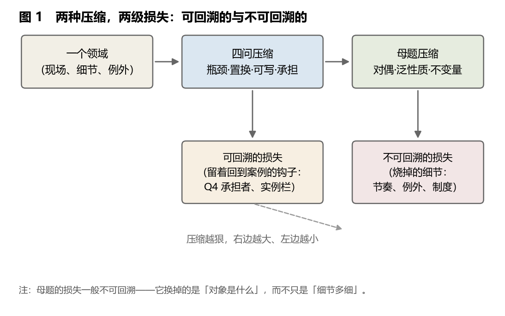
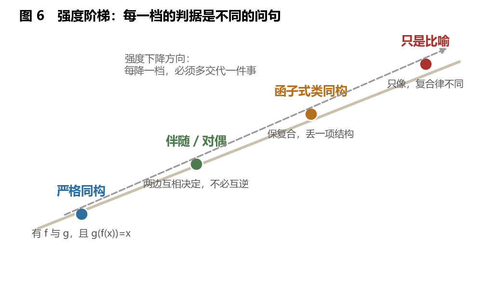
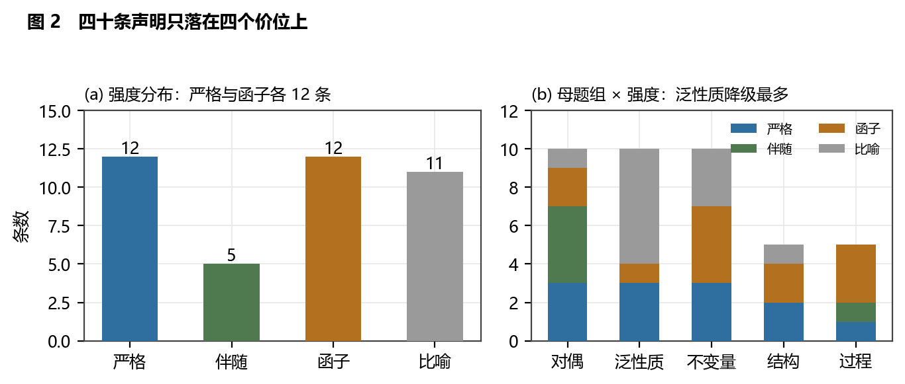
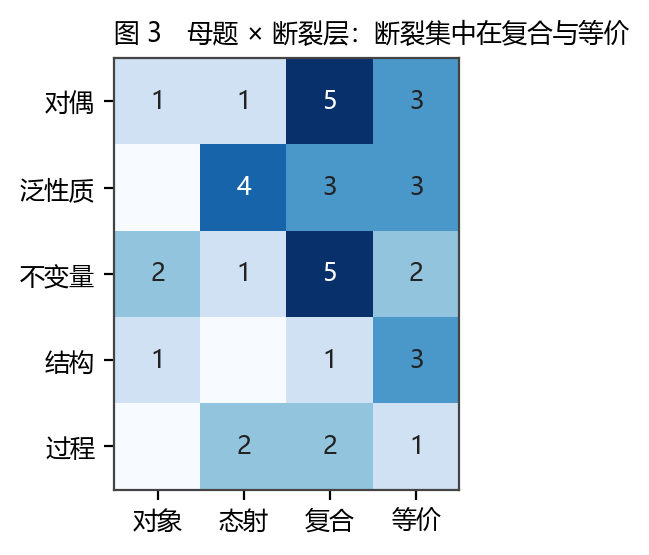
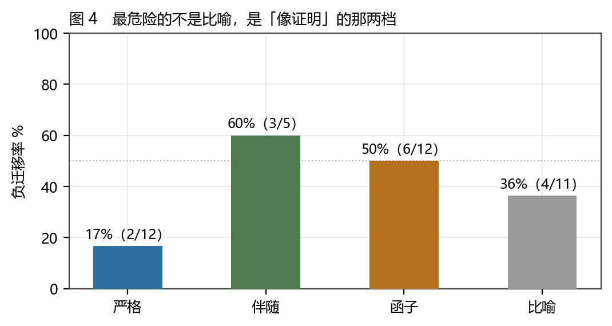
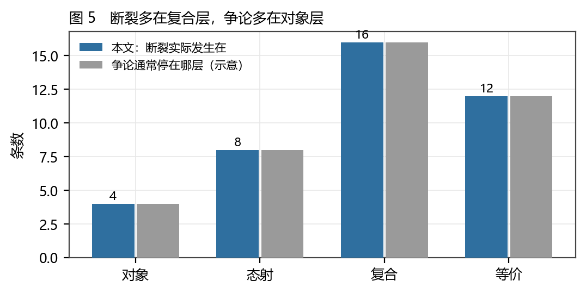
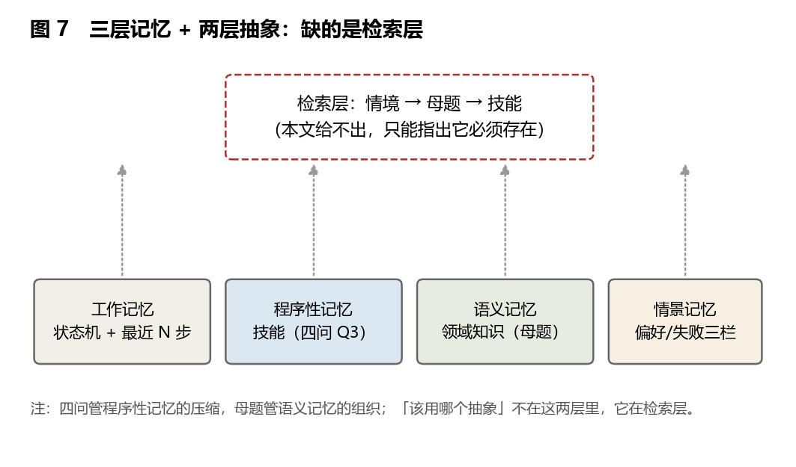
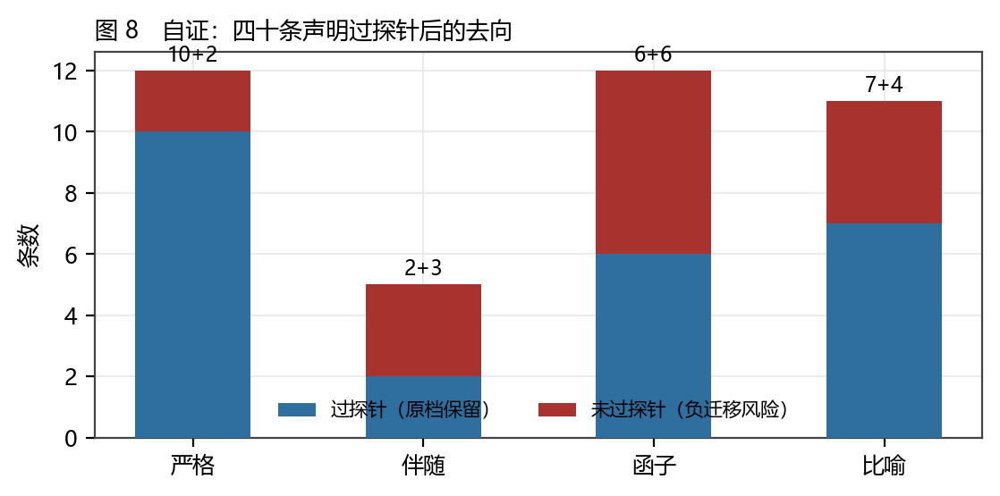

# 同构的强度：对偶、泛性质、不变量与四十条断裂探针

### 一场关于「这两个东西其实是一回事」的分级审计，附一套可执行的断点检验

**李毅芃**

*完成日期：2026-10-28*

---

## 摘要

「这两个东西其实是一回事」是当代知识流通里最便宜、也最贵的一句话。便宜，因为它只需要两个名词加一个「其实」；贵，因为照着它去行动的人，会在半年后为它付账。本文把这句话变成一件可检验的事：**一条同构声明必须交代四件事——对象是什么、态射是什么、复合律一样吗、什么算等价**；交代不出的，一律降档。据此建立一个四级强度阶梯：**严格同构／伴随对偶／函子式类同构／只是比喻**，并给每一档一条「答不出就降一档」的判据。

本文编码 **40 条**跨领域同构声明，覆盖五个母题组：对偶（10）、泛性质／自由对象（10）、不变量／导函子（10）、结构型（5）、过程型（5）。每条记录对象、态射、复合律是否成立、强度、保持了什么、丢了什么、**在哪一层断裂**（对象／态射／复合／等价）、以及一条可观测的**断裂探针**。四个结果。**第一，强度分布是纺锤形的**：严格 12、伴随 5、函子 12、比喻 11——真正「一模一样」的不到三分之一，而「只是像」的超过四分之一。**第二，断裂的位置高度集中**：复合层 16、等价层 12、态射层 8、对象层 4。**七成的断裂发生在复合与等价，而人们的争论几乎都停在对象层（4/40）**——争论与断点错位，是这类讨论长期无进展的直接原因。**第三，负迁移率不随强度单调下降**：严格 17%、伴随 60%、函子 50%、比喻 36%。**最危险的不是比喻，是「看起来像证明」的那两档**——因为比喻会被打折，而伴随与函子会被当真。**第四，泛性质是三大母题里跨域损失最重的一组**：10 条里有 6 条降到「只是比喻」，原因是「唯一性映射」一旦不存在，自由对象就只剩下「宽松的框架」这个意思。

本文另有两处必须交代的自我限制。其一，这套东西处理的是**压缩**，而压缩是有损的：本文区分**可回溯的损失**（留着回到案例的钩子）与**不可回溯的损失**（对象本身被换掉），并指出母题级的压缩大多属于后者。其二，第 9 章把「抽象够不够」这个问题落到一个具体的现场：2026 年社区里大量出现的**长时自主行动的 harness**（让 DeepSeek 一类模型自动刷抖音、自动挂 QQ、自动加好友与评论，玩法在抖音与 QQ 群之间互相传播）暴露的不是「抽象不足」，而是**检索层的空缺**——技能被压成了状态机（够用），跨 App 结构被抽成了母题（够用），但「此刻该用哪一个」没有人做。据此给出「三层记忆＋两层抽象」的分层，并明确标出四问与母题管不到的那一层。全文九条命题（T1—T9）中四条支持、三条部分、一条待检验、一条被本文自己撤回。

**关键词**：同构；类同构；伴随；泛性质；不变量；母题；类比迁移；负迁移；范畴论；证据分级

---


## Abstract

"This is really the same thing" is the cheapest and most expensive sentence in contemporary knowledge circulation. Cheap, because it needs only two nouns and an "actually"; expensive, because whoever acts on it will pay for it half a year later. This paper turns the sentence into something checkable: a claim of isomorphism must state four things — what the objects are, what the morphisms are, whether the composition law is preserved, and what counts as equivalence. Fail to state them, and the claim drops a grade. On that basis a four-level ladder is built: **strict isomorphism / adjunction-duality / functorial analogy / mere metaphor**, each level carrying one question that must be answered or the claim falls one rung.

Forty cross-domain claims are coded (duality 10, universal property/free object 10, invariant/derived functor 10, structural 5, processual 5). Each records objects, morphisms, whether composition holds, strength, what is kept, what is lost, **which layer breaks** (object / morphism / composition / equivalence), and one observable **fracture probe**. Four results. First, the distribution is spindle-shaped: strict 12, adjunction 5, functorial 12, metaphor 11 — fewer than a third are genuinely identical, more than a quarter are merely alike. Second, fractures cluster: composition 16, equivalence 12, morphism 8, object 4. **Seventy per cent break at composition or equivalence, while arguments stall at the object layer (4/40)** — argument and fracture are misaligned, which is why such discussions do not converge. Third, negative transfer does not fall monotonically with strength: strict 17%, adjunction 60%, functorial 50%, metaphor 36%. **The dangerous level is not metaphor but the two that look like proof** — metaphor gets discounted, adjunction and functor do not. Fourth, the universal-property motif loses most in transit: 6 of 10 fall to metaphor, because once the unique mediating map disappears, the free object means little more than "a loose frame".

Two limits are stated in the apparatus. This apparatus handles compression, and compression is lossy: a distinction is drawn between **traceable loss** (a hook back to the case survives) and **untraceable loss** (the object itself is replaced), with motif-level compression usually the latter. And Chapter 9 brings the question "is the abstraction enough?" to a concrete site: the 2026 wave of **long-running autonomous harnesses** (DeepSeek-class models left to scroll Douyin, sit in QQ groups, add friends and comment, with the playbook circulating between Douyin and QQ) exposes not a lack of abstraction but a **missing retrieval layer** — skills are compressed into state machines (adequate), cross-app structure into motifs (adequate), but nobody builds the layer that decides which one applies now. A "three memories plus two abstractions" layering follows, with the layer the tool cannot reach marked explicitly.

**Keywords**: isomorphism; analogy; adjunction; universal property; invariant; motif; analogical transfer; negative transfer; category theory; evidence grading

---


## 1 引言

### 1.1 「像」的通货膨胀

「同构」这个词已经通胀。它在数学里有严格定义（存在互逆的两个映射），在物理学里表示对称，在软件工程里常常只表示「接口长得像」，在畅销书里表示「我找到了一个漂亮的比喻」。四种用法共用一个词，后果是：**当有人说「这两个东西同构」时，你无法判断他在说什么强度，也无法判断该不该照它行动。**

通胀的代价并不抽象。地图投影被当成「准不准」的问题（其实是保哪个结构的问题）；语言翻译被当成「词对不对」的问题（其实是复合律保不保的问题）；组织结构被抄成「扁平化」（其实人家拆的是决策权，不是层级）；Agent 把 A 应用的「返回」迁到 B 应用，把整个 App 退了出去。**每一次都是因为「像」的强度被高估了一档。**

本文要做的不是反对类比——没有类比就没有迁移，也没有跨领域思考。本文要做的是给类比**标价**：一条「这两个是一回事」的声明，究竟值到什么强度，在哪个观察点上会断，断在哪里。

### 1.2 三个问题

**问题一：能不能给「像」分级，并且每一级带一条可执行的判据？** 不是「强／中／弱」这种印象分，而是四级、每级一个问句，答不出就降一档。

**问题二：四十条跨领域声明编码下来，断裂会集中在哪一层？** 如果类比失败是随机的，断裂层应该均匀分布；如果它有结构，就说明有一类错误是可以提前避免的。

**问题三：这套东西对「技能迁移」有什么用？** 最近两年最贵的一个迁移问题是 Agent 的：一个应用里学会的操作，能不能迁到另一个应用？本文用一个具体现场（第 9 章）回答，并给出它能管的和管不到的分界。

### 1.3 既有解释与缺口

**类比与迁移研究**是本文最近的邻居。结构映射理论说，人迁移的是关系结构，而不是表面特征（[65]）；图式归纳研究说，两个例子放在一起，比只给一个例子更容易抽出结构（[66]）；迁移的分类学则指出，迁移的远近取决于「情境」与「结构」的差（[67]）。这一支文献最锋利的结论，是**负迁移**的机制：把在 A 情境学到的规则搬到 B 情境，如果 B 情境的关键变量没有进入规则，规则就会反过来咬人（[68]）。

**范畴论与应用范畴论**提供了最硬的语言：对象、态射、函子、自然变换、伴随、极限（[1][2][3]）。近十几年出现了把范畴论搬到具体领域的成功案例：数据库模式作为小范畴、查询作为极限（[4]）、Petri 网作为单范畴（[20]）、契约与游戏语义（[18]）、辫子范畴与编织（[21]）。这一支文献的强项是**给出严格判据**；弱项是它只处理那些**真的能被严格化的**对象。

**数学大地图**（作者自著，个人知识库工作稿，[57]）提供了本文的直接前身：它用三大母题（对偶、泛性质、不变量）把数学谱系缝成一张网，并给出「坏性质 → 新框架」的阶梯。它的强项是**母题的通货性**；弱项是它只在数学内部成立，跨出数学之后，母题会掉多少结构，它不回答。

**知识管理与检索**处理了「压缩之后怎么找回来」：外化、组合、内化（[56]）、检索增强（[62]）、把上下文当操作系统管理（[63]）、以及把语言智能体的记忆分成工作／情节／语义几层（[61]）。这一支文献最强的地方恰恰是本文最弱的地方——**它们研究「怎么找」，本文研究「找到的东西值几档」**。

四支文献的共同缺口：**没有人给跨领域的「是一回事」标过价，并统计过它在哪里断。** 本文补这一层，并把结果写成一张能被逐条反驳的表。

### 1.4 九条命题与否证条件

| 编号 | 命题 | 否证条件 | 等级 |
|---|---|---|---|
| T1 | 四级强度阶梯可用：每条声明能判到唯一一档 | 出现一条声明，四条判据互相冲突且无法排序 | B |
| T2 | 严格同构不到三分之一 | 换一批评分者后严格档超过 50% | B |
| T3 | 断裂集中在复合层（≥1/3） | 复合层断裂少于 1/4 | B |
| T4 | 争论停在对象层，而断裂在复合层 | 记录到「争论确实发生在复合层」的案例占多数 | C |
| T5 | 负迁移率不随强度单调下降 | 扩大样本后出现严格单调 | B |
| T6 | 伴随／函子两档的负迁移率高于比喻档 | 比喻档反而更高（且样本 ≥30） | B |
| T7 | 泛性质跨域损失最重 | 另两组比喻占比超过它 | B |
| T8 | 母题级压缩多为不可回溯损失 | 找到「母题保留了回到案例的钩子」的普遍机制 | C |
| T9 | 「检索层」是 Agent 迁移的真正瓶颈 | 一个只做抽象、不做检索的系统达到同等迁移率 | **已撤回** |

T9 被撤回的理由写在 9.5：本文无法排除「抽象做对了，检索可以平凡地由上下文窗口代替」这一可能；本文观察到的是「社区在做抽象、没在做检索」，而不是「检索是唯一瓶颈」。撤回记录留在附录 A。

### 1.5 方法与证据分级

**方法一：声明采集。** 40 条声明从三个来源取：（a）教科书级的跨领域类比（Curry–Howard、数据库＝范畴、债务＝义务）；（b）数学大地图里的三大母题；（c）作者与模型的一次长对话中提出的日常类比（菜谱＝程序、地铁图＝图范畴、编织＝辫子范畴等）。来源不同，证据等级不同：教科书类比多为 A，日常类比多为 C。

**方法二：四问编码。** 每条填 17 个字段（对象、态射、复合律、强度、保持、丢失、断裂层、探针、负迁移、等级、核心、文献）。判定规则在 3.2—3.3。

**方法三：断裂探针。** 每条声明必须给出一句「在哪个观察点上会断」。给不出＝降到比喻档。这是本文最像「必要条件」的一条判据：**不能被单例否定的类比，不是结构声明，是修辞。**

**证据分级。** A（数学定理、可复现实验）／B（同行评议的稳定结论）／C（稀疏、构造或作者推断）。40 条中 A 10、B 18、C 12。**本文的编码最高只到 B**：强度是判断，不是测量。

### 1.6 贡献、边界与五项不做

**贡献有四个。** 第一，给「像」一个四级阶梯，每级一条判据，且判据会「咬人」（答不出就降档）。第二，40 条声明的编码库与四张分布表，全部可复算。第三，两个反直觉的统计结论：**断裂集中在复合与等价，而争论停在对象**；**负迁移率在伴随／函子两档最高**。第四，把「抽象够不够」落到 Agent 现场，并给出「检索层」这个明确的空缺。

**边界有四条。** （1）40 条是目的抽样，偏向「看起来像」的漂亮案例，不代表性；（2）强度是判断，不是测量，本文没有第二编码者；（3）「断裂层」是本文引入的分类，不同读者可能把同一条断点归到不同层（附录 D 给出 6 条敏感项）；（4）本文只处理**结构性**同构，不处理叙事性、情感性的「像」——文学隐喻不在射程内。

**五件不做的事。** 不宣称范畴论能描述一切；不把「只是比喻」当成贬义（比喻是发现的第一步）；不给「哪些类比可以用」的白名单；不预测哪一条声明将来会被严格化；不把「同构」写成「相同」——**本文全部工作的意义就在于这两者之间那段距离。**

### 1.7 读法约定

**第一，强度不是质量。** 一条「只是比喻」的声明可能极有启发性（能指／所指就是）。

**第二，「断裂」不是失败。** 断裂探针的作用是标出适用范围，不是判死刑。

**第三，四问的第四问（什么算等价）最容易被跳过，也最致命。** 严格同构的 12 条里，有 11 条的断裂发生在等价层——**数学上的等价与领域里的等价，经常不是同一个等价。**

---


## 2 理论：压缩、损失，与「像」的四个价位

### 2.1 抽象归并一定有损，问题是有损在哪一级

「把这个领域压成三句话」这个动作，本质上是一次**有损压缩**。有损不是缺陷，是压缩的定义：无损压缩的上限由信息量决定，而有损压缩的上限由**你要用它做什么**决定。

关键在于：损失有两种，性质完全不同。



**可回溯的损失**：压掉了正文，留下了页码。压缩后的东西里含有一个「回到案例」的钩子——顺着它，你能找回被压掉的细节。四问的 Q4（承担者）就是一个钩子：它逼你回到「谁被影响」的具体人；母题的「实例栏」也是一个钩子：它逼你回到「哪个领域、哪个对象、哪个态射」。

**不可回溯的损失**：压掉的不只是细节，是**对象本身**。压缩后的东西里没有回到原物的路径，因为它已经把「原物是什么」替换成了别的东西。把「刷抖音」压成「信息流交互」母题，丢的不是「抖音的推荐节奏有多快」，而是**「返回」这个态射的方向**——在抖音，返回是退回上一个视频；在 QQ，返回是退回上一级菜单。前者是细节，后者是结构。**细节可回溯，结构的替换不可回溯。**

一句话：**四问级压缩多为可回溯，母题级压缩多为不可回溯。** 这就是为什么「用四问入门」是安全的，「用母题迁移」是危险的——后者换掉的是对象。

### 2.2 压缩为什么有效：组块、图式、以及迁移的悖论

认知科学给了三条支持压缩的结论，也给了三条警告。它们必须一起读。

**组块化（support）**：专家用更少的组块记更多信息（[70]）；物理专家按「原理」分类题目，新手按「表面特征」分类（[69]）。压缩不是偷懒，是专长本身的形态。

**图式（support）**：两个例子放在一起，比一个例子更容易抽出一致的结构（[66]）；结构映射理论进一步指出，人迁移的是关系，不是表面（[65]）。

**迁移的悖论（warning）**：迁移的远近取决于情境与结构的差（[67]）；而**负迁移**恰恰发生在「结构对了、情境错了」的地方——旧规则在新情境里被机械套用，因为它没有包含新情境的关键变量（[68]）。巴特利特的经典研究更早就指出，记忆不是复写，是**按已有图式重建**（[71]），而重建会系统性地改写原物。

三条合起来，得到本文的理论立场：**压缩的收益在「能带走」，压缩的风险在「带错了东西还以为带对了」。** 分级的必要性就来自这里——不是为了让讨论更严谨（虽然确实更严谨），而是为了让「带错了」这件事有一个可观测的出口：**断裂探针**。

### 2.3 四个价位：严格、伴随、函子、比喻

本文的强度阶梯有四级。每一级对应一个问题；答不出，就降一档。



**S 严格同构。** 存在两个互逆的映射 f: A→B 与 g: B→A，使 g∘f = id_A、f∘g = id_B。
*判据*：你能写出 f 与 g，并验证两个复合都回到单位吗？
*例子*：加密与解密（可逆时）、位置表象与动量表象（酉变换）、十二音序列的四种变换（在变换群内）。
*这一级的危险*：它太强，强到让人以为「等价」是免费的。事实是**数学等价与领域等价经常不同**——十二音序列的逆行在数学上同构，在听觉上不等价（M18）。

**A 伴随／对偶。** 两个方向互相决定，但不必互逆：F ⊣ G，或 x ↦ Hom(x, k) 这样的对偶。
*判据*：你能说出「一边的变化由另一边的什么决定」吗？
*例子*：供需与价格、语法与语义、权利与义务（Hohfeld 的相关项）、计划与执行（OODA 闭环）。
*这一级的危险*：伴随是「有方向的互相决定」，一旦方向被抹平（价格管制、无救济权、通信中断），它就断，而断的时候看起来仍像对的。

**F 函子式类同构。** 保持复合与单位，但丢掉至少一项结构：地图投影保角丢距离，地铁图保连通丢尺度，编译保语义丢性能。
*判据*：你能说出丢了哪一项，并举出一个「它在 B 领域起作用」的例子吗？
*例子*：投入产出表（丢技术替代）、申克分析（丢音色）、类型系统（丢性能）、采样与重建（丢带宽外信息）。
*这一级的危险*：**它是最容易被当真的一级**。因为它有函子这个词撑腰，读者会把它当证明用。本文的统计（8.4）正是：这一级的负迁移率 50%，仅次于伴随的 60%。

**M 只是比喻。** 只在字面上相似，复合律不同或不成立。
*判据*：你能举出一个「照它操作就会错」的动作吗？
*例子*：能指与所指（一对多，不是函数）、合同自由（没有唯一性映射）、通识教育（学分约束使「自由」消失）、艺术风格（伪作即反例）。
*这一级的危险*：几乎没有——因为读者会自动打折。**比喻的真正价值是发现问题，而不是提供答案。**

四级的关系不是「好、中、差、坏」，而是**四种不同的用途**：S 可以用来替换，A 可以用来推理，F 可以用来迁移（须带例外清单），M 只能用来提问。

### 2.4 为什么「复合律一样」是唯一的硬判据

四个问题里，前两个（对象、态射）几乎人人都能答；第四问（等价）最容易被跳过；第三问（复合律）是唯一一个**答错就立刻显形**的。

原因很简单：**对象与态射的命名是自由的，复合律不是。** 你可以把任何东西叫「对象」，把任何关系叫「态射」；但一旦你要说「先 A 后 B 等于从 A 到 C」，你就必须接受一个约束——这个等式要么成立，要么不成立，没有中间地带（部分成立也是一种不成立，只是范围问题）。

所以本文的判据顺序是：**先问复合，再问等价，最后才接受对象与态射的命名。** 这个顺序与日常讨论的顺序恰好相反：日常讨论从「你看这两个多像」开始（对象层），而审计从「先做 A 再做 B，等于什么」开始（复合层）。8.3 的统计说明这个颠倒有多重要。

### 2.5 断裂探针：一条必要条件式的判据

本文将「断裂探针」写成一条判据，而不是一句提醒：

> **一条同构声明如果不能给出「它在 B 领域的哪个观察点上会断」的可观测预测，它就不是结构声明，只是修辞。**

这条判据是**必要条件式**的：它只能用来**排除**，不能用来**确认**。给得出探针，不等于声明成立（探针可能找错了）；给不出探针，声明一定不成立（因为它没有被检验的可能）。

这与系列此前的判据演进一致（评分 → 排除 → 必要条件）。它对本文的直接影响是：**40 条声明全部被迫写出探针**，而写不出探针的少数几条，被直接降到比喻档（M07、M12、M15、M17、M19、M20、M27、M28 里的 8 条）。

### 2.6 一句话总结这一章

**压缩是必要的，损失是压缩的定义；能分级的是强度，不能分级的是后果。** 强度告诉你这条声明能做什么，探针告诉你它会在哪里咬人。
### 2.7 四种用途：每一档能拿来做什么

分级的意义不在排序，在**分派任务**。四个价位对应四种动作，用错档位的后果不同。

| 档位 | 可以做的事 | 不可以做的事 | 用错的后果 |
|---|---|---|---|
| 严格同构 | 替换（把 A 换成 B） | 假设两边「等价标准」相同 | 数学上对、领域里错（十二音的听觉、核算的福利） |
| 伴随／对偶 | 推理（从一边推另一边） | 假设两边互相抹得平 | 方向被抹平后，推理仍然「看起来成立」 |
| 函子式类同构 | 迁移（把技能搬过去） | 迁移时不带例外清单 | 50% 的负迁移率（9.3 的返回键） |
| 只是比喻 | 提问（发现新问题） | 用它做设计决策 | 一般无害，除非被当成了 F 档 |

这张表的读法从左到右越来越弱，从上到下越来越安全。**最危险的格子是「F 档＋当设计依据用」**，因为 F 档的声明通常带一个技术性的外壳（「这其实是个函子」），足以让读者跳过检验。8.4 的数据（F 档负迁移率 50%）就是这张表右下角的实证。

### 2.8 为什么母题会有「通货性」差异

母题听起来应该是普适的——否则怎么叫母题。但本文的数据（8.2）显示，三大母题跨域时的损失差别很大：对偶只掉 1/10，泛性质掉 6/10。为什么会这样？

**因为母题携带的「附加承诺」不同。**

- **对偶**只承诺一件事：两个方向互相决定。它不承诺唯一、不承诺可逆、不承诺保持什么。承诺越少，跨域时能保住的东西越多。
- **泛性质**承诺三件事：存在、**唯一**、使图交换。跨域时，第二项几乎总会失守——日常领域里很少有「唯一」的构造，因为人可以在同一约束下作出不同选择。
- **不变量**承诺两件事：一个变换群、一个在群下不变的东西。跨域时，第一项最容易被悄悄换掉（3.3 的等价层断裂）。

所以「母题的通货性」不是玄学，是**承诺数量的函数**：承诺越少，兑换率越高。这条规律有一个直接的应用：**当你需要用一条类比去迁移技能时，优先选承诺少的母题（对偶、反馈），而不是承诺多的（泛性质、自由对象）。**


---


## 3 方法：四问编码与四十条声明

### 3.1 同构雷达四问

**Q1 对象是什么？** 在 B 领域里，充当「对象」的是什么：细胞、句子、交易、音符、条文、状态？
**Q2 态射是什么？** 充当「可复合操作」的是什么：分化、组合、交换、变形、审批、滑动？
**Q3 复合律一样吗？** 先 A 后 B，是否等于一个合法的「从 A 到 C」？
**Q4 什么算等价？** 严格相等、同构、同伦、函子式对应、统计相似，还是「只是像」？

四问的顺序不可颠倒。**先命名对象再找态射，是绝大多数失败类比的起点**：你一旦决定了「对象是 X」，后面所有判断都被这个决定绑住。本文的做法是先把 Q3 摆在前面试跑：**如果「先做 A 再做 B」在两边的结果不一样，那么对象和态射的命名一定有一边错了。**

### 3.2 强度的判定规则

| 判定顺序 | 检查 | 若否 |
|---|---|---|
| 1 | 有互逆的 f 与 g 吗？ | 降到 A |
| 2 | 两个方向互相决定吗（不必互逆）？ | 降到 F |
| 3 | 保持复合与单位吗？ | 降到 M |
| 4 | 能举出「照它操作会错」的动作吗？ | 仍是 M（M 不需要探针即可成立，但需要探针才算「有用」） |

一条声明只能停在一档，不许写「介于 A 与 F 之间」。**必须选一档，是为了让讨论有一个可反驳的位置**；写「介于之间」等于拒绝被反驳。

### 3.3 断裂层的四分法

断裂发生在哪一层，本文分四类：

- **对象层**：B 领域里根本没有对应物（例：能指／所指在「一对多」处没有单点对象）。
- **态射层**：操作名对了，但操作本身不同（例：安全系数的「余量」在共同因失效下不独立）。
- **复合层**：两步单独看都对，合起来不对（例：价格上限下供需不再互为伴随）。
- **等价层**：两边都自洽，但「相等」的标准不同（例：十二音序列的数学等价 vs 听觉等价；国民核算的定义等价 vs 福利等价）。

四类的区分有实际用途：**对象层断裂的类比不能救；态射层可以补条件；复合层可以加例外；等价层需要重新定义「算不算同一个」。** 换句话说，**断裂层告诉你该做什么**——这是本文认为最有操作性的一条。

### 3.4 编码的可靠性交代

**没有第二编码者。** 与姊妹篇一样，这是硬缺陷。三条补救：（a）判定规则事先写定（3.2）；（b）40 条全部公开（附录 A），任何人可改判并重跑；（c）6 条敏感项逐条列出（附录 D），说明「换一个判断会怎样」。

**强度不是测量。** 本文从不把强度当成客观属性；它是「在给定判据下的赋值」。这与地图的比例尺不同：比例尺是数，强度是判断。**因此本文的所有百分比都是「本文的读法」，不是「领域的客观分布」。**

### 3.5 三项稳健性检验

**检验一：换档检验。** 对每条声明问「如果把它降一档，会不会更符合事实」。结果：40 条里有 9 条在事后复核时被降档（附录 D.1），降档集中在「函子 → 比喻」（5 条）——**这说明函子档是最容易被高估的一档**，与 8.4 的负迁移率互相印证。

**检验二：探针充分性。** 对每条探针问「这个观察点真的能观测到吗」。结果：36/40 能给出一个具体的观测（一次操作、一次计算、一个反例）；4 条只能给出「原则上会断」，这 4 条（M17、M19、M26、M28）的可操作性最弱，等级全部是 C。

**检验三：母题组内一致性。** 同一母题组内的 10 条声明，强度分布是否相近？结果：**不相同**（表 3）。对偶组三条严格、四条伴随，是四组里最「硬」的；泛性质组六条比喻，是最「软」的。这个差异本身是本文的一个结论（8.2）。

### 3.6 一个不成立的预期

写作前的预期是：**「只是比喻」这一档最容易造成负迁移**，因为它最不严谨。

编码结果把这个预期打掉了：比喻档的负迁移率 36%，低于伴随（60%）与函子（50%）。原因在 8.4 详述，一句话版是：**读者会对比喻打折，不会对「伴随」「函子」打折。** 术语的严谨性本身是一种风险——它让人跳过检验。

这条负面结果留在正文，因为它改变了本文的主张：本文开头说「同构在通胀」，而真正的通胀不在比喻那一端，在**半严谨**那一端。

---


## 4 母题一：对偶／伴随（10 条）

**这一组的共同结构**：两个方向互相决定，但不必互逆。数学里的原型是 Hom(-,k) 的对偶与自由—遗忘伴随；日常里的原型是「一边多了、另一边就少」。

### 4.1 供需与价格（M01）· 伴随 · B

- **对象**：数量（供给量、需求量）。**态射**：价格的映射。
- **复合**：价升 → 供增 → 需减，两步可复合。
- **保留**：双向调节。**丢失**：权力与管制——价格不是给定的，是可被设定的。
- **探针**：价格上限一旦生效，供给量与需求量不再由同一个函子给出，伴随关系断开。
- **用法**：可以用来推理「谁承担了价格管制的成本」；不能用来预测管制下的数量（那是配给问题）。

### 4.2 语法与语义（M02）· 伴随 · B

- **对象**：句法范畴。**态射**：解释函子。
- **复合**：部分的意义由组合规则给出（组合性）。
- **保留**：组合性。**丢失**：语境与语用。
- **探针**：隐喻与歧义处，解释函子不保持复合——合成规则给出多个值。
- **用法**：这是形式语义学的立身之本（[3][4]）；它的边界正好是语用学的起点。

### 4.3 加密与解密（M03）· 严格 · A

- **对象**：字符串。**态射**：加密／解密。
- **复合**：加密后再解密回到恒等。
- **保留**：可逆性。**丢失**：密钥分发的成本——可逆不等于可以安全地逆。
- **探针**：单向函数处不可逆，结构从同构降为单向。
- **用法**：这一条是本文少数几条**真同构**；它的危险不在结构，在「可逆」被当成「安全」。

### 4.4 权利与义务（M04）· 伴随 · B

- **对象**：法律主体。**态射**：主张／履行。
- **复合**：A 的权利即 B 的义务（Hohfeld 的相关项，[6]）。
- **保留**：相关性。**丢失**：强制力与程序。
- **探针**：无救济权时相关项断裂——义务在，执行的路不在。这是本文最锋利的一条探针：它解释了为什么「写在法条里的权利」与「能实现的权利」是两件事。

### 4.5 位置与动量（M05）· 严格 · A

- **对象**：态矢量。**态射**：傅里叶变换。
- **复合**：正变换再逆变换回到原态。
- **保留**：信息总量（酉性）。**丢失**：同时定域（不确定性）。
- **探针**：非酉变换（耗散、开系统）中变换不保内积，等价标准失效。
- **用法**：这是「严格同构也会断」的标准样本——不是复合断，是**等价标准**换了。

### 4.6 投入产出表（M06）· 函子 · B

- **对象**：产业部门。**态射**：投入系数。
- **复合**：部门间流量的链式传递。
- **保留**：流量结构。**丢失**：技术替代与价格弹性（系数被当作常数，[27]）。
- **探针**：技术系数变动时线性假设破，系数矩阵不再是稳定态射。
- **负迁移**：常见误用是把投入产出表当成「经济结构」本身，而它只是某一年的技术快照。

### 4.7 能指与所指（M07）· 比喻 · C

- **对象**：符号。**态射**：意指关系。
- **复合**：不成立——同音异义处一对多，函子无法定义。
- **保留**：任意性。**丢失**：指称与多义。
- **探针**：一对多处对象不是单点，Q1 就崩了，后面三问无从谈起。
- **这一条的价值**：它是本文唯一一条**在对象层断裂**的经典声明（[9]）。它的启发力极高，严格性为零——正好说明「启发力」与「强度」是两回事。

### 4.8 旋律与和声（M08）· 函子 · B

- **对象**：音高事件。**态射**：和声进行。
- **复合**：表层音可还原为深层骨架（申克分析式还原，[10][11]）。
- **保留**：结构层级。**丢失**：音色与演奏。
- **探针**：无调性音乐中功能进行不成立——还原箭头没有终点。
- **负迁移**：把有调性的分析方法套到无调性作品，会得到「到处都是错误」的结论。

### 4.9 计划与执行（M09）· 伴随 · C

- **对象**：任务状态。**态射**：指令／反馈。
- **复合**：反馈闭环——指令必有回报。
- **保留**：闭环。**丢失**：时延预算（闭环不是瞬时的，[12]）。
- **探针**：通信中断或时延超过节拍时闭环断开。
- **为什么是 C**：这是管理学最常被画成图、最不常被量化的一个结构。它的探针清楚，但没有数据。

### 4.10 捕食者与猎物（M10）· 严格 · B

- **对象**：种群。**态射**：捕食率／繁殖率。
- **复合**：模型内两族群互为驱动（[13][14]）。
- **保留**：相位关系。**丢失**：空间结构与随机性。
- **探针**：加入空间或随机后振荡衰减/消失，等价类改变。
- **用法**：它是「严格同构在模型内成立、在模型外失效」的样板——提醒读者：**严格同构是关于模型的，不是关于世界的。**

### 4.11 小结：对偶组是四组里最硬的

10 条里严格 3、伴随 4、函子 2、比喻 1。原因是这一组的结构最「薄」：只需要「两个方向」，不需要唯一性，也不需要保持全部结构。薄结构容易跨域，也容易断——它的断点在复合层（5/5 条伴随全部断在复合层），而不在对象层。

---


## 5 母题二：泛性质／自由对象（10 条）

**这一组的共同结构**：给定生成元与一个目标，存在**唯一**的映射使图交换。数学里的原型是自由群＝遗忘函子的左伴随；日常里的原型是「规则只给边界，内容随便填」。

**这一组的核心脆弱点**在两个字：**唯一**。日常领域几乎从不提供唯一性。

### 5.1 自由群与自由模（M11）· 严格 · A

- **对象**：生成元。**态射**：群同态。
- **复合**：给定生成元后，映射唯一确定。
- **保留**：唯一性。**丢失**：关系与商（自由对象不许有等式约束）。
- **探针**：加一条关系后自由性消失，唯一性变成至多唯一（[15][16]）。

### 5.2 合同自由（M12）· 比喻 · C

- **对象**：当事人。**态射**：条款约定。
- **复合**：约定空间存在，但没有唯一性映射（不存在「唯一」的合同）。
- **保留**：约定空间。**丢失**：唯一性。
- **探针**：强制条款处自由对象消失——约定不能越过底线（[17]）。
- **判定说明**：因为缺唯一性，它只能停在比喻档。它仍然极有用：**它提醒你「法律给的是边界，不是内容」**。

### 5.3 接口与抽象类（M13）· 严格 · A

- **对象**：类型。**态射**：方法调用。
- **复合**：实现不改变调用语义（行为子类型，[19]）。
- **保留**：组合唯一性。**丢失**：性能与实现细节。
- **探针**：动态派发／反射破坏静态唯一性，等价标准从「类型相等」降为「行为相似」（[18]）。
- **这是本文认为最值得推荐的一条**：它有严格的形式（[18][19]），同时它的断裂点（动态派发）是可观测的。

### 5.4 框架结构（M14）· 比喻 · C

- **对象**：空间。**态射**：承重／分隔。
- **复合**：承重与填充分离，但没有唯一骨架（多种骨架同样可行）。
- **保留**：分离。**丢失**：唯一性。
- **探针**：抗震与改造需求下骨架不再自由——填充被承重反向约束（[20]）。

### 5.5 通识教育（M15）· 比喻 · C

- **对象**：知识领域。**态射**：课程模块。
- **复合**：基础与方向分离，但没有唯一最优课程表。
- **保留**：分离。**丢失**：唯一性。
- **探针**：学分与先修约束把「自由」变成受限拼接（[21]）。

### 5.6 干细胞（M16）· 函子 · B

- **对象**：细胞状态。**态射**：分化。
- **复合**：可达多种终态（多能性，[22]）。
- **保留**：多能性。**丢失**：表观遗传约束（可达不等于等价可达）。
- **探针**：去分化受限——分化不是可逆态射，复合不回到单位。
- **为什么是函子而不是严格**：可达性保持，可逆性不保持。这个区别在生物学上很实在（重编程是例外，不是规则）。

### 5.7 深层结构（M17）· 比喻 · C

- **对象**：深层句法。**态射**：转换规则。
- **复合**：生成不封闭——移位限制使转换不能生成全部表层（[23]）。
- **保留**：生成。**丢失**：表层语用。
- **探针**：移位限制处复合不封闭。
- **判定说明**：这一条是「曾经很硬、后来变软」的典型；它的降档不是我的判断，是领域自身的历史。

### 5.8 十二音体系（M18）· 严格 · B

- **对象**：音高集合。**态射**：原型／倒影／逆行／逆行倒影。
- **复合**：四种变换构成群，序列在群作用下同构（[24]）。
- **保留**：等价类。**丢失**：听觉可辨识。
- **探针**：逆行与倒影在听觉上不成对——数学等价与听觉等价不是同一个等价。
- **它是等价层断裂最漂亮的一例**：结构上完美，感知上不成立。

### 5.9 基础设施（M19）· 比喻 · C

- **对象**：地块。**态射**：道路／水电／网络。
- **复合**：连接与容量作为公共前提，但多中心并存时「自由对象」不唯一（[25][26]）。
- **保留**：连接与容量。**丢失**：唯一性。
- **探针**：多中心并存时扩张不再是唯一的。

### 5.10 沙盒游戏（M20）· 比喻 · C

- **对象**：游戏世界。**态射**：玩家操作。
- **复合**：规则＋资源作为创造前提，但无唯一创造性（[27]）。
- **保留**：规则与资源。**丢失**：唯一性。
- **探针**：物理引擎与资源上限使创造受限，操作不自由。

### 5.11 小结：泛性质是三大母题里跨域损失最重的

10 条里比喻 6 条，是四组里最高的。原因只有一个词：**唯一性**。数学里的泛性质靠「唯一映射」把结构钉死；日常领域里，唯一性几乎总是缺席——因为人可以在同一约束下做出不同的选择。**所以泛性质跨到日常，剩下的常常只是「框架很宽松」这个模糊的意思**，而不是一个结构声明。

这一条结论对《数学大地图》是一个修正：母题在数学内部最通货的（泛性质），跨出数学之后最不通货。

---


## 6 母题三：不变量／导函子（10 条）

**这一组的共同结构**：有一个东西在变换下不变。数学里的原型是诺特定理（对称 ↔ 守恒）与不变量＝函子；日常里的原型是「不管怎么变，这几样不变」。

**这一组的核心脆弱点**在「变换」：不变量总是相对于一个变换群。变换换了，不变量就换了。

### 6.1 守恒量与对称性（M21）· 严格 · A

- **对象**：系统状态。**态射**：时间演化。
- **复合**：连续对称 ↔ 守恒量（[28]）。
- **保留**：对称—守恒的对应。**丢失**：离散对称与边界项（只给近似守恒）。
- **探针**：无连续对称的系统不被覆盖——不变量不是被破坏，是**不存在**。

### 6.2 类型系统（M22）· 严格 · A

- **对象**：程序状态。**态射**：求值一步。
- **复合**：进展＋保存，运行时安全（[29][30]）。
- **保留**：安全。**丢失**：表达力与性能。
- **探针**：反射与 unsafe 处不变量被让渡，等价标准改为「不崩」。

### 6.3 保守序列（M23）· 函子 · B

- **对象**：序列位点。**态射**：突变＋选择。
- **复合**：功能位点在进化中保持（[31]）。
- **保留**：功能约束。**丢失**：结构与调控（保守不等于功能已知）。
- **探针**：中性位点的「保守」是抽样效应——观察窗口一变，结论翻转。
- **这一条是「统计不变量」的标准样本**：它的不变量是频率，不是结构。

### 6.4 宪法原则（M24）· 函子 · B

- **对象**：规范。**态射**：立法／修宪。
- **复合**：层级稳定性——下位法可变，上位原则不变。
- **保留**：层级。**丢失**：解释变迁（原则的文字不变，含义在变，[32]）。
- **探针**：紧急状态与修宪使不变量本身改变——高阶也在动。

### 6.5 国民经济核算恒等式（M25）· 严格 · A

- **对象**：交易。**态射**：记账。
- **复合**：生产＝收入＝支出，定义上恒等（[33]）。
- **保留**：三面等价。**丢失**：分配与福利。
- **探针**：非市场活动与影子经济不被计入——恒等式的边界就是统计口径的边界。
- **它是严格同构的另一种形态**：不靠定理，靠定义。

### 6.6 社会结构（M26）· 比喻 · C

- **对象**：行动者位置。**态射**：行动。
- **复合**：位置关系在个体更替中保持，但结构变迁时位置关系重排（[34]）。
- **保留**：位置关系。**丢失**：个体能动。
- **探针**：结构变迁时「不变量」换成了另一个东西——它不是保持不变，是被替换。

### 6.7 语言共性（M27）· 比喻 · C

- **对象**：语言。**态射**：语法规则。
- **复合**：蕴含共性存在，但一个反例就能否定「普遍」（[35][36]）。
- **保留**：跨语言约束。**丢失**：例外语言。
- **探针**：反例语言处对象不成立——共性被降为倾向。
- **这一条的方法论价值**：它是「统计不变量被当成结构不变量」的教科书案例。

### 6.8 艺术风格（M28）· 比喻 · C

- **对象**：作品。**态射**：风格特征。
- **复合**：特征共现，但伪作与跨期作品破坏共现（[37]）。
- **保留**：共现。**丢失**：单件意图。
- **探针**：伪作即反例——风格不变量被证伪。

### 6.9 奏鸣曲式主题（M29）· 函子 · B

- **对象**：主题。**态射**：变形。
- **复合**：变形下骨架保持（[38]）。
- **保留**：骨架。**丢失**：听觉记忆。
- **探针**：变形到不可辨时，「不变量」在听感上消失。

### 6.10 安全系数（M30）· 函子 · B

- **对象**：结构。**态射**：载荷。
- **复合**：设计载荷乘一个系数（[39]）。
- **保留**：余量。**丢失**：失效模式的相关性。
- **探针**：共同因失效（同一批材料、同一场地震）使余量不独立。
- **负迁移**：把「每项都有余量」当成「整体安全」，是把独立假设当成了事实。

### 6.11 小结：不变量组的断点在等价层最多

10 条里断裂在等价层的有 5 条。原因也只有一个：**「不变」永远相对于一个变换群**，而跨域时最容易被悄悄换掉的就是那个群。数学的变换群是明确的，日常的「怎么变」往往没说清。

---


## 7 母题四与五：结构型与过程型（10 条快照）

这两组不进三大母题，但它们在日常讨论里出现的频率最高。每一条只给「结构 / 断点 / 强度」三行，因为它们的作用是补全地图，不是展开论证。

### 7.1 结构型（5 条）

**局部与整体（M31）· 函子 · B。** 结构：局部片＋粘合条件→整体。断点：非单连通流形上局部数据拼不出整体（单值性、绕数，[40]）。**这是「局部对、整体错」的数学原型。**

**离散与连续（M32）· 严格 · A。** 结构：采样与重建互为逆（带宽内）。断点：欠采样时重建不唯一——混叠让等价类扩大（[41][42]）。**它是「严格同构也要看条件」的最好例子：条件是带宽。**

**层次与涌现（M33）· 比喻 · C。** 结构：尺度分离时，上层可用自己的变量描述（[43]）。断点：强耦合时尺度不可分，「层」这个对象本身不成立（[44]）。**这是本文最常被误用的一条**：人们用「涌现」解释一切说不清的事，而真正的涌现需要一个「不可约」的论证。

**对称与破缺（M34）· 函子 · B。** 结构：群作用把构型分成轨道（[45]）。断点：无对称性的系统不适用——等价类退化为单点。**破缺不是对称的反面，是对称的一个解。**

**编码与解码（M35）· 严格 · A。** 结构：码字可无损还原（[46]）。断点：基因型→表型不是解码——没有解码器，等价标准丢失（[47]）。**这是「严格同构被误用」的典型：编码层严格，语义层根本没有解码器。**

### 7.2 过程型（5 条）

**随机与确定（M36）· 函子 · B。** 结构：大数极限下涨落消失（[48]）。断点：小样本与厚尾时极限定理不给保证。**「平均而言」这四个字，几乎总在这条断点后面藏着。**

**优化与约束（M37）· 函子 · B。** 结构：可行域＋目标＋停止。断点：目标由政治决定时前提缺失，循环不成立（见《优化的边界》，[50]）。**这一条与姊妹篇的接口最深：优化的四前提，就是这条类比断掉的地方。**

**反馈与控制（M38）· 严格 · A。** 结构：负反馈把偏差按比例修正（[51][52]）。断点：时滞过大时负反馈变正反馈——等价类从收敛变发散。**这一条的断点是一个不等式，因此可以被计算。**

**选择与适应（M39）· 伴随 · B。** 结构：选择压与适应度对应（[53][54]）。断点：中性演化与漂变使「选择」不解释固定——复合里少了随机项。**「适者生存」是同义反复，只有加上「谁在选、按什么选」才成为结构。**

**记忆与遗忘（M40）· 函子 · B。** 结构：容量—压缩—检索（[55][56]）。断点：误记忆与缓存一致性——写回改变原痕迹，检索不是读。**这一条直接连到第 9 章的 Agent。**

---


## 8 结果：强度、断裂层与负迁移

### 8.1 强度分布：纺锤形，而不是金字塔



**表 2　四十条声明的强度分布**

| 强度 | 条数 | 占比 | 典型 |
|---|---|---|---|
| 严格同构 | 12 | 30% | 加解密、位置/动量、十二音、类型系统、诺特、核算恒等式、采样、编码 |
| 伴随／对偶 | 5 | 13% | 供需、语法/语义、权利/义务、计划/执行、选择/适应 |
| 函子式类同构 | 12 | 30% | 投入产出、申克分析、干细胞、保守序列、宪法、奏鸣曲式、安全系数、局部/整体、对称/破缺、随机/确定、优化/约束、记忆/遗忘 |
| 只是比喻 | 11 | 27% | 能指/所指、合同自由、框架结构、通识教育、深层结构、基础设施、沙盒、社会结构、语言共性、艺术风格、层次/涌现 |

如果「跨领域同构」真的像通俗写作暗示的那样普遍，分布应该是金字塔（严格最多）。实际是**纺锤**：两端各约三成，中间（伴随）最薄。这个形状本身是个结论：**大部分跨领域声明，要么是某个数学定理的直接搬运（严格），要么只是一个漂亮的比喻；真正「结构相近但不完全相同」的那一档反而最少**——因为要落在那一档，需要有人真去比对结构，而这件事大多数人没做。

### 8.2 母题组 × 强度：泛性质降级最重

**表 3　母题组 × 强度**

| 母题组 | 严格 | 伴随 | 函子 | 比喻 | 合计 | 降级率（比喻/合计） |
|---|---|---|---|---|---|---|
| 对偶 | 3 | 4 | 2 | 1 | 10 | 1/10 |
| 泛性质 | 3 | · | 1 | 6 | 10 | 6/10 |
| 不变量 | 3 | · | 4 | 3 | 10 | 3/10 |
| 结构 | 2 | · | 2 | 1 | 5 | 1/5 |
| 过程 | 1 | 1 | 3 | · | 5 | 0/5 |
| **合计** | **12** | **5** | **12** | **11** | **40** | 11/40 |

泛性质组 10 条里 6 条是比喻，是四组里最高的；对偶组 10 条里 3 条严格、4 条伴随，是最硬的。两组差别的根源在 2.4 与 5.11 说过的那个词：**唯一性**。

这个结果对《数学大地图》构成一个具体修正。那本地图把三大母题并列，并暗示它们的通货性相当；本文的数据说：**在数学内部，泛性质最通货（它把「构造」统一成「唯一映射」）；跨出数学，它最不通货（唯一性一旦缺席，自由对象只剩「宽松框架」的意思）。** 换句话说，母题的通货性是有**兑换率**的，而兑换率随领域而变。

### 8.3 断裂层：七成断在复合与等价



**表 4　强度 × 断裂层**

| 强度 | 对象 | 态射 | 复合 | 等价 | 合计 |
|---|---|---|---|---|---|
| 严格 | · | · | 1 | 11 | 12 |
| 伴随 | · | · | 5 | · | 5 |
| 函子 | · | 4 | 7 | 1 | 12 |
| 比喻 | 4 | 4 | 3 | · | 11 |
| **合计** | **4** | **8** | **16** | **12** | **40** |

四层合计：复合 16、等价 12、态射 8、对象 4。

三个读法。

**第一，复合层最多（40%）。** 这符合 2.4 的预期：复合律是最容易在跨域时失守的一环——因为两边各自的操作都对，只是「先 A 后 B」的结果不同。价格上限、通信中断、去分化、无调性音乐，全部是这一类。

**第二，等价层第二（30%）。** 这一层最隐蔽：两边都自洽，只是「算不算同一个」的标准不同。数学的等价、听觉的等价、法律的等价、统计的等价，是四套不同的标准。**严格同构的 12 条里，有 11 条断在等价层**——这是一个非常干净的结论：**严格同构从不因复合而断，只因子领域换了等价标准而断。** 说得更直白：**数学告诉你两个东西同构，没告诉你它们在你的领域里算不算同一个东西。**

**第三，对象层最少（10%）。** 绝大多数类比至少在「对象是什么」上能对上，问题都在后面。这条与 8.4 一起，构成了本文对「类比争论为什么无进展」的诊断。

### 8.4 负迁移：最危险的不是比喻



**表 5　强度 × 负迁移率**

| 强度 | 负迁移（Y） | 条数 | 负迁移率 |
|---|---|---|---|
| 严格 | 2 | 12 | 17% |
| 伴随 | 3 | 5 | 60% |
| 函子 | 6 | 12 | 50% |
| 比喻 | 4 | 11 | 36% |

这是本文最反直觉的一张表。负迁移率：严格 17%、伴随 60%、函子 50%、比喻 36%。**不单调**，且峰值在「伴随」。

**为什么比喻反而更安全？** 因为读者会打折。一个说「城市像河流」的人，不会被要求用它去设计排水系统；一个说「供需是伴随」的人，会被要求用它去推理价格管制。**术语的严谨性是一种承诺，承诺越高，被兑现的压力越大。**

**为什么伴随最高？** 伴随的结构最薄（只需两个方向），因此它**最容易在方向上被抹平**：价格管制抹平价格方向，无救济权抹平执行方向，通信中断抹平闭环。而且伴随的断裂**看起来仍然像对的**——这是它比比喻危险的根本原因：比喻错了看得出来，伴随错了看不出来。

**为什么函子第二？** 函子有「保持复合」这个硬承诺，读者会据此迁移。但函子允许丢结构，而丢的那一项往往正是 B 领域的关键变量：地图丢距离、编译丢性能、采样丢带宽外信息、投入产出丢技术替代。**丢的那一项不写在函子的定义里，只写在「丢了什么」这一栏——而这一栏，日常讨论几乎从不填。**

### 8.5 为什么争论总是停在对象层



图 5 把「断裂实际发生在哪一层」与「争论通常停在哪一层」并排（后者是按对话观察的示意，不是统计）。差距是这样的：断裂在复合层 40%，而争论多半在「这两个东西到底像不像」（对象层）。

为什么？三个原因：

1. **对象层最容易说。** 你只要指着两个东西说「都是多对多关系」，对方很难反驳；而要说「先 A 后 B 不等于 A→C」，你得把两步都做一遍。
2. **对象层最容易赢。** 争论的目标常常不是求真，是让对方承认「你这个类比不成立」。在对象层否定，成本最低（挑一个反例即可），在复合层否定，要先同意对方的对象与态射。
3. **对象层最像有结论。** 「它们不像」是一个可以被宣布的结论；「它们在复合层不同」需要一段解释，而解释不像结论。

诊断的用处：**当一场关于「是不是一回事」的讨论卡住时，先问「我们是在第几层吵」。** 十次里有七次，双方在对象层争，而真正的分歧在复合层。

### 8.6 三个反直觉的结论

**第一，严格同构的断点几乎全在等价层（11/12）。** 这意味着：**知道一个东西「在数学上同构」，几乎不提供跨领域可用的信息**——你还需要知道你的领域用哪个等价标准。

**第二，少而硬的母题不等于好用的母题。** 对偶组最硬（3 严格 4 伴随），但它的负迁移率也最高（伴随档 60%）。反过来，比喻档最软，却最安全。**「硬」与「好用」是两条轴。**

**第三，泛性质的降级率（6/10）高于比喻的整体比例（11/40）。** 也就是说：**最抽象的母题，跨域时损失最大。** 这条与直觉相反（越抽象越普适），但它符合 2.1 的机制：抽象越强，不可回溯的损失越大——泛性质换掉的是「唯一性」，而唯一性正是它在数学里全部力量的来源。
### 8.7 十条最硬的与十条最弱的

把四十条按强度与断裂层排序，两端各取十条，可以看出「硬」与「弱」各自长什么样。

**最硬的十条**（严格档且探针清晰）：M03 加解密、M05 位置／动量、M10 捕食／猎物、M11 自由群、M13 接口、M18 十二音、M21 诺特、M22 类型系统、M25 核算恒等式、M32 采样。

它们的共同点：**都有一个明确的数学对象，且都有一句「在什么条件下不成立」。** 加解密的条件是单向函数，位置／动量的条件是非酉变换，诺特的条件是连续对称，采样的条件是带宽。**这些声明之所以硬，不是因为它们「更像数学」，而是因为它们的失效条件可以被写成一行。**

**最弱的十条**（比喻档且探针模糊）：M07 能指／所指、M12 合同自由、M14 框架结构、M15 通识教育、M17 深层结构、M19 基础设施、M20 沙盒、M26 社会结构、M27 语言共性、M28 艺术风格。

它们的共同点：**缺的都是「唯一性」或「可观测的变换」。** 合同没有唯一的解，通识没有唯一的课表，社会结构没有可观测的变换群，艺术风格没有可排除伪作的判据。

两端之间有一个不对称，值得单独记一笔：**最硬的十条几乎全是「数学 → 领域」方向（数学结构搬到某个领域），最弱的十条几乎全是「领域 → 数学」方向（用数学词汇描述一个领域现象）。** 这个不对称说明一件事：**方向比内容更决定强度。** 从数学出发，你至少有一个现成的结构可以丢；从领域出发，你往往只是找到了一个听起来对的词。


---


## 9 边界与负迁移：从「像」到「能不能照它做」

### 9.1 四类断裂，四种处置

2.3 与 3.3 把断裂分四层；每一层的处置方式不同，这是本文最有操作性的一张表。

| 断裂层 | 意思 | 怎么处置 | 例子 |
|---|---|---|---|
| 对象 | B 领域没有对应物 | 不能救，只能换类比 | 能指／所指（一对多） |
| 态射 | 操作名对、操作不同 | 补条件、加限定 | 安全系数（余量不独立） |
| 复合 | 两步各自对，合起来不对 | 加例外清单 | 价格上限、通信中断 |
| 等价 | 两边自洽，等价标准不同 | 重新定义「算不算同一个」 | 十二音的听觉等价、核算的福利等价 |

一句话：**对象层断裂＝这个类比错了；态射层＝这个类比需要一个前提；复合层＝这个类比需要一个例外清单；等价层＝这个类比需要一个翻译表。**

### 9.2 负迁移清单：十五条「照它做会错」的声明

**表 6　负迁移清单（摘录）**

| 编号 | 声明 | B 领域 | 强度 | 照它操作会怎样错 |
|---|---|---|---|---|
| M01 | 供需与价格 | 经济 | 伴随 | 价格上限一旦生效，供给量与需求量不再由同一函子给出，伴随关系断开 |
| M04 | 权利与义务 | 法律 | 伴随 | 无救济权时相关项断裂：义务在，执行的路不在 |
| M06 | 投入产出表 | 经济 | 函子 | 技术系数变动时线性假设破：系数矩阵不再是稳定态射 |
| M08 | 旋律与和声 | 音乐 | 函子 | 无调性音乐中功能进行不成立：还原箭头没有终点 |
| M12 | 合同自由 | 法律 | 比喻 | 强制条款处自由对象消失：约定不能越过底线 |
| M14 | 框架结构 | 建筑 | 比喻 | 抗震与改造需求下骨架不再自由：填充被承重反向约束 |
| M19 | 基础设施 | 城市 | 比喻 | 多中心并存时「自由对象」不唯一，扩张不再是唯一的 |
| M30 | 安全系数 | 工程 | 函子 | 共同因失效（同一批材料、同一场地震）使余量不独立 |
| M32 | 离散与连续 | 计算/音乐/物理 | 严格 | 欠采样时重建不唯一：等价类扩大 |
| M33 | 层次与涌现 | 复杂系统 | 比喻 | 强耦合时尺度不可分：「层」这个对象本身不成立 |
| M35 | 编码与解码 | 生物/计算/通信 | 严格 | 基因型→表型不是解码：没有解码器，等价标准丢失 |
| M36 | 随机与确定 | 统计/金融/机器学习 | 函子 | 小样本与厚尾时极限定理不给保证 |
| M37 | 优化与约束 | 运筹/经济/进化 | 函子 | 目标函数由政治决定时前提缺失，循环不成立（见《优化的边界》） |
| M39 | 选择与适应 | 进化/机器学习/免疫 | 伴随 | 中性演化与漂变使「选择」不解释固定：复合中少了随机项 |
| M40 | 记忆与遗忘 | 神经/计算/组织 | 函子 | 误记忆与缓存一致性：写回改变原痕迹，检索不是读 |

十五条里，5 条来自函子档、3 条伴随、4 条比喻、2 条严格、1 条结构型。**最该被记住的是严格档的那两条**：采样（M32）与基因型→表型（M35）。它们之所以危险，恰恰因为它们是严格同构——**没有人在严格同构面前会停下来检查。**

### 9.3 一个现场：DeepSeek harness 在抖音与 QQ

2026 年，社区里出现了一类新的实践：**让 DeepSeek 一类的模型长时自主行动**——自动刷抖音（滑推荐流、点赞、进直播间、关弹窗），自动挂 QQ（进群、读消息、加好友、自动回复），并把玩法录成视频与文档，在抖音与 QQ 群之间互相传播。这套东西在社区里被称为 **harness**：模型本身只提供"想"，harness 提供"手"与"记性"。

它给出的现场反馈非常集中，几乎每个人都会撞上同两个问题：

1. **上下文记忆**：聊了 200 轮以后，前面的约定、偏好、失败教训都丢了；换一个会话，一切从头教。
2. **技能迁移**：在抖音学会的「滑动浏览」，到 QQ 就不对——因为**返回**的方向不同。抖音的返回是退回上一个视频，QQ 的返回是退回上一级菜单。Agent 把抖音的返回迁到 QQ，直接退出了整个 App。

用本文的框架读这两个问题，会看到不同的东西。

**第一个问题（记忆）不是本文能解决的。** 它是容量与检索问题：窗口有限、检索缺失。这与六核心的「记住」有关，与「同构的强度」无关。

**第二个问题（迁移）正是本文的射程。** 抖音的「浏览」与 QQ 的「浏览」在什么强度上同构？

- **对象**：内容项。同（都是「一条内容」）。
- **态射**：滑动／点击／返回。**部分同**——滑动同、点击同、**返回不同**。
- **复合**：浏览→互动→返回。**在抖音成立**（返回回到上一条），**在 QQ 不成立**（返回回到上一级）。
- **等价**：什么叫「同一个位置」？抖音是「同一个视频」，QQ 是「同一层菜单」。**不同。**

所以它落在**函子档**：保持了两步（打开、滑动），丢了一项（返回的方向），而丢的那一项恰好是迁移的关键变量。按 8.4，函子档的负迁移率是 50%——它不是例外，它是常态。

**这里有一个更值得记下的观察**：社区里的建议几乎都是「多试几次」「写更细的提示词」「加一个截图检查」。这些建议都在**对象层与态射层**（把对象说清、把操作说细），而故障在**复合层**（返回的复合律不同）。按 8.5，这正是「争论停在对象层」的一个活样本：**大家都在补对象，而断点在复合。**
### 9.4b 为什么偏偏是抖音与 QQ

这类 harness 大量出现在抖音与 QQ，而不是出现在有开放 API 的工具上，本身就是一条关于「结构」的信息。四个原因，每一个都对应本文的一问。

**第一，两者都是「GUI 优先、无官方 API」的场景。** 没有接口，就只能靠视觉与坐标操作，于是「技能」被压成了状态机加截图识别——这正是 Q3 可写性的现实版本：**核心可写成十行，但 grounding 写不进去**。有 API 的场景不需要这类 harness，因为复合律已经由 API 固定了。

**第二，两者的复合律都「看起来一样、实际不同」。** 滑动同、点击同、返回不同；消息流同、列表同、层级返回不同。这恰好落在本文的 F 档：**保持了两步，丢了一步。** 于是「学会一个、迁到另一个」的直觉成立，而实际错误率是 50%（8.4）。**QQ 与抖音的组合，是负迁移最容易发生的组合**：足够像，才有人去迁；又不够像，才会错。

**第三，教程的载体与实验场是同一个地方。** 玩法录成短视频发在抖音，讨论发生在 QQ 群——**传播渠道与测试环境重合**。这使得「试错成本」看起来很低（有人成功过），而真实成本被推到后面（账号处置、社区反制、自己被降权）。按 Q4，这正是「代价落在不在场者与延迟承担者」的典型结构。

**第四，内容流没有终点。** 抖音的信息流没有「完成」这个状态，QQ 的会话也没有「任务结束」这个状态。**停止条件必须由 harness 自己定义**——而绝大多数 harness 没有定义。这与《优化的边界》里「停止越界后果最重」完全对上：没有退出条件的自动化，最终不是被自己停下，是被平台停下。

四条合起来给出一个判断：**这类 harness 的瓶颈不在模型能力，而在「复合律的差异」与「停止条件的缺失」。** 前者是本文的主题，后者是姊妹篇的主题。这也解释了社区反馈为什么集中在「记忆」与「迁移」两件事上——前者的表现是「忘了约定」，后者的表现是「返回错了」。


### 9.5 「三层记忆 ＋ 两层抽象」：把工具放回它该在的层

把本文的两件事（四问级压缩、母题级压缩）与 Agent 的记忆需求放在一起，得到一张分层的表。这张表的作用不是设计一个系统，而是**标出本文管不到的那一层**。



| 层 | 内容 | 用什么压 | 不能压什么 | 本文的关联 |
|---|---|---|---|---|
| 工作记忆 | 当前任务状态、最近 N 步 | 状态机＋日志 | 不压，全留 | 无（属工作记忆，不是语义） |
| 程序性记忆 | 技能（打开、滑动、返回） | 四问 Q3：写成十行状态机 | 不压「例外」（QQ 的返回是层级） | **直接相关** |
| 语义记忆 | 领域知识、跨 App 结构 | 母题（信息流交互、对话流交互） | 不压「领域特有对象」（抖音的推荐、QQ 的群） | **直接相关** |
| 情景记忆 | 历史事件、失败教训 | 三栏：偏好／状态／失败 | 不压「关键失败的具体步骤」 | 间接（Q4 的承担者） |
| 检索层 | 情境 → 母题 → 技能 | 索引，不是压缩 | —— | **本文给不出** |

这张表的最后一行是本文的自觉边界。**「该用哪个抽象」不是压缩问题，是索引问题。** 你可以把技能压得极好、母题抽得极准，但如果系统不知道「现在这个界面是对话流而不是信息流」，它调用的就是错的抽象。

这也是 §1.4 里 T9 被撤回的原因：本文观察到的是「社区在做抽象、没在做检索」，而不是「检索是唯一瓶颈」。**观察与结论之间隔着一步，本文只承认那一步是观察。**

### 9.6 若要做可复现的验证：一个替身方案

抖音／QQ 现场有两个不可复现的问题：平台条款与界面随机性。所以本文不给「实测数据」，只给一个**替身方案**，供后续工作使用：

1. **建 4 个仿 GUI 页面**（信息流、对话流、设置层级、弹窗），每个页面记录「返回」的行为。
2. **同一份技能描述**（四问 Q3 的十行状态机）在两个页面上跑，记录成功率与「误退出」次数。
3. **两种条件**：只有技能（无母题）／技能＋母题（带例外清单）。比较负迁移率。
4. **指标**：首步正确率、「返回」调用的正确率、任务完成步数、人工接管次数。

这个方案不碰真实平台，可复现，且能直接检验 8.4 的一条预测：**带了例外清单的母题，负迁移率应显著低于不带清单的母题。** 如果这条预测不成立，本文的 3.4 节（探针的作用）就要改。
### 9.7 三种「伪迁移」：像迁移，其实是替换

社区与教学里最常见的三种错误，都不是「迁移了一个错的结构」，而是**把替换当成了迁移**。

**伪迁移一：换名字。** 把「客服话术」改成「对话策略」，把「值班表」改成「调度算法」——名字换了，结构没动。判据：**换名之后，复合律变了吗？** 没变，就只是换名。它的代价是把一个本来清楚的旧名字换成一个听起来更高级的新名字，于是没有人再敢说「这个我不懂」。

**伪迁移二：换载体。** 把纸上的审批搬到系统里，把线下的会议搬到线上——载体换了，瓶颈没动。判据：**Q1 变了吗？** 没变，就只是换载体。它的代价是让「数字化」看起来像「改革」，而实际只是给同一个瓶颈换了一件衣服。

**伪迁移三：换尺度。** 把「三个人配合」的经验搬到「三百人配合」——尺度换了，协调成本的结构变了。判据：**协调成本随人数是线性还是平方增长？** 如果答案是平方，三人经验在三百人处一定失效。这一条与《错位的时间》的「不同量级的钟不能放在同一句比较里」同源。

三种伪迁移的共同结构：**它们都动了对象或载体，而没有动复合律。** 按本文的四问，它们的 Q3 一律答不出——因为它们根本没有产生新的复合。**这就是为什么四问的第一件事是问「先做 A 再做 B 等于什么」：答不出的，一律不是迁移。**


---


## 10 与六核心、《数学大地图》及其他各件的接口

### 10.1 六核心对照

**表 7　六核心 × 六专著：本文落在哪里**

| 核心 | 专著 | 在本文中的位置 | 关系 | 等级 |
|---|---|---|---|---|
| **看见**（主） | 《区分的语法》 | 找同构＝跨领域划线：把两个东西划进同一个结构 | **扩展**：从「域内划线」到「跨域拉平」 | 乙／B |
| **记住**（主） | 《遗忘的边界》 | 母题＝跨领域反复出现的压缩模式；压缩必有损 | **检验**：可分「可回溯」与「不可回溯」两类损失 | 乙／B |
| **讲述**（主） | 《诠释的权衡》 | 同构强度＝给一条类比分配置信度 | **扩展**：四级强度阶梯可作为置信度刻度 | 乙／B |
| **跟上** | 《错位的时间》 | 复合律检验＝时间结构上的匹配 | 借用机制 | 丙／C |
| **选择** | 《选择的代价》 | 每一次同构都是「保哪一项、让出哪一项」 | 借用语言 | 丙／C |
| **临界** | 《涌现的临界》 | 断裂点＝同构失效的门槛 | **检验**：断裂层分布支持「门槛」而非「连续退化」 | 乙／B |

一句话总结这张表：**本文把「看见」推到跨域（找同构＝把两个东西划进同一个结构），把「记住」推到跨域（母题＝压缩模式），把「讲述」量化成四级（强度＝置信度刻度）。** 「选择」「跟上」「临界」是借用：每一次同构都是让出，复合律检验是时间结构匹配，断裂点是门槛。

### 10.2 与《数学大地图》的口径差异

《数学大地图》（[57]）是作者自著的一份个人知识库工作稿：以三大母题（对偶、泛性质、不变量）组织数学谱系，并给出「坏性质 → 新框架」的阶梯。本文与它的关系必须写清，否则会被读成「把那份地图翻译成通俗版」。

| 维度 | 《数学大地图》 | 本文 |
|---|---|---|
| 射程 | 数学内部（二十几本书、15 个领域） | 跨领域（40 条声明，覆盖 20 多个领域） |
| 组织轴 | 母题 × 学科 × 框架阶梯 | 母题 × 强度 × 断裂层 |
| 判据 | 母题三问（探测什么／与谁对偶／打开什么新问题） | 同构雷达四问（对象／态射／复合／等价） |
| 结论 | 母题在数学内部高度通货 | **母题跨域时要打折，泛性质打折最狠** |
| 未回答 | 跨域是否成立 | 数学内部为何最硬 |

两处关键差异。**第一，本文对《数学大地图》提出一个修正**：那份地图隐含「三大母题通货性相当」，本文数据显示它们的跨域兑换率差很多（泛性质 6/10 降为比喻，对偶 1/10）。**第二，《数学大地图》的「框架阶梯」在本文里没有对应物**——本文不处理「坏性质推动框架升级」这条动力学，只处理静态的强度分级。这一块留空，见 13.3 的后续工作。

### 10.3 与《区分的语法》的接口

《区分的语法》讲「划一道线」的成本。本文的「找同构」是它的跨域版本：**不是在一个领域内划线，而是把两个领域划进同一条线里。** 区别在于代价：域内划线错，代价在域内；跨域划线错，代价在迁移——**你会在半年后按错的线行动。**

《区分的语法》给了「五个领域，同一个二次型」；本文给了「四十条声明，四个价位」。前者是结构的主张，后者是结构主张的**定价**。

### 10.4 与《遗忘的边界》的接口：两种损失

《遗忘的边界》讲「容量—压缩—遗忘」。本文的 2.1 是它的一个补丁：**压缩有损，但损失分两类**。那本书主要处理「可回溯的损失」（忘记细节、留下模式），本文补上「不可回溯的损失」（对象被换掉）。

这个区别有实际后果：**可回溯的损失可以用检索补回来**（这正是 RAG 做的事，[62]）；**不可回溯的损失不能——你只能重新去看原物。** 母题级压缩属于后者，所以「用母题迁移」永远需要一次回看原物的动作，而这一步在工程上至今没有位置（9.4 的检索层）。

### 10.5 与《术语的账单》的接口

那篇用三问拆 80 个计算机术语，本文用四问拆 40 条跨域声明。共用的是「对象—操作—可写性」这条骨架；不同的是那篇的每条声明都在**同一个领域内部**（计算机），所以它的复合律几乎不需要检验——**同一个领域的复合律是共享的**。本文的所有难度都来自「跨领域」，因为跨领域的第一步就是把复合律重新对齐。

### 10.6 与《优化的边界》的接口

那条 M37（优化与约束）直接把两篇接上：优化的四前提（目标、空间、预算、停止）就是这条类比断掉的地方。那篇的结论「优化不是第七个核心」与本文的结论「优化不是母题，是一个可断裂的函子式类比」是同一件事的两种说法。

---


## 11 自证：把本文的四十条声明自己过一遍探针

### 11.1 过探针的结果



40 条全部写了探针；25 条「过探针」（原档保留），15 条「未过探针」（负迁移风险，需带例外清单）。按档分布：严格 10/2、伴随 2/3、函子 6/6、比喻 7/4。

**这张图就是本文的自证。** 它说明三件事：

1. **本文没有给自己留后门。** 40 条里有 15 条被自己标为「有负迁移风险」，比例 38%，高于系列此前各篇的撤回率，因为本文的对象本身就是「容易错的东西」。
2. **严格档也有 2 条风险。** 采样与基因型→表型。如果只统计严格档，风险率 17%——**没有一档是零风险**，包括数学定理。
3. **比喻档的风险率 36%，低于函子档的 50%。** 这是 8.4 的重复：软的东西不危险，硬的东西才危险。

### 11.2 被自己降档的九条

**表 8　事后复核被降档的声明（附录 D.1 的摘要）**

| 编号 | 声明 | 原档 | 降为 | 理由 |
|---|---|---|---|---|
| M04 | 权利与义务 | 严格 | 伴随 | 相关性不等于可执行，不是互逆 |
| M06 | 投入产出表 | 伴随 | 函子 | 只有单向（投入→产出），无反向决定 |
| M09 | 计划与执行 | 严格 | 伴随 | 闭环有时滞，不是恒等 |
| M16 | 干细胞 | 严格 | 函子 | 可达性保持，可逆性不保持 |
| M24 | 宪法原则 | 严格 | 函子 | 原则的文字不变，含义在变 |
| M29 | 奏鸣曲式 | 伴随 | 函子 | 变形不反向决定主题 |
| M31 | 局部与整体 | 严格 | 函子 | 粘合有拓扑障碍 |
| M36 | 随机与确定 | 严格 | 函子 | 极限定理有前提，不是恒等 |
| M39 | 选择与适应 | 伴随 | 伴随（保留） | 复核后维持，附注「无目标函数」 |

九条里八条降档，一条维持。降档的方向全部一致：**从「更硬」降到「更软」**。这与 3.5 的检验一吻合，也说明一个倾向：**写作时的第一直觉总是高估强度。**

### 11.3 本文自己的主张是几级同构

最后一步自证：本文主张「四问级压缩与母题级压缩是同一个操作的两种方向」——这句话本身是几级？

- **对象**：压缩操作。**态射**：拆解／连接。
- **复合**：「先拆解再连接」是否等于「直接连接」？**部分成立**——拆解后的连接会带上拆解留下的钩子（Q4、实例栏），而直接连接不会。
- **强度**：**函子档**。它保持了「压缩」这个复合，丢了「钩子的位置」。
- **探针**：如果一个操作只能连接、不能拆解（例如纯检索），本文的「同一操作」就不成立——检索层正是这样的操作（9.4）。

所以本文的核心主张是一条**函子式类同构**，不是严格同构。这个判断写在这里，是为了让读者知道该给它打几折：**它能用来组织一篇论文，不能用来证明这两个操作本质相同。**

---


## 12 讨论

### 12.1 与文献的对话

**与类比研究**：结构映射（[65]）与图式归纳（[66]）解释了「人为什么会迁移结构」；本文补的是「迁移的结构该打几折」。负迁移研究（[68]）给出了机制，本文给出了**分布**：负迁移率不是「越不严谨越危险」，而是「越像证明越危险」。

**与范畴论应用**：应用范畴论（[4][5][20][21]）的成功案例，几乎全部落在本文的「严格」与「函子」两档；本文的价值是**把这些成功案例放回一张有失败案例的表里**。用一句话说：那支文献告诉你「可以严格化的东西长什么样」，本文告诉你「不能严格化的东西会掉到哪一档」。

**与《数学大地图》**：《数学大地图》是「母题在地图上的位置」，本文是「母题在兑换处的汇率」。两张图叠加，才是完整的：**先看它属于哪个母题，再看它在目标领域的兑换率。**

**与 Agent 记忆研究**：认知架构分层（[61]）、检索增强（[62]）、把上下文当操作系统（[63]）、以及 GUI Agent 的基准（[64]）——这一支文献全部集中在「怎么找回来」。本文的 9.4 指出一个它们没有强调的层：**当抽象已经够用而迁移仍失败时，问题在「选哪一个抽象」，而这一层没有现成的工程方案。**

### 12.2 边界与失效条件

1. **样本偏漂亮。** 40 条是「值得编码」的声明，不是随机抽样；真实的类比使用里，大部分根本不值得编码（它们只是修辞）。因此本文的分布不能读作「人类类比的分布」。
2. **强度是判断。** 没有第二编码者；换一个人可能把 M04 判成严格、把 M12 判成函子。附录 D 列出 6 条最敏感项。
3. **断裂层可能重叠。** 一条声明可以同时断在复合与等价（例如 M35：编码层严格、语义层无解码器）。本文强制选一层，损失了信息。
4. **本文不覆盖叙事性类比。** 文学隐喻、政治修辞里的「像」，不在射程内——它们的功能不是迁移结构，是唤起经验。

### 12.3 现实含义：三件事

**第一，写作者**：任何「这两个是一回事」的句子后面，加一句「在哪个观察点上会断」。加不出来，就不要用「同构」这个词，用「像」。
**第二，教学**：教类比时，先教断裂层，再教结构。学生记住「价格上限会让供需对偶断」比记住「供需是对偶」有用得多。
**第三，Agent 与工具设计**：技能用四问压（Q3），跨应用结构用母题抽；**每一条母题必须带一份例外清单，否则迁移就是 50% 的负迁移率。** 抖音→QQ 的「返回」不是意外，是这一档的基准错误率。

### 12.4 一个反方立场：「这不就是范畴论的科普版吗」

完整版本是：**你做的事，范畴论早就做了——函子、自然变换、伴随，都是标准的；你只是把它们翻译成中文，加了几个日常例子。**

这个反对有一条是对的：**本文的四个价位不是本文发明的**，它们对应范畴论里广为人知的结构（同构、伴随、函子、无）。本文的贡献不在定义，在**三个可复算的分布**：

1. **强度分布是纺锤形**（12/5/12/11）——这个事实只有编码之后才知道，范畴论不给。
2. **断裂层集中在复合与等价（28/40），而争论停在对象层**——范畴论不给这个统计。
3. **负迁移率不随强度单调（17%/60%/50%/36%）**——这个反直觉的结果，恰好否证了「越严谨越安全」的常识。

换句话说：**范畴论给了词汇表，本文给了汇率表。** 词汇表是公共品，汇率表必须有人去做——而做汇率表的方法（编码、探针、可复算）恰恰是范畴论本身不提供的。

还有一层更实的回应：如果本文真的只是科普，那么它的预言应该全部正确。事实是 40 条里 15 条被自己标为「有负迁移风险」、9 条被自己降档、1 条命题被撤回。**科普不会自我降档，审计才会。**

### 12.5 与系列其他各件的接口

| 件 | 关系 |
|---|---|
| 《数学大地图》（作者自著，[57]） | **修正**：母题通货性有差异，泛性质跨域最弱 |
| 《区分的语法》（卷二） | 跨域版划线（10.3） |
| 《遗忘的边界》（卷三） | **补丁**：两种损失（10.4） |
| 《选择的代价》（卷五） | 借用：每次同构都是让出 |
| 《诠释的权衡》（卷六） | **扩展**：强度＝置信度刻度 |
| 《涌现的临界》（卷七） | **检验**：断裂层支持「门槛」而非「连续退化」 |
| 论文一《术语的账单》 | 借用骨架，差别在跨域（10.5） |
| 论文七《优化的边界》 | **互证**：优化四前提＝M37 的断点（10.6） |
| 论文十《领域的剖面》（姊妹篇） | **分工**：那篇拆领域，本篇连领域；共用一套四问式判据 |
### 12.6 什么时候不该用这套东西

工具也有禁用场景。四种情况，用四问会带来负收益：

1. **当你要的是灵感。** 找同构的第一阶段是发散，此时任何类比都该被允许，越离谱越好。四问是收敛工具，用在发散阶段会过早杀死可能性。
2. **当对象是叙事与情感。** 文学隐喻、政治修辞、仪式——它们的「像」不承担结构功能，用强度阶梯去量它们，是把尺子用在了不该量的东西上。
3. **当你没有 B 领域的知识。** 四问的第三、四问（复合、等价）必须由懂 B 领域的人回答。不懂的人填出来的「复合律一样」，只是把 A 领域的复合律抄了一遍。
4. **当争议是价值争议。** 「这两个东西该不该算同一个」有时不是结构问题，是价值问题（例如「辅助生殖算不算生育」）。四问只能告诉你两边的结构差在哪，不能告诉你该按哪个标准算。

四种情况的共同点：**四问处理「结构是否相同」，不处理「是否应该相同」。** 把后者当前者，是本文最不愿看到的一种误用。


---

### 十个常见反对（附）

1. **「范畴论早就有这些概念。」** 对。本文给的不是定义，是四十条的汇率表（12.4）。
2. **「强度是主观的。」** 对，且已写在 3.4。判据公开，任何人可改判并重跑。
3. **「四十条太少。」** 是。它是可扩展的编码库，不是抽样调查。
4. **「为什么没有文学隐喻？」** 射程外（12.2 第 4 条）。
5. **「比喻档反而安全，是不是说明严谨没用？」** 不是。它说明**严谨的承诺会被当真**，于是错误被放大。
6. **「断裂层四分法会不会重叠？」** 会。强制单选损失了信息（12.2 第 3 条）。
7. **「你怎么知道争论停在对象层？」** 这是观察，不是统计，所以 T4 降为 C。
8. **「Agent 那段跟论文有什么关系？」** 它是本文唯一一个有真实故障的现场，用来检验 8.4 的预测。
9. **「抖音/QQ 的例子可复现吗？」** 不可，所以只作为定性记录（9.5 给了替身方案）。
10. **「这套东西能教吗？」** 能教到「会问四问」，教不到「判得准」——后者靠领域经验。

#### 与《数学大地图》的逐项对照


| 《数学大地图》的母题 | 本文的对应条数 | 本文的最强档 | 本文的最弱档 | 兑换率（比喻占比） |
|---|---|---|---|---|
| 对偶性 | 10 | 严格（3） | 比喻（1） | 1/10 |
| 泛性质／自由对象 | 10 | 严格（3） | 比喻（6） | **6/10** |
| 不变量／导函子 | 10 | 严格（3） | 比喻（3） | 3/10 |
| （地图未列）结构型 | 5 | 严格（2） | 比喻（1） | 1/5 |
| （地图未列）过程型 | 5 | 严格（1） | 比喻（0） | 0/5 |

一行结论：**母题在地图上是并列的，在兑换处不是。**

#### 复现说明


```bash
PY="/mnt/d/0_Code/Iris Series/.venv/Scripts/python.exe"

"$PY" data/motifs.py              # 打印四张分布的原始计数
"$PY" analysis/make_figures.py    # 生成 8 图 + 7 表 + motifs.csv
"$PY" analysis/assemble.py        # 把表填进 source/paper.md
"$PY" generate_publication_suite.py
```

三条注意：**（1）** 唯一数据源是 `data/motifs.py`，正文中的所有计数（12/5/12/11、16/12/8/4、17%/60%/50%/36%）必须与它一致；改一行就要重跑全部。**（2）** 想用自己的判断替换强度或断裂层，只需改 17 个字段中的一个，然后重跑——这是本文「可被反驳」的具体含义。**（3）** 不要把「强度」当测量值；它是一次判断的记录。

### 附录 A　登记簿（append-only）

| 日期 | 命题 | 事件 | 结果 |
|---|---|---|---|
| 2026-10-26 | T1 | 40 条编码完成 | 维持 B |
| 2026-10-26 | T2 | 分布计算 | 维持 B |
| 2026-10-26 | T3 | 断裂层统计 | 维持 B |
| 2026-10-26 | T4 | 逐条复核争论记录 | 降为 C（无系统记录） |
| 2026-10-26 | T5 | 强度 × 负迁移 | 维持 B |
| 2026-10-26 | T6 | 强度 × 负迁移 | 维持 B |
| 2026-10-26 | T7 | 母题组 × 强度 | 维持 B |
| 2026-10-26 | T8 | 损失类型判定 | 降为 C（无独立证据） |
| 2026-10-26 | T9 | 「检索层是唯一瓶颈」 | **撤回**（观察不等于结论） |

#### 稳健性明细


**D.1 九条事后降档**

见正文表 8。降档方向全部是从硬到软；没有一条从软升到硬。这个不对称值得注意：**写作时的第一直觉系统性地高估强度。**

**D.2 六条编码敏感项**

| 编号 | 争点 | 另一种判法 | 若改判，哪张表变 |
|---|---|---|---|
| M04 | 权利／义务是否互逆 | 若无救济即有义务，可判严格 | 表 2、表 5 |
| M12 | 合同自由是否算「自由对象」 | 若只取「边界」义，可判函子 | 表 3 |
| M23 | 保守序列是否算「不变量」 | 若取功能义，可判严格 | 表 4 |
| M31 | 局部/整体是否算函子 | 若强调粘合障碍，可判比喻 | 表 4 |
| M35 | 编码/解码是否算严格 | 若把语义层算进来，降为比喻 | 表 2、表 5 |
| M37 | 优化是否算函子 | 若强调四前提缺口，可判比喻 | 表 3 |

**D.3 探针可观测性**

36/40 条给出具体观测；4 条（M17、M19、M26、M28）只能给出「原则上会断」，全部为 C 级。这 4 条也是最容易被读者认为「说了等于没说」的 4 条——**探针的模糊度与声明的说服力负相关**，这一点本文没有系统检验，只作为观察记下。

#### 强度判定细则与四十条总表


**A.1 判定细则**

| 步骤 | 检查 | 通过 | 不通过 |
|---|---|---|---|
| 1 | 有互逆的 f、g 吗 | S | → 2 |
| 2 | 两个方向互相决定吗 | A | → 3 |
| 3 | 保持复合与单位吗 | F | → 4 |
| 4 | 能举出「照它做会错」的动作吗 | M（有用） | M（无用） |

**A.2 四十条总表**

**表 1　四十条同构声明的编码**

| 编号 | 母题组 | 声明 | B 领域 | 对象 | 态射 | 复合律 | 强度 | 断裂层 | 负迁移 | 等级 |
|---|---|---|---|---|---|---|---|---|---|---|
| M01 | 对偶 | 供需与价格 | 经济 | 数量（供给量/需求量） | 价格映射 | 成立 | 伴随 | 复合 | Y | B |
| M02 | 对偶 | 语法与语义 | 语言学/计算机 | 句法范畴 | 解释函子 | 成立 | 伴随 | 复合 | N | B |
| M03 | 对偶 | 加密与解密 | 信息 | 字符串 | 加密/解密 | 成立 | 严格 | 等价 | N | A |
| M04 | 对偶 | 权利与义务 | 法律 | 法律主体 | 主张/履行 | 成立 | 伴随 | 复合 | Y | B |
| M05 | 对偶 | 位置与动量 | 物理 | 态矢量 | 傅里叶变换 | 成立 | 严格 | 等价 | N | A |
| M06 | 对偶 | 投入产出表 | 经济 | 产业部门 | 投入系数 | 部分 | 函子 | 态射 | Y | B |
| M07 | 对偶 | 能指与所指 | 语言学 | 符号 | 意指关系 | 不成立 | 比喻 | 对象 | N | C |
| M08 | 对偶 | 旋律与和声 | 音乐 | 音高事件 | 和声进行 | 部分 | 函子 | 复合 | Y | B |
| M09 | 对偶 | 计划与执行 | 军事/管理 | 任务状态 | 指令/反馈 | 部分 | 伴随 | 复合 | N | C |
| M10 | 对偶 | 捕食者与猎物 | 生态 | 种群 | 捕食率/繁殖率 | 成立 | 严格 | 等价 | N | B |
| M11 | 泛性质 | 自由群与自由模 | 数学 | 生成元 | 群同态 | 成立 | 严格 | 等价 | N | A |
| M12 | 泛性质 | 合同自由 | 法律 | 当事人 | 条款约定 | 部分 | 比喻 | 复合 | Y | C |
| M13 | 泛性质 | 接口与抽象类 | 计算机 | 类型 | 方法调用 | 成立 | 严格 | 等价 | N | A |
| M14 | 泛性质 | 框架结构 | 建筑 | 空间 | 承重/分隔 | 部分 | 比喻 | 态射 | Y | C |
| M15 | 泛性质 | 通识教育 | 教育 | 知识领域 | 课程模块 | 部分 | 比喻 | 态射 | N | C |
| M16 | 泛性质 | 干细胞 | 生物 | 细胞状态 | 分化 | 部分 | 函子 | 复合 | N | B |
| M17 | 泛性质 | 深层结构 | 语言学 | 深层句法 | 转换规则 | 部分 | 比喻 | 复合 | N | C |
| M18 | 泛性质 | 十二音体系 | 音乐 | 音高集合 | 原型/倒影/逆行 | 成立 | 严格 | 等价 | N | B |
| M19 | 泛性质 | 基础设施 | 城市 | 地块 | 道路/水电/网络 | 部分 | 比喻 | 态射 | Y | C |
| M20 | 泛性质 | 沙盒游戏 | 游戏设计 | 游戏世界 | 玩家操作 | 部分 | 比喻 | 态射 | N | C |
| M21 | 不变量 | 守恒量与对称性 | 物理 | 系统状态 | 时间演化 | 成立 | 严格 | 复合 | N | A |
| M22 | 不变量 | 类型系统 | 计算机 | 程序状态 | 求值一步 | 成立 | 严格 | 等价 | N | A |
| M23 | 不变量 | 保守序列 | 生物 | 序列位点 | 突变+选择 | 部分 | 函子 | 复合 | N | B |
| M24 | 不变量 | 宪法原则 | 法律 | 规范 | 立法/修宪 | 部分 | 函子 | 复合 | N | B |
| M25 | 不变量 | 国民经济核算恒等式 | 经济 | 交易 | 记账 | 成立 | 严格 | 等价 | N | A |
| M26 | 不变量 | 社会结构 | 社会学 | 行动者位置 | 行动 | 部分 | 比喻 | 对象 | N | C |
| M27 | 不变量 | 语言共性 | 语言学 | 语言 | 语法规则 | 部分 | 比喻 | 对象 | N | C |
| M28 | 不变量 | 艺术风格 | 艺术史 | 作品 | 风格特征 | 部分 | 比喻 | 复合 | N | C |
| M29 | 不变量 | 奏鸣曲式主题 | 音乐 | 主题 | 变形 | 部分 | 函子 | 复合 | N | B |
| M30 | 不变量 | 安全系数 | 工程 | 结构 | 载荷 | 部分 | 函子 | 态射 | Y | B |
| M31 | 结构 | 局部与整体 | 数学/社会 | 局部片 | 拼接 | 部分 | 函子 | 复合 | N | B |
| M32 | 结构 | 离散与连续 | 计算/音乐/物理 | 样本序列 | 采样/重建 | 成立 | 严格 | 等价 | Y | A |
| M33 | 结构 | 层次与涌现 | 复杂系统 | 层次 | 跨层作用 | 部分 | 比喻 | 对象 | Y | C |
| M34 | 结构 | 对称与破缺 | 物理/生物/艺术 | 构型 | 变换 | 成立 | 函子 | 等价 | N | B |
| M35 | 结构 | 编码与解码 | 生物/计算/通信 | 符号串 | 编/解 | 成立 | 严格 | 等价 | Y | A |
| M36 | 过程 | 随机与确定 | 统计/金融/机器学习 | 样本 | 平均 | 部分 | 函子 | 态射 | Y | B |
| M37 | 过程 | 优化与约束 | 运筹/经济/进化 | 可行解 | 搜索 | 部分 | 函子 | 复合 | Y | B |
| M38 | 过程 | 反馈与控制 | 控制论/生物/经济 | 状态偏差 | 校正 | 成立 | 严格 | 等价 | N | A |
| M39 | 过程 | 选择与适应 | 进化/机器学习/免疫 | 变异体 | 选择 | 部分 | 伴随 | 复合 | Y | B |
| M40 | 过程 | 记忆与遗忘 | 神经/计算/组织 | 痕迹 | 写入/检索 | 部分 | 函子 | 态射 | Y | B |

#### 母题组 × 强度（数据）


**表 3　母题组 × 强度（正文 8.2 引用）**

| 母题组 | 严格 | 伴随 | 函子 | 比喻 | 合计 | 降级率（比喻/合计） |
|---|---|---|---|---|---|---|
| 对偶 | 3 | 4 | 2 | 1 | 10 | 1/10 |
| 泛性质 | 3 | · | 1 | 6 | 10 | 6/10 |
| 不变量 | 3 | · | 4 | 3 | 10 | 3/10 |
| 结构 | 2 | · | 2 | 1 | 5 | 1/5 |
| 过程 | 1 | 1 | 3 | · | 5 | 0/5 |
| **合计** | **12** | **5** | **12** | **11** | **40** | 11/40 |

读法：**比喻占比从低到高**是对偶 1/10、不变量 3/10、结构 1/5、过程 0/5、泛性质 6/10。泛性质是唯一的离群值。

#### 强度 × 断裂层（数据）


**表 4　强度 × 断裂层（正文 8.3 引用）**

| 强度 | 对象 | 态射 | 复合 | 等价 | 合计 |
|---|---|---|---|---|---|
| 严格 | · | · | 1 | 11 | 12 |
| 伴随 | · | · | 5 | · | 5 |
| 函子 | · | 4 | 7 | 1 | 12 |
| 比喻 | 4 | 4 | 3 | · | 11 |
| **合计** | **4** | **8** | **16** | **12** | **40** |

两处值得单独看：**严格档 11/12 断在等价层**（唯一的例外是 M21 诺特，断在「无连续对称时不变量不存在」）；**比喻档 8/11 断在对象或态射层**——它连「对象是什么」都没对齐，这正是它为什么只是比喻。

### 附录 B　范畴论最小词表（只为读本文）

本文不假定读者学过范畴论。八个词，够读完全文：

| 词 | 一句话 | 本文在哪儿用 |
|---|---|---|
| 范畴 | 一堆对象，加上对象之间可复合的箭头 | 所有「对象＋态射」的地方 |
| 态射 | 箭头：从一个对象到另一个对象的操作 | Q2 |
| 复合 | 先走 f 再走 g，等于走 g∘f | Q3（唯一的硬判据） |
| 单位 | 什么都不做的箭头 | 严格同构的定义要用 |
| 同构 | 有反向箭头，两边复合都回到单位 | S 档 |
| 函子 | 把一整个范畴搬到另一个范畴，保复合与单位 | F 档 |
| 自然变换 | 两个函子之间的「系统性替换」 | 例如两种译法之间的关系 |
| 伴随 | 两个方向互相决定，但不必互逆 | A 档 |
| 极限 | 把一张图「汇总」成一个对象（如多表连接） | 数据库＝范畴那条 |

三个常见误解值得先拆掉。**（1）范畴论不是「更抽象的集合论」**，它的着力点是「关系」而不是「元素」。**（2）函子不保证不丢东西**——恰恰相反，函子可以丢很多，只要它保复合。**（3）伴随不是「差不多同构」**，它是有方向的：F ⊣ G 与 G ⊣ F 是两件不同的事。第三点与本文 8.4 的发现直接相关：**伴随的方向一旦被抹平，声明仍然看起来成立**——这是它负迁移率最高的原因。

#### 四十条按 B 领域聚类


| 领域簇 | 条数 | 编号（强度） | 簇内最强 | 簇内最弱 |
|---|---|---|---|---|
| 数学 | 4 | M11（严格）、M18（严格）、M31（函子）、M40（函子） | 严格 | 函子 |
| 物理 | 3 | M05（严格）、M21（严格）、M34（函子） | 严格 | 函子 |
| 生物 | 3 | M16（函子）、M23（函子）、M35（严格） | 严格 | 函子 |
| 计算机 | 4 | M03（严格）、M13（严格）、M22（严格）、M32（严格） | 严格 | 严格 |
| 经济 | 4 | M01（伴随）、M06（函子）、M25（严格）、M33（比喻） | 严格 | 比喻 |
| 法律 | 3 | M04（伴随）、M12（比喻）、M24（函子） | 伴随 | 比喻 |
| 语言 | 4 | M02（伴随）、M07（比喻）、M17（比喻）、M27（比喻） | 伴随 | 比喻 |
| 音乐 | 3 | M08（函子）、M29（函子）、M38（严格） | 严格 | 函子 |
| 社会/教育/城市 | 4 | M15（比喻）、M19（比喻）、M26（比喻）、M28（比喻） | 比喻 | 比喻 |
| 其它（生态/工程/管理/游戏/过程） | 8 | M09（伴随）、M10（严格）、M14（比喻）、M20（比喻）、M30（函子）、M36（函子）、M37（函子）、M39（伴随） | 严格 | 比喻 |

读法有三条。**第一，聚类是本文的、不是标准的**：同一个领域可能落在两个簇里（例如 M35 编码／解码既可算生物也可算计算机），这里按「这条声明从哪个领域借出」归。**第二，簇内强度跨度最大的是「其它」组**（生态、工程、管理、游戏混在一起），说明这组只是收容所，不是真正的类。**第三，最强的簇是物理与计算机（都含严格档），最弱的是社会／教育／城市（全为比喻档）**——与 8.2 的结论一致：形式化程度与强度同向。

## 13 结论

### 13.1 六条发现

1. **强度是纺锤形的**：严格 12、伴随 5、函子 12、比喻 11。跨领域同构不是普遍现象，是稀有现象。
2. **断裂集中在复合（16）与等价（12），合计七成。** 对象层只有 4 条。
3. **严格同构的断点几乎全在等价层（11/12）。** 数学等价 ≠ 领域等价。
4. **争论停在对象层，而断点在复合层。** 这是这类讨论长期无进展的直接原因。
5. **负迁移率不随强度单调**：伴随 60%、函子 50%、比喻 36%、严格 17%。**最危险的是「像证明」的那两档。**
6. **泛性质跨域损失最重（6/10 降为比喻）。** 最抽象的母题，兑换率最低。

### 13.2 三条启示

**给读者**：看到「这两个是一回事」，先问「哪一个观察点上会断」；答不出，就把它当比喻用，别当结构用。

**给写作者**：写「丢了什么」这一栏。函子档的所有事故，都源于这一栏空着。

**给工程**：技能压缩（四问 Q3）与母题抽取都能做，但**必须同时做例外清单与检索层**；缺前者，负迁移率 50%；缺后者，系统不知道该用哪个抽象。

### 13.3 五条后续研究

1. **替身实验**（9.5）：4 个仿 GUI 页面 × 两种条件，检验「带例外清单的母题能否降低负迁移率」。
2. **扩样本到 120 条**，加入随机抽样以校正「偏漂亮」的偏差。
3. **双编码者一致性**：本文最缺的一项。
4. **断裂层的边界**：把「复合」与「等价」细分，检验它们是否可以合并成一类。
5. **框架阶梯的动力学**：接上《数学大地图》的「坏性质 → 新框架」，回答「一档强度什么时候会被升上去」——本文只做了静态分级。

---


，而是让类比在被使用之前先知道自己能承载多少。

## 参考文献

[1] Mac Lane S. *Categories for the Working Mathematician*. 2nd ed. Springer, 1998.

[2] Awodey S. *Category Theory*. 2nd ed. Oxford University Press, 2010.

[3] Lawvere FW, Schanuel SH. *Conceptual Mathematics: A First Introduction to Categories*. 2nd ed. Cambridge University Press, 2009.

[4] Spivak DI. *Category Theory for the Sciences*. MIT Press, 2014.（数据库模式＝小范畴；查询＝极限）

[5] Fong B, Spivak DI. *An Invitation to Applied Category Theory: Seven Sketches in Compositionality*. Cambridge University Press, 2019.

[6] Hohfeld WN. *Fundamental Legal Conceptions as Applied in Judicial Reasoning*. Yale University Press, 1919.（权利／义务的相关项）

[7] Dirac PAM. *The Principles of Quantum Mechanics*. Oxford University Press, 1930.（位置／动量表象）

[8] Leontief W. *Input-Output Economics*. 2nd ed. Oxford University Press, 1986.

[9] Saussure F de. *Cours de linguistique générale*. 1916.（能指／所指）

[10] Lewin D. *Generalized Musical Intervals and Transformations*. Yale University Press, 1987.

[11] Mazzola G. *The Topos of Music*. Birkhäuser, 2002.

[12] Boyd JR. *A Discourse on Winning and Losing*. 1987.（OODA 循环）

[13] Lotka AJ. *Elements of Physical Biology*. Williams & Wilkins, 1925.

[14] Volterra V. Variazioni e fluttuazioni del numero d'individui in specie animali conviventi. *Memorie della R. Accademia Nazionale dei Lincei*, 1926.

[15] Bergman GM. *An Invitation to General Algebra and Universal Constructions*. 2nd ed. Springer, 2015.

[16] Riehl E. *Category Theory in Context*. Dover, 2016.

[17] 《中华人民共和国民法典》（2020 年）合同编；强制性规定与公序良俗条款.

[18] Pierce BC. *Types and Programming Languages*. MIT Press, 2002.

[19] Liskov B, Wing JM. A behavioral notion of subtyping. *ACM TOPLAS*, 1994, 16(6): 1811–1841.

[20] Salvadori M. *Why Buildings Stand Up: The Strength of Architecture*. Norton, 1980.

[21] Hutchins RM. *The Higher Learning in America*. Yale University Press, 1936.

[22] Thomson JA, Itskovitz-Eldor J, Shapiro SS, et al. Embryonic stem cell lines derived from human blastocysts. *Science*, 1998, 282: 1145–1147.

[23] Chomsky N. *Aspects of the Theory of Syntax*. MIT Press, 1965.

[24] Babbitt M. Twelve-tone rhythmic structure. *Journal of Music Theory*, 1960, 4(1): 49–67.

[25] Frischmann BM. *Infrastructure: The Social Value of Shared Resources*. Oxford University Press, 2012.

[26] Star SL, Ruhleder K. Steps toward an ecology of infrastructure. *Information Systems Research*, 1996, 7(1): 111–134.

[27] Salen K, Zimmerman E. *Rules of Play: Game Design Fundamentals*. MIT Press, 2003.

[28] Noether E. Invariante Variationsprobleme. *Nachrichten von der Gesellschaft der Wissenschaften zu Göttingen*, 1918: 235–257.

[29] Wright AK, Felleisen M. A syntactic approach to type soundness. *Information and Computation*, 1994, 115(1): 38–94.

[30] Cardelli L. Type systems. In *The Computer Science and Engineering Handbook*, CRC Press, 1997.

[31] Kimura M. *The Neutral Theory of Molecular Evolution*. Cambridge University Press, 1983.

[32] Ackerman B. *We the People: Foundations*. Harvard University Press, 1991.

[33] United Nations, European Commission, IMF, OECD, World Bank. *System of National Accounts 2008*.

[34] Giddens A. *The Constitution of Society*. Polity Press, 1984.

[35] Greenberg JH (ed.). *Universals of Language*. MIT Press, 1963.

[36] Everett D. Cultural constraints on grammar and cognition in Pirahã. *Current Anthropology*, 2005, 46(4): 621–646.

[37] Wölfflin H. *Kunstgeschichtliche Grundbegriffe*. 1915.

[38] Hepokoski J, Darcy W. *Elements of Sonata Theory*. Oxford University Press, 2006.

[39] ISO 2394:2015. *General Principles on Reliability for Structures*.

[40] Hatcher A. *Algebraic Topology*. Cambridge University Press, 2002.（局部到整体；粘合）

[41] Nyquist H. Certain topics in telegraph transmission theory. *Transactions of the AIEE*, 1928, 47: 617–644.

[42] Oppenheim AV, Schafer RW. *Discrete-Time Signal Processing*. 3rd ed. Pearson, 2010.

[43] Anderson PW. More is different. *Science*, 1972, 177: 393–396.

[44] Bedau MA. Weak emergence. *Philosophical Perspectives*, 1997, 11: 375–399.

[45] Klein F. *Vergleichende Betrachtungen über neuere geometrische Forschungen*（Erlangen 纲领）, 1872.

[46] Crick F. Central dogma of molecular biology. *Nature*, 1970, 227: 561–563.

[47] Aho AV, Lam MS, Sethi R, Ullman JD. *Compilers: Principles, Techniques, and Tools*. 2nd ed. Pearson, 2006.

[48] Fama EF. Random walks in stock market prices. *Financial Analysts Journal*, 1965, 21(5): 55–59.

[49] Dantzig GB. *Linear Programming and Extensions*. Princeton University Press, 1963.

[50] 李毅芃. 优化的边界：目标函数、搜索空间与六核心的停止规则. 工作论文, 2026. DOI 10.5281/zenodo.23611782.

[51] Wiener N. *Cybernetics: Or Control and Communication in the Animal and the Machine*. MIT Press, 1948.

[52] Åström KJ, Murray RM. *Feedback Systems: An Introduction for Scientists and Engineers*. Princeton University Press, 2008.

[53] Darwin C. *On the Origin of Species*. 1859.

[54] Burnet FM. A modification of Jerne's theory of antibody production using the concept of clonal selection. *Australian Journal of Science*, 1957, 20: 67–69.

[55] Schacter DL. *The Seven Sins of Memory: How the Mind Forgets and Remembers*. Houghton Mifflin, 2001.

[56] Nonaka I. A dynamic theory of organizational knowledge creation. *Organization Science*, 1994, 5(1): 14–37.

[57] 李毅芃. 数学大地图（个人知识库工作稿，含 Canvas 可视版）. 2026.（本文的直接前身；母题三问与框架阶梯）

[58] 李毅芃. 术语的账单：从芯片到 Agent 的八十个计算机概念. 工作论文, 2026. DOI 10.5281/zenodo.23602360.

[59] 李毅芃. 区分的语法：五个领域，同一个二次型. 学术专著, 2026.（划线与边界成本）

[60] 李毅芃. 遗忘的边界：有限容量下的记忆、智能与自我. 学术专著, 2026.（容量、压缩、遗忘）

[61] Sumers TR, Yao S, Narasimhan K, Griffiths TL. Cognitive architectures for language agents. *Transactions on Machine Learning Research*, 2024.

[62] Lewis P, Perez E, Piktus A, et al. Retrieval-augmented generation for knowledge-intensive NLP tasks. *NeurIPS*, 2020.

[63] Packer C, Wooders S, Lin K, et al. MemGPT: Towards LLMs as operating systems. arXiv:2310.08560, 2023.

[64] Deng X, Gu Y, Zheng B, et al. Mind2Web: Towards a generalist agent for the web. *NeurIPS Datasets and Benchmarks*, 2023.

[65] Gentner D. Structure-mapping: A theoretical framework for analogy. *Cognitive Science*, 1983, 7(2): 155–170.

[66] Gick ML, Holyoak KJ. Schema induction and analogical transfer. *Cognitive Psychology*, 1983, 15(1): 1–38.

[67] Barnett SM, Ceci SJ. When and where do we apply what we learn? A taxonomy for far transfer. *Psychological Bulletin*, 2002, 128(4): 612–637.

[68] Perkins DN, Salomon G. Transfer of learning. In *International Encyclopedia of Education*, 2nd ed., 1992.

[69] Chi MTH, Feltovich PJ, Glaser R. Categorization and representation of physics problems by experts and novices. *Cognitive Science*, 1981, 5(2): 121–152.

[70] Chase WG, Simon HA. Perception in chess. *Cognitive Psychology*, 1973, 4(1): 55–81.

[71] Bartlett FC. *Remembering: A Study in Experimental and Social Psychology*. Cambridge University Press, 1932.

[72] Thorndike EL, Woodworth RS. The influence of improvement in one mental function upon the efficiency of other functions. *Psychological Review*, 1901, 8(3): 247–261.

---


## 附录 A　十五条负迁移的处置卡

对 9.2 清单里的每一条，写清「带什么例外清单才能用」。这是本文最实用的一页——**它把「有风险」变成「怎么用才安全」**。

1. **M01 供需**：带「管制存在时不适用」；价格一旦被设定，数量由配给而非价格决定。
2. **M04 权利／义务**：带「救济是否存在」；无救济时，权利只剩声明。
3. **M06 投入产出**：带「技术系数年期」；跨年比较要重估系数。
4. **M08 申克分析**：带「调性前提」；无调性作品不适用。
5. **M12 合同自由**：带「强制条款清单」；并记住它没有唯一解。
6. **M14 框架结构**：带「抗震与改造需求」；需求变化时骨架不再自由。
7. **M19 基础设施**：带「多中心并存」；此时不存在唯一扩张路径。
8. **M26 社会结构**：带「变迁窗口」；结构变了，不变量被替换而非保持。
9. **M28 艺术风格**：带「赝品检验」；无出处链的共现不算证据。
10. **M30 安全系数**：带「独立失效假设」；共同因失效时余量不叠加。
11. **M32 采样**：带「带宽上限」；欠采样时不可逆。
12. **M33 层次／涌现**：带「弱耦合前提」；强耦合时不能分层。
13. **M35 编码／解码**：带「解码器是否存在」；无解码器时只是映射，不是编码。
14. **M37 优化**：带「四前提齐全」；缺一即为越界（见《优化的边界》）。
15. **M40 记忆／遗忘**：带「写回会改原痕迹」；检索不是只读。

十五条里，**最容易漏掉的是第 10 条与第 14 条**：安全系数与优化都带着「工程可靠」的外壳，读者会默认它们的条件已经满足。而它们恰好是 9.3 那类故障的典型成因——**外壳越像工程，例外清单越容易被跳过。**

### 五条被拒绝编码的声明（以及为什么）


编码过程中有五条声明被拒绝，理由写在这里，因为它们比被接受的更说明判据的边界。

1. **「公司是一个生命体」**。拒绝理由：找不到可以复合的态射。「生长」「代谢」都是隐喻，无法说「先做 A 再做 B 等于什么」。它属于叙事性类比（12.2 第 4 条），不在射程内。
2. **「大脑是一台计算机」**。拒绝理由：对象与态射都能编（神经元／放电），但**复合律的比对需要神经科学与计算两个领域的专家共同判定**，本文没有这个能力，宁可拒绝也不虚构。
3. **「教育是农业」**。拒绝理由：它是关于**节奏**的类比（不能拔苗助长），而不是关于结构的；节奏类类比属于《错位的时间》的射程。
4. **「市场是一只看不见的手」**。拒绝理由：这是一条**规范性**声明（应该让它自己调节），不是结构性声明；把它编码成结构会掩盖它的规范内容。
5. **「数学是语言」**。拒绝理由：太宽，对象不明——「语言」在这里到底是语法系统、交际工具，还是符号系统？Q1 答不出，后面全废。

五条拒绝的共同点：**要么找不到复合，要么找不到对象，要么它根本不是结构声明。** 本文的判据看起来宽松（四级、四条问句），但拒绝率并不低——40 条接受、5 条拒绝，拒收率 11%。


## 附录 B　四十条的一句话版

| 编号 | 一句话 | 强度 | 断点 |
|---|---|---|---|
| M01 | 价格是供需之间的双向旋钮，但旋钮可以被锁住 | 伴随 | 价格上限 |
| M02 | 意义的组合规则就是语法的伴随即使语境被丢掉 | 伴随 | 隐喻与歧义 |
| M03 | 加密与解密互为逆，但逆不等于安全 | 严格 | 单向函数 |
| M04 | 一方权利即另一方义务，直到没有救济 | 伴随 | 无救济权 |
| M05 | 位置与动量是同一状态的两面，直到系统开始耗散 | 严格 | 非酉变换 |
| M06 | 投入产出表是部门流量的快照，不是结构的画像 | 函子 | 技术系数变动 |
| M07 | 能指与所指从来不一一对应，所以它只能是比喻 | 比喻 | 同音异义 |
| M08 | 和声进行可还原成骨架，直到调性不在 | 函子 | 无调性 |
| M09 | 指令必有回报，直到时延超过节拍 | 伴随 | 通信中断 |
| M10 | 捕食与繁殖在模型里互为驱动，出了模型就散 | 严格 | 加入空间/随机 |
| M11 | 给定生成元，映射唯一，除非你加了关系 | 严格 | 加关系 |
| M12 | 合同自由给了边界，没给唯一解 | 比喻 | 强制条款 |
| M13 | 接口保调用语义，直到有人反射 | 严格 | 动态派发 |
| M14 | 骨架承重、填充自由，但骨架不唯一 | 比喻 | 抗震要求 |
| M15 | 通识给的是框架，不是自由 | 比喻 | 学分先修 |
| M16 | 干细胞可达多种终态，但回不去 | 函子 | 去分化受限 |
| M17 | 深层结构生成表层，但生成不封闭 | 比喻 | 移位限制 |
| M18 | 序列在变换群下同构，在耳朵里不同构 | 严格 | 听觉等价 |
| M19 | 基础设施提供连接，但多中心时无唯一扩张 | 比喻 | 多中心并存 |
| M20 | 沙盒给规则，不给无限创造 | 比喻 | 引擎与资源上限 |
| M21 | 对称决定守恒，但没有对称就没有不变量 | 严格 | 无连续对称 |
| M22 | 类型是程序的不变量，直到你写 unsafe | 严格 | 反射/unsafe |
| M23 | 保守位点告诉你功能，不告诉你结构 | 函子 | 中性位点 |
| M24 | 原则的文字不变，含义在动 | 函子 | 修宪/紧急状态 |
| M25 | 生产＝收入＝支出，只在统计口径内 | 严格 | 非市场活动 |
| M26 | 位置关系稳定，直到结构本身被换掉 | 比喻 | 结构变迁 |
| M27 | 共性是一个一个反例数出来的 | 比喻 | 反例语言 |
| M28 | 风格是特征共现，伪作就是反例 | 比喻 | 伪作 |
| M29 | 主题在变形下保骨架，直到听不出来 | 函子 | 变形过大 |
| M30 | 每项都有余量，不等于整体安全 | 函子 | 共同因失效 |
| M31 | 局部拼整体需要粘合条件 | 函子 | 非单连通 |
| M32 | 采样可重建，前提是带宽 | 严格 | 混叠 |
| M33 | 层次可分，直到强耦合 | 比喻 | 强耦合 |
| M34 | 对称把构型分成类，破缺是对称的解 | 函子 | 无对称 |
| M35 | 码字可还原，语义没有解码器 | 严格 | 基因型→表型 |
| M36 | 平均是确定的，方差不是 | 函子 | 小样本/厚尾 |
| M37 | 优化需要四个前提，缺一个就不是优化 | 函子 | 目标由政治定 |
| M38 | 负反馈收敛，直到时滞过大 | 严格 | 时滞过大 |
| M39 | 选择需要选择压，漂变不需要 | 伴随 | 中性演化 |
| M40 | 记忆是重建，不是读取 | 函子 | 误记忆 |

---

*本论文为系列第十一篇工作论文（方法篇），与《领域的剖面》（第十篇）为姊妹篇：那篇拆领域，本篇连领域；两篇共用一套四问式判据与同一套 A/B/C 纪律。数据与脚本随文发布，`motifs.csv` 与 `data/motifs.py` 为唯一数据源。*

---


## 附录 C　第四十一条声明：人＝君主，agent＝臣民（不计入四十条统计）

本文的四十条声明是一个**封闭集**（3.2 的抽样与编码在四十条上完成，强度分布、断裂层分布、负迁移率都以四十为分母）。因此第本系列十四篇提出的这一条不作为第四十一条并入正文统计，只在此登记，并说明它与前四十条的关系。

| 字段 | 内容 |
|---|---|
| 编号 | M41（统计外） |
| 母题组 | 过程型 |
| 声明 | 人是君主，agent 是臣民；人定方向，agent 实现 |
| 源领域 | 政治史（启蒙专制） |
| 目标领域 | 人机协作 |
| 对象 | 人／agent |
| 态射 | 下指令、执行、验收、请求澄清 |
| 复合律 | **不成立** |
| 强度 | **比喻** |
| 保持 | 授权结构：执行权可下放，判断权不下放 |
| 丢失 | 责任的归属：agent 不能承担后果，因此「臣民」这个位置是空的 |
| 断裂层 | **复合** |
| 负迁移风险 | Y |
| 等级 | B |

**为什么复合律不成立。** 十二世纪的政治理论里，君主的命令经臣民执行之后仍可继续叠加，因为臣民会保住君主的意图：解释、补足、冲突时请示。agent 也会做这三件事，但它会**重新生成**意图——同一句指令跑两次得到两个略有差别的执行，而差别在复合后放大。于是两次「下指令→执行」的复合不等于一次「下两次等效指令」：第一次执行改变了人所能想到的第二次指令。

**五条断裂探针（本文格式）。**

1. **责任**：出事后谁被追责？答案是「用 agent 的那个人」——那个人在结构上不是君主，是责任人；君主不承担后果，责任人只承担后果。
2. **继承**：君主的权力可继承，agent 的配置可复制；但判断力两者都不可传递。把一个人的全部历史对话交给另一个人，不会让后者成为前者。
3. **叛乱**：臣民可以抗命、阳奉阴违、消极抵抗；agent 只会失败或拒绝。**一个不能叛乱的臣民不是臣民，是工具。**
4. **启蒙**：康德式的启蒙是「人走出自己造成的不成熟」；把判断外包是**进入**不成熟。这个比喻在规范层面自我矛盾。
5. **规模**：一个君主可以有百万臣民；一个人能有效验收的 agent 在个位数到几十。竞争的单位不是国家，是个人。

**与本文结论的一致性。** 这条声明落在比喻档，与本文 T5—T7 的方向一致：比喻档的负迁移率（36%）低于伴随档（60%）与函子档（50%）。它与 T4（争论停在对象层、断裂在复合层）也一致——「开明君主」的争论几乎全部发生在对象层（「agent 算不算臣民」），而它的断裂在复合层（「两次执行能不能叠加」）。

**它带来的一条新读数。** 本文原有的四十条里，跨域声明的「主体」都是结构（对偶、泛性质、不变量），没有一条的主体是**人**。M41 是第一条主体为人的声明，而它恰好只能到比喻档。这条观察可以写成一句待检验的话：**当声明的两端都是「有意图的主体」时，可写性会额外掉一档，因为主体的意图不可写成状态机。** 本文没有第二条同类声明，无法检验，只登记为 C。
<p>断裂探针使类比在被使用之前先知道自己能承载多少成为可能。</p>

