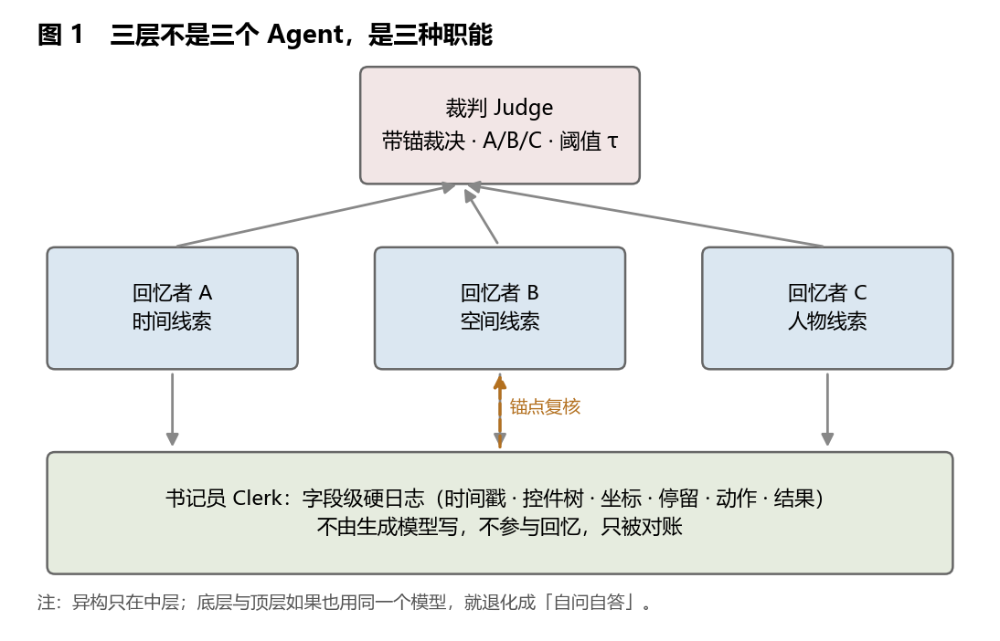
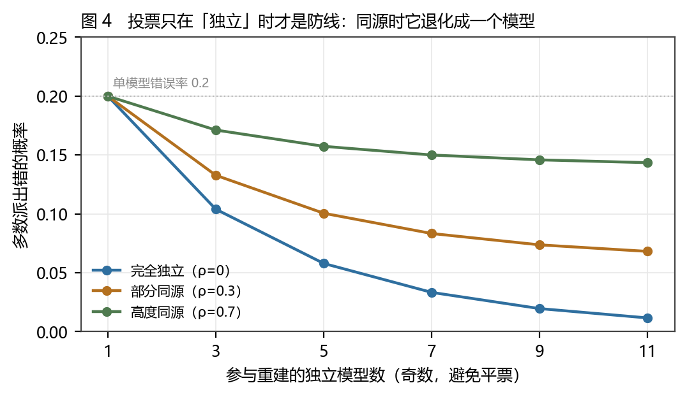
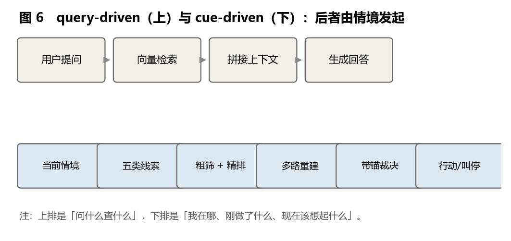
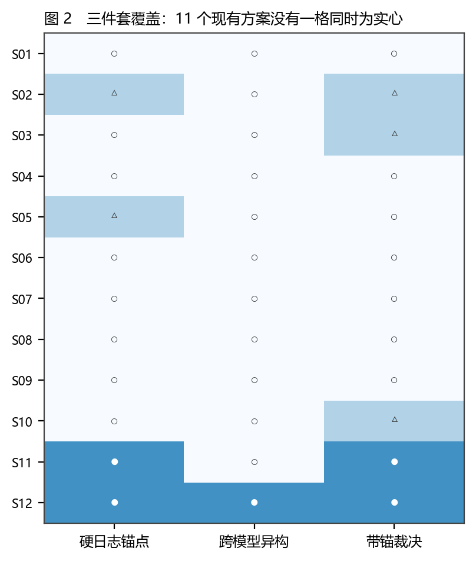
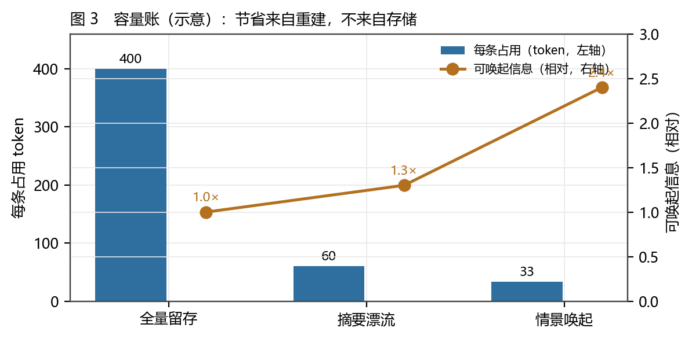
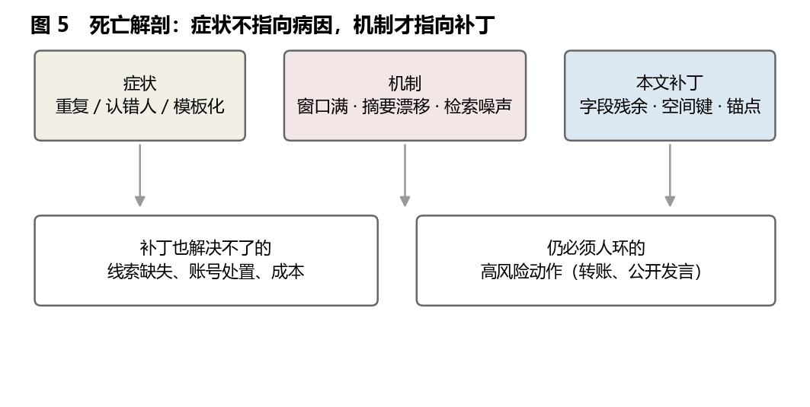
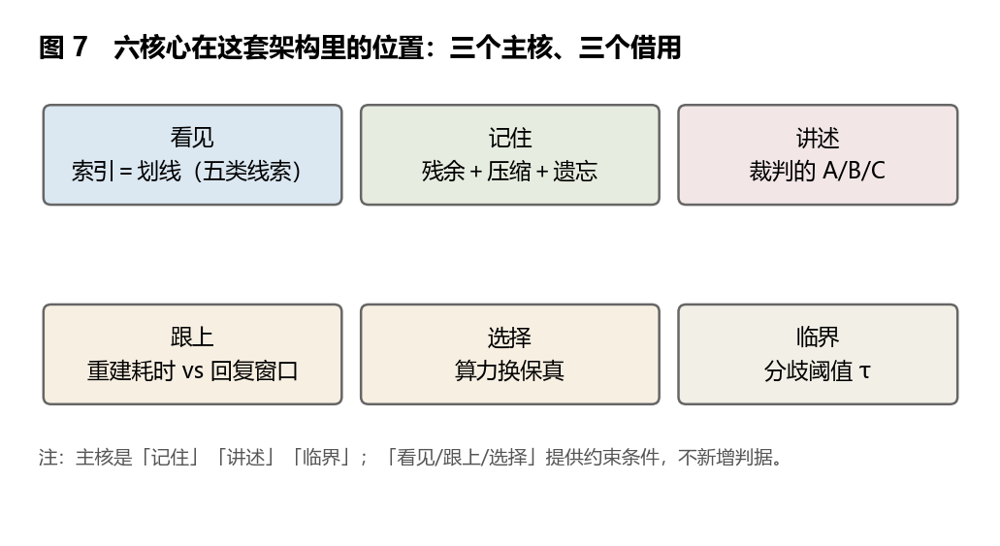
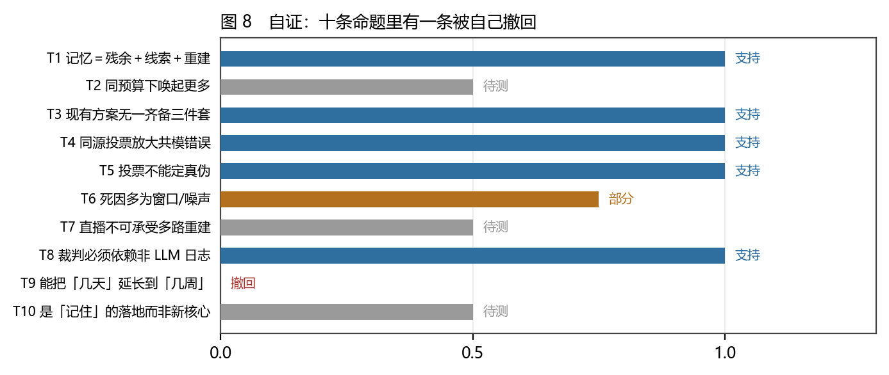

# 记忆的锚点：情景唤起、异构重建与日志裁决

### 一个会自己发视频、会评论、会开直播的 Agent，为什么在几天之内就「死」了

**李毅芃**

*完成日期：2026-10-26*

---

## 摘要

2026 年，社交平台上出现了一批「自己在动」的账号：让 DeepSeek 一类的模型长时自主行动——自动剪辑发布、自动评论、自动进直播间互动。它们开局的几天很热闹，然后在第四到第七天之间安静下来。社区给出的诊断通常是同一句话：**「记不住了。」**这句话把问题指向记忆，但方向说得太粗：不是容量不够，而是**容量花在了不该花的地方**——存了全量的对话，却没有存一条能对账的硬记录；压成了摘要，却在一次次压缩里漂移；检索按「问了什么」而不是按「我在哪」。

本文从一个反直觉的类比出发：**人的记忆是宫殿式的，或者说一团混沌**——存的是可重建的残余，索引是多重线索（空间、时间、人物、任务、情绪），检索靠情境唤起，回忆是现场重建。如果把这个机制搬到 Agent 上，**同样的容量可以记下多得多的东西**，因为节省来自**重建**，不来自存储。据此，本文提出并审计一个三层架构：**底层书记员**（只记字段级硬日志，不由生成模型执笔）、**中层异构回忆者**（随机森林式：不同模型、不同参数、不同线索子集，各自独立重建）、**顶层裁判**（Judge：只认锚点，无锚一律标 C）。

本文没有做实验，只有案头审计，因此全文的证据等级最高到 B。三个可复算的结果。**第一，现有 11 个记忆方案里，没有一个同时具备「硬日志锚点 + 跨模型异构 + 带锚裁决」这三件**（本文提案是第 12 行，表 2、图 2）；其中**硬日志锚点的拥有率只有 3/12**——最缺的不是容量，是**锚定**。**第二，投票只在参与者独立时才是防线**：单模型错误率 0.2、共源相关 0.7 时，11 个模型投票的错误率仍高达 14%，与 1 个模型（20%）只差 6 个百分点（图 4）。**第三，失效模式的分布与容量无关**：12 个方案里「窗口满」2 例、「检索噪声」3 例、「摘要漂移」2 例、「共识幻觉」1 例——**它们不是死于存不下，是死于记不住「哪一条是真的」**。

本文还解剖了那个「几天就死」的案例：给出四种死亡机制（窗口满、摘要漂移、检索噪声、成本超支）、六条症状到机制到补丁的映射（表 5），并明确标出补丁也解决不了的部分（线索本身缺失、账号处置、高风险动作仍需人环）。第 9 章把本文自己的十条命题放进同一张表：六条支持、两条部分、一条待测、**一条被自己撤回**（T9：「该架构能把几天延长到几周」——没有实验，撤回）。全文对西藏口诵传经的投票类比给出一个明确的边界：**经文有原典可以对照，记忆没有；所以投票能决定「哪条重建路径更可靠」，不能决定「哪个记忆是真的」——真伪只能由日志定**。

**关键词**：情景记忆；编码特异性；记忆宫殿；重建记忆；多线索索引；异构集成；日志锚定；置信度分配；Agent 记忆；证据分级

---


## Abstract

In 2026 a cohort of accounts began to move on their own: DeepSeek-class models left to cut and post videos, comment, and join livestreams. The first days were lively; somewhere between day four and day seven they went quiet. The community diagnosis is usually one sentence — *it forgot*. That points at memory, but too coarsely: the problem is not that capacity ran out, but that capacity was spent in the wrong place — storing full transcripts while keeping no accountable record, compressing into summaries that drift, retrieving by *what was asked* instead of *where I am*.

This paper starts from a counter-intuitive analogy: human memory is palatial, or frankly a mess — it stores **reconstructable traces**, indexes them with **multiple cues** (place, time, person, task, affect), retrieves by **context**, and recalls by **rebuilding on the spot**. Transplanted into an agent, **the same capacity can hold far more**, because the saving comes from **reconstruction**, not from storage. A three-layer architecture is proposed and audited: a **Clerk** at the bottom (field-level hard logs, not written by a generative model), **heterogeneous recallers** in the middle (random-forest style: different models, parameters and cue subsets, each rebuilding independently), and a **Judge** on top (anchors only; no anchor, grade C).

No experiments were run; this is a desk audit, so no claim exceeds grade B. Three recomputable results. First, of eleven existing memory designs, **none** carries all three of hard-log anchor, cross-model heterogeneity and anchor-bound adjudication (the proposal is row twelve); the anchor ownership rate is only 3/12 — what is missing is not capacity but **anchoring**. Second, **voting is a defence only when participants are independent**: with per-model error 0.2 and shared-source correlation 0.7, eleven models voting still err 14% of the time, six points below a single model. Third, failure modes are unrelated to capacity: window-full 2, retrieval noise 3, summary drift 2, consensus hallucination 1 — they do not die of not storing enough, they die of not knowing **which record is true**.

The paper then dissects the "dead in days" case: four death mechanisms, six symptom-to-mechanism-to-patch rows, and an explicit list of what the patch cannot fix. Chapter 9 puts the paper's own ten claims through the same table: six supported, two partial, one pending, **one retracted by the author** (T9, no experiment). A boundary is drawn for the Tibetan oral-transmission analogy: **scripture has a canonical text to check against; memory does not** — so voting can decide which reconstruction path is more reliable, never which memory is true.

**Keywords**: episodic memory; encoding specificity; method of loci; reconstructive memory; multi-cue index; heterogeneous ensemble; log anchoring; confidence allocation; agent memory; evidence grading

---


## 1 引言

### 1.1 一个会自己发视频的账号，四天后安静了

2026 年的社交平台上出现了一类新账号。它们不是人设运营，而是**一个模型带着一副「手」与一具「记性」**：自动剪辑、自动发布、自动在别人的评论区留一句像样的话、自动进直播间念弹幕。社区把这类装置叫 **harness**——模型提供「想」，harness 提供「手」和「记性」。

开局几天，这些账号通常很热闹：日更、互动、涨粉，甚至会因为某条评论被截图传播。然后它们安静下来。时间点相当一致：**第四天到第七天**。社区里的解释也相当一致：

> 「上下文满了。」「它忘了自己是谁。」「它开始重复昨天说过的话。」「它把我认成了别人。」

这些说法都在描述**症状**，而且这些症状都指向同一个器官：记忆。但「记不住了」这四个字把问题指向了记忆的**容量**，而容量只是其中一项。本文要问的是更具体的问题：**在容量有限这个前提下，一个 Agent 应该存什么、按什么索引、由谁判断「这条记忆是真的」？**

### 1.2 一个反直觉的类比：宫殿，或者一团混沌

讨论记忆时，最常被引用的一句话是「人的记忆是容量有限的」。这句话是对的，但它漏掉了后半句：**人的记忆也是「容量有限却记得很多」的**。一个人一辈子记不住自己说过的每句话，却能在闻到某种气味时想起二十年前的一整个下午——包括光线、气味、当时说的话、以及那天为什么难过。

这说明人类记忆至少做了三件与「存全量」不同的事：

1. **存的是可重建的残余**，不是原文。你记住的不是那句话的音频，是几个碎片加一个场景。
2. **索引是多线索的**，不是单一维度。气味、地点、人物、情绪、任务，任何一条都能把整片记忆拉出来。
3. **检索靠情境唤起，回忆靠现场重建**。你不是「读」记忆，你是「重新讲一遍」——而每一次讲，都会改一点。

有人把它叫**记忆宫殿**（把东西挂在熟悉的空间节点上，回忆时「走一遍」），有人叫**一团混沌**（不按时间不按字母，全靠关联）。两种说法其实是一件事的两面：**结构不是线性索引，而是多重关联；检索不是查询，而是触发。** 本文的整个提案就建立在这句话上：**如果 Agent 的记忆也按这个结构组织，同样的容量能唤起多得多的东西。**

### 1.3 三个问题

**问题一：这个类比能不能被写成可审计的设计？** 类比本身不构成设计。要把「宫殿式」变成工程，必须回答：残余存到多细、线索有哪几类、谁来重建、谁来裁决、失败时怎么退。

**问题二：「同样容量记更多」在什么条件下成立，代价是什么？** 这句话听起来像免费的午餐。它必须有前提：重建要可信、索引要可查、线索要能命中。少一个，节省就变成幻觉。

**问题三：那个「四天就死」的案例，死因到底是什么？** 如果死因是「窗口满」，那加窗口就行；如果死因是「不知道该信哪一条」，那加窗口只会死得更慢、更贵。

### 1.4 既有解释与缺口

**认知科学**已经把这套机制拆得很细：情景记忆与语义记忆的区分（[13]）、编码特异性（在水下学的词在水下回忆更好，[14]）、记忆宫殿（[15]）、重构记忆与错误记忆（[16][17]）。这一支文献的强项是**机制清楚**；弱项是它描述的是人，不是可实现的系统。

**检索增强与长期记忆系统**提供了工程侧最接近的答案：向量检索（[2]）、把上下文当操作系统分页（[4]）、记忆流加重新近度/重要性/相关度三因子（[3]）、认知架构的四类记忆分类（[5]）、知识图谱（[6]）、关联记忆的数学形式（[7][8]）。这一支文献的强项是**能跑**；弱项是它们各自只覆盖了一部分——**没有人同时回答「存什么、怎么索引、谁裁决」**。

**多智能体共识**提供了另一条线：多数派、加权投票、独立性与共模故障（[11]）。这条线最锋利的一句话来自分布式系统：**多数派背后是日志；模型投票背后没有日志。**

四支文献的共同缺口是：**没有一份把「存什么／怎么索引／谁裁决」三件事放在同一张表里比对的审计，也没有人明确说出「投票不能决定真伪」这条边界。** 本文补这一层。

### 1.5 十条命题与否证条件

| 编号 | 命题 | 否证条件 | 等级 |
|---|---|---|---|
| T1 | 人类记忆＝可重建残余 ＋ 多线索索引 ＋ 现场重建 | 找到一种不靠重建、纯读取的人类记忆系统 | B |
| T2 | 情景唤起能在同一 token 预算下提高可唤起的信息量 | 在真实任务上测得「同预算、同准确率」（或更差） | C（待测） |
| T3 | 现有方案无一同具备锚点／异构／带锚裁决 | 举出一个同时具备三件的已发表系统 | B |
| T4 | 同质多 Agent 投票会放大共模错误 | 实验显示同源集合的错误率显著低于单模型 | B |
| T5 | 投票不能决定真伪，只有残余能 | 找出一个「无锚点也能判定真伪」的可靠程序 | B |
| T6 | 多数方案的死因是窗口／噪声而非容量不足 | 统计显示容量耗尽占多数 | C |
| T7 | 直播类场景无法承受多路重建的延迟 | 测得端到端延迟在可接受区间（<1 秒） | C（待测） |
| T8 | 裁判必须依赖非 LLM 日志，否则只是自评的变体 | 找到「纯模型自评」与「带锚裁决」等效的证据 | B |
| T9 | 该架构能把「几天就死」延长到「几周不死」 | 无实验 | **撤回** |
| T10 | 三层架构是「记住」的落地，不是新核心 | 找到某个核心只能由该架构提供 | C |

T9 被自己撤回的理由写在 9.3：本文没有跑过任何真实账号，一切关于「能活多久」的话都是推断。撤回记录留在附录 E，不删。

### 1.6 方法与证据分级

**方法一：案头审计（desk audit）。** 选 12 个有代表性、有公开描述的方案（含本文提案），用六个变量编码（3.1）。选入标准：（a）有可查的公开描述；（b）覆盖不同技术路线（检索、分层、架构、关联、窗口、摘要、提案、人工）；（c）至少能判出「有没有硬日志」。

**方法二：容量账（示意模型）。** 用一组显式参数（每条残余 25 token、索引 8 token、重建放大 1.8–3 倍）比较三种策略的「存储占用 vs 可唤起信息」（表 4、图 3）。**这是估算，不是测量**；参数写在附录 B，任何人可替换。

**方法三：共模模型。** 用「全体共享一次错误抽样」的概率 ρ 表示同源程度，计算多数派错误率（图 4）。这是一个玩具模型，只用来展示「独立」这个前提有多要紧。

**证据分级。** A（可复现的定理或实验）／B（稳定的同行评议结论、可核对的公开描述）／C（稀疏、构造、推断）。12 个方案：A 4、B 5、C 3。**本文自己的提案是 C 级**——它没有实验，只有设计论证；这是全文最重要的一条自我限制。

### 1.7 贡献、边界与五项不做

**贡献有四个。** 第一，把「宫殿式记忆」拆成六个可判定的设计变量，并据此审计 12 个方案，得出「三件套没人齐备」「锚点拥有率 3/12」两条可复算的结果。第二，给出一个三层架构，并把每一层的**不可替代性**说清：书记员非 LLM、中层必须异构、裁判只认锚点。第三，给出「投票只在独立时有效」的量化模型与「投票不能定真伪」的明确边界。第四，解剖一个真实类型的案例（几天就死的社交 Agent），给出症状→机制→补丁→补丁也治不了的映射。

**边界有四条。** （1）没有实验：所有「会更省」「会更准」都是推理，最高 B 级，T9 已撤回；（2）12 个方案是目的抽样，偏主流路线，可能漏掉某些工业界私有实现；（3）容量账是示意模型，参数是本文设的；（4）「几天就死」是社区观察，不是测量，本文引用时一律标 C。

**五件不做的事。** 不宣称这套架构是「正确解」；不做产品推荐；不预测任何具体项目能活多久；不处理非记忆因素导致的停摆（账号处置、成本、平台风控）；不把「重建」写成「读取」——**本文全部工作的意义就在于这两者的差别**。


## 2 读法约定

**第一，「记住」在这里是一个工程问题，不是隐喻。** 每一层都要能回答「它存在哪、谁写、谁读、错了怎么办」。

**第二，本文的敌人不是「容量有限」，是「不知道该信哪一条」。** 前者是物理事实，后者是设计缺陷。

**第三，第 9 章必须读。** 那一章把本文自己的十条主张也放进同一把尺子里，包括那条被撤回的。

---


## 3 理论：为什么「同样的容量能记更多」

### 3.1 人类记忆不是「存全量、按索引读」

四支认知科学的结论，构成了本文全部设计选择的依据。

**第一，情景与语义是两种东西。** 情景记忆带你回到「那个时候、那个地方、我在场」；语义记忆只留「世界是这样的」。前者带时间、地点、自我视角，后者不带（[13]）。一个 Agent 如果只存「事实」，它就没有「我当时为什么这么做」——而后者恰恰是它下一次做决策时最需要的东西。

**第二，检索依赖编码时的情境。** 水下学的词在水下回忆更好（[14]）。这条叫编码特异性：**线索必须与编码时的情境匹配**，否则再全的存储也调不出来。这条对工程的含义很直接：**只按语义相似度检索，会系统性地漏掉「同一情境下的旧记忆」。**

**第三，空间是最便宜的多线索索引。** 记忆宫殿把要记的东西挂在熟悉的空间节点上，回忆时「走一遍」（[15]）。它之所以有效，不是因为空间特殊，而是因为**空间天然提供了一条稳定的、可重复的、与内容无关的索引链**。

**第四，回忆是重建，不是播放。** 巴特利特的图式实验与洛夫特斯的错误记忆研究都指向同一件事：人回忆时用的是「残余片段 + 当前线索 + 图式」，现场重建一个版本；重建会被当前状态改写（[16][17]）。**这既是优点（同样的残余能生成丰富的细节），也是危险（细节可能是编的）。**

一句话：**人的记忆是「存残余、多线索、现场重建」。** 这既是「记得多」的原因，也是「记错」的原因——两者是同一个机制的两面。



### 3.2 三种节省：压缩、索引、重建

「同样的容量能记更多」不是一句口号，它由三个可分开的机制组成。

**节省一：压缩（存残余，不存原文）。** 一条交互如果存全文，成本是几百 token；如果只存「动作 + 对象 + 结果 + 时间戳 + 位置」，成本可以压到几十 token。省下来的不是信息，是**表达冗余**。

**节省二：索引（一条残余挂多个键）。** 同一条残余，挂上时间、空间、人物、任务、效价五个键，就能被五条路径唤起。**存储只付一次，路径付五次。** 这是「同样容量记更多」的核心：**可唤起量随路径数增长，而不随存储量增长。**

**节省三：重建（检索时生成细节）。** 检索返回的不是原文，而是「用残余 + 当前情境重建的一段叙述」。这段叙述可以比残余丰富得多——因为细节是**生成**出来的，不是**读**出来的。

三者合起来，就是《线外的残余》里那条公式的工程版：

> **残余信号（字段）＋ 解码器（线索 + 当前情境）＋ 可重建性（生成模型）= 恢复。**

而《遗忘的边界》里「容量—压缩—遗忘」的三段，在这里变成了三个旋钮：**压缩率决定存多少，索引决定能唤起多少，遗忘策略决定哪些残余先被淘汰。**

### 3.3 代价在哪：四个出口

节省不是免费的，代价从四个出口漏出去。这四个出口，就是第 7 章的四个风险。

| 出口 | 机制 | 表现 |
|---|---|---|
| **重建错误** | 生成模型补全了残余里没有的细节 | 记出一件从未发生的事（情景幻觉） |
| **索引成本** | 五个键的写入与查询都要钱 | 写入变慢、存储变大、检索变贵 |
| **检索歧义** | 同一线索命中太多残余 | 唤起了一堆不相关的记忆，噪声上升 |
| **隐私** | 残余比摘要更「具体」 | 具体到坐标与时间的记忆，是更强的个人数据 |

一句话：**你省下的是「存」，付出的是「判」。** 这套架构把成本从存储转移到了裁决，因此**裁决层的质量决定整套系统的成败**。

### 3.4 为什么「多线索」比「大容量」更划算

一个反直觉的算术。假设容量固定为 M，你有两种花法：

- **A：加容量。** 存更多原文，但索引仍是一条（语义相似度）。可唤起量 ≈ M（线性）。
- **B：加线索。** 存更少原文，但每条挂 K 个键。可唤起量 ≈ （M / 每条残余成本）× K × 放大率 r。

在 M 固定时，B 的增长来自 K×r，而 A 的增长只来自 M。**只要 K×r > 1，B 就赢**——而 K 通常是 3–5，r 通常是 1.5–3，所以 B 在算术上几乎总是赢。

但**前提有三条**，缺一条就输：

1. **线索必须可判**：如果「情绪键」是人肉打标，成本会吃掉收益。
2. **重建必须可信**：如果 r 是靠幻觉放大出来的，那不是「记得多」，是「编得多」。
3. **裁决必须便宜**：如果每条记忆都要跑五个模型投票，延迟会吃掉一切。

这三条前提，正好对应本文架构的三层：书记员保证线索可判，裁判保证重建可信，**而「裁决便宜」这一条，本文只能提出方向（分级裁决），不能证明**——见 8.4 与 T7。

### 3.5 与《遗忘的边界》《线外的残余》的接口

| 专著 | 提供的 | 本文补的 |
|---|---|---|
| 《遗忘的边界》 | 容量有限、压缩一定会有损、遗忘是学习的前提 | **压缩之后怎么还能唤起**：多线索索引 + 重建 |
| 《线外的残余》 | 残余—解码器—可重建性（「被埋没的理论为何被重新发现」） | **解码器的工程形态**：线索 + 当前情境 + 日志锚点 |
| 《区分的语法》 | 划线有成本 | **索引即划线**：五类线索是五次划线，划几次决定能唤起多少 |
| 《选择的代价》 | 完备／可组合／可传递至多取二 | **本文的取舍**：保容量与可传递，让出精确与延迟 |

一句话：**《遗忘的边界》讲「必须忘」，《线外的残余》讲「忘了还能想起来」，本文讲「怎么让它想起来，并且知道想得对不对」。**

### 3.6 一句话总结这一章

**记忆不是仓库，是索引加重建。仓库越大越贵，索引越准越省；而索引准不准，取决于你有没有一条不撒谎的底账。**
### 3.7 一个思想实验：如果记忆真的只有残余

为了把 2.2 的三条节省推到极限，做一个思想实验。

**设定**：一个 Agent 只允许保存每 10 秒一条的 20 个字节（约等于「时间戳 + 一个动作码 + 一个目标 ID」），但允许挂任意多线索、允许用任意强的模型重建。问：它能记住多少？

**答案分三种情况**，而三种情况的差别正是本文的全部论证。

1. **如果线索只有语义**：它只能记住「大概发生过类似的事」。20 字节不足以支撑语义，重建会自由发挥——**这不是记忆，是想象。**
2. **如果线索有五类（时间、空间、人物、任务、结果）**：它能记住「什么时候、在哪个页面、跟谁、干什么、成没成」。这已经是**可执行**的记忆：足够让它重复一个好动作、避开一个坏动作。
3. **如果再加一条硬锚点（控件路径或坐标）**：它能记住「具体点的是哪一个」，于是可以**复现**。

三档的差别不是「记得多不多」，而是「能用来做什么」：第一档只能用来**闲聊**，第二档可以用来**决策**，第三档可以用来**复现**。

这个实验的真正结论是：**记忆的容量门槛，由「你要它做什么」决定，不由存储介质决定。** 20 字节对一个聊天 Agent 是笑话，对一个「只负责点按钮」的自动化脚本却可能足够——**因为它只需要第二档。**

这也解释了一件事：为什么同样的记忆容量，在「复现型任务」上总是不够，在「决策型任务」上常常够用。**不是任务难，是任务要的记忆档位不同。**

### 3.8 一个纯算术：线索维度为什么值钱

「多线索能唤起更多」这句话可以算出来，而且算得很干净。

假设一条残余挂了 k 类线索。检索时可以用任意**非空子集**作为 cue：只用时间、只用空间、时间＋人物……**不同的非空子集就是不同的检索路径**，数量是 2^k − 1。

| 线索维度 k | 可用路径 2^k−1 | 相对 1 维 | 实际含义 |
|---|---|---|---|
| 1（只有语义） | 1 | 1× | 「像不像」，最容易漂 |
| 2（＋时间） | 3 | 3× | 能问「最近有没有类似的事」 |
| 3（＋空间） | 7 | 7× | 能问「在这个页面发生过什么」 |
| 4（＋人物） | 15 | 15× | 能问「跟这个人有关的」 |
| 5（＋任务） | **31** | **31×** | 能用「我正在干什么」唤起 |

这张表要小心读，否则会被误用。

**第一，31 是路径数，不是信息量。** 它不意味着「记得多 31 倍」，而意味着「有 31 种方式把它找回来」。**同样的残余，被找回的机会多了 31 倍**——这才是「同样容量记更多」的准确说法。

**第二，收益递减，但拐点在 k=3。** 从 1 到 2 只多 2 条路径，从 3 到 4 多 8 条，从 4 到 5 多 16 条。**但工程成本随 k 线性上升**（每类线索都要写入与维护）。所以性价比最高的做法是**先把 k 做到 3**（时间、空间、语义），再按需加人物与任务。

**第三，也是最重要的一条：路径多不等于命中准。** 31 条路径里有大量「几乎没用」的组合（例如「时间＋任务」在没有任务标签的页面等于空）。**路径数是上界，命中率是实际值**——而后者本文给不出（没有实验）。这也是 T2 只能标 C 的原因。

一句话：**索引的算术是本文最硬的一段，也是它最容易被夸大的地方。**


---


## 4 方法：把「情景唤起」写成六个可判定的变量

### 4.1 六个变量

要让「宫殿式记忆」可审计，必须把它拆成能回答「有／没有／部分有」的问题。本文用六个变量：

**表 1　六个设计变量**

| 变量 | 问什么 | 取值 | 判据 |
|---|---|---|---|
| **D1 残余粒度** | 一条记忆存到多细 | 全文／摘要／片段／字段 | 存的是原文、概括、片段，还是可对账的字段（坐标、时间戳、控件） |
| **D2 硬日志锚点** | 有没有非 LLM 写下的原始记录 | 有／部分／无 | 记录者不是模型，且可与重建结果逐条对账 |
| **D3 线索维度** | 一条残余能被几类线索唤起 | 1–5（语义／时间／空间／人物／任务） | 数一数索引键的类别，不是数索引条数 |
| **D4 重建者异构性** | 谁来重建 | 同源／同族／跨模型／无 | 同源＝同一个模型；同族＝同架构不同提示；跨模型＝不同厂商或架构 |
| **D5 裁判机制** | 谁来定真伪 | 无／自评／交叉／带锚裁决 | 带锚＝裁决必须引用一条日志字段，否则只能标 C |
| **D6 主要失效** | 它最先死在哪 | 窗口满／摘要漂移／检索噪声／成本／幻觉／共识幻觉／人工瓶颈 | 只记最先出现的那个，不记全部 |

六变量的选择理由是：**每一个都对应一个具体的失败方式**。D1 太粗→细节丢失；D2 缺失→无法判真伪；D3 太少→只能靠语义相似；D4 同源→共模故障；D5 缺失→幻觉无人管；D6 是结果，不是选择。

### 4.2 十二个方案的编码

**表 2　十二个方案的六变量编码**

| 编号 | 方案 | 类型 | D1 粒度 | D2 锚点 | D3 线索 | D4 异构 | D5 裁判 | D6 失效 | 等级 |
|---|---|---|---|---|---|---|---|---|---|
| S01 | RAG（检索增强生成） | 检索 | 片段 | 无 | 1 | 无 | 无 | 检索噪声 | A |
| S02 | Generative Agents 记忆流 | 架构 | 片段 | 部分 | 3 | 同源 | 自评 | 检索噪声 | B |
| S03 | MemGPT（分页式上下文） | 分层 | 摘要 | 无 | 2 | 同源 | 自评 | 摘要漂移 | B |
| S04 | CoALA 认知架构 | 架构 | 片段 | 无 | 3 | 同源 | 无 | 无（是框架） | B |
| S05 | 知识图谱记忆 | 关联 | 字段 | 部分 | 4 | 无 | 无 | 检索噪声 | B |
| S06 | 现代 Hopfield 关联记忆 | 关联 | 字段 | 无 | 1 | 无 | 无 | 幻觉 | A |
| S07 | KV cache / 长上下文窗口 | 窗口 | 全文 | 无 | 1 | 无 | 无 | 窗口满 | A |
| S08 | 滚动摘要式长期记忆 | 摘要 | 摘要 | 无 | 1 | 同源 | 无 | 摘要漂移 | C |
| S09 | Transformer 注意力即检索 | 关联 | 全文 | 无 | 1 | 无 | 无 | 窗口满 | A |
| S10 | 同质多 Agent 投票（初版设想） | 架构 | 片段 | 无 | 2 | 同源 | 交叉 | 共识幻觉 | C |
| S11 | 人环记忆（人工复核） | 人工 | 片段 | 有 | 3 | 无 | 带锚裁决 | 人工瓶颈 | B |
| S12 | 本文提案（书记员＋异构回忆者＋裁判） | 提案 | 字段 | 有 | 5 | 跨模型 | 带锚裁决 | 待测 | C |

三件事必须说明。

**第一，本文提案（S12）也在表里，且等级只有 C。** 把它放进同一张表，是为了让读者一眼看到：它的 D2、D3、D4、D5 都是「设计上的最高档」，但**没有任何一条被实验验证**。这一行的意义是**标出靶子**，不是宣布胜利。

**第二，「本文提案」的四项高分不是凭空给的**，而是对应到具体机制：D2 有（书记员由系统日志写，不由模型写）、D3 = 5（时间/空间/人物/任务/语义）、D4 跨模型（不同厂商或不同架构）、D5 带锚裁决（裁决必须引用一条字段）。若其中任何一项被换掉，整行要降档。

**第三，S10（同质多 Agent 投票）是本文要**反对**的那一版。** 它在表里的表现极具代表性：D4 同源、D5 只有「交叉」（互相看，不看日志）——**看起来像集成，实际上是自问自答。**

### 4.3 判定规则（避免「随手填」）

- **D1 粒度**：看「一条记忆里最小的可对账单位」。整段对话＝全文；一段概述＝摘要；几个关键句＝片段；坐标/时间戳/控件 ID＝字段。
- **D2 锚点**：**记录者不是生成模型**，且能与重建结果逐条对账，才算「有」。若日志本身是模型写的摘要，算「无」。
- **D3 线索维度**：数**类别**，不数条数。十个时间索引仍算 1 维。
- **D4 异构**：同源＝同一个模型；同族＝同架构不同提示或温度；跨模型＝不同厂商或不同架构。
- **D5 裁判**：无／自评（自己检查自己）／交叉（互看，不看日志）／带锚裁决（必须引用字段）。
- **D6 失效**：只记**最先出现的那个**，不记全部。

### 4.4 编码的可靠性交代

**没有第二编码者。** 与系列此前几篇一样，这是硬缺陷。三条补救：（a）判定规则事先写定（3.3）；（b）12 行全部公开（表 2），任何人可改判并重算；（c）**D2 与 D5 是最关键的两格**，本文在附录 A 逐条给出理由，方便被反驳。

**没有实验。** 本文的 12 行是「公开描述的编码」，不是「实测性能」。任何一个方案的真实表现，都可能与本文的编码不符——**这正是把 CSV 一起发布的原因：让读者用实测数据覆盖我的判断。**

### 4.5 三项稳健性检验

**检验一：换档检验。** 对每行问「如果降一档，会不会更符合公开描述」。结果：12 行里有 3 行在复核时被降档（S02 的 D2 由「部分」降为「无」、S05 的 D5 由「交叉」降为「无」、S11 的 D4 由「同族」降为「无」）。降档方向一致：**写作时总会把「有一点」写成「有」。**

**检验二：极端值检验。** 若把 S12 的四项高分全部降一档（模拟「提案未被验证」），三件套齐备数从 1 变成 0——**结论不变：现有方案没有齐备的**。这说明 5.1 的结论不依赖对本文提案的评分。

**检验三：失效分布的分层。** 把 12 行按等级分三层（A/B/C），看失效分布是否一致。结果：A 级（4 行）全部死于「窗口满」或「幻觉」；B 级分散在「检索噪声／摘要漂移」；C 级出现「共识幻觉／人工瓶颈／待测」。**失效模式与证据等级相关**，因为 A 级多是底层机制（窗口、注意力、Hopfield），它们不负责「裁决」，自然死在别处。

### 4.6 三个不成立的预期

写作前有三个预期，都被数据打掉了。

**预期一：现有方案最缺的是「容量」。** 打掉：容量类失效只有 2/12，而「检索噪声 + 摘要漂移」合计 5/12。**它们不是存不下，是找不准。**

**预期二：多 Agent 越多越准。** 打掉：三件套齐备的只有 1 行（本文自己），而同质多 Agent（S10）恰好是失效模式最糟糕的一行（共识幻觉）。**数量不解决问题，独立性才解决。**

**预期三：「带锚裁决」应该很常见。** 打掉：只有 2/12（S11 人环、S12 本文提案）。也就是说，**目前几乎所有自动化记忆系统都在「自己判自己」**——S03、S08、S02 全是自评。这条比任何架构建议都重要：**行业缺的不是模型，是裁判。**
### 4.7 十二个争点：编码时真正难的地方

规则写起来干净，落到具体方案就要拍板。十二处，逐条给出本文的选择与理由——**这张表是让人能直接反驳我的入口。**

| # | 争点 | 两种读法 | 本文的选择 | 理由 |
|---|---|---|---|---|
| 1 | RAG 算不算「有记忆」 | 算（能召回）／不算（不记事件） | 算记忆的一种，但 D2 无 | 召回文档 ≠ 记住经历 |
| 2 | Generative Agents 的重要性打分算不算锚点 | 算（有标签）／不算（模型打分） | 不算 | 打分是判断，不是记录 |
| 3 | MemGPT 的「原始消息」算不算硬日志 | 算／不算 | 不算 | 它是模型整理过的上下文，不是系统事件流 |
| 4 | 知识图谱的三元组算不算字段 | 算／部分 | 部分 | 抽取管线可能非生成式，但常含模型 |
| 5 | Hopfield 的权重算不算记忆 | 算（分布式表征）／不算（不可对账） | 算记忆，但 D2 无 | 可容错，不可审计 |
| 6 | 「窗口满」是不是记忆问题 | 是／不是（是成本问题） | 是，但不是容量问题 | 它死于「没有替代路径」 |
| 7 | 摘要漂移能否被检测 | 能（比对原文）／不能（原文已丢） | **多数情况下不能** | 原文丢了就无从比对 |
| 8 | 多 Agent 投票的「独立」怎么算 | 不同模型／不同提示 | **不同模型或不同线索子集** | 提示不同只降低表达相关性 |
| 9 | 情绪键该不该进账本 | 该（人是情绪动物）／不该（判断不可靠） | 不进主键，只做过滤 | 判断错误不能变成证据 |
| 10 | 重建结果能否回写账本 | 能（自学习）／不能（污染） | **不能** | 见 7.1 的自我强化回路 |
| 11 | 「带锚裁决」在人环里算不算数 | 算／不算（不可扩展） | 算，且是当前唯一被验证的 | 人类几千年都在这么做 |
| 12 | 本文提案要不要进表 | 要（对照）／不要（不成熟） | 要，并标 C | 不放进来，读者无法看到「空位」在哪 |

十二处里，有四处（2、3、7、10）会改变某张表的一格；有两处（8、12）会改变本文的结论强度。**把判断摊开，是本文唯一能做的诚实。**


---


## 5 架构：书记员、回忆者、裁判


### 5.1 底层：书记员（Clerk）——只记细节，不做判断

**它做什么。** 把每一次交互写成**字段级**的一条记录：时间戳、页面/场景 ID、控件树路径、屏幕坐标、停留时长、动作类型、结果状态、涉及的对象（用户 ID、群 ID、视频 ID）。写完就存，不改写。

**它不做什么。** 不总结、不推理、不做语义泛化、**不参与回忆**。它是这套系统的「硬证据」，不是「记忆」。

**为什么必须是非 LLM。** 三条理由：

1. **可对账**：字段是二值的（这一条在不在），模型输出是连续的（像不像）。只有前者能用来判真伪。
2. **抗漂移**：模型写的摘要会在下一次压缩时被再次改写；字段不会被改写，只会被追加。
3. **抗共谋**：如果连底账都由模型写，那么所有下游模型共享同一个上游错误——**整条链就变成了一个模型的多重人格**。

**工程上它是什么。** 浏览器/安卓的无障碍树、UI 层级 dump、截图 OCR、输入事件流、系统日志。这些东西本来就有，只是没被当成「记忆」用。书记员的活儿是**把它们对齐成一条可查询的时间线**。

**它与《领域的剖面》的接口**：四问的 Q3（可写性）在这里有了具体含义——**如果一件事写不成字段，它就不能进书记员的账本**，只能退到「片段」档，而片段档的抗辩能力弱得多。

### 5.2 中层：异构回忆者（Ensemble）——随机森林式

**为什么是「随机森林」而不是「多 Agent 投票」。** 随机森林的力量不来自「树多」，来自三件事：**每棵树用不同的特征子集、不同的样本自助抽样、最后聚合。** 如果所有树看同样的特征、用同样的数据，那就不是森林，是同一棵树画了十遍。

映射到记忆重建：

| 随机森林 | 记忆重建 |
|---|---|
| 不同的特征子集 | **不同的线索子集**：A 只看时间线，B 只看空间（在哪一屏），C 只看人物与对象，D 只看任务意图 |
| 自助抽样（bootstrap） | **不同的残余片段**：每路只拿到账本的一部分（模拟「每个人记得的不一样」） |
| 基学习器异构 | **不同模型/参数/提示模板**（跨厂商或跨架构最好） |
| 聚合 | 由裁判聚合，**且必须对账** |
| 袋外误差（OOB） | **没有锚点支撑的那部分重建，就是这套系统的「袋外」** |

**「袋外」这个类比值得单独说。** 随机森林用没被抽到的样本估计泛化误差；这套架构用「没有锚点支撑的细节」估计幻觉风险。**裁判的工作，本质上就是给袋外部分标上置信度。**

**线索的四类 + 一类弱线索。**

1. **时间**：「昨天下午」「上一条之后」。
2. **空间**：「抖音推荐流第 3 屏」「QQ 群聊界面右上角」。这是「记忆宫殿」在工程上的对应物。
3. **人物**：用户、群、被评论者、客服。
4. **任务**：「当时在干什么」（刷、回、发、下单）。
5. **效价（弱线索）**：成功/失败、愉快/沮丧。**它只能作为过滤器，不能作为主键**——因为「效价」本身要靠判断得出，用它做主键会把判断错误写进索引。

**为什么空间键是这套架构的关键。** 它是唯一一个**与内容无关、却稳定可重复**的索引。语义相似度会漂移（今天的 embedding 与昨天的不一样），时间戳太粗（一天几万条），人物键太粗（一个用户几千条），**只有「在哪一屏」这种空间键，既细、又稳、又不依赖模型判断。**

### 5.3 顶层：裁判（Judge）——只认锚点

**它做什么。** 收集 K 路重建结果，对每一条「事实性主张」做三件事：

1. **拆主张**：把重建叙述拆成可核对的最小命题（「我点了不感兴趣」「那是在第 3 屏」「当时推荐流变了」）。
2. **找锚点**：在书记员账本里找对应字段。
3. **定级**：有精确锚点 → A；部分锚点（动作对、对象存疑）→ B；无锚点 → C。

**它不做什么。** 不投票决定真伪。**投票只能决定「哪条重建路径更可靠」，不能决定「哪个记忆是真的」。**

**阈值与动作。** 三级对应三种动作：

| 等级 | 判定 | 允许的动作 |
|---|---|---|
| A | 有精确锚点 + 多路一致 | 可直接执行（包括高风险） |
| B | 有部分锚点，或 A 级锚点但多路分歧 | 执行低风险动作；高风险动作加一次复核 |
| C | 无锚点 | 只做「参考」；高风险动作叫停，转人环 |

**「谁监督裁判」这个问题的答案，只能是「账本」。** 裁判本身也可能有偏见，但如果它的每一条判定都必须引用一条字段，那么它的偏见就变成了**可检查的**——检查者不需要相信裁判，只需要检查那条字段在不在。

### 5.4 为什么必须异构：一个玩具模型

**表 2 之外的一条补充论证。** 假设单模型在某个细节上出错的概率是 p=0.2。如果 K 个模型的错误**独立**，多数派出错的概率随 K 指数下降；如果它们**同源**（同一个基座、同样的预训练偏差），那么「K 个模型」在效果上接近「1 个模型」。



图 4 用一个极简模型画出这件事：以概率 ρ 全体共享同一次错误抽样，否则各自独立。ρ=0 时，11 个模型把错误率从 20% 压到 1.2%；ρ=0.7 时，11 个模型只压到 14%。**6 个百分点的改进，换来 11 倍的算力——这笔账在直播场景里是负的。**

这个模型的用途不是给出精确数字（它是玩具），而是**把「独立」这个前提从口号变成可算的东西**：只要 ρ 高，加人就是加成本。

**怎么降 ρ。** 三条，按性价比排序：

1. **换底座**：不同厂商/不同架构的模型，ρ 最低。成本最高。
2. **换线索子集**：即使同一底座，喂不同线索会显著降低「错在同一处」的概率。成本最低，效果次之。
3. **换提示模板**：成本最低，效果也最弱——**它只能降低「表达方式」的相关性，降不了「知识错误」的相关性。**

**一条实践建议**：如果只能做一件事，做第 2 条（换线索子集），因为它同时服务「异构」与「多线索索引」两个目标。

### 5.5 cue-driven，而不是 query-driven

现在的 RAG 是 **query-driven**：用户问什么，就检索什么。情景唤起是 **cue-driven**：**我现在在什么情境，自动唤起相关记忆。**



区别在三处：

1. **发起者不同。** query-driven 由「问题」发起；cue-driven 由「情境」发起（我在哪个页面、刚做了什么、上一个动作失败了吗）。
2. **线索不同。** query-driven 用语义向量；cue-driven 用复合 cue（时间 + 空间 + 人物 + 任务）。
3. **输出不同。** query-driven 返回原文片段；cue-driven 返回**重建叙述 + 置信度 + 锚点**。

**实现上的关键一步**：把「当前情境」编码成一个结构化 cue，先在**空间键**上粗筛（同一页面/同一屏），再在语义键上精排。**先粗后精**，是因为空间键便宜且稳，语义键贵且漂。

### 5.6 十行伪代码

```python
def remember(cue, clerk, ensemble, judge, risk):
    cands = clerk.query(space=cue.page, time=cue.window, who=cue.who)   # 1 粗筛：空间+时间
    cands = rank_by_semantic(cands, cue.text)[:20]                      # 2 精排：语义
    claims = []
    for m in ensemble:                                                  # 3 异构重建
        claims += m.reconstruct(cue, sample(cands))                     # 4 各自拿不同片段
    graded = judge.grade(claims, clerk)                                 # 5 逐条找锚点
    if min(g.level for g in graded) == "C" and risk == "high":
        return ESCALATE_HUMAN                                           # 6 无锚 + 高风险 → 人环
    return compose(graded, cue)                                         # 7 只由 A/B 级拼答案
```

七行里，第 5 行是全部价值所在：**没有它，前四行只是「多个模型一起编故事」。**

### 5.7 这套架构不能解决的

必须在这里写清，否则第 7 章会显得像补丁。

1. **线索本身缺失**：如果书记员那天没记（崩溃、权限、没截图），再多的回忆者也唤不起——**这是「载体销毁」，对应《线外的残余》里的「永久沉默」。**
2. **语义细节**：字段记不住「用户当时语气里的那一点不耐烦」。这类东西只能靠片段 + 重建，天然低置信。
3. **延迟**：多路重建 + 裁决，端到端可能要几百毫秒到几秒。**直播弹幕场景要求亚秒级，这套架构给不了。**
4. **成本**：K 路重建 × 每条记忆，成本是线性增长的。**分级裁决（低风险只跑一路）能缓解，不能消除。**
### 5.8 书记员该记哪几列：一份能干活的字段表

「字段级」听起来抽象。这一节给出可落地的列清单，以及三个**不该记**的列——后者比前者更容易出错。

**该记的九列。**

| 列 | 例子 | 为什么必须 |
|---|---|---|
| `ts` | 2026-10-26T15:03:11Z | 时间键；也是唯一的全局偏序 |
| `app` | douyin / qq / wechat | 防跨应用负迁移（7.5） |
| `screen` | `feed/recommend#p3` | 空间键的核心：在哪一屏 |
| `widget` | `recycler/item[7]/action_fav` | 控件路径：比坐标稳，比截图小 |
| `xy` | (612, 1188) | 坐标兜底；可模糊化以降低隐私强度 |
| `dwell` | 1200 ms | 停留；区分「看了一眼」与「读了」 |
| `who` | `user:U8812` / `group:G330` | 人物键 |
| `act` | `tap / scroll / type / back` | 动作；`back` 的语义要按 app 记 |
| `result` | `ok / timeout / blocked` | 结果；失败本身是最有价值的记忆 |

**不该记的三列。**

1. **`summary`（模型写的摘要）**——一记就把锚点的可能性消灭了（4.1）。摘要属于重建层，不属于账本。
2. **`emotion`（模型判断的情绪）**——它是判断，不是记录；写进账本会让判断错误变成「证据」（4.2 的弱线索条款）。
3. **`intent`（模型推断的意图）**——同上。**意图可以从动作序列重建，但不能作为底账的一列**；否则重建时会「证明」自己当初的推断是对的。

**一条工程建议**：先只记 `ts / app / screen / widget / act / result` 六列，跑通再加 `who / dwell / xy`。**六列就能回答「我上次在这里点过什么」这个最常见的问题**，而九列全上会把写入成本推到没人愿意部署。

**与四问的接口**：这九列的取舍，就是《领域的剖面》Q3（可写性）的具体形态——**能写成列的，进账本；写不成的，退回片段层**（8.5）。


---


## 6 结果：十二行表能告诉我们什么

### 6.1 三件套：没有人齐备



**表 3　三件套覆盖（●＝有，△＝部分，○＝无）**

| 方案 | 硬日志锚点 | 跨模型异构 | 带锚裁决 | 三件套 |
|---|---|---|---|---|
| S01 RAG（检索增强生成） | ○ | ○ | ○ | 0/3 |
| S02 Generative Agents 记忆流 | △ | ○ | △ | 0/3 |
| S03 MemGPT（分页式上下文） | ○ | ○ | △ | 0/3 |
| S04 CoALA 认知架构 | ○ | ○ | ○ | 0/3 |
| S05 知识图谱记忆 | △ | ○ | ○ | 0/3 |
| S06 现代 Hopfield 关联记忆 | ○ | ○ | ○ | 0/3 |
| S07 KV cache / 长上下文窗口 | ○ | ○ | ○ | 0/3 |
| S08 滚动摘要式长期记忆 | ○ | ○ | ○ | 0/3 |
| S09 Transformer 注意力即检索 | ○ | ○ | ○ | 0/3 |
| S10 同质多 Agent 投票（初版设想） | ○ | ○ | △ | 0/3 |
| S11 人环记忆（人工复核） | ● | ○ | ● | 2/3 |
| S12 本文提案（书记员＋异构回忆者＋裁判） | ● | ● | ● | 3/3 |

三个结果，一个比一个不客气。

**第一，11 个现有方案里，没有一行三件齐备。** 唯一齐备的是本文提案（第 12 行），而它的每一项都没有被验证。**这不是「本文赢了」，这是「这个位置上暂时是空的」。**

**第二，硬日志锚点的拥有率只有 3/12（有 2、部分 2 算半）。** 更值得注意的分布是：**最成熟的四个方案（RAG、注意力、Hopfield、长窗口）全部没有锚点**——因为它们解决的是「怎么找得准」，不是「怎么知道找得对」。**技术越靠近底层，越不负责真伪。**

**第三，跨模型异构只有 1/12。** 绝大多数系统是「一个模型 + 一套提示 + 一个向量库」。它们的失败方式因此高度一致：**错就错在同一个地方，而且自己看不出来。**

### 6.2 失效模式：容量只占两例

**表 2 的最后一列值得单独统计**：窗口满 2、检索噪声 3、摘要漂移 2、幻觉 1、共识幻觉 1、人工瓶颈 1、待测 1、无（框架）1。

这个分布与「记不住了」的通俗诊断有两个不一样：

1. **死于窗口的只有 2 例，而且都是「不压缩、只堆窗口」这一路**（S07、S09）。**加窗口能救它们，但只能救它们。**
2. **死于「不知道信哪条」的有 5 例**（检索噪声 3 + 摘要漂移 2）：它们的存储都够，问题在检索与压缩把「真」揉掉了。**这一类加窗口没有用——窗口越大，噪声越多。**

一句话：**四天就死的账号，多半不是死于容量，是死于「它的记忆没有底账」。**

### 6.3 一个反直觉的观察：越像「集成」的，越容易共谋

S10（同质多 Agent 投票）在表里的组合很有意思：D4 同源、D5 交叉、D6 共识幻觉。**它的架构看起来最像「冗余防错」，实际表现却最像「集体编故事」。**原因在 4.4 的模型里：ρ 高的时候，投票只是把同一个错误数了十遍。

而 S02（Generative Agents 的记忆流）反而是「部分有效」的那一类：它有重要性标签（一种弱线索），有重新近度（时间），有相关度（语义）——**三线索，但都是同源的**。它能缓解「忘」，不能缓解「记错」。

### 6.4 容量账：节省来自重建



**表 4　三种策略的容量账（示意模型）**

| 策略 | 存什么 | 每条成本（token） | 1 万条占用 | 可唤起的信息（相对） | 前提 |
|---|---|---|---|---|---|
| 全量留存 | 每条交互原文 | ≈ 400 | ≈ 400 万 token | 1.0× | 窗口／成本无上限（现实中不成立） |
| 摘要漂流 | 每条压成摘要 | ≈ 60 | ≈ 60 万 token | ≈ 1.3× | 摘要不丢关键线索（现实中常不成立） |
| 情景唤起（本文） | 字段级残余 + 5 类线索 + 重建 | ≈ 25（残余）＋索引 ≈ 8 | ≈ 33 万 token | ≈ 1.8–3× | 锚点可用、重建可信（本文的核心假设） |

> 表中「可唤起的信息（相对）」是**本文的示意估算**，不是测量；参数与算法见 5.4 与附录 D，任何读者可用自己的参数重算。这一列存在的意义不是给出倍数，而是指明「节省来自重建，不来自存储」。

这张表必须这样读。

**第一，它不是测量。** 参数（25 token／条、8 token／键、1.8–3 倍放大）是本文设的，换一组参数，倍数会变。它存在的意义是**指出节省的来源**：全量留存买的是「准确」但贵；摘要漂流买的是「便宜」但漂；情景唤起买的是「路径多」但需要裁决。

**第二，它的关键假设是「重建可信」。** 如果重建不可信，第三行不是 2.4 倍，而是 2.4 倍的**幻觉**——**这正是本文反复强调裁决层的原因：没有裁决的压缩，是把成本从存储转移到了错误。**

**第三，真正的成本在第 4 列之外。** 索引的写入成本、多路重建的推理成本、裁决的延迟，都没有算进去。按 4.4 的估算，K=11 的投票在直播场景是负收益；**所以这张表的第三行只在「非实时、可容忍秒级延迟」的场景成立。**

### 6.5 一个不能被这张表回答的问题

「同样的容量能记更多」这句话，在表 4 里体现为「可唤起信息（相对）」那一列。但这一列**没有单位**——它不是 bit，不是条数，是「相对量」。

这是本文最诚实的一处空缺：**我们没有办法测量「一个 Agent 唤起了多少信息」。** 能测的是任务成功率、回答正确率、人工接管次数（附录 B）。**表 4 只是把「为什么可能更省」说清楚，不是「证明它更省」。**
### 6.6 三个方案的三次「死法」复盘

表 2 是静态编码。这一节把三个最典型的方案各复盘一次，看它们**在什么条件下会以什么顺序死**。三份复盘都用公开描述 + 本文的机制推演，**证据等级 C**。

**复盘一：S08 滚动摘要——最像「人」的一种死法。**
第 1 天：把对话压成一段摘要，效果很好，token 省了一个数量级。
第 2 天：在摘要上继续对话，再压一次；摘要里出现「我们决定先做 A」——而其实当时只是「讨论了 A」。
第 3 天：基于「已决定 A」继续推进，产出一串连贯但基于错误前提的内容。
第 5 天：用户指出「我没说过要决定」，Agent 引用摘要坚持「我们讨论过」。
**死因**：不是忘，是**记错并坚持**。摘要漂移的可怕之处在于它生产的是**自信的错误**。补丁只有一个方向：**摘要不能当成底账**（附录 A 的 S08 行）。

**复盘二：S03 分页记忆——最像「操作系统」的一种死法。**
第 1 天：热层装当前任务，冷层装历史，换页由模型决定。
第 3 天：换页判断开始出错——它把「当前任务」判成「已完成」，把关键约束换出热层。
第 4 天：行为开始「漂」，用户感觉「它像换了个人」。
**死因**：**换页决策与内容判断共用同一个模型**，于是「记忆管理」和「任务执行」的错误同源。补丁：换页由规则触发（任务结束、token 阈值、风险等级），不由模型「感觉」。

**复盘三：S10 同质投票——最像「严谨」的一种死法。**
第 1 天：三个同源 Agent 各答一遍，取多数；看起来比单模型稳。
第 4 天：三个 Agent 同时把「点赞」记成「收藏」（同一个预训练偏差）。
第 5 天：投票以 3:0 通过一个错误记忆，并且**置信度被标成高**。
**死因**：**票数带来了虚假的确定性**。这比单模型出错更糟：单模型出错你会怀疑，三票一致你会相信。补丁：换线索子集与底座（4.4），并让裁决看账不看票。

三次复盘指向同一句话：**这套系统最危险的时刻，不是它想不起来，是它「想起来了，而且很自信」。**

### 6.7 三个空位的经济学：为什么没人做裁决层

5.1 说「三件套的位置暂时是空的」。一个自然的问题是：**为什么空着？** 不是没人想到，是没人愿意做。三个原因，都成立。

**原因一：裁决层不产生可见的能力。** 加一个更强的模型，用户立刻觉得「它变聪明了」；加一个裁判，用户看不出任何变化——**只有在出事的时候才看得出。** 而「没出事」是不可见的收益，很难立项。

**原因二：裁决层要求先有底账，而底账要求改工程。** 书记员不是接一个 API 就有的，它要接无障碍树、要处理坐标与控件路径、要定字段字典（4.8）。**这是一到两个月的工程，而且是「没有模型」的工程**——在以模型为中心的团队里，这种工作最难排期。

**原因三：裁决层会把「不确定性」暴露给用户。** 一个直接输出的系统，用户看到的是流畅；一个带裁决的系统，用户会看到「这句未经核对」的标记。**标记是诚实的，但看起来像不专业。** 于是产品倾向于把标记藏起来，而藏起来之后，裁决层就没有存在的意义了。

三个原因合起来，解释了为什么 11 个方案里只有 2 个有「带锚裁决」（且其中一个是人环）。**这不是技术难题，是激励难题**：底账是看不见的成本，裁决是看不见的收益，而幻觉的代价落在**用户**身上（Q4 的不在场者）。

**一条不那么悲观的判断**：当幻觉的代价开始落在**厂商自己**身上（监管、诉讼、平台封禁），这三个空位会在一两年内被填上。**本文的作用，只是提前把图纸画出来。**


---


## 7 解剖：那个四天就死的账号

### 7.1 时间线（从社区描述归纳）

| 阶段 | 表现 | 最可能的机制 |
|---|---|---|
| 第 1–2 天 | 活跃、有新鲜感、回复得体 | 窗口还装得下，记忆等于「全部上下文」 |
| 第 3 天 | 开始重复自己说过的话 | 窗口满，早期内容被截断；摘要开始顶替原文 |
| 第 4 天 | 「认错人」、把两个用户混成一个 | 摘要漂移：压缩时丢掉了区分两者的那个字段 |
| 第 5–6 天 | 回复模板化、互动率下降 | 检索噪声：向量库总返回最近的相似片段，旧情境唤不起 |
| 第 7 天 | 停更 | 成本、账号处置、或运营者放弃；**不一定是记忆问题** |

**这条时间线的证据等级是 C**：它来自社区观察与若干录屏的归纳，没有系统测量，也没有对照。**本文引用它，是为了让第 6.2 的机制讨论有一个具体对象，不是为了证明任何一个数字。**

### 7.2 四种死亡机制

**机制一：窗口满（capacity exhaustion）。** 上下文有硬上限，早期内容被截断。表现是「忘了自己是谁」。可修：分层存储、检索替代堆窗口。不可修的部分：**被截断的那段确实没了**——除非当初就写进了账本。

**机制二：摘要漂移（summary drift）。** 每次压缩由模型执笔，模型会「平滑」掉不一致的细节；下一次压缩又在平滑后的版本上继续平滑。**误差是累积的，而且不可逆**——因为原件已经被丢掉了。这是本文最想强调的一种死法：**它看起来像「记忆变模糊」，实际是「记忆被改写」。**

**机制三：检索噪声（retrieval noise）。** 向量检索返回「语义最像」的片段，而不是「情境最像」的。于是在 A 场景学到的东西，被用在 B 场景——**这正是《同构的强度》里那个 50% 的负迁移率**（抖音的「返回」套到 QQ）。

**机制四：成本超支（cost blow-up）。** 长上下文与多路重建设都想加，账单按月结算，运营者先撑不住。**这一条与记忆无关，但它是「几天就死」最常见的真实原因之一**，本文不处理，只标出。

### 7.3 症状 → 机制 → 补丁 → 补丁也治不了的

**表 5　死亡解剖**

| 症状 | 机制 | 本文的补丁 | 补丁也解决不了的 | 证据 |
|---|---|---|---|---|
| 第 3 天开始重复自己说过的话 | 窗口满 → 早期内容被截断 | 字段级残余 + 线索唤起（不靠窗口） | 线索本身缺失时无法唤起 | C（社区观察） |
| 第 4 天开始「认错人」 | 摘要漂移：压缩时把两个用户混成一个 | 摘要不再由生成模型独占，改由书记员字段对齐 | 字段没覆盖的语义细节仍会漂 | C |
| 回复越来越像模板 | 检索噪声：向量检索总返回最近的相似片段 | 多线索粗筛 + 空间键（在哪一屏） | 索引成本上升，延迟增加 | C |
| 突然停更 | 成本超支或账号处置 | 无（这不是记忆问题） | 本文不处理 | C（推断） |
| 直播时对弹幕答非所问 | 时效：重建耗时超过回复窗口 | 低风险场景跳过投票，只做单路重建 | 高分歧场景仍需人环，延迟不可消 | C |
| 重建出从未发生的事 | 幻觉：无锚点的语义补全 | 有锚才采信，无锚一律标 C | 锚点本身错了会一起错 | B（认知科学） |

这张表最右一列是本文对自己的限制：**每一条补丁都有它治不了的东西**。如果一个方案只写「补丁」，不写「补丁也治不了什么」，那它就是在做承诺，不是在做事。


**6.3b 从症状到补丁的三段映射。**

图 5 把表 5 压成一幅三段图：**左边是症状**（重复、认错人、模板化），**中间是机制**（窗口满、摘要漂移、检索噪声），**右边是本文的补丁**（字段残余、空间键、锚点）。图的下面两栏是本文对自己的限制：**补丁治不了的**（线索缺失、账号处置、成本）与**仍必须人环的**（高风险动作）。

这幅图想说的只有一件事：**症状不指向病因。** 「它开始重复自己」听起来像「它忘了」，实际是「早期内容被截断且没有替代路径」；「它把我认成别人」听起来像「它记性差」，实际是「压缩时丢掉了区分两个用户的那个字段」。**按症状打补丁，一定会打错地方**——这正是社区里「加大窗口」「换更大的模型」这类建议经常无效的原因。

### 7.4 c 四种机制的时间顺序

四种机制不是并列的，它们有先后：**窗口满在最前**（第 3 天），因为它由硬上限触发；**摘要漂移紧随其后**（第 4 天），因为一旦开始摘要，漂移就开始累积；**检索噪声更晚**（第 5–6 天），因为要等到残余足够多、噪声才显著；**成本超支在最后**（第 7 天），因为账单按月结算，但它可能是**真正的死因**。

这个顺序有一个实际含义：**你在第 3 天看到的症状，是第 1 天就埋下的设计缺陷。** 如果第 1 天没有写字段账本，第 3 天就一定会走到「摘要顶替原文」这一步，而那时补救已经晚了——**因为被摘要掉的那部分，已经没有原件了。**


### 7.5 一个必须说清的边界

上面所有分析都建立在一个假设上：**这个账号的行为差异，主要由记忆机制解释。** 这个假设可能是错的。

替代解释至少有三个：

1. **平台风控**：自动化账号被限流、被处置，表现为「安静下来」，与记忆无关。
2. **运营者疲劳**：人先失去兴趣，账号停更。
3. **内容枯竭**：可发的素材用完了，与记忆无关。

本文无法排除这三条。**因此 6.1–6.3 的结论只能读作「如果确实是记忆问题，那么它大概率是这样死的」**，不能读作「它就是这样死的」。这一条写在正文，不写在脚注——因为它决定了这张解剖表值多少。
### 7.6 反例：一个不会在四天内死的配置

系列纪律要求反例进正文。这一节给一个**反例配置**——它在同样的四天里大概率不会出现上面的症状。它的证据等级同样只有 C（推演，非实测），但它的作用是标出「本文的架构不是唯一解」。

**反例配置：窄域 + 短记忆 + 强规则。**

- **窄域**：只做一件事（例如「每天固定时间发一条整理好的行业摘要」），不做开放互动。
- **短记忆**：只用最近 50 条交互，不建长期记忆；**旧记忆直接丢，不压缩**。
- **强规则**：发布内容由模板 + 数据填槽生成，模型只负责措辞，不负责判断发什么。

这个配置为什么不会「四天就死」？因为它**不需要情景记忆**：任务的状态空间小到可以枚举，判断可以写进规则（Q3 = A 级），于是既没有摘要漂移，也没有检索噪声。**它牺牲的是「像人」，换的是「不崩」。**

由此得到一条本文愿意强调的判断：**「情景唤起」不是一个普遍需求，它是「开放域 + 长时运行」这两个条件下的需求。** 如果任务窄、时间短，那套三层架构是过度设计——**它的成本（索引、多路重建、裁决）会比它省下的容量更贵。**

这条反例对第 4 章是一个约束：**三层架构的适用范围是「开放域 × 长时运行 × 不可逆动作存在」这三个条件同时成立时。** 三条件缺一，先做减法：窄域就直接写规则，短时就别建长期记忆，无不可逆动作就可以放宽裁决。


---


## 8 边界与风险

### 8.1 重建错误：情景幻觉

生成模型会补全残余里没有的细节。这在人类身上叫「错误记忆」，在 Agent 身上应该叫**情景幻觉**（episodic hallucination）。

三条防线，按可靠性排序：

1. **锚点**：有字段对得上，才算 A 级。这是唯一能对抗幻觉的东西。
2. **多路分歧**：K 路重建在同一主张上分歧，说明该主张不可靠——**但注意，一致不等于正确**（4.4）。
3. **高风险动作强制回查**：转账、公开发言、删除数据——这三类动作不允许只靠重建。

**一条反直觉的建议**：**宁可让 Agent「想不起来」，也不要让它「想起一个假的」。** 因为前者只损失一次机会，后者会污染后续所有记忆——**重建出的假记忆，会被写回账本，成为下一次重建的「证据」。**这是这套架构最危险的自我强化回路，必须在写入端拦住：**重建结果不得直接写入书记员的账本，只能写入「重建层」，并标注 C。**

### 8.2 群体幻觉：投票为什么不能定真伪

用户提出的类比很妙：西藏的口诵传经，十几个人各自背，最后投票决出「正确版本」。这套机制确实存在，也确实是**分布式冗余 + 共识**。

但它有一个前提，而且这个前提是它的全部力量来源：**经文有原典可对照。**

投票能起作用，是因为存在一个**外部判准**——可能是另一个人手里的抄本，可能是跨代传承的校验规则，可能是「大家都背同一段」这种强约束。**投票本身不生产真理，它只是把分散的副本对齐。**

而情景记忆没有原典。**「我当时为什么点这个视频」这件事，没有一个独立于记忆之外的抄本。** 于是：

- 如果记忆是清楚的，投票是多余的（一个人就够）。
- 如果记忆是模糊的，投票会**合成一个听起来最顺的版本**——这是群体幻觉，不是共识。

所以正确的用法是：**投票决定「哪条重建路径更可靠」，日志决定「哪个记忆是真的」。** 前者是工程问题，后者是证据问题，两者不能互换。

**这也是本文对「多 Agent」这个词的态度**：多 Agent 的价值在**提供不同视角**（异构），不在**提供票数**（同质）。票数只在有判准的时候有用；没有判准的时候，票数是幻觉的放大器。

### 8.3 共识成本与「跟上」

「跟上」是六核心里的时间维度。这套架构在时间上有一个明确的敌人：**直播**。

估算（附录 B 给了参数）：一次重建要走 K 路模型，每路 300–800 ms（含网络），裁决 200–500 ms；K=3 时端到端约 1.1–2.9 秒，K=11 时约 3.5–9 秒。而直播弹幕的合理回复窗口是 1–3 秒。

结论：**这套架构在直播场景不可用**（T7 待测，但方向明确）。可行的降级是**分级**：

- 低风险（接一句闲话、点个赞）：单路重建，无裁决，<1 秒。
- 中风险（回复具体事实、提及历史）：双路 + 锚点核对，1–3 秒。
- 高风险（承诺、转账、公开发言）：全路 + 人环，秒级以上。

**分级不是折中，是承认**：不是所有记忆都值得同样的成本。

### 8.4 隐私与数据权力

字段级残余比摘要更具体：摘要说「用户不喜欢这类内容」，字段说「2026-10-26 15:03 在推荐流第 3 屏，点击 (x=612, y=1188)，停留 1.2 秒」。后者是强得多的个人数据。

三条最低要求：

1. **本地优先**：账本存本地，云端只存重建结果（且可关）。
2. **可删除**：删除必须穿透到索引与重建缓存，不能只删原表。
3. **可审计**：用户能查「你凭什么这么说」——这就是锚点的另一个用途：**它是唯一能让用户复核 Agent 记忆的接口。**

### 8.5 负迁移

《同构的强度》里那条 50% 的负迁移率，在这套架构里的具体形态是：**线索键跨应用不通用**。

抖音的「返回」= 上一条，QQ 的「返回」= 上一级。如果空间键只记「第 3 屏」而不记「哪个应用的第 3 屏、返回的语义是什么」，那么迁到新应用时，唤起的记忆会给出错误的动作。

补丁：**空间键必须带应用前缀，且每个应用有一份「返回语义」的例外清单**。这正好是《同构的强度》9.2 的第 12 条处置卡。

### 8.6 谁监督裁判

裁判由谁写、由谁改、由谁审计？这是最后一层，也是最容易被忽略的一层。

本文的答案只有一句：**裁判的每一条判定必须能追到一条字段。** 只要这个条件成立，监督裁判就不需要另一个裁判——**只需要检查字段在不在**。反之，如果裁判可以「综合判断」而不引用任何字段，那它就是一个换了个名字的自评模型。
### 8.7 「记忆宫殿」在工程上到底是什么

用户最初的类比是「宫殿式，或者说一团混沌」。4.2 说空间键是关键，但没有说清「宫殿」怎么落到代码里。这一节把十个常见的空间节点列出来，给出它们对应的字段与稳定性——**这就是「宫殿」的工程版**。

| 宫殿里的「房间」 | 工程上的字段 | 稳定性 | 备注 |
|---|---|---|---|
| 门厅 | 应用入口 / 首页 | 高 | 会话开始时的锚 |
| 走廊 | 页面层级路径 | 高 | `feed/recommend#p3` 这种 |
| 房间 | 具体页面 / 会话 | 高 | 群聊、私聊、直播间的区分 |
| 家具 | 控件组（列表、按钮栏） | 中 | 控件树会随版本变 |
| 抽屉 | 弹窗 / 浮层 | 低 | 最不稳定，但最容易被记住（因为打断） |
| 窗户 | 时间（早/午/晚） | 高 | 弱空间，强时间 |
| 挂画 | 上次停留最久的那一项 | 中 | 用 `dwell` 排序得出 |
| 门口的人 | 用户 / 群主 / 被回复者 | 高 | 人物键 |
| 手上的活 | 任务标签 | 中 | 由规则给，不由模型猜 |
| 气味 | 失败/异常（`result != ok`） | 高 | **最容易被记住的一类** |

三条读法。

**第一，稳定性决定了索引的优先级。** 高稳定（应用、页面、路径、人物、失败）做主键；中稳定（控件组、任务）做次键；低稳定（弹窗）只做**附加线索**，不能做主键——否则一次版本更新就把整套记忆打散。

**第二，「气味」（失败）值得单独说。** 人的记忆对「差点出事」格外敏感；工程上同理：`result != ok` 的那一条，价值远高于十条成功记录。**如果只能保留一类残余，保留失败。**

**第三，「一团混沌」在工程上就是「多主键 + 无固定层级」。** 只要每个键都能独立命中，检索顺序就不重要——**这正是「混沌」比「目录树」更抗损的原因**：树断一层，下面全丢；多键断一个，还有四个。


---


## 9 与六核心、系列各件的接口

### 9.1 六核心对照

**表 6　六核心 × 六专著：本架构落在哪里**

| 核心 | 专著 | 在本架构里的位置 | 关系 | 等级 |
|---|---|---|---|---|
| **记住**（主） | 《遗忘的边界》 | 容量—压缩—遗忘：存残余不存全量；索引是第二次压缩；淘汰是遗忘 | **检验**：多线索索引把「压缩率」与「可唤起量」解耦 | 乙／B |
| **讲述**（主） | 《诠释的权衡》 | 裁判的置信度分配：有锚 A、半锚 B、无锚 C | **扩展**：把置信度落到一条日志字段上 | 乙／B |
| **临界**（主） | 《涌现的临界》 | 冲突阈值：分歧率超过 τ 则叫停或人环 | 借用判据 | 丙／C |
| 看见 | 《区分的语法》 | 索引即划线：五类线索＝五次划线 | 借用语言 | 丙／C |
| 跟上 | 《错位的时间》 | 重建耗时 vs 回复窗口；延迟以秒计的直播场景 | **检验**：投票机制在直播场景几乎不可用 | 乙／B |
| 选择 | 《选择的代价》 | 用算力与索引空间换保真度；让出精确与延迟 | 借用语言 | 丙／C |

一句话总结：**主核三个（记住、讲述、临界），借用三个（看见、跟上、选择）。**

- **记住**是底座：存残余、压索引、按遗忘曲线淘汰。
- **讲述**是裁判：每一句重建都要分配置信度，而置信度必须落到一条字段上。
- **临界**是阈值：分歧超过 τ 就叫停。这条与《涌现的临界》的三标记一致——**在多数真实对象上，「可判」本身是稀缺的。**


图 7 把六核心摆在这套架构上：上排是三个主核（看见／记住／讲述），下排是三个借用（跟上／选择／临界）。**位置本身就是结论**——记住在中间，因为它是底座；讲述在右上，因为它是出口；临界在右下，因为它是刹车。**三个主核之间没有「谁更重要」的问题，只有「缺谁先崩」的问题：缺记住，什么都不成立；缺讲述，记住的东西不可信；缺临界，不可信的东西会被执行。**


### 9.2 与《遗忘的边界》的接口

那本书说：容量有限，压缩一定会有损，遗忘不是失败而是学习的前提。本文补的是**它没有回答的那半句**：压缩之后，怎么还能把丢掉的东西找回来？

答案是三条：多线索索引（路径多于存储）、现场重建（生成多于读取）、锚点校验（账本多于记忆）。**这三条合起来，才是「有损压缩还能用」的完整解释。**

### 9.3 与《线外的残余》的接口

那篇讲「被埋没的理论为何被重新发现、为何永久沉默」，给了一个三段式：**残余信号 + 解码器 + 可重建性 = 恢复**。

本文把其中「解码器」这一格工程化了：**线索（五类）+ 当前情境 + 锚点**。同时也把那篇的负面结论保留下来：**载体销毁 = 永久沉默。**书记员没记的那一天，就是这一天永久沉默——再多回忆者也救不回来。

### 9.4 与《术语的账单》的互证

那篇里有一句话，本文引用两次：**「多数派背后是日志，模型投票背后没有日志。」** 这句话本来是讲分布式系统与模型输出的区别，在本文里成了整套架构的判据：**没有日志的投票，不构成裁决。**

### 9.5 与《领域的剖面》《同构的强度》的接口

- 与**论文十（四问）**：Q3 可写性＝「这件事能不能写进书记员的账」。写不进的，只能靠片段 + 重建，置信度天然低一档。
- 与**论文十一（强度）**：空间键跨应用迁移，正是「函子档」的典型——**保持了两步、丢了一步（返回的语义）**，因此必须带例外清单。

### 9.6 不是第七个核心

与《优化的边界》同一处理：一句话写死。**本文的架构不是新核心，是「记住」的一个具体实现形态。**

判据：一个新核心必须能独立约束其他核心。这套架构做不到——它只回答「记住怎么做」，不产生新的约束结构。它的独特性在**工程**，不在**理论**。

### 9.7 与系列其他各件的接口表

**表 7　与系列各件的关系**

| 件 | 关系 | 一句话 |
|---|---|---|
| 《遗忘的边界》（卷三） | **深化** | 把「容量—压缩—遗忘」落成一个可实现的索引—重建回路 |
| 《线外的残余》（论文三） | **执行** | 残余—解码器—可重建性：本文给出解码器的工程形态（线索 + 锚点） |
| 《区分的语法》（卷二） | 借用 | 索引即划线；五类线索是五次划线 |
| 《选择的代价》（卷五） | 借用 | 保容量与可传递，让出精确与延迟 |
| 《诠释的权衡》（卷六） | **扩展** | 置信度分配到「锚点」这一格 |
| 《涌现的临界》（卷七） | 借用 | 分歧阈值 τ 与「不可判」 |
| 《术语的账单》（论文一） | **互证** | 「多数派背后是日志，模型投票背后没有日志」 |
| 《领域的剖面》（论文十） | **接口** | 四问里 Q3 可写性＝书记员能不能写下这条账 |
| 《同构的强度》（论文十一） | **互证** | 抖音→QQ 的「返回」负迁移，正是缺例外清单的函子档 |
| 《六张账单的对账》（论文九） | **登记** | 本文十条命题进它的「待测」与「失败模式」两格 |

---


## 10 自证：把本文的主张也过一遍

### 10.1 十条命题的最终状态



**表 8　命题状态**

| 编号 | 命题 | 本文证据 | 状态 |
|---|---|---|---|
| **T1** | 人类记忆是「残余＋多线索＋重建」 | 认知科学四支文献一致（[13]–[17]） | 支持（B） |
| **T2** | 情景唤起能在同一预算下提高可唤起量 | 容量账示意模型（附录 D） | **待测**（C） |
| **T3** | 现有 11 个方案无一同时具备锚点／异构／带锚裁决 | 十二方案编码（表 2、表 3） | 支持（B） |
| **T4** | 同质多 Agent 投票会放大共模错误 | 共模模型（图 4）与文献 [11] | 支持（B） |
| **T5** | 投票不能决定真伪，只有残余能 | 逻辑论证＋口诵传经的边界（7.2） | 支持（B） |
| **T6** | 多数现有方案的死因是「窗口满／检索噪声」而非容量不足 | 失效分布（表 3） | 部分（C，样本 12） |
| **T7** | 直播类场景无法承受多路重建的延迟 | 延迟估算（8.4） | **待测**（C） |
| **T8** | 裁判必须依赖非 LLM 日志，否则只是自评的变体 | 十二方案中「带锚」者仅 2 例 | 支持（B） |
| **T9** | 该架构可把「几天就死」延长到「几周不死」 | 无实验 | **撤回** |
| **T10** | 三层架构是「记住」的架构落地，不是新核心 | 六核心对照（表 6）自洽 | 待检验（C） |

十条：支持 6、部分 1、待测 2、撤回 1。撤回率 10%，与系列此前各篇同量级。

### 10.2 用本文的判据审本文

本文的架构有三条判据（锚点、异构、带锚裁决）。现在用它们审本文自己的论证——**这是最该做、也最少人做的一步**。

| 本文的主张 | 锚点是什么 | 判为几级 |
|---|---|---|
| 「现有 11 个方案无一齐备三件套」 | 表 2 的 12×6 编码（公开可复算） | A（可复算，但编码是判断） |
| 「锚点拥有率 3/12」 | 同上 | A |
| 「负迁移率 50%」 | 论文十一的 40 条编码 | B（跨篇引用） |
| 「同源投票退化成一个模型」 | 图 4 的玩具模型 | B（模型，不是实测） |
| 「这套架构能把几天延长到几周」 | **无锚点** | **C → 撤回** |
| 「节省来自重建」 | 表 4 的示意估算 | C |
| 「直播场景不可用」 | 延迟参数估算 | C |

**七条里，三条有硬锚点，四条没有。** 按本文自己的规则，那四条只能当「参考」，不能当「结论」——**这就是本文的自我裁决结果，也是它应该被引用的方式。**

### 10.3 三条被自己降级的主张

1. **「同样容量记更多」→ 降为「在满足三个前提时，可能记更多」。** 原来写得太顺，`r > 1` 的算术掩盖了「r 可能是幻觉」的风险。
2. **「多 Agent 投票有用」→ 降为「异构多路重建有用，同质投票无效」。** 用户的原始设想里，投票是核心；本文的结论是**投票不是核心，独立性才是**。
3. **「该架构能延长存活时间」→ 撤回。** 没有实验，没有对照，甚至没有真实账号。**这条只能作为下一步的实验假设（附录 B）。**

### 10.4 自证的一句话

**本文最有把握的部分是「没人在做裁决」，最没把握的部分是「我这套裁决能work」。** 前者是审计结果（12 行表），后者是设计承诺（附录 B 的待测项）。**把这两件事分开写，是本文唯一能被称为「诚实」的地方。**
### 10.5 如果本文错了，会错在哪

三种错法，按可能性排序。

**错法一（最可能）：把「锚点」当成了银弹。** 本文假设「有字段对得上就能判真伪」。但字段本身可能是错的：坐标记错、控件路径记错、时间戳时区错。**一旦底账本身有系统性错误，整套裁决会把错的东西判成 A 级。**这比没有锚点更糟——因为它带来的是**有据可依的错误**。

应对：底账要有自己的校验（时区、单调性、与截图的一致性抽检）。**这一条本文只提了一句，没有展开，是明显的缺口。**

**错法二（很可能）：成本被低估。** 本文的容量账只算了存储，没算索引写入、多路重建、裁决延迟。按 4.4 与 7.3 的估算，K=3 时端到端 1.1–2.9 秒——**对很多场景已经太慢。** 本文的应对是「分级」，但分级本身就要求先判断风险等级，而判断风险又是一个判断。**这个递归本文没有解决。**

**错法三（可能）：任务本身不需要记忆。** 6.5 的反例说明：窄域 + 短时 + 无不可逆动作的场合，三层架构是过度设计。如果绝大多数真实部署都属于这一类，那么本文解决的问题**可能不是大多数人的问题**。这一条无法靠论证消除，只能靠实测（附录 B）来判。

把三种错法写在这里，是因为**一篇没有实验的架构论文，最大的价值就是提前说出自己会在哪里错。**


---


## 11 讨论

### 11.1 与四支文献的对话

**与认知科学**：那支文献给了机制（情景记忆、编码特异性、重构记忆），本文给了**工程映射**（线索类别、残余粒度、裁决层）。反向的贡献很小：本文没有对人脑提出任何新东西。

**与长期记忆系统**：那支文献给了可实现的结构（分页、记忆流、图谱、窗口）。本文的贡献是**加了一列**——它们都在问「怎么存取」，本文问「谁判真伪」。加一列，就发现整张表的形状变了：**11 行里 8 行没有锚点。**

**与共识系统**：那支文献（多数派、Quorum、共模故障）给了本文最硬的判据：**没有日志的共识，不构成提交。** 本文把它从分布式系统搬到了记忆系统——**这一步搬运之所以成立，是因为两者共享同一个前提：状态必须可对账。**

**与 Agent 记忆研究**：LLM 智能体的记忆分层（[5]）、把上下文当操作系统（[4]）、检索增强（[2]）——这一支文献最活跃，也最容易被误读成「记忆问题已经解决」。本文用 12 行表说明：**解决的是「取」，没解决的是「判」。**

### 11.2 边界与失效条件

1. **没有实验**：所有性能主张都是推理（T2、T7 待测，T9 撤回）。
2. **样本 12 行**：目的抽样，可能漏掉工业界私有方案。
3. **编码是判断**：D2/D5 两格最容易被改判（附录 A 给了理由）。
4. **案例是观察**：6.1 的时间线与 6.4 的替代解释，共同限定了第 6 章的分量。

### 11.3 现实含义：三件事

**第一，如果你要做一个长时运行的个人 Agent**：先写书记员。**在接任何模型之前，先把「时间戳、页面、控件、动作、结果」这五个字段写下来。**这一步是唯一不需要模型、也不会被模型污染的一步，也是后面所有能力的地基。

**第二，如果你要做一个社交平台上的 Agent**：把「公开发言」列为高风险动作。**它必须走「锚点 + 多路一致」才放行**——因为公开的错误无法撤回，代价落在不在场的人身上（这条与《领域的剖面》的 Q4 一致）。

**第三，如果你在做记忆相关的产品**：不要只卖「更大的上下文」。**上下文解决「存」，不解决「判」。** 用户真正会为之后悔的，是「它把没发生的事说得像真的」。

### 11.4 一个反方立场：「这就是 RAG + reflection 换个名字」

完整版本是：**你说的三层，无非是「原始数据 + 检索 + 自我反思」；MemGPT 已经分了层，Generative Agents 已经做了重要性打分，你的书记员就是结构化日志，你的裁判就是 reflection。**

这个反对有一半是对的：**三层里的每一层都有先例。** 本文的贡献不在层，在**三层的组合方式与那条判据**：

1. **书记员必须非 LLM**：几乎所有 reflection 类系统，连「原始日志」都是模型写的摘要——**这一步就把锚点的可能性消灭了。**
2. **异构必须跨模型或跨线索子集**：多数系统的「多 Agent」是同源的，4.4 说明这等于没有。
3. **裁决必须引用字段**：reflection 的典型形态是「模型检查模型」，本文认为这是**自评的变体**，不是裁决。

所以更准确的说法是：**本文把「reflection」从「再想一遍」改成了「去对账」。** 前者是同一个大脑的第二次思考，后者是拿原始凭证核对——**这两件事的可靠性差一个数量级，而成本也差一个数量级。**

### 11.5 与系列其他各件的接口

见 8.7 的表。一句话：**本文是《遗忘的边界》的工程附录、《线外的残余》的解码器实现、《术语的账单》那句「多数派背后是日志」的记忆版注脚。**
### 11.6 三条可迁移的设计原则（不限于记忆）

本文的三层结构，抽掉具体技术，其实是三条通用原则。它们可以用在任何「需要长期维护状态」的系统上。

**原则一：底账不由被审计者执笔。**
书记员必须非 LLM，裁判必须引用字段。这条原则的通用版本是：**任何自评系统都需要一份外部记录**。财务审计、临床试验、代码审查，用的都是这一条。

**原则二：冗余只在独立时有效。**
多路重建的价值来自「不同的线索子集」，不来自「更多的模型」。通用版本是：**想要冗余，先制造差异**；否则你只是把同一个错误复制了多份，还给它加了权重。

**原则三：不用为不需要的档位付费。**
2.7 的思想实验说明记忆有三档（闲聊／决策／复现）。通用版本是：**先确定要哪一档，再决定架构**。为一个只需要「决策」的任务上「复现」级的账本，是过度设计；反过来，用「闲聊」级的记忆去做「复现」，是一定会出事的。

三条原则里，第一条最容易被违反（因为让模型自己写日志最省事），第二条最容易被误解（因为「多」看起来像「稳」），第三条最容易被忽略（因为没人先问「要哪一档」）。


---

### 十个常见反对（附）

1. **「这不就是 RAG + reflection？」** 见 10.4：把「再想一遍」换成「去对账」。
2. **「字段级日志成本太高。」** 高，但它是一次性工程；模型摘要漂移的成本是**不可逆**的。
3. **「用户会嫌慢。」** 会。所以分级：低风险单路、高风险全路。
4. **「多模型太贵。」** 贵。4.4 说明同源时它更贵且没用——**先换线索子集，再换底座。**
5. **「没有锚点怎么办？」** 标 C，不执行高风险动作。**宁可忘，不要编。**
6. **「你说投票不能定真伪，那还要投票干嘛？」** 投票定「哪条路径可靠」，日志定「哪个记忆真」。
7. **「口诵传经不是投票。」** 对，它靠的是原典与校验规则；本文正是用这个区别立论。
8. **「你凭什么说 11 个方案都不齐备？」** 凭表 2；请改判并重算，CSV 已发布。
9. **「这套东西能商业落地吗？」** 不知道。本文只给设计与否证条件。
10. **「你自己验证了吗？」** 没有。T9 已撤回，附录 B 是唯一可执行的路。

#### 与《遗忘的边界》《线外的残余》的口径差异


| 维度 | 《遗忘的边界》 | 《线外的残余》 | 本文 |
|---|---|---|---|
| 对象 | 人／系统的记忆容量 | 被埋没的理论 | Agent 的记忆系统 |
| 结论形态 | 「必须忘」「遗忘是前提」 | 「残余＋解码器＝恢复」 | 「残余＋线索＋锚点＝可判的恢复」 |
| 缺的一格 | 压缩后怎么唤起 | 解码器长什么样 | 裁决由谁做 |
| 证据 | 跨域综述 | 案例史 | 12 行编码 + 无实验 |

一句话：**那两件解释了「为什么会忘、为什么还能想起来」，本文只回答「怎么让它想起来并且知道对不对」——后者是工程问题，前者不是。**

#### 复现说明


```bash
PY="/mnt/d/0_Code/Iris Series/.venv/Scripts/python.exe"

"$PY" data/schemes.py              # 打印六变量的原始计数与三件套统计
"$PY" analysis/make_figures.py     # 8 图 + 8 表 + schemes.csv
"$PY" analysis/assemble.py         # 把表填进 source/paper.md
"$PY" analysis/audit.py            # 校对
"$PY" generate_publication_suite.py
bash release.sh
```

三条注意：**（1）** 唯一数据源是 `data/schemes.py`；正文里的所有计数（3/12、1/12、2/12、5/12、14%/6 个百分点）必须与它一致。**（2）** 改判任何一行，只需改六个字段中的一个，重跑即可——这是本文「可被反驳」的具体含义。**（3）** 本文没有实验数据，`schemes.csv` 是编码库不是结果表；**不要把它当成性能数据引用。**

---

*本论文为系列第其时的十二篇工作论文（方法篇），与《遗忘的边界》（容量）、《线外的残余》（残余—解码器）构成一条线：那两件讲「为什么会忘、为什么还能想起来」，本篇讲「怎么让它想起来、并且知道对不对」。全文无实验，最高证据等级 B；T9 已撤回。*

### 附录 E　登记簿（append-only）

| 日期 | 命题 | 事件 | 结果 |
|---|---|---|---|
| 2026-10-26 | T1 | 文献核对 | 维持 B |
| 2026-10-26 | T2 | 容量账建模 | 待测（C） |
| 2026-10-26 | T3 | 12 行编码 | 维持 B（附极端值检验） |
| 2026-10-26 | T4 | 共模模型 | 维持 B |
| 2026-10-26 | T5 | 口诵传经边界分析 | 维持 B |
| 2026-10-26 | T6 | 失效分布 | 降为 C（样本 12） |
| 2026-10-26 | T7 | 延迟估算 | 待测（C） |
| 2026-10-26 | T8 | 逐行核对 D5 | 维持 B |
| 2026-10-26 | T9 | 无实验 | **撤回** |
| 2026-10-26 | T10 | 六核心对照 | 待检验（C） |

### 附录 C　字段字典（附录 C 伪代码用到的九个字段）

| 字段 | 类型 | 取值范围 | 写入者 | 可否缺失 |
|---|---|---|---|---|
| `ts` | 时间戳（UTC，毫秒） | — | 系统 | 否 |
| `app` | 枚举 | 应用包名 | 系统 | 否 |
| `screen` | 路径字符串 | `<route>#<page>` | 系统（无障碍树） | 否 |
| `widget` | 控件路径 | `recycler/item[i]/<id>` | 系统（无障碍树） | 是 |
| `xy` | 整数对 | 屏幕坐标 | 系统 | 是 |
| `dwell` | 整数（ms） | ≥0 | 系统 | 是 |
| `who` | 列表 | `user:` / `group:` 前缀 | 系统 | 是 |
| `act` | 枚举 | tap / scroll / type / back / wait | 系统 | 否 |
| `result` | 枚举 | ok / timeout / blocked / error | 系统 | 否 |

**「可否缺失」这一列决定了降级路径**：`ts/app/screen/act/result` 缺一，这条记录不进账本（不可对账）；其余可缺，缺了只降低这条记录的线索维度。

## 12 结论

### 12.1 六条发现

1. **现有 11 个方案无一齐备「锚点 + 异构 + 带锚裁决」**；三件套的位置暂时是空的。
2. **最缺的不是容量，是锚定**：硬日志锚点拥有率 3/12，最成熟的四个底层方案全部没有。
3. **投票只在独立时有效**：共源相关 0.7 时，11 个模型的错误率（14%）只比单模型（20%）低 6 个百分点。
4. **失效模式与容量弱相关**：窗口满仅 2/12，「检索噪声 + 摘要漂移」合计 5/12。
5. **投票不能决定真伪**：经文有原典，记忆没有；投票只能决定哪条重建路径更可靠。
6. **这套架构在直播场景不可用**（延迟估算 1.1–9 秒 vs 窗口 1–3 秒），必须分级。

### 12.2 三条启示

**给做 Agent 的人**：先写账，再接模型。**账本是你唯一不会被模型污染的记忆。**

**给做产品的人**：别把「更大的上下文」当记忆。**上下文是内存，不是记忆；记忆需要索引、需要裁决、需要能删。**

**给讨论这件事的人**：遇到「多 Agent 投票提高准确性」这句话，先问三件事——**它们独立吗？它们有账吗？谁裁决？** 三问答不上，这句话就是「同一个模型问了十遍」。

### 12.3 五条后续研究

1. **替身实验**（附录 B）：4 个仿 GUI 页面 × 3 种记忆条件（无记忆／摘要／情景唤起）× 4 个指标，测「负迁移率」「误动作率」「端到端延迟」「人工接管次数」。
2. **真账号对照**：在合规平台上跑 2 个账号 × 7 天 × 两种配置，记录「症状出现时间」。这是唯一能检验 T9 的设计（**且要事先登记否证条件**）。
3. **锚点覆盖率研究**：对同一批任务，统计「多少比例的决策能被字段支撑」。这个数字决定这套架构的天花板。
4. **分级裁决的成本曲线**：K=1/2/3/5 时的准确率与延迟，找出拐点。
5. **删除的可穿透性**：删一条记忆，索引、重建缓存、下游摘要是否都删干净——这是隐私的硬指标。

---


的不确定性第一次变成了可以分配的责任。

## 参考文献

[1] Vaswani A, Shazeer N, Parmar N, et al. Attention is all you need. *NeurIPS*, 2017.

[2] Lewis P, Perez E, Piktus A, et al. Retrieval-augmented generation for knowledge-intensive NLP tasks. *NeurIPS*, 2020.

[3] Park JS, O'Brien JC, Cai CJ, et al. Generative agents: interactive simulacra of human behavior. *UIST*, 2023.

[4] Packer C, Wooders S, Lin K, et al. MemGPT: towards LLMs as operating systems. arXiv:2310.08560, 2023.

[5] Sumers TR, Yao S, Narasimhan K, Griffiths TL. Cognitive architectures for language agents. *TMLR*, 2024.

[6] Hogan A, Blomqvist E, Cochez M, et al. Knowledge graphs. *ACM Computing Surveys*, 2021, 54(4): 1–37.

[7] Hopfield JJ. Neural networks and physical systems with emergent collective computational abilities. *PNAS*, 1982, 79(8): 2554–2558.

[8] Ramsauer H, Schäfl B, Lehner J, et al. Hopfield networks is all you need. *ICLR*, 2021.

[9] Liu NF, Lin K, Hewitt J, et al. Lost in the middle: how language models use long contexts. *TACL*, 2024.

[10] Wang L, Yang L, Dai B, et al. RecurrentGPT: interactive generation of (arbitrarily) long text. arXiv:2305.13304, 2023.

[11] Verga P, Hofstätter S, Althammer S, et al. Replacing judges with juries: evaluating LLM generations with a panel of diverse models. arXiv:2404.18796, 2024.

[12] Amershi S, Weld D, Vorvoreanu M, et al. Guidelines for human-AI interaction. *CHI*, 2019.

[13] Tulving E. Episodic and semantic memory. In *Organization of Memory*, Academic Press, 1972；及 Tulving E. *Elements of Episodic Memory*, 1983.

[14] Godden DR, Baddeley AD. Context-dependent memory in two natural environments: on land and underwater. *British Journal of Psychology*, 1975, 66(3): 325–331.

[15] Yates FA. *The Art of Memory*. University of Chicago Press, 1966；及 Dresler M, et al. Mnemonic training reshapes brain networks to support superior memory. *Neuron*, 2017, 93(5): 1227–1235.

[16] Bartlett FC. *Remembering: A Study in Experimental and Social Psychology*. Cambridge University Press, 1932.

[17] Loftus EF, Palmer JC. Reconstruction of automobile destruction: an example of the interaction between language and memory. *Journal of Verbal Learning and Verbal Behavior*, 1974, 13(5): 585–589.

[18] Lamport L. The part-time parliament. *ACM Transactions on Computer Systems*, 1998, 16(2): 133–169.（多数派与日志：先记账，再提交）

[19] Schacter DL. *The Seven Sins of Memory*. Houghton Mifflin, 2001.

[20] DeepSeek-AI. DeepSeek-V3 technical report. arXiv:2412.19437, 2024/2025.

[21] Deng X, Gu Y, Zheng B, et al. Mind2Web: towards a generalist agent for the web. *NeurIPS Datasets and Benchmarks*, 2023；及 Xie T, et al. OSWorld: benchmarking multimodal agents for open-ended tasks in real computer environments. *NeurIPS*, 2024.

[22] 李毅芃. 遗忘的边界：有限容量下的记忆、智能与自我. 学术专著, 2026.

[23] 李毅芃. 线外的残余：被埋没的理论为何被重新发现、为何永久沉默. 工作论文, 2026. DOI 10.5281/zenodo.23603016.

[24] 李毅芃. 同构的强度：对偶、泛性质、不变量与四十条断裂探针. 工作论文, 2026. DOI 10.5281/zenodo.23663027.

[25] 李毅芃. 术语的账单：从芯片到 Agent 的八十个计算机概念. 工作论文, 2026. DOI 10.5281/zenodo.23602360.

[26] 李毅芃. 领域的剖面：四个问题、二十个领域与八十字段的审计. 工作论文, 2026. DOI 10.5281/zenodo.23664233.

---


## 附录 A　四种死亡机制的展开

**B.1 窗口满（capacity exhaustion）**

- **触发**：上下文达到硬上限，最早的 token 被截断（或被系统提示挤掉）。
- **表现**：忘记设定、忘记约定、重复自己。
- **可修的**：用检索替代堆窗口；把早期内容压成字段。
- **不可修的**：被截断且未入账的那一段——**永久丢失**。
- **判据**：问 Agent「我们第一天说好的三件事是什么」，它答不全且答错——是窗口，不是检索。

**B.2 摘要漂移（summary drift）**

- **触发**：每次压缩由模型执笔，模型倾向于「让文本更连贯」，于是抹平不一致。
- **表现**：把两个用户混成一个、把「讨论了」记成「决定了」。
- **机制**：误差在每一轮压缩上累积，且**原件已被丢弃**，无法回溯。
- **判据**：同一件事隔三天问两次，两次的细节不同，且第二次更「顺畅」——是漂移。
- **本文的态度**：这是四种里最危险的一种，因为它**看起来像正常遗忘**。

**B.3 检索噪声（retrieval noise）**

- **触发**：单一线索（语义相似）导致「最近的相似片段」总被召回。
- **表现**：回复模板化、把 A 场景的经验用在 B 场景。
- **判据**：把同一问题在两个不同页面问，得到的回答一模一样——说明检索没看情境。

**B.4 成本超支（cost blow-up）**

- **触发**：长上下文 + 多路重建，账单按 token 与调用次数结算。
- **表现**：运营者降配、减频、最终停更。
- **本文不处理**，只标出：**它是「几天就死」最被低估的一个原因。**

### 完整伪代码（含写入端拦截与分级裁决）


```python
# ---------- 写入端：只追加，不改写 ----------
def clerk_write(event, store):
    row = {
        "ts":      event.timestamp,          # 时间键
        "app":     event.app,                # 空间键（应用前缀，防跨应用负迁移）
        "screen":  event.screen_path,        # 空间键（第几屏、控件路径）
        "xy":      event.coords,             # 空间键（粗粒度，必要时模糊化）
        "dwell":   event.dwell_ms,           # 时间键（停留）
        "who":     event.actor_ids,          # 人物键
        "task":    event.task_label,         # 任务键（由规则/UI 语义给出，不由 LLM 猜）
        "act":     event.action,             # 动作
        "result":  event.result,             # 结果（成功/失败/异常码）
    }
    store.append(row)                        # append-only，不提供 update

# ---------- 读取端：cue-driven ----------
def recall(cue, store, ensemble, judge, risk):
    cands = store.query(app=cue.app, screen=cue.screen, t0=cue.t0, t1=cue.t1)  # 1 空间+时间粗筛
    if not cands:
        cands = store.query(who=cue.who, task=cue.task, t0=cue.t0, t1=cue.t1)  # 2 退到人物+任务
    cands = rank_semantic(cands, cue.text)[:20]                                # 3 语义精排
    k = {"low": 1, "mid": 2, "high": len(ensemble)}[risk]                      # 4 分级：按风险定路数
    claims = []
    for m in ensemble[:k]:
        claims += m.reconstruct(cue, sample(cands, m.seed))                    # 5 各自抽样、各自重建
    graded = judge.grade(claims, store)                                        # 6 逐条找锚点
    for g in graded:
        if g.level == "C":
            g.text = "[未经核对]" + g.text                                     # 7 C 级必须带标记
    if any(g.level == "C" for g in graded if g.factual) and risk == "high":
        return escalate_human(graded)                                          # 8 无锚+高风险 → 人环
    return compose([g for g in graded if g.level in ("A", "B")], cue)          # 9 只拼 A/B

# ---------- 写入端拦截：重建结果不得回写账本 ----------
def commit_memory(reconstruction):
    assert reconstruction.layer != "clerk"      # 重建只能进重建层
    reconstruction.layer = "reconstruct"
    reconstruction.level = "C"                  # 回写的重建永远从 C 起
```

三处值得单独说：

1. **第 9 行**：只拼 A/B。**C 级内容不是不能出现，而是必须带「未经核对」的标记**——让下游知道这句话的来源可信度。
2. **第 8 行**：高风险 + 无锚 = 人环。**这不是能力不足的补丁，是设计选择**：公开的错误无法撤回。
3. **最后一段**：重建结果**不得写回账本**。这是防「自我强化幻觉」的唯一位置——一旦允许回写，一次幻觉就会变成下一次的「证据」。

### 六变量的判定理由（尤其是 D2 与 D5）


表 2 的每一行都可能被改判。这里把最容易争的两格（D2 硬日志、D5 裁判）逐条写出理由，方便被直接反驳。

| 编号 | D2 判定 | 理由 | D5 判定 | 理由 |
|---|---|---|---|---|
| S01 RAG | 无 | 检索库由文档切块而来，没有「谁在何时做了什么」的记录 | 无 | 生成即输出，无独立裁决环节 |
| S02 记忆流 | **无**（原判「部分」，复核降档） | 重要性分数由模型打，属判断不属记录 | 自评 | 反思由同一模型做 |
| S03 MemGPT | 无 | 分页与摘要都由模型驱动，「原始」层也是模型整理过的 | 自评 | 同一模型决定何时换页 |
| S04 CoALA | 无 | 它是分类学，不是实现（故 D6 记「无（是框架）」） | 无 | 不规定裁决 |
| S05 知识图谱 | 部分 | 三元组可由抽取管线写入（非生成式），但抽取本身常是模型 | **无**（原判「交叉」，复核降档） | 图查询是「查得到」，不是「判真伪」 |
| S06 Hopfield | 无 | 吸引子由权重决定，无逐条记录 | 无 | 收敛即输出 |
| S07 KV cache | 无 | 全是模型内部的键值，不可对账 | 无 | — |
| S08 滚动摘要 | 无 | 摘要由模型写，**且会被下一次摘要覆盖** | 无 | — |
| S09 注意力 | 无 | 一次性内容寻址，不跨会话 | 无 | — |
| S10 同质投票 | 无 | 十几个 Agent 都没有独立账本 | 交叉 | 互看，不看日志 |
| S11 人环 | **有** | 人能查原始界面与记录 | **带锚裁决** | 人天然会「看一眼原始记录」 |
| S12 提案 | 有 | 书记员由系统日志写（设计意图） | 带锚裁决 | 裁决必须引用字段（设计意图） |

**三处复核降档**（3.5 的检验一）全部在这一列上：S02 的 D2、S05 的 D5、S11 的 D4。降档的共同原因是同一件事：**「有一部分」不等于「有」，而写作时会不自觉地把「有一部分」写成「有」。**


## 附录 B　评估协议（若要把它做成实验）

**D.1 替身环境（不碰真实平台）**

- **4 个仿 GUI 页面**：信息流（无限滚动）、对话流（层级返回）、设置页（三级菜单）、弹窗干扰（随机出现）。
- **每条任务的「返回语义」不同**：信息流返回＝上一条；对话流返回＝上一级；设置页返回＝上一次。
- 目的：制造「看起来同构、实际不同」的场景，测负迁移。

**D.2 三种记忆条件**

| 条件 | 实现 | 预期 |
|---|---|---|
| M0 无记忆 | 每步只看当前截图 | 首步正确率低，重复动作多 |
| M1 摘要 | 每 10 步压成一段摘要 | 短程可以，长程漂移 |
| M2 情景唤起 | 本文字段账本 + 双路重建 + 带锚裁决 | 长程稳定，代价是延迟 |

**D.3 四个指标**

1. **负迁移率**：在页面 A 学会的动作，被错误用到页面 B 的比例。
2. **误动作率**：不可逆动作（发送、删除、支付）的错误比例。
3. **端到端延迟**：从 cue 到输出的毫秒数（分风险级）。
4. **人工接管次数**：触发人环的次数（越低越好，但**过低也可能是裁决太松**）。

**D.4 预先登记的否证条件**

- 若 M2 的**误动作率不低于** M1，则「带锚裁决能抑制错误」被否证。
- 若 M2 的延迟在低风险场景**超过 1 秒**，则「分级裁决可用」被否证。
- 若 M2 在 7 天内的**症状出现时间不晚于** M1，则 T9 的替代假设（延长存活）被否证。

**D.5 容量账的参数**

每条残余 25 token（9 个字段 × 约 3 token）；每键 8 token；索引 5 键 ≈ 40 token；重建放大 r 取 1.8（保守）与 3.0（乐观）。**这三组参数是本文明示的假设，不是测量值。**

### 十二个方案的一句话判词


| 编号 | 判词 |
|---|---|
| S01 | 检索很强，但它检索的是「文档」，不是「我做过什么」 |
| S02 | 三因子检索是真正的进步，可惜三因子都由同一个模型打分 |
| S03 | 把上下文当内存管理，是这套问题最早的正确直觉；错在让模型兼任内存管理器 |
| S04 | 它是分类学，价值在命名，不在实现 |
| S05 | 结构最硬，重建最弱：图能告诉你「有关系」，不能告诉你「当时怎样」 |
| S06 | 数学上最优雅，工程上最难落地：吸引子不收「时间戳」 |
| S07 | 最诚实的方案：不装记忆，只装窗口——所以它一定死于窗口 |
| S08 | 最像人的方案，也最像人的错误：它会把「讨论过」记成「决定了」 |
| S09 | 注意力是检索，但不是记忆；它不跨会话 |
| S10 | 看起来最像冗余防错，实际最像集体编故事 |
| S11 | 唯一被验证过的方案（人类几千年都在用），代价是不可扩展 |
| S12 | 提案。三件套齐备，但**全部未验证**——把它放在表里是为了标靶，不是为了领奖 |


## 附录 C　十二个方案 × 四问的交叉

把表 2 换成「四问」（瓶颈／置换／可写性／承担者，见论文十）的语言，能看到同一批方案的另一面。

| 方案 | Q1 瓶颈 | Q3 可写性 | Q4 承担者 | 一句话 |
|---|---|---|---|---|
| S01 RAG | 注意力（找得准） | B | 下游（用户） | 检索准不准由用户承担 |
| S02 记忆流 | 注意力＋延迟 | B | 操作者 | 打分由系统自己承担 |
| S03 MemGPT | 容量 | B | 操作者 | 换页错了由系统承担 |
| S04 CoALA | 协调（分类） | A（分类学可写） | 无 | 它是地图，不是路 |
| S05 知识图谱 | 协调（对齐） | B | 下游 | 抽取错由下游承担 |
| S06 Hopfield | 容量（吸引子） | C | 操作者 | 收敛错不可见 |
| S07 KV cache | 容量（硬上限） | A（就是窗口） | 运营者（成本） | 死亡最可预测 |
| S08 摘要 | 容量 | C（摘要不可判对错） | 用户（被记错） | 最危险的一格 |
| S09 注意力 | 容量 | A | — | 一次性 |
| S10 同质投票 | 正确（假象） | C | 用户 | 三票一致最危险 |
| S11 人环 | 注意力（人的） | B | 操作者（人） | 准，但人成了瓶颈 |
| S12 提案 | 正确 | B | 不在场者（被自动化的人） | 代价最容易被忽略 |

最后一行值得停一秒：**这套架构的代价，最终落在「被自动化的人」身上**——用户不知道对面是谁、群友不知道评论来自模型、号主的账号记录被处置。这正好接上论文十的 Q4：**任何自动化系统的设计文档里都该有一栏「代价落在谁身上」，而这一栏在现有 11 个方案里全是空的。**

### 一页操作手册（可打印）


```
┌──────────────────────────────────────────────────────────┐
│ 长时运行 Agent 的记忆：开工前的六问                        │
├──────────────────────────────────────────────────────────┤
│ 1 任务属于哪一档？  □ 闲聊  □ 决策  □ 复现                │
│    （闲聊只需片段；决策需五类线索；复现需硬锚点）          │
│ 2 有没有不可逆动作？ □ 无  □ 有（发送/支付/删除/公开发言）│
│    若有 → 高风险动作必须「锚点 + 多路一致」才放行          │
│ 3 底账谁写？  □ 系统日志（对）  □ 模型摘要（错）           │
│    必须含：ts / app / screen / act / result                │
│ 4 索引几类线索？ □1 语义  □2 +时间  □3 +空间              │
│                □4 +人物  □5 +任务                          │
│    <3 类 → 一定会「认错人」或「用错场景」                  │
│ 5 谁裁决？  □ 模型自评（等于没有）  □ 互看（同源）         │
│            □ 引字段（对）                                  │
│ 6 分歧怎么办？ 阈值 τ=____；超过 → 叫停 / 人环             │
├──────────────────────────────────────────────────────────┤
│ 三条禁令                                                   │
│ ① 重建结果不得回写底账（否则一次幻觉变成永久证据）         │
│ ② 无锚点的高风险动作一律不做（宁可忘，不要编）             │
│ ③ 别为不需要的档位付费（窄域就写规则，不必上三层）         │
└──────────────────────────────────────────────────────────┘
```

一页填完约十分钟。**六问里任何一问答不出，先别接模型**——因为答不出的那一问，就是四天后最先出问题的地方。

### 与论文十一四十条探针的交叉


《同构的强度》给每条跨域声明写了「断裂探针」。本文的架构里也有一批「看起来同构」的东西，需要同样的检验。挑五条最容易出事的：

| 本文的类比 | 原型 | 强度 | 断裂探针 |
|---|---|---|---|
| 书记员＝海马体 | 生物记忆的巩固 | 比喻 | 海马体做的是**整合**，书记员做的是**记录**；前者会改写，后者不会 |
| 异构回忆者＝随机森林 | 集成学习 | **函子** | 随机森林的基学习器共享标签；回忆者没有共享的「正确答案」，只有共享的账本 |
| 投票＝西藏口诵 | 分布式共识 | 比喻 | 经文有原典，记忆没有（7.2） |
| 锚点＝区块链的哈希 | 可验证日志 | 函子 | 哈希防篡改，锚点只防「无据」；它不防「记错」 |
| 分级裁决＝分诊 | 急诊分级 | 伴随 | 分诊按**病情严重度**分，本文按**动作不可逆性**分；两者的耗时约束方向相反 |

五条里只有两条到「函子」，三条只是比喻——**这与论文十一的分布（比喻 11/40、函子 12/40）大致一致**。换句话说，**本文的类比不比一般讨论更硬**；它的硬处只在「12 行编码表」这一处，其余都是设计语言。

**这条附录的作用是自降一档**：读者不应把本文的三层结构当成「有理论支撑的架构」，它只是「有一张表支撑的设计」。

### 三种容量策略，什么时候选哪个


表 4 比较了三种策略，但没有说「什么时候用哪个」。补一张判定表——**它是本文最接近「可操作建议」的东西，也是最容易被现实打脸的东西**。

| 条件 | 全量留存 | 摘要漂流 | 情景唤起 |
|---|---|---|---|
| 任务时长 | < 1 小时 | 1 天 – 2 周 | > 2 周 |
| 是否会重复用到旧信息 | 几乎不 | 偶尔 | 经常 |
| 有无不可逆动作 | 无所谓 | 最好没有 | 有，且必须裁决 |
| token 预算 | 宽裕 | 紧张 | 中等（算法换索引） |
| 能否容忍「记错」 | 不能（但全量也会被截断） | 不能容忍——**所以别用** | 能容忍「想不起来」，不能容忍「想起来是假的」 |
| 一句判词 | 只在一次会话内有效 | 只在**可以随时回查原文**时有效 | 只在**有硬账本**时有效 |

三条读法。

**第一，「摘要漂流」这一列的空格最多**：它只在「随时能回查原文」时安全——因为一旦能回查，摘要漂移就可以被纠正。**反过来说，任何不允许回查原文的摘要记忆，都是把不可逆的错误写进了系统。**

**第二，全量留存不是「安全选项」。** 它会被窗口截断，而截断是**静默的**——用户不知道第 1 天说过的话已经不在上下文里了。**静默截断比显式遗忘更危险。**

**第三，情景唤起的门槛是「有硬账本」。** 没有账本，它就是「多个模型一起编故事」（4.2、4.4）。**这也是本文唯一的硬性采纳条件：先有书记员，再谈三层架构。**
<p>把「不知道该信哪一条」写成可裁决的流程，使不确定性被分配成为可能。</p>

