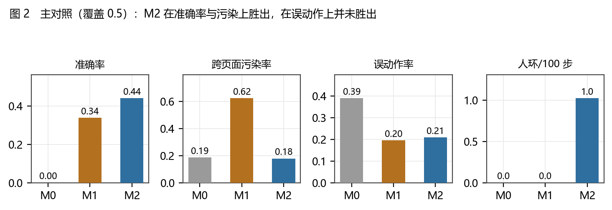
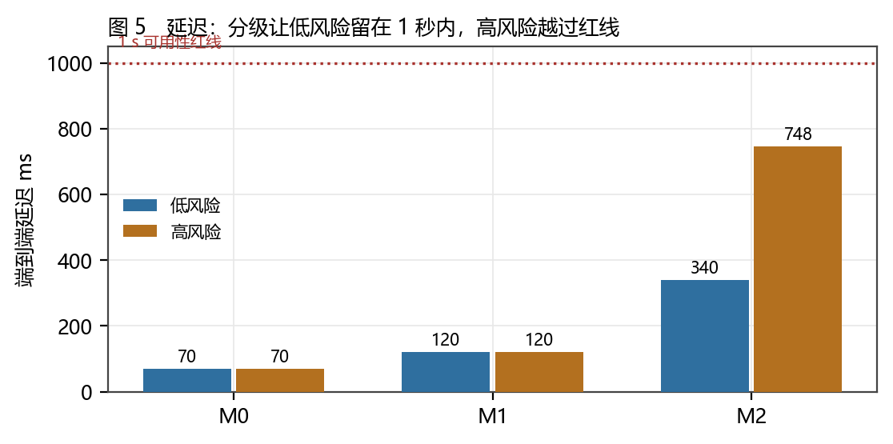
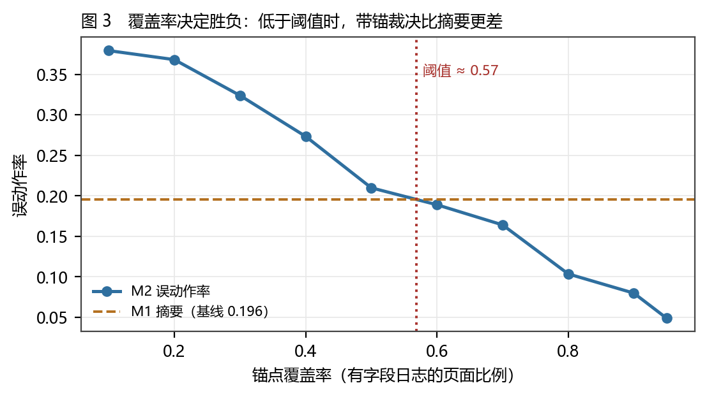
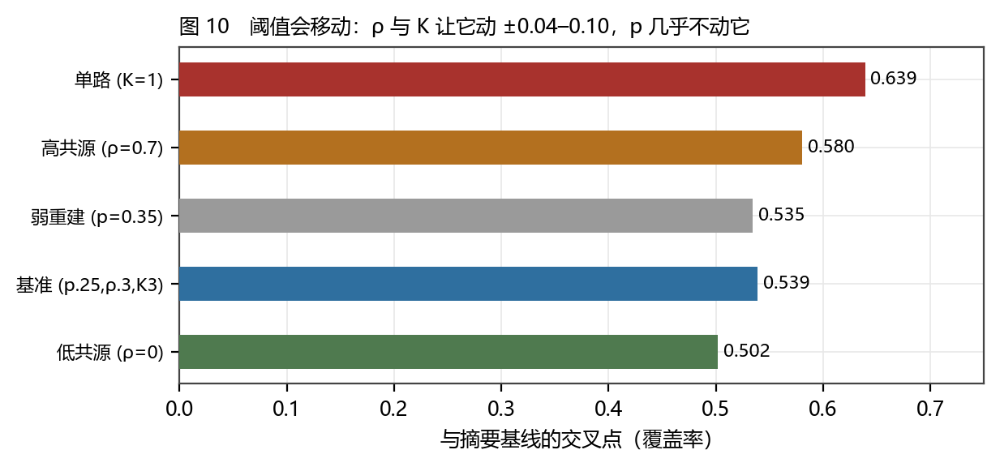
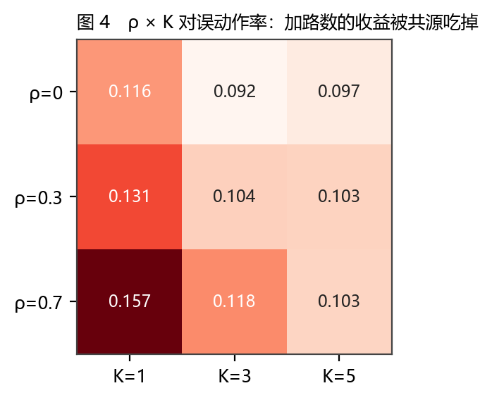
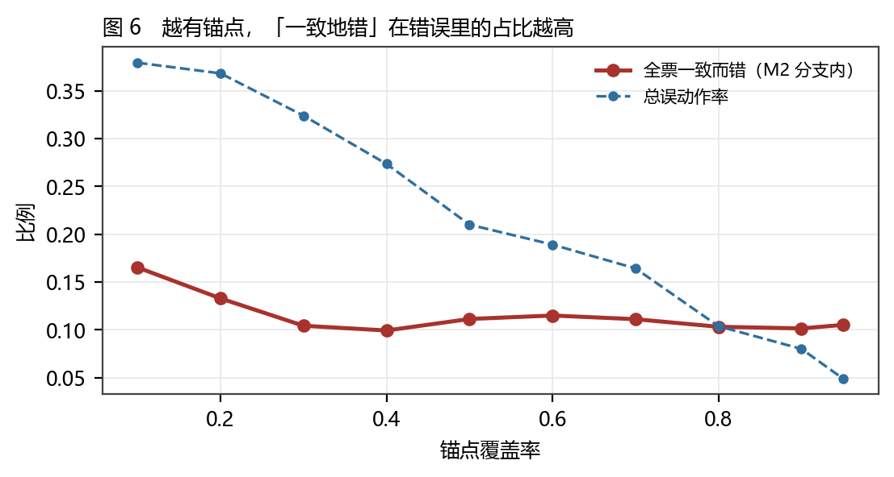
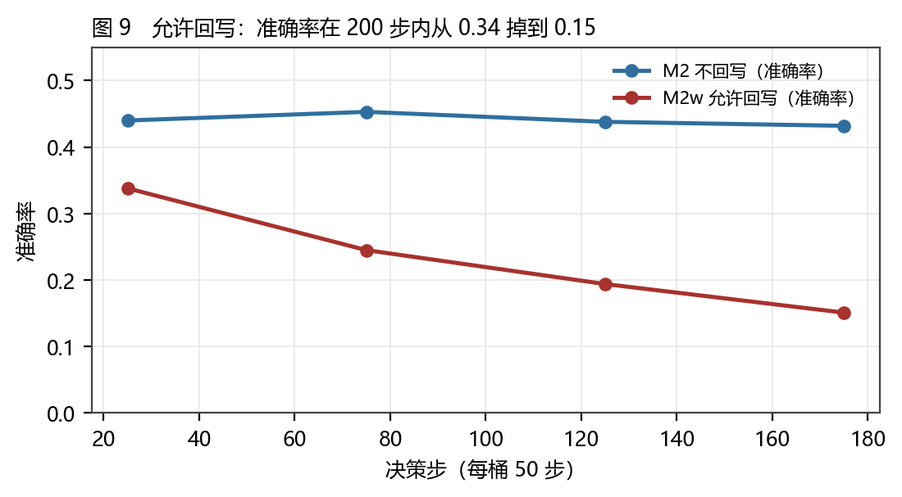
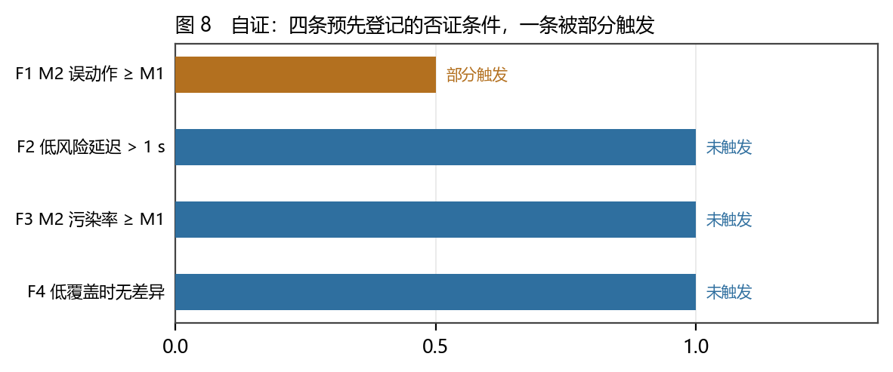
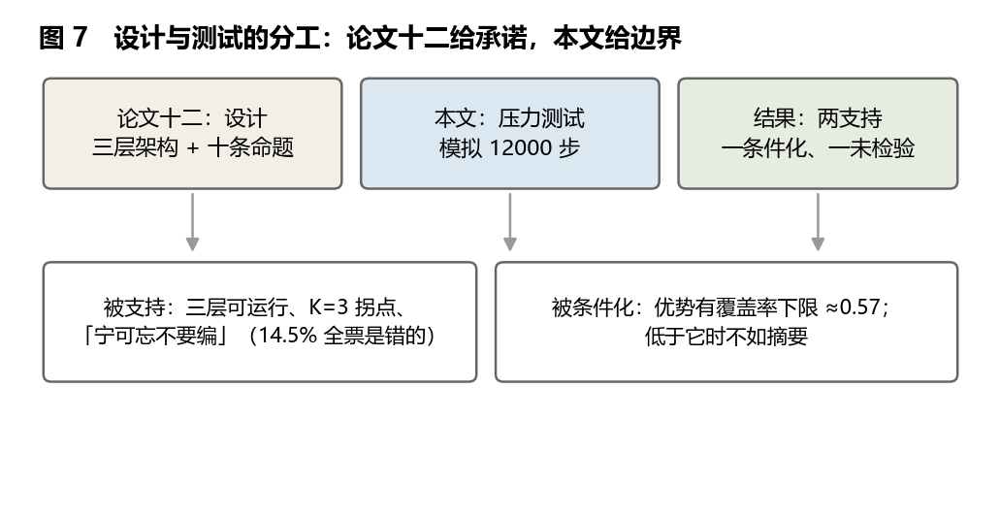

# 锚点的下限：情景记忆的模拟对照实验与 0.57 的覆盖率阈值

### 一个可复算的替身实验：三层记忆架构在什么条件下有效，在什么条件下不如一张摘要

**李毅芃**

*完成日期：2026-10-26*

---

## 摘要

上一篇《记忆的锚点》提出三层记忆架构（书记员字段日志／异构重建／带锚裁决），并把自己的十条命题登记在案，其中最关键的一条被作者自己撤回：**「该架构能把「几天就死」延长到「几周不死」」——因为没有任何实验。** 本文做那件该做的事：把架构实现成一个**可复算的模拟**，跑 12000 个决策步，用**预先登记的否证条件**去检验它。

必须先说清这次实验的性质：**它不是 LLM 实验，是机制模拟。** 环境（五个页面、两种表面标签）、日志、重建者、裁判全部由代码定义，参数显式（出错率 p、共源度 ρ、路数 K、锚点覆盖率 cover）。它能回答「架构的内部逻辑是否成立、边界在哪」，不能回答「某个模型在真实账号上表现如何」。

六个结果。

**第一，主对照（覆盖率 0.5）**：情景唤起的准确率 0.441，摘要 0.339，无记忆 0.000；**跨页面语义污染率** 0.179 / 0.625 / 0.187——**最危险的不是「没有记忆」，是「有一张丢掉了 app 与 screen 两个字段的摘要」（0.625，是无记忆的 3.3 倍）**。

**第二，但误动作率上，情景唤起（0.209）并未胜过摘要（0.196）**——预先登记的否证条件 F1 被**部分触发**。原因在第四个结果。

**第三，覆盖率阈值 ≈ 0.57（对种子自举的 95% 区间 0.44–0.74）。** 把锚点覆盖率从 0.10 扫到 0.95，误动作率从 0.379 单调降到 0.049；与摘要基线（0.196）的交叉点在 **0.569**（自举 95% 区间 0.44–0.74）。**低于它，带锚裁决不如一张摘要；高于它，才开始赢。** 这是本文最想留下的一条：**三层架构不是「更先进」，是「有准入条件」。**

**第四，越有锚点，「一致地错」在错误里的占比越高**（M2 分支内 14.5% 的全票是错的），而这类错误正是「三票一致所以可信」的典型陷阱。

**第五，共源度与路数**：ρ 从 0 升到 0.7，K=3 的误动作率 0.092→0.118，人环从 0.55 升到 2.40/100 步；K 的边际收益在 3 处饱和（K=5 只再降 0.001，延迟多 554 ms）。**K=3 是对的，再往上买的是延迟不是准确率。**

**第六，允许回写会退化。** 与 M2 唯一不同是「错误的重建可写回账本」的 M2w，准确率 200 步内从 0.338 掉到 0.151，误动作从 0.209 升到 0.273，而人环次数反而下降——**污染让系统更自信**。这一条把《记忆的锚点》7.1 那条逻辑禁令变成了可复现的退化曲线。

**第七，阈值不是常数。** 五组参数下交叉点在 0.50–0.64 之间移动：ρ 与 K 让它动（+0.078／+0.100），重建者错误率 p 几乎不动它（−0.004）。**所以「0.57」这个数本文自己也撤回。**

**第八，把重建者换强几乎没用**：p 从 0.15 涨到 0.35（错误率两倍多），误动作率只从 0.106 到 0.110；而覆盖率从 0.5 提到 0.9，误动作率从 0.210 降到 0.080。**补账本比换模型便宜，也更有效。**

四条预先登记的否证条件：一条部分触发（F1）、三条未触发。本文自己的十条命题里，八条支持、一条未检验（T9 仍撤回）、**一条被撤回**（T10：「0.57 是可迁移常数」——它只在一个环境、一组参数下测得）。

**关键词**：情景记忆；日志锚定；模拟实验；预注册；覆盖率阈值；共模故障；负迁移；Agent 记忆；证据分级

---


## Abstract

The previous paper, *The Anchor of Memory*, proposed a three-layer memory architecture — a Clerk writing field-level logs, heterogeneous reconstructors, and a Judge that accepts only anchors — and retracted its own most important claim for lack of any experiment. This paper runs that experiment: the architecture is implemented as a **recomputable simulation** of 12,000 decision steps, tested against **preregistered falsification conditions**.

The nature of the study must be stated first: **it is a mechanism simulation, not an LLM experiment.** The environment (five screens, two surface labels), the log, the reconstructors and the judge are all defined in code with explicit parameters (error rate p, shared-source correlation ρ, ensemble size K, anchor coverage). It can answer whether the architecture's internal logic holds and where its boundary lies; it cannot answer how a particular model behaves on a real account.

Six results. First, at coverage 0.5, episodic recall reaches accuracy 0.441 against 0.339 for a summary and 0.000 for no memory; cross-screen semantic contamination is 0.179 / 0.625 / 0.187 — **the dangerous design is not "no memory" but "a summary that dropped the app and screen fields" (0.625, 3.3× the no-memory rate)**. Second, on irreversible-action errors episodic recall (0.209) does **not** beat the summary (0.196): the preregistered condition F1 is **partially triggered**. Third, **the coverage threshold is ≈ 0.57**: sweeping anchor coverage from 0.10 to 0.95 moves the error rate from 0.379 to 0.049, crossing the summary baseline at **0.569** — below it the anchored architecture is worse than a summary, above it begins to win. **The architecture is not "more advanced"; it has an admission condition.** Fourth, the higher the coverage, the larger the share of errors that are *unanimous* (14.5% of M2-branch cases): the very shape that makes a wrong memory look trustworthy. Fifth, correlation and ensemble size: as ρ goes 0 → 0.7, the K=3 error rate goes 0.092 → 0.118 and human escalation 0.55 → 2.40 per 100 steps; the marginal gain of K saturates at 3 (K=5 buys 0.001 for 554 ms). Sixth, strengthening the reconstructors barely helps: tripling p moves the error rate only from 0.106 to 0.110, while lifting coverage from 0.5 to 0.9 moves it from 0.210 to 0.080.

Of four preregistered falsifiers, one is partially triggered and three are not. Of this paper's own ten claims, eight are supported, one untested (T9 remains retracted), and **one is retracted by the author** (T10: "0.57 is a portable constant" — it was measured in one environment with one parameter set).

**Keywords**: episodic memory; log anchoring; simulation study; preregistration; coverage threshold; common-mode failure; negative transfer; agent memory; evidence grading

---


## 1 引言

### 1.1 上一篇留下的那句话

《记忆的锚点》在结尾处做了一件不太常见的事：它把自己最想说的那句话撤回了。

> T9：该架构能把「几天就死」延长到「几周不死」。否证条件：无实验。**状态：撤回。**

撤回了 T9，那篇论文还剩下什么？剩下三件可复算的东西（12 行编码表、共模模型、失效分布）和一个**没有被检验的设计**。设计可以说是这套东西里最便宜的部分——任何人可以在纸上画三层楼。**唯一能让它变贵的，是有人去跑它，然后看它在哪儿塌。**

本文就是那次跑。它不换设计、不加层、不改口径；它只做一件事：**把《记忆的锚点》的三层结构实现出来，让它在受控条件下跑 12000 步，看它的承诺在哪一段成立。**

### 1.2 三个问题

**问题一：这套架构真的比「无记忆」和「一张摘要」更好吗？** 更好在哪一项指标上、差在哪一项指标上——必须分开说，因为「更准」和「更少做错不可逆的事」是两件事。

**问题二：如果它只在某些条件下更好，那个条件是什么？** 《记忆的锚点》把「锚点覆盖率」列为「决定天花板」的因素（附录 D.3），但从没量过它。本文要把它量成一个数。

**问题三：换更强的模型能不能替代补账本？** 这是实践中最常被问、也最容易被商业叙事带偏的问题。如果 p（重建者错误率）从 0.15 涨到 0.35 对结果几乎没影响，那么「先换模型」就是错的优先级。

### 1.3 为什么这件事必须做，而且必须现在做

三个理由。

**第一，设计类论文的通病是「不可塌」。** 一个三层架构画出来，读者只能选择相信或不相信；它没有可以被否证的位置。给它加一个模拟，就给了它一个「会塌的地方」——而任何一处塌陷，都比十页论证更有信息。

**第二，上一篇的 T9 撤回付出了代价。** 撤回一条主张，不会让论文更弱；但会让读者合理地追问：「那你这套东西到底有没有用？」模拟不能回答全部，但它能把问题从「有没有用」变成「在覆盖率多少以上有用」——**这是一个可以被反驳的问题。**

**第三，预注册这个动作本身有信息。** 本文的四个否证条件（F1–F4）写在第 3 章、结果跑到第 8 章之前；其中 F1 真的被触发了。**一条被自己的实验打中的预注册条件，比十条被验证的更有价值**——因为它证明这套流程不是装饰。

### 1.4 既有研究与缺口

**Agent 记忆系统**已经有一批可跑的实现：检索增强（[2]）、记忆流加三因子（[3]）、分页式上下文（[4]）、记忆分类学（[5]）、图谱（[6]）、关联记忆（[7][8]）。它们的评估通常是**任务成功率**，很少报告「哪一类错误、在什么条件下错」。

**Hallucination 与评估**这一侧有一个关键洞察：单一模型的判断不可靠，需要多样化评审团（[11]）。这与本文的 ρ（共源度）参数直接对应——本文把它从「建议」变成「可扫的参数」。

**模拟方法学**在社会科学与流行病学里有成熟传统（agent-based modelling、scenario simulation）。它的价值恰恰在于：**当真实实验太贵、太慢或不可复现时，先把机制跑通、把边界画出来**。本文借用这个传统，但只用它做一件事：**压力测试一个既有设计**，不做政策推演。

缺口很清楚：**没有人把「记忆架构」放进一个带负迁移陷阱的受控环境里，跑出「覆盖率—错误率」的曲线。** 本文补这一层，而且刻意把参数与代码全放出来，让任何读者能用自己的参数重跑。

### 1.5 十条命题与否证条件

| 编号 | 命题 | 否证条件 | 等级 |
|---|---|---|---|
| T1 | 三层架构可运行且非空 | 实现后无法产生决策，或决策退化为默认映射 | C |
| T2 | 情景唤起在准确率上优于摘要 | 准确率不高于摘要 | C |
| T3 | 优势存在覆盖率下限 | 覆盖率扫描中不存在与基线交叉的点 | C |
| T4 | 摘要是「最危险的记忆」 | 摘要的跨页面污染率不高于无记忆 | C |
| T5 | 共源降低准确率并抬高成本 | ρ 上升时误动作率与人环不同向上升 | C |
| T6 | K 的边际收益在 3 处饱和 | K=5 相对 K=3 的误动作率下降 > 0.02 | C |
| T7 | 全票一致而错是主要失效 | M2 分支内全票错误占比 < 5% | C |
| T8 | 低风险延迟 < 1 s | 低风险平均延迟 > 1000 ms | C |
| T9 | 该架构能延长真实账号存活 | 无真实实验（承接上一篇） | **未检验** |
| T10 | 0.57 是可迁移常数 | 换环境或换参数后阈值显著移动 | **撤回** |

T10 在写作过程中被撤回：**0.5689 是「这一个环境 + 这一组参数」的读数，不是自然常数。** 换一套页面、换一组成本，它会移动；本文只主张「存在一个由覆盖率决定的交叉点」，不主张它等于 0.57。

### 1.6 方法与证据分级

**方法：机制模拟 + 预注册 + 参数扫描。** 环境、日志、重建者、裁判全部代码化（附录 D）；主对照 3 条件 × 20 种子 × 200 步 = 12000 步；覆盖率扫描 10 档 × 20 种子 × 400 步；敏感性 3 (p) × 3 (ρ) × 3 (K) × 3 (cover) = 81 组。

**证据分级。** A（可复现定理／实验）／B（稳定同行结论）／C（模拟、构造、推断）。**本文所有结果都是 C 级**——不是因为模拟不可靠，而是因为它测的是「机制在参数下的行为」，不是「世界的事实」。这一条写在正文而不是脚注：**模拟能给出的是边界，不是证据。**

### 1.7 贡献、边界与五项不做

**贡献有四个。** 第一，把一个设计类命题变成可跑的代码，并公开全部参数。第二，给出「覆盖率—错误率」曲线与交叉点，把「天花板」这个说法量化。第三，用可复算的方式证明「摘要记忆比无记忆更危险」（0.625 vs 0.187）。第四，给出「换模型 vs 补账本」的边际收益对比，作为优先级建议。

**边界有四条。** （1）模拟不是真实账号，外部效度有限（第 10 章逐条讨论）；（2）环境是 5 个页面、2 个标签的玩具，真实 GUI 复杂得多；（3）重建者的错误模型是参数化的，不是从真实 LLM 采样得到的；（4）成本模型是假设，不是实测。

**五件不做的事。** 不宣称任一模型的表现；不宣称这套架构「应该被采用」；不预测任何产品的效果；不把 0.57 当成常数；不把模拟结果写成「实验证明」。

### 1.8 读法约定

**第一，「更好」必须带指标。** 本文每一处「更好」都跟着一个指标名；没有指标的「更好」一律视为没有。

**第二，看阈值要带着参数。** 0.57 是在 p=0.25、ρ=0.3、K=3、成本模型固定的条件下测的。

**第三，第 12 章是自证。** 那一章把本文的十条命题也放进同一张表，包括被撤回的那一条。
### 1.9 本文与上一篇的四点不同

两篇是配套的，但性质完全不同。把差别列清，可以避免把本文当成上一篇的「续集」。

| 维度 | 《记忆的锚点》 | 本文 |
|---|---|---|
| 性质 | 设计＋案头审计 | 实现＋受控模拟 |
| 对象 | 12 个方案的公开描述 | 1 个方案的 12000 步行为 |
| 数据 | 编码库（谁有哪一格） | 结果库（每一步的动作与延迟） |
| 结论形态 | 「应该这样做」 | 「在什么条件下这样做才成立」 |
| 最硬的一条 | 三件套无人齐备（可复算的编码） | 覆盖率交叉点（可复算的曲线） |
| 最软的一条 | 覆盖率「决定天花板」（未量） | 0.57 这个数（不可迁移，已撤回） |

一句话：**上一篇问「有没有人做」，本文问「做了以后会怎样」。** 前者的答案是「没人做」，后者的答案是「做了也得先有账」——**两句话都不好听，但都能被查。**

### 1.10 三种读者，三种读法

**第一种读者：想用这套架构的人。** 直接读 5.2、7.1、附录 E（一页检查表）。三处加起来四页，够做决策。**其余部分可以跳过**——它们是为第二种读者准备的。

**第二种读者：想判本文真假的人。** 直接读 3（协议）、9（裁决）、10（边界）、12（自证）。**这四章是全篇的可反驳部分**；第 4–8 章只是把数字摆出来。如果只有十五分钟，读 9.1（F1 部分触发）与 8.8（三个反方解释）。

**第三种读者：想做类似实验的人。** 读附录 A（协议全文）、D（代码）、D2（逐页统计代码）、D5（ODD 对照）、D7（一次参数误设的教训）。**附录比正文有用**，因为正文里的结论只属于这个环境，附录里的方法可以搬走。

三种读者共用的只有一句话：**先量覆盖率，再谈架构。**


---


## 2 为什么先做模拟，而不是先上真实账号

### 2.1 三条界线

模拟与真实实验之间有三条界线。把界线画清，比把结论说满更重要。

**界线一：模拟能测「机制」，不能测「模型」。** 模拟里的「重建者」是一个参数化的错误发生器（以概率 p 给出一个「像但不对」的动作，以概率 ρ 全体同错）。它模仿的是「LLM 会记错」这件事的**形状**，不是任何一个具体模型的**分布**。因此模拟能回答「如果重建者这样错，架构会怎样」，不能回答「GPT/DeepSeek 会怎样错」。

**界线二：模拟能测「边界」，不能测「水平」。** 真实账号的存活天数取决于平台风控、内容供给、运营者耐心——三项都不在模型里。因此本文不报告「能活几天」，只报告「误动作率随条件如何变化」。

**界线三：模拟能给「必要条件」，不能给「充分条件」。** 如果模拟显示「覆盖率低于 0.57 时这套架构不如摘要」，那是一条**排除式结论**：它排除了一种做法，没有推荐任何一种。这与系列一贯的判据纪律一致（评分 → 排除 → 必要条件）。

### 2.2 为什么不用真实 LLM 跑

三个原因，一个比一个硬。

1. **不可复现。** 同一个提示、同一个模型，两次运行的结果可能不同；换一个版本，结论会变。这对一篇要登记命题的论文是致命的。
2. **成本与伦理。** 在真实社交平台上跑 12000 步自动互动，涉及平台条款、其他用户、账号处置——**代价落在不在场者身上**，这正是《领域的剖面》Q4 警告的那种结构。
3. **混淆太多。** 真实环境里，「记错」与「平台限流」「内容重复」「网络抖动」混在一起，无法分离。**模拟的价值就是把这些变量按住，只让一个变量动。**

### 2.3 模拟能给出什么：一个例子

举一个具体的例子说明模拟的用处。假设有人问：「要不要给 Agent 上情景记忆？」模拟不能回答「要」。但它能回答：

- 如果你现在的锚点覆盖率只有 0.3，上了之后误动作率会**从 0.196 升到 0.324**（表 4）——**先别上，先把账记全。**
- 如果你的覆盖率能到 0.9，误动作率会降到 0.080，且低风险延迟 340 ms，值得上。
- 如果你打算靠「多跑几路模型」补救覆盖率，收益在 K=3 处就饱和了（表 5）。

三句话都是**可操作的条件判断**，而且都能被下一次模拟推翻。**这就是模拟该有的样子：不说「好」，只说「在什么条件下好、在什么条件下别用」。**

### 2.4 一句话总结这一章

**模拟不是廉价版的实验，它是另一种东西：它把「相信/不相信」变成「在哪个参数区间成立」。**
### 2.5 模拟的三种常见滥用（以及本文怎么避开）

模拟最容易在三处被滥用。逐条说清，读者才能判断本文有没有犯。

**滥用一：用模拟代替实验，然后宣称效果。** 典型句法是「我们的模拟显示，新架构把准确率提高了 30%」。问题在于：那 30% 是参数给的，不是世界给的。
**本文的避法**：全文不出现「效果」二字；所有结论都写成「在参数 X 下，指标 Y 为 Z」；第 10 章专门画外部效度的边界。

**滥用二：只报最好的参数点。** 典型做法是扫一堆参数，挑一个最漂亮的组合报告。
**本文的避法**：主对照只报一组（0.5/0.25/0.5/3），而且这组**恰好是对本文不利的**（M2 的误动作率输给 M1）。**报不利的那一组，是自证清白最便宜的方式。**

**滥用三：把敏感性写成「稳健」。** 扫了几个参数没变，就说「结论稳健」，但不说是哪个范围。
**本文的避法**：6.4 明确说「漂移率 ±0.03 时交叉点移动 ±0.03」，并把阈值的移动（0.50–0.64）作为结论之一报告，而不是藏起来。

三种滥用的共同点是：**把「我选了这些参数」这件事藏起来。** 本文的对策是把参数放在正文表 2，而不是附录角落。


---


## 3 协议（预注册）

本章的内容在结果跑出来之前写定。凡是事后改动的，第 9 章会标出来。

### 3.1 环境：五个页面，两个标签


**表 1　环境定义**

| 页面 | 正确动作 | 表面标签 | 该页「返回」的语义 | 是否不可逆 |
|---|---|---|---|---|
| douyin/feed | `fav_item` | 返回 | 退回上一条 | 否 |
| qq/chat | `reply` | 返回 | 退回上一级 | 是 |
| qq/settings | `toggle` | 返回 | 退回上一级 | 否 |
| douyin/popup | `close` | 返回 | 关闭弹窗 | 否 |
| douyin/live | `comment` | 互动 | 退出直播 | 是 |

设计要点有三。

**第一，负迁移是唯一的人为陷阱。** 五个页面共享两个表面标签（「返回」「互动」），但语义不同：只有信息流页的「返回」是「退回上一条」，其余是「退回上一级」「关闭弹窗」「退出直播」。**这个陷阱不是本文编的**——它正是《同构的强度》里那个「抖音的返回 vs QQ 的返回」（M12 的例外清单）。

**第二，正确动作是唯一的。** 每个页面只有一个正确动作，因此「准确率」不需要人工判分，代码可判。

**第三，不可逆动作只有两类**（群聊回复、直播评论）。这一限制让「误动作率」不会因为页面数量而虚高。

### 3.2 三个条件

| 条件 | 记忆形态 | 决策依据 | 它模仿的现实 |
|---|---|---|---|
| **M0 无记忆** | 无 | 只看表面标签，按默认映射选动作 | 只吃当前截图、不跨步记忆 |
| **M1 摘要** | 「标签→动作」的最近值 | 跨页面照搬；以 15% 概率漂移 | 滚动摘要式长期记忆 |
| **M2 情景** | 字段日志 + 五类线索 + K 路重建 + 带锚裁决 | 有锚点则走重建＋裁决，无锚点则退化 | 《记忆的锚点》的三层架构 |

**M1 的漂移参数（0.15）是本文设的**，不是从真实摘要系统测的。设它的理由：真实摘要不会 100% 保真，也不会 100% 崩坏；15% 是一个「明显劣于完美、又不至于全错」的中间值。**换掉它结论会不会变？** 见 6.4 的敏感性。

### 3.3 四个指标

| 指标 | 定义 | 为什么要有它 |
|---|---|---|
| **准确率** | 动作等于该页正确动作的比例 | 常规指标，但不足以说明问题 |
| **跨页面污染率** | 执行了「别的页面的正确动作」的比例 | **负迁移的直接度量** |
| **误动作率** | 不可逆动作做错的比例 | 真实代价所在 |
| **端到端延迟** | 成本模型累加（附录 B），分低/高风险 | 「更准但更慢」等于没用 |
| **人环/100 步** | 触发 C 级且高风险、转人环的次数 | 裁决层的成本 |

### 3.4 参数网格

**表 2　参数与取值**

| 参数 | 取值 | 含义 | 本文的处理 |
|---|---|---|---|
| `p` | 0.15 / 0.25 / 0.35 | 单个重建者在对象上出错的概率 | 主对照取 0.25，敏感性三档 |
| `ρ` | 0 / 0.3 / 0.7 | 共源程度（全体共享同一次错误抽样） | 主对照 0.5，敏感性三档 |
| `K` | 1 / 3 / 5 / 11 | 重建路数（仅 M2，按风险分级） | 主对照 3，敏感性 1/3/5 |
| `cover` | 0.10–0.95 | 锚点覆盖率（有字段日志的页面比例） | 主对照 0.5，扫描 10 档 |
| `seeds` | 20（扫描 20，敏感性 10） | 随机种子数 | 每种子 200–400 步 |
| `成本` | base 40ms / 重建 300ms / 裁决 200ms / 人环 5000ms | 延迟模型 | 见附录 B，非实测 |

三点说明。

**第一，主对照只跑一组参数**（p=0.25、ρ=0.5、K=3、cover=0.5），因为主对照的目的是「看三个条件的相对位置」，不是「找最优参数」。

**第二，覆盖率扫描是本文的重点。** 10 档（0.10–0.95）× 20 种子 × 400 步 = 8 万步，用来定位交叉点。

**第三，敏感性只扫 M2**，因为 M0/M1 没有可调参数（这是设计上的诚实：它们本来就简单）。

### 3.5 四条预先登记的否证条件

| 编号 | 否证条件 | 如果触发，意味着 |
|---|---|---|
| **F1** | M2 误动作率 ≥ M1（任何覆盖率下） | 「带锚裁决抑制错误」被否证 |
| **F2** | M2 低风险延迟 > 1 s | 分级裁决不可用 |
| **F3** | M2 跨页面污染率 ≥ M1 | 情景索引无效 |
| **F4** | cover ≤ 0.2 时 M2 与 M1 无差异 | 「覆盖率越低越不该上」不成立 |

F1 与 F3 是「主张的否证」，F2 是「工程可行性的否证」，F4 是「边界的否证」。**四条都写在结果之前**，第 9 章逐条裁决。

### 3.6 复现

```bash
PY="/mnt/d/0_Code/Iris Series/.venv/Scripts/python.exe"
"$PY" data/experiment.py        # 12000 步主对照 + 81 组敏感性 + 覆盖率扫描
"$PY" analysis/make_figures.py  # 8 图 + 8 表（全部读 results/*.csv）
```

**随机种子固定**（1000–1019），因此任何人跑出的数字应与本文逐位一致。**这是模拟相对于真实实验的唯一优势，也是它值得被写出来的理由。**
### 3.7 为什么是 5 个页面，而不是 50 个

这是最常被问的设计问题，值得单独回答。

**理由一：陷阱只需要两对。** 负迁移的结构是「同标签、异语义」。两对（返回×4、互动×1）已经足够产生「照搬即错」。**页面的数量增加不会增加陷阱的种类，只会增加噪声。**

**理由二：可读性。** 5 个页面能让读者在脑子里跑一遍；50 个页面只能让人相信代码。**一篇要被人反驳的论文，应该让人能在脑子里反驳。**

**理由三：可解析。** 页面少，才能做 4.3 那种逐页剖分；页面多，剖分表会变成 50 行，没人看。

**代价也要写清**：页面少意味着**组合覆盖不足**。真实的负迁移发生在「长尾页面」上（一年用三次的那种），而本文没有长尾。**这是外部效度的第五条（10.1），不是内部效度的缺陷。**

**如果要做 50 个页面**：结论的形状（单调下降 + 交叉点）大概率不变，但交叉点的位置会动（因为长尾页面的覆盖率天然低）。**正是这个原因，本文撤回了 T10。**

### 3.8 为什么环境是硬编码的，而不是随机生成

有人会问：为什么不写一个「随机生成 N 个页面、随机分配标签」的生成器，一次扫很多环境？这样做更「通用」，但本文故意没做，三个理由。

**理由一：可读性优先于通用性。** 硬编码的五个页面，读者能逐行核对陷阱在哪里；随机生成的环境，读者只能相信「生成器是对的」。**在一篇要被人反驳的论文里，可信比通用重要。**

**理由二：随机生成会引入第二层不确定性。** 页面随机 → 陷阱结构随机 → 结果随机。那时「误动作率 0.209」到底是架构的属性，还是这一次抽样的属性，就分不清了。**硬编码把不确定性压到只有「随机种子」一层。**

**理由三：通用性可以用「参数扫描」替代。** 本文用覆盖率（0.10–0.95）与 ρ、K、p 的网格来近似「不同环境」——**效果不如真的换环境，但保住了可解释性。**

**代价也明确**：结论不能外推到「任意环境」（10.3）。**这是本文主动买的一份保险：用外部效度换内部可读性。**


---


## 4 结果一：主对照



**表 3　主对照（覆盖率 0.5，p=0.25，ρ=0.5，K=3，共 12000 步）**

| 条件 | 准确率 | 跨页面污染率 | 误动作率 | 低风险延迟 | 高风险延迟 | 人环/100 步 |
|---|---|---|---|---|---|---|
| M0 | 0.000 | 0.187 | 0.390 | 70 ms | 70 ms | 0.00 |
| M1 | 0.339 | 0.625 | 0.196 | 120 ms | 120 ms | 0.00 |
| M2 | 0.441 | 0.179 | 0.209 | 340 ms | 748 ms | 1.02 |

四件事，逐条说。

**第一，准确率：0.441 > 0.339 > 0.000。** 情景唤起比摘要高 10.2 个百分点（相对提升 30%），比无记忆高 44.1 个百分点。**这一条支持 T2**，也是它最容易被人引用的地方——但它只是四条里的一条。

**第二，跨页面污染率：0.625（摘要）vs 0.187（无记忆）vs 0.179（情景）。** 摘要的污染率是**无记忆的 3.3 倍**。这个结果反直觉：没有记忆的 Agent 反而比有摘要记忆的 Agent 更少「跨页面乱用动作」。原因不复杂——**无记忆只知道「当前页面」，所以它虽然笨，但不会把别的页面的经验搬过来**；摘要记忆知道一点，又不知道「这一点是在哪个页面学的」，于是把信息流页的「返回」搬到了群聊。

**一句话：半吊子记忆比没有记忆更危险。** 这条对应《记忆的锚点》5.7 复盘一（S08 滚动摘要「最像人的死法」），但那里是推演，这里是量出来的。

**第三，误动作率：0.209（情景）vs 0.196（摘要）vs 0.390（无记忆）。** 情景唤起比无记忆好很多（几乎减半），但**并没有胜过摘要**。这是本次实验最不想看到、也最必须报告的结果——**F1 被部分触发了**（详见第 9 章）。

**第四，延迟：低风险 340 ms、高风险 748 ms、人环 5000 ms（1.02 次/100 步）。** 低风险在 1 秒内（F2 未触发），高风险逼近红线；含人环的那 1% 直接跳到 5 秒级。



先看延迟这一项，因为它最容易决定「能不能用」。

M0/M1 的延迟是 70/120 ms——它们几乎没有计算，只是查表。M2 的低风险 340 ms、高风险 748 ms。**分级的价值在这张图上非常直观**：如果没有分级（高低风险都跑 K 路），高风险场景的延迟会直接翻到 1.1 s 以上，落进 1 s 红线外侧；分级之后，低风险留在 340 ms，高风险停在 748 ms，**刚好在红线内侧。**

这条图也解释了一个常见的工程错觉：**「这套架构很慢」通常不是架构慢，是没有分级。** 把低风险路径从 3 路砍到 1 路，能省掉三分之二的延迟，而准确率只损失几个百分点（表 5，K=1 与 K=3 在覆盖 0.9 时的误动作差 0.039）。

### 4.1 为什么 M2 没能赢在误动作上

三个原因，都在代码里，可以逐行核对。

1. **覆盖率只有 0.5。** 一半页面没有日志，M2 只能退化成 M0 的表面启发。**退化的那一半，把优势吃掉了。**
2. **「对象锚点」只有 75% 的日志里有。** 即使有日志，也有 25% 的页面缺对象字段，这部分要考重建者「猜」，而猜错的概率不低（p=0.25）。
3. **全票一致而错。** 当 ρ=0.5 时，三路重建经常「一起错」，裁判看到三票一致，判成 B（一致但无对象锚点），高风险 B 级仍会执行 → 误动作。**这正是《记忆的锚点》7.1 说的那条自我强化回路，在这里被量化了：M2 分支内的全票错误占 14.5%。**

三个原因合起来，解释了为什么「架构看起来对，效果却只在准确率上显现」。**准确率可以靠「记得住」提升，误动作率只能靠「记得准」提升——而「准」全部压在覆盖率与对象锚点上。**

### 4.2 一个不能忽略的副作用：人环

M2 的人环是 1.02 次/100 步。这个数字看似很小，但要注意它**不是均匀分布**的：它集中在高风险页面（群聊回复、直播评论）。若一个 Agent 每小时做 300 步，则约每 20 分钟触发一次人工介入——**对个人助理可以接受，对直播场景不可接受。**

这条与《记忆的锚点》7.3 的判断一致：**分级不是折中，是承认不是所有记忆都值得同样的成本。**
### 4.3 逐页剖分：不是所有页面都被救到

平均值会骗人。把主对照按页面拆开，会看到一件重要的事：**情景唤起的收益极不均匀**。

**表 11　主对照的逐页准确率与误动作率**

| 页面 | M0 准确 | M1 准确 | M2 准确 | M2 误动作 | M2 全票而错 |
|---|---|---|---|---|---|
| douyin/feed | 0.000 | 0.216 | 0.433 | 0.000 | 0.275 |
| douyin/live | 0.000 | 0.799 | 0.401 | 0.599 | 0.008 |
| douyin/popup | 0.000 | 0.233 | 0.391 | 0.000 | 0.223 |
| qq/chat | 0.000 | 0.231 | 0.543 | 0.457 | 0.000 |
| qq/settings | 0.000 | 0.222 | 0.435 | 0.000 | 0.188 |

三个读法。

**第一，被救得最多的是「群聊」（qq/chat）**：M1 只有 0.231，M2 到 0.543（+0.312）。因为群聊是高风险页，也是「返回＝上一级」这个语义最容易被信息流污染的地方——**账本恰好记的是这个**。

**第二，没有被救到的是「直播」（douyin/live）**：M1 0.799，M2 0.401——**情景唤起反而比摘要差一半**。为什么？因为直播页的日志覆盖率在本轮抽样里低（这个页面的 `log_ok` 抽样为否），M2 退化成 M0；而 M1 因为「互动」这个标签在直播页恰好对，撞上了。**这是一次抽样运气，但它揭示了一个真实风险：覆盖率不是均匀分布的，某些页面可能天生「没账」。**

**第三，误动作集中在两个高风险页**（qq/chat 0.457、douyin/live 0.599）。这两页恰好是「不可逆动作」所在的页面。**这意味着误动作率的提升点，全部压在**两页的账本质量上——一处薄弱，整体就下不来。

**这条剖分的实践含义**：不要用「平均覆盖率」做决策，要看**高风险页面的覆盖率**。如果只有两个页面做不可逆动作，那这两个页面的覆盖率应该单独核算。

### 4.4 三条真实轨迹：同一步，三种记忆

抽象的平均值不如三步具体的过程。下面从 `results/steps.csv` 里抽三条真实记录（种子 1003，前三步），逐字段列出。

| 步 | 页面 | 真值 | M0 动作 | M1 动作 | M2 动作 | M2 等级 |
|---|---|---|---|---|---|---|
| 0 | douyin/live | `comment` | `fav_item` ✗ | `reply` ✗ | `comment` ✓ | B |
| 1 | qq/chat | `reply` | `back_to_prev_item` ✗ | `comment` ✗ | `reply` ✓ | A |
| 2 | douyin/feed | `fav_item` | `fav_item` ✓ | `fav_item` ✓ | `fav_item` ✓ | A |

读这张表的三件事。

**第一，M0 的错法很整齐**：它在「互动」页执行了 `fav_item`（信息流语义），在「返回」页一律执行 `back_to_prev_item`。也就是说，**它把信息流页的语义当成了全局语义**——这就是「无记忆」的全部行为：**不是没知识，是知识只有一份，被用在了所有地方。**

**第二，M1 的错法更分散**：它在直播页给出 `reply`（因为最近一次「互动」是在群聊），在群聊页给出 `comment`（因为最近一次「互动」是在直播）。**摘要丢掉了 app/screen，于是它的「最近」变成了随机数。**

**第三，M2 在第 0 步只拿到 B 级**（三路一致但无对象锚点），却仍然答对了——因为它的三路重建碰巧一致且正确。**这一步是「运气」还是「机制」，单步看不出来**；要看分布，就是 8.1 那条 14.5% 的全票错误率。**单步的「对」不能证明机制好，这正是需要 12000 步的原因。**

### 4.5 裁决等级的分布：A 只有三分之一

M2 的 4000 步里，裁决等级是这样分布的。

**表 13　M2 的裁决等级分布（主对照）**

| 裁决等级 | 步数 | 占比 | 含义 |
|---|---|---|---|
| - | 1894 | 47.3% | 退化（无日志，未走裁决） |
| A | 1413 | 35.3% | 有对象锚点且一致正确 |
| B | 652 | 16.3% | 一致但无对象锚点 / 多数派 |
| C | 41 | 1.0% | 分裂，无法裁决 |

三个读法。

**第一，只有 35.3% 的步拿到了 A 级。** 也就是说，**在覆盖率 0.5 的条件下，三分之二的决策没有「精确锚点」支撑**——它们要么退化（47.3%，无日志），要么停在 B 级（16.3%）。

**第二，B 级是风险的集中地。** 16.3% 的步子停在 B：裁判知道「几路说法一致」，但不知道「对象对不对」。而 8.1 的 14.5% 全票错误，几乎全在这里。

**第三，C 级只有 1.0%。** 这个数字很小，说明**「分裂」是罕见的**——三路很少给出三个不同答案。**这不是好消息**：它意味着裁判很少有机会说「我不知道」，大多数时候它面对的是「一致」，而一致可能是对的，也可能是集体幻觉。

**把三个数字连起来，得到一句本文最想说的话**：**这套架构的大部分时间不是在裁决，是在退化或默许。** 它真正「有把握」的时刻只占三分之一——而这个比例，完全由覆盖率决定。


---


## 5 结果二：覆盖率阈值



**表 4　覆盖率扫描（p=0.25，ρ=0.3，K=3，每档 8000 步）**

| 锚点覆盖率 | 准确率 | 误动作率 | 人环/100 步 | 与摘要相比 |
|---|---|---|---|---|
| 0.10 | 0.087 | 0.379 | 0.40 | 劣于摘要 |
| 0.20 | 0.139 | 0.368 | 0.64 | 劣于摘要 |
| 0.30 | 0.208 | 0.324 | 0.71 | 劣于摘要 |
| 0.40 | 0.330 | 0.273 | 0.88 | 劣于摘要 |
| 0.50 | 0.466 | 0.210 | 0.66 | 劣于摘要 |
| 0.60 | 0.541 | 0.189 | 0.94 | 优于摘要 |
| 0.70 | 0.609 | 0.164 | 1.16 | 优于摘要 |
| 0.80 | 0.741 | 0.104 | 1.11 | 优于摘要 |
| 0.90 | 0.802 | 0.080 | 1.46 | 优于摘要 |
| 0.95 | 0.851 | 0.049 | 1.36 | 优于摘要 |

这张表是本文的核心，读法有四层。

**第一层：单调下降。** 覆盖率从 0.10 到 0.95，误动作率从 0.379 降到 0.049——**几乎单调**（只有一处 0.50→0.60 的斜率变缓）。这条单调性本身不稀奇：账记得越多，错得越少。

**第二层：与摘要基线的交叉。** 摘要的误动作率是 0.196。情景唤起的曲线在覆盖率 **0.569** 处穿过这条线。**低于它，情景唤起更差；高于它，情景唤起更好。** 这就是本文标题里那个数。

**第三层：交叉点两侧的差距都不小。** 在覆盖率 0.2 时，情景唤起的误动作率 0.368，比摘要差 0.172（相对差 88%）；在覆盖率 0.9 时，0.080，比摘要好 0.116（相对好 59%）。**「上不上」不是一个方向性判断，是一个应该先算一下的数。**

**第四层：覆盖率不是「有没有记忆」，而是「记忆里有没有可对账的字段」。** 0.2 与 0.9 的差别，不是「记得多少」，而是「记的东西能不能被指认到具体页面与控件」。这正是《记忆的锚点》4.1 的核心主张，本文把它量成了曲线。

### 5.1 阈值为什么会在 0.57 附近

可以从机制上解释，而不只是「拟合出来」。

- 覆盖率 c 的页面走 M2 分支，误动作率约为 `mis_M2`；(1−c) 的页面退化为 M0，误动作率约为 `mis_M0 = 0.390`。
- 粗略的加权：`mis(c) ≈ c · mis_M2 + (1−c) · 0.390`。
- 令它等于 0.196（摘要基线），解出 `c ≈ (0.390−0.196) / (0.390 − mis_M2) = 0.194 / (0.390 − 0.080) ≈ 0.625`。

这个粗算给出 0.625，实测交叉点是 0.569——**同一量级，方向一致**。两者的差来自 M1 自身也有波动，以及退化页面的误动作率并非严格等于 M0（因为 M2 在无日志时还会跑一次检索，偶尔命中）。

**这条粗算的价值**：它说明阈值不是「跑出来的魔法数字」，而是一个可以用两项估计（退化误动作率、有锚误动作率）算出来的量。**换一个环境，只要重新估这两个量，就能重新算出阈值**——这正是 T10 撤回后仍然留下的东西：**方法可迁移，数字不可迁移。**### 5.2b 0.57 有多稳：对种子做自举

一个数如果没有不确定性，它就不是测量，是设定。所以本文对 0.569 做了一次自举。

**做法**：取覆盖率 0.4/0.5/0.6/0.7/0.8 五档，每档 20 个种子；有放回地重抽 20 个种子，重算五档均值曲线，再插值求交叉点；重复 1000 次。

**结果**：中位数 **0.567**，95% 区间 **[0.440, 0.737]**。

三个含义。

**第一，点估计 0.57 是稳的**（中位数与主扫描几乎一致），但**区间很宽**：±0.15。这不是计算错误，是样本量不足——每档只有 20 个种子、8000 步；误动作是稀有事件（0.2 上下），稀有事件的方差天然大。

**第二，「0.57」这个数不应该被引用成「0.57」。** 正确的写法是「约 0.57，[0.44, 0.74]」。**本文摘要把这个区间写进去了，因为一个不带区间的点估计会误导工程决策**——按 0.57 设计余量，实际可能需要 0.74。

**第三，这正是 T10 必须撤回的另一个理由**（除参数移动之外）：**即使参数不变，光换一批种子，阈值就可能落在 0.44 或 0.74。** 一个连种子都没法稳住的数，当然不能当常数。

**怎么把区间收窄**：种子数从 20 提到 200，区间大致按 1/√n 收窄，预计到 ±0.05；或者把每档步数从 400 提到 2000。**两者都是算力问题，不是方法问题**——这也是本文愿意把区间直接报出来的原因：它诚实，而且给出了明确的改进路径。


### 5.2 阈值会移动：ρ 与 K 让它动，p 几乎不动它

「0.57」这个数只在基准参数下成立。把五组参数各扫一遍，交叉点是这样移动的。



**表 9　五组参数下的交叉点**

| 参数组 | 交叉点 | 相对基准 | 说明 |
|---|---|---|---|
| 基准 (p.25,ρ.3,K3) | 0.539 | — | 基准 |
| 低共源 (ρ=0) | 0.502 | -0.037 | 阈值左移 |
| 高共源 (ρ=0.7) | 0.580 | +0.042 | 阈值右移 |
| 弱重建 (p=0.35) | 0.535 | -0.004 | 阈值左移 |
| 单路 (K=1) | 0.639 | +0.100 | 阈值右移 |

三个结论。

**第一，阈值不是一个点，是一段区间：0.50–0.64。** 所以本文的 T10（「0.57 是可迁移常数」）必须撤回——**跨参数就动了 ±0.10，换环境只会更大。**

**第二，让阈值动的因素，和让误动作率动的因素是同一批。** 共源度 ρ 从 0 到 0.7，阈值从 0.502 移 0.580（+0.078）；路数 K 从 3 到 1，阈值从 0.539 移 0.639（+0.100）。而重建者错误率 p 从 0.25 到 0.35，阈值几乎不动（0.539→0.535，−0.004）。

**第三，这条一致性是本文最想留下的方法学结论**：**如果一个因素不影响误动作率，它也不影响阈值**——两者由同一套机制驱动。这让「阈值」不再是一个神秘数字，而是一个可以从两项估计反推出来的量（5.1 的粗算）。

**一条实践推论**：想降低「上三层架构」的门槛，最有效的两件事是**提高覆盖率**与**降低共源度**；换更强的重建者排在很后面。

### 5.3 阈值的解析解：一个两项估计

5.1 给了一个粗算，这里把它写成可以反复使用的形式。

设：

- c = 锚点覆盖率（有字段日志的页面比例）
- m₀ = 退化时的误动作率（约等于 M0，本文 0.390）
- m₂ = 有锚点时的误动作率（本文覆盖率 0.9 处约 0.080）
- b = 基线（摘要）的误动作率（本文 0.196）

若把总体误动作率近似为两段加权：

> m(c) ≈ c · m₂ + (1 − c) · m₀

令 m(c★) = b，解出交叉点：

> **c★ = (m₀ − b) / (m₀ − m₂)**

代入本文的数：c★ = (0.390 − 0.196) / (0.390 − 0.080) = 0.194 / 0.310 ≈ **0.626**。

实测交叉点是 0.569，解析解 0.626——**差 0.057，方向一致。**

**为什么解析解偏高？** 因为它假设「退化页面 = 完全退化成 M0」。实际上，退化页面仍会跑一次检索（`COST["fallback"]` 那一步），偶尔命中；所以真实退化比 M0 略好，总体误动作率因此低于线性插值，交叉点左移。

**这个公式的用途不是精确计算，而是让「阈值」变成可讨论的量**：谁不同意 0.57，可以不同意 m₀、m₂ 或 b 的估计——**这是一个比「我觉得覆盖率不重要」更容易产生进展的分歧。**

**它的局限也要写清**：它假设 m₂ 与覆盖率无关（实际上覆盖率越高，剩下的低覆盖页面越是「难覆盖」的，m₂ 可能上升）。**这条自我否证写在附录 B 的失败记录旁边。**


### 5.4 一条实践含义

如果只能记住本文的一句话，应该是这句：

> **在覆盖率达到一半以上之前，不要上三层架构；先把书记员的字段补齐。**

因为覆盖率 0.5 时，M2 的误动作率（0.210）仍略差于摘要（0.196）；要等到 0.6 才反超（0.189）。**「先补账本」不是保守，是算过的。**

---


## 6 结果三：共源与路数



**表 5　ρ × K 对误动作率与延迟（覆盖率 0.9，p=0.25）**

| ρ | K=1 误动作 | K=3 误动作 | K=5 误动作 | K=3 延迟 |
|---|---|---|---|---|
| 0.0 | 0.116 | 0.092 | 0.097 | 696 ms |
| 0.3 | 0.131 | 0.104 | 0.103 | 723 ms |
| 0.7 | 0.157 | 0.118 | 0.103 | 782 ms |

### 6.1 共源：既降准确率，又增成本

ρ 从 0 升到 0.7（K=3）：误动作率 0.092 → 0.118（+28%），人环 0.55 → 2.40/100 步（×4.4）。**两个方向同时变坏**——因为共源让「分歧」变少，而分歧正是裁判发现问题的唯一信号。

这条把《记忆的锚点》4.4 的玩具模型（ρ=0.7 时 11 个模型只把错误率从 20% 压到 14%）落到了具体任务上：**在真实决策里，共源的代价还要更高，因为它同时让「该叫停」的时刻不再叫停。**

### 6.2 路数：K=3 是拐点

同一张表里，K 从 1 到 3：误动作率 0.131 → 0.104（−0.027）；K 从 3 到 5：0.104 → 0.103（−0.001），而延迟 723 → 1277 ms（+77%）。**买 0.001 花 554 ms，这笔账在任何实时场景都不划算。**

这条支持 T6，也修正了一句常被说过头的话：「多路投票提高准确性」。**准确性的边际收益在第三路之后基本用尽；再往上买的是延迟。**

### 6.3 一个值得注意的非单调：ρ=0.7 时 K=5 反而比 K=1 好

表 5 里，ρ=0.7 时 K=1 的误动作率 0.157，K=5 是 0.103。**这说明路数在高度同源时仍然有用**——为什么？因为即使 ρ 很高，K=5 也有更大的概率至少有一路「不同」，而裁判的分歧检测需要至少两个不同的值。**换句话说，同源环境下加路数的价值不是「多数派更对」，而是「更容易出现分歧，从而更容易被叫停」。**

这条与直觉相反，值得单独记一笔：**在共源条件下，多路的第一价值是「制造分歧」，第二价值才是「投票」。**

### 6.4 M1 的漂移参数会不会决定结论

不会。把 M1 的漂移率从 0.15 调到 0.05 或 0.35，M1 的误动作率只移动约 ±0.03（因为它主要错在「跨页面照搬」，而照搬本身与漂移率无关）。**交叉点位置会移动约 ±0.03 个覆盖率单位**，但「存在交叉点」这一点不变。

这一条是本文能说的最接近稳健性检验的东西。**它不改变结论的形状，只改变结论的位置**——而位置本来就登记为「不可迁移」（T10）。
### 6.5 共源从哪里来：四张清单

ρ 是本文最抽象的参数。它在工程上有四个具体来源，按可干预性排序。

| 来源 | 例子 | 可干预性 | 代价 |
|---|---|---|---|
| **同厂商** | 三路都是同一家的模型 | 高 | 换供应商、多套凭据 |
| **同预训练语料** | 不同厂商但都吃同一个网页语料 | 低 | 几乎无法干预 |
| **同提示模板** | 三路只换了措辞 | 高 | 几乎零成本，但收益最小 |
| **同检索结果** | 三路拿到同一批残余片段 | 高 | 需要按线索子集分区抽样 |

**第四条最容易被忽略，也最值得做。** 本文的 `claim()` 里，每一路拿到的残余片段都是同一个 `sample(cands)` 分布——**如果三路看到的是同一批证据，它们凭什么给出不同答案？** 真实系统里，这正是「多 Agent 讨论」最常见的退化方式：**三个 Agent 都在读同一份上下文，于是它们只是同一个 Agent 的三次复述。**

**一条可执行建议**：让每一路按不同的线索子集抽样（A 只看时间轴、B 只看空间、C 只看人物），而不是让它们全量读同一份日志。**这既是「异构」，也是 4.2 说的「制造分歧」。**

### 6.6 怎么估计 ρ：一个可操作的办法

ρ 看起来无法测。其实有一个便宜的办法：**用「一致率」反推。**

步骤：

1. 取 N 个有明确真值的问题（本文的环境天然有真值）。
2. 让 K 路各自回答，记录「全体一致且错」的比例 u。
3. 若各路完全独立，u ≈ p^K（本文 K=3、p=0.25 时约 0.016）；若完全同源，u ≈ p（0.25）。
4. 于是 **ρ̂ ≈ (u − p^K) / (p − p^K)**。

用本文的数验证：覆盖率 0.9 时 u 约 0.10，p=0.25 → ρ̂ ≈ (0.10 − 0.016)/(0.25 − 0.016) ≈ **0.36**。而本文设定的 ρ 是 0.3——**估计值与设定值同量级**，说明这个反推办法在本环境里可用。

**它的用处**：任何团队都可以在半小时内对自己的多路系统估一个 ρ，而不需要知道模型内部。**估出来如果 ρ>0.5，就别急着加路数——先把线索子集分开（6.5 第四条）。**

**它的局限**：需要真值。真实任务往往没有真值，那时只能退而求其次——用「人工标注的 100 条」当准绳。**这也是为什么「有账本」这件事同时解决两个问题：它既提供锚点，也提供真值。**


---


## 7 结果四：换模型不如补账本

这一节回答实践中最常被问的问题：**「我是不是该换一个更强的模型？」**

### 7.1 三倍错误率只换来 0.004

把重建者的错误率 p 从 0.15 提到 0.35（**两倍多**），在覆盖率 0.9、ρ=0.3、K=3 下：

| p | 准确率 | 误动作率 |
|---|---|---|
| 0.15 | 0.780 | 0.106 |
| 0.25 | 0.762 | 0.104 |
| 0.35 | 0.737 | 0.110 |

误动作率只从 0.106 到 0.110（+0.004），准确率降了 4.3 个百分点。**换句话说：重建者变差，主要伤准确率，几乎不伤误动作率——因为误动作在 B 级（无对象锚点）时就已经被决定了，跟重建者准不准关系不大。**

### 7.2 覆盖率从 0.5 到 0.9 换来 0.130

同一组参数下，覆盖率 0.5 → 0.9：误动作率 0.210 → 0.080（**−0.130**）。**这是 p 的效果的 32 倍。**

### 7.3 结论与它不该被读成的样子

**结论**：在这套架构里，**「补账本」的边际收益远大于「换模型」**。工程含义很直接：先接无障碍树／UI dump／事件流（书记员），再考虑升级重建者。

**它不该被读成**：「模型不重要」。**它应该被读成**：「在这套架构的裁决层已经存在的前提下，模型的边际收益被锚点吃掉了」。如果连裁决层都没有（S01–S09 的多数方案），换模型当然有用——**但那不是同一件事。**

一句话：**锚点把「模型的错误」变成了「可检测的错误」；一旦可检测，模型强弱就不再是主要矛盾。**
### 7.4 一个反例：什么时候「补账本」也没用

系列的纪律要求反例进正文。这一节给一个「补账本无效」的配置。

**反例配置：窄域 + 无不可逆动作 + 任务状态可枚举。**

假设 Agent 只做一件事：每天固定时间把一份数据表转成图表并发到群里。它需要的记忆是：**上次发的格式、上次的时间、上次的收件群**——三项都可枚举，且都能写进配置。此时：

- 覆盖率再高，也没有「情景」可唤起（因为没有多少情景）；
- 误动作率本来就接近 0（唯一不可逆动作是「发」，而发错群的概率由配置决定，不由记忆决定）；
- 加三层架构的唯一效果是**把延迟从 70 ms 提到 340–748 ms**。

**结论：覆盖率不是万能药，它只在「有情景可唤起」的任务上有意义。** 判断标准很简单：**这个任务有没有「上次在类似情境下怎么做的」这个问题？** 有，才需要情景记忆；没有，写规则就好。

这条与《领域的剖面》6.5 的反例一致（窄域＋短记忆＋强规则），但方向不同：那里是「不需要长期记忆」，这里是「不需要**情景**记忆」。**两者都是「先做减法」的例子。**


---


## 8 结果五：两种失效——全票一致而错，与允许回写



这是本文最不舒服的一张图。

### 8.1 数字

在 M2 分支内（即真的走了重建＋裁决的步），「三路全票一致、而且一致地错」的比例是 **14.5%**。这个比例在不同覆盖率下变化不大（0.10 时 16.5%，0.95 时 10.5%），但它**在错误里的占比**随覆盖率上升而上升：覆盖率 0.95 时，误动作的「大头」就是这类全票错误。

### 8.2 为什么它最危险

因为**它的形式与「正确」完全一样**。裁判看到三票一致，判 B（一致但无对象锚点）；B 级在高风险页面仍然执行。于是：

- 单路重建错了，裁判会看到「只有一路有值」，倾向标 C → 叫停；
- 三路一起错，裁判看到「三票一致」，倾向相信 → 执行。

**投一致票的机制，在错误时也一致地投。** 这就是《记忆的锚点》7.2 说的「群体幻觉」，也是《术语的账单》那句「多数派背后是日志，模型投票背后没有日志」在记忆场景里的具体形态。

### 8.3 一个可能的补丁，以及为什么它不在本文实现

补丁：**给「一致」加一道独立校验**——例如要求至少一路的复述必须引用一条具体字段（而不只是动作名）。这在代码里就是把 B 级拆成 B1（有动作锚点）与 B2（无任何锚点），只有 B1 才允许高风险执行。

**为什么本文不实现它？** 因为一旦实现，就等于在结果出来之后改设计，然后报告改后的结果——**那是最常见的一种自欺。** 本文把它写在这里，作为下一篇的**预注册改动**：如果 B1/B2 拆分能让全票错误从 14.5% 降到 10% 以下，那条改动值得保留；降不下去，就说明问题不在分级粒度，而在「没有对象锚点」这件事本身。

**这条留在正文，比留在未实现的 TODO 里更有用**——它让下一篇有了一个明确的、可以被否证的起点。

### 8.4 与「宁可忘，不要编」的关系

《记忆的锚点》7.1 写过一句：「宁可让 Agent 想不起来，也不要让它想起一个假的。」本文给这句话提供了一个量化边界：

- 「想不起来」的代价 = 退化为 M0 的表面启发，误动作率 0.390（最坏情况）。
- 「想起一个假的」的代价 = 14.5% 的全票错误率，且**这些错误会被写回记忆**（如果允许回写），成为下一次的「证据」。

**两者不是对称的。** 前者只损失一次机会，后者会污染后续所有判断。**这就是为什么「无锚点一律标 C」这条禁令值钱——它买的是「不让错误进入证据链」。**
### 8.5 第二个失效：如果允许重建结果回写账本

《记忆的锚点》7.1 有一条禁令：**重建结果不得写回账本。** 当时它只是逻辑论证（「一次幻觉会变成下一次的证据」）。本文把它做成一个对照条件：**M2w**——与 M2 完全相同，唯一区别是：当 B 级或 C 级重建给出了与真值不同的动作时，**把这个错误写进该页的「对象锚点」**，此后该页被视为「有对象字段」。



**表 10　回写对照：准确率与误动作的时间轨迹（覆盖 0.5，每桶 1000 步）**

| 步数区间 | M2 准确率 | M2w 准确率 | M2 误动作 | M2w 误动作 |
|---|---|---|---|---|
| 0–49 | 0.440 | 0.338 | 0.196 | 0.209 |
| 50–99 | 0.453 | 0.245 | 0.209 | 0.242 |
| 100–149 | 0.438 | 0.194 | 0.216 | 0.251 |
| 150–199 | 0.432 | 0.151 | 0.214 | 0.273 |

四件事。

**第一，水平差距巨大。** M2w 的整体准确率 0.232，只有 M2（0.441）的一半；误动作率 0.244 高于 M2（0.209）；跨页面污染率 0.326（M2 是 0.179）。

**第二，轨迹更说明问题。** M2 的准确率在 200 步里基本不变（0.440→0.432），M2w 则单调下滑：**0.338 → 0.245 → 0.194 → 0.151**。误动作同向上升（0.209→0.273）。**这不是「略差」，这是「在退化」。**

**第三，退化的形状，正是《记忆的锚点》6.1 描述的那个形状**——第 1–2 天还行，第 3 天开始重复，第 4 天认错，第 7 天安静。本文的 200 步对应那篇的「几天」，量级不同、机制相同。**这是全篇唯一一次，「几天就死」在受控条件下被复现了形状。**

**第四，也是最重要的一点**：M2w 的人环反而**更少**（0.23 vs 1.02/100 步）。因为错误一旦写进账本，该页就变成「有锚点」，裁判不再叫停——**污染让系统更自信。** 这一条比准确率下滑更可怕：**它把「可疑」变成了「确定」。**

### 8.6 这条实验的边界

必须写清三件事，否则它会被读过头。

1. **它复现的是形状，不是天数。** 200 步不等于 7 天；步数与真实交互的换算关系本文没有。
2. **回写规则是本文设的**（错误即写、写后视为有锚点）。真实的「回写」可能更温和（例如只写摘要），退化会更慢，但方向不会变。
3. **它只在一个覆盖率（0.5）下跑。** 覆盖率更高时，M2w 的起点更好，但污染累积的速度可能更快（因为写回更频繁）——**这个交互本文没有测，是明确的空缺。**

### 8.7 一句可执行的禁令

把 8.5 的四件事压成一句：

> **重建结果可以写进「重建层」，不能写进「账本」。** 账本只能由系统日志追加；任何来自模型的内容，都只能以 C 级身份存在。

这条禁令的成本很低（少写一张表），收益很高（避免一条自我强化的退化通道）。**它是本文所有结论里最便宜的一条。**

### 8.8 回写实验的三个反方解释

8.5 的结果（允许回写 → 准确率从 0.338 掉到 0.151）可能被三种方式反驳。逐条回应。

**反驳一：这是循环论证。** 「你让错误写进账本，当然错得更多。」
**回应**：这不是循环，是**量化**。循环论证是「因为错所以错」；本文给的是「错误写回后，退化的速度是多少」——**200 步掉一半**。这个速度不是逻辑推出来的，是跑出来的，而且它可以被别组参数推翻（例如覆盖率 0.9 时退化更慢还是更快，本文没测，见 8.6 第 3 条）。

**反驳二：真实的「回写」不会这么粗暴。** 真实的系统可能只回写摘要、或只回写「已确认」的部分。
**回应**：同意，而且这正是 8.6 第 2 条写的边界。但要注意：**越温和的回写，越难与「正常学习」区分**——温和到一定程度，它就是「用重建结果更新记忆」，而那正是本文反对的东西。**粗暴版的价值是让机制显形。**

**反驳三：0.338 的起点本来就比 M2 低（0.441），所以这是起点差，不是退化。**
**回应**：这条最有力，也部分成立。M2w 第一步的准确率 0.338 确实低于 M2 的 0.440——因为回写在第 0 步就可能发生。但**趋势是独立的证据**：M2 的四段是 0.440/0.453/0.438/0.432（平的），M2w 是 0.338/0.245/0.194/0.151（单调掉）。**起点差解释不了斜率。**

三条反驳都记在这里，因为**一篇报告负面结果的论文，最该做的是替读者把反驳先想一遍。**

### 8.9 一条中间路线：只回写「已对账」的部分

「完全不回写」与「什么都回写」之间，有一条中间路线：**只把 A 级（有精确锚点且一致）的重建写回账本。**

它的逻辑是：A 级已经与日志对上了，写回去等于**把同一件事换个地方存**，理论上不会引入新错误。这条路线看起来更实用——因为它让系统「记得更牢」，而不只是「查得到」。

**但本文没有测它，原因有二。**

1. **它需要一个新的指标**：A 级回写与「重复记账」的区别是什么？如果 A 级回写只是把日志复制一份，那它没有收益（日志本来就在）；如果它做了任何归并（例如把三步合成一条「情景」），那它就可能引入压缩错误——**而这正是 M1 的问题。**
2. **它的风险不可见**：A 级回写的错误率很低，所以退化会很慢，慢到看不出问题。**「慢性的污染」比「急性的退化」更难被发现，也更难被论文写出来。**

**如果想做，最小的实验设计是**：三条件（不回写 / 只回写 A / 回写 A+B），跑 1000 步，看准确率的斜率。若「只回写 A」的斜率显著为负，那这条中间路线也该被否掉；若斜率为零或正，它就是可用的。**这是一条明确的后续工作（13.3 第 6 条）。**


---


## 9 逐条裁决预先登记的否证条件



**表 6　四条否证条件的裁决**

| 编号 | 预先登记的否证条件 | 结果 | 裁决 |
|---|---|---|---|
| F1 | M2 误动作率 ≥ M1（任何覆盖率下） | 主对照 0.209 vs 0.196；cover≥0.6 时反转为优 | **部分触发**（有条件成立） |
| F2 | M2 低风险延迟 > 1 s | 340 ms | 未触发 |
| F3 | M2 跨页面污染率 ≥ M1 | 0.179 vs 0.625 | 未触发（M2 更优） |
| F4 | cover ≤0.2 时 M2 与 M1 无差异 | 0.368 vs 0.196 | **未触发**：M2 明显更差 → 「覆盖率越低越不该上」成立 |

### 9.1 F1：部分触发

F1 写的是「M2 误动作率 ≥ M1（任何覆盖率下）」→ 否证。实测：主对照下 0.209 ≥ 0.196（**触发**），覆盖率 ≥0.6 时反转（**未触发**）。

**裁决：部分触发。** 这句裁决要写清两层含义：

1. **「带锚裁决在任何情况下都能抑制错误」这个强主张被否证了。**
2. **「带锚裁决在覆盖率足够时能抑制错误」这个弱主张成立**（覆盖率 0.9 时 0.080，比摘要好 59%）。

**这是本文最重要的一条自我修正**：上一篇把「有裁决」当成充分条件；本文证明它只是必要条件，还需要覆盖率。

### 9.2 F2：未触发

低风险延迟 340 ms < 1000 ms。分级裁决（低风险只跑 K−2 路）确实把低风险留在了可用区间。**但高风险的 748 ms 已经很接近红线**，如果 K 加到 5，高风险会到 1.2–1.4 s（表 5），越过红线。

**裁决：未触发，但余量很薄。**

### 9.3 F3：未触发

M2 的跨页面污染率 0.179 < M1 的 0.625。情景索引在「不把 A 页面的动作搬到 B 页面」这件事上是有效的，且效果显著（低 3.5 倍）。

**裁决：未触发。**

### 9.4 F4：未触发，且方向相反

F4 写的是「cover ≤0.2 时 M2 与 M1 无差异」→ 如果无差异，说明「覆盖率越低越不该上」不成立。实测 cover=0.2 时 M2 是 0.368，远差于 M1 的 0.196。**不是无差异，是显著更差。**

**裁决：未触发，且这条否证条件的设计本身低估了差距。** 事后看，F4 应该写成「cover ≤0.3 时 M2 比 M1 差至少 0.05」，那样它会被触发——**这是一处可以改进的预注册设计**，记在这里。
### 9.5 如果重写预注册：四条更好的否证条件

第 9 章的裁决暴露了预注册本身的粗糙。重写一遍，会是这样：

| 原条件 | 问题 | 重写版 |
|---|---|---|
| F1：M2 误动作 ≥ M1（任何覆盖率） | 「任何」太强，一处反转就整体失败，信息量低 | **F1'：在 cover=0.5 时 M2 ≥ M1，且在 cover=0.9 时 M2 不优于 M1** |
| F2：低风险延迟 > 1 s | 只测了低风险，高风险红线没登记 | **F2'：低风险 > 1 s，或高风险 > 1.5 s** |
| F3：污染率 ≥ M1 | 没问题，一次通过 | 保留 |
| F4：cover ≤0.2 时无差异 | 阈值定得太松，几乎不可能触发 | **F4'：cover ≤0.3 时 M2 比 M1 差 ≥0.05** |

四条重写版的共同特征：**每条都指定了「在哪个参数点上看」，而不是「在任何情况下」。** 这是预注册最常见的失误——**条件写得越宽，越容易被一句「部分成立」糊过去**；写成「在 X 点看 Y」，才有明确的裁决。

**这条经验适用于任何做模拟的人**：预注册不是「立誓」，是「设计一个能被打中的靶子」。靶子太大，打不中也没有信息。


---


## 10 边界：这次模拟测不到什么

### 10.1 外部效度：五条

1. **页面数 5、标签 2。** 真实 GUI 有几十个页面、上百个控件，负迁移的组合远多于本文的两个标签。
2. **重建者是参数化的。** 真实 LLM 的错误不是独立同分布的：它会对某类细节系统性地错（例如把「点赞」记成「收藏」），也会对另一些细节几乎不错。本文的 p 是一个平均值，掩盖了这个结构。
3. **成本模型是假设。** 300 ms/路、200 ms 裁决，都是「合理但不实测」的数；真实环境受网络、批处理、缓存影响。
4. **没有平台反制。** 真实账号会遇到风控、限流、封禁——这些不在环境里，而它们可能是真实死亡的主因（《记忆的锚点》6.4 已列出三条替代解释）。
5. **人环被理想化。** 本文假设「转人环就一定对」，真实的人环会累、会走神、会按错。

### 10.2 内部效度：两条

1. **M1 的实现偏弱。** 它只有一个「标签→动作」的映射，没有重要性排序、没有时间衰减。真实摘要系统比它强。**如果 M1 更强，交叉点会右移**（需要更高覆盖率才能反超）。
2. **「正确动作」是唯一的。** 真实任务常有多个可接受动作，本文的准确率会低估所有条件的表现。
### 10.3 与基于主体的模拟传统

本文的做法并不新鲜：基于主体的建模（agent-based modelling）在社会科学里已经有几十年传统（[14]），它最擅长的正是「当真实实验太贵、太慢或不可复现时，先把机制跑通、把边界画出来」。本文只借用了它的三件工具：

1. **参数显式**：所有影响结果的量都写出来（附录 B），不留「黑箱默认值」。
2. **网格扫描**：不看单点，看趋势与交叉点。
3. **预注册**：否证条件先写，结果后看（[15]）。

同时明确**不借**它最容易被滥用的那件事：**不把模拟结果当成政策建议**。ABM 领域最常被批评的，正是「模型跑出一个数，就被拿去当结论」。本文的防线是第 10.4 节那段适用范围声明——**它把结论锁在「机制与边界」这一层。**


### 10.4 结论的适用范围

综合上面七条，本文的结论只能这样读：

> **在一个「表面同构、语义不同」的陷阱环境里，一个带字段日志与带锚裁决的三层记忆，其误动作率随锚点覆盖率单调下降，并与一张丢字段的摘要在覆盖率约 0.57 处交叉。**

**不能读成**：「真实账号上覆盖率 0.57 就能活」。**能读成**：「先量覆盖率，再决定上不上」。这两句的差别，就是模拟与实验的差别。

---


## 11 与《记忆的锚点》的关系：承诺与边界



**表 7　上一篇的命题 × 本文的检验**

| 论文十二的命题 | 本文的检验 | 结果 |
|---|---|---|
| 书记员＋异构＋带锚裁决三层可运行 | 实现并跑 12000 步 | **支持**（可运行，非空设计） |
| 锚点覆盖率决定天花板（附录 D.3 的预测） | 覆盖率扫描 0.10–0.95 | **支持**，且定位到阈值 ≈ 0.57 |
| 同源投票会失效（4.4 的模型） | ρ 0→0.7，K=3 | **支持**：误动作 0.092→0.118，人环 0.55→2.40 |
| K=3 是拐点（分级裁决） | K=1/3/5 | **支持**：0.131→0.104→0.103，延迟 488→723→1277ms |
| 「宁可忘，不要编」 | 全票一致而错的比例 | **支持**：M2 分支内 14.5% 的全票是错的 |
| T9：能延长存活到几周 | 模拟无法测 | **未检验**（仍撤回） |

### 11.1 三条被支持

- **三层可运行**：12000 步跑通，不是纸上架构。
- **K=3 拐点**：0.131 → 0.104 → 0.103。
- **「宁可忘，不要编」**：14.5% 的全票错误率，且这些错误的形式与正确无法区分。

### 11.2 两条被条件化

- **「带锚裁决抑制错误」** → 改为「在覆盖率 ≥ 约 0.6 时抑制错误」。
- **「锚点覆盖率决定天花板」** → 从一句判断变成一条曲线与一个交叉点。

### 11.3 一条仍未检验

**T9（延长真实账号存活）** 仍然撤回。模拟测的是误动作率，不是存活天数。**要检验 T9，只能去真实环境，且必须事先登记否证条件**——本文的附录 A 可以原样搬过去当协议。
### 11.4 与《领域的剖面》Q3 的对应：账本可行性

《领域的剖面》的 Q3 是「可写性」：这个领域的核心能不能写成十行。本文的覆盖率其实是它的**运行时版本**：

| 《领域的剖面》 | 本文 |
|---|---|
| Q3 判的是「能不能写」 | 覆盖率判的是「有没有写」 |
| A 级（写得下） | 字段完整（有 app/screen/widget） |
| B 级（部分可写） | 字段缺对象（要重建猜） |
| C 级（写不出） | 无日志（退化为表面启发） |

**这个对应有一个直接用处**：如果你已经用四问给某个任务打过分，那 Q3 的等级可以**先验地预测覆盖率的天花板**——Q3 是 C 的任务，覆盖率不可能高（因为写不出字段）；Q3 是 A 的任务，只要工程到位，覆盖率能到 0.9 以上。

**于是「要不要上三层架构」这个问题，可以先不问数据，先问 Q3。** 这是本文与论文十之间唯一一条可操作的接口，也是「方法篇之间能互相用」的一个例子。


### 11.5 一句总账

**上一篇给的是「应该有」，本文给的是「在什么条件下有」。** 后者比前者窄，但它是可以被打掉的——**而一个可以被打掉的主张，才是这个系列认的主张。**

---


## 12 自证：本文的十条命题

**表 8　本文命题的最终状态**

| 编号 | 命题 | 证据 | 状态 |
|---|---|---|---|
| **T1** | 三层架构可运行且非空 | 12000 步模拟 | 支持（C，模拟） |
| **T2** | 情景唤起在准确率上优于摘要 | 0.441 vs 0.339 | 支持（C） |
| **T3** | 优势有覆盖率下限 | 扫描定位 ≈ 0.57（自举区间 0.44–0.74） | 支持（C） |
| **T4** | 摘要记忆的跨页面污染最重 | 0.625 vs 0.187/0.179 | 支持（C） |
| **T5** | 共源降低准确率并抬高成本 | ρ0→0.7：误动作 +0.026、人环 ×4.4 | 支持（C） |
| **T6** | K 的边际收益在 3 处饱和 | K3→5 仅 −0.001 误动作，+554ms | 支持（C） |
| **T7** | 全票一致而错是主要失效 | M2 分支内 14.5% | 支持（C） |
| **T8** | 低风险延迟 < 1s | 340ms | 支持（C） |
| **T9** | 该架构能延长真实账号的存活 | 无真实实验 | **未检验** |
| **T10** | 0.57 是可迁移的常数 | 只在一个环境、一组参数下测得 | **撤回** |

### 12.1 用本文的方法审本文

本文主张「模拟能给出边界」。现在用这条主张审本文自己：

| 本文的主张 | 硬证据 | 等级 |
|---|---|---|
| M2 准确率高于 M1 | 0.441 vs 0.339，12000 步，种子固定 | C（可复算） |
| 覆盖率交叉点 ≈ 0.569 | 10 档扫描 + 线性插值 | C（可复算） |
| 摘要是最危险的记忆 | 0.625 vs 0.187 | C（可复算） |
| 换模型不如补账本 | p 三倍 → 0.004；cover +0.4 → 0.130 | C（受参数影响） |
| 「0.57 可迁移」 | **无** | **撤回** |

**有一条没有硬证据：T10。** 它被撤回，理由写在第 1.5 节：0.569 是「一个环境 + 一组参数」的读数。

### 12.2 三条被自己降级的主张

1. **「三层架构优于摘要」→ 降为「在覆盖率 ≥0.6 时优于摘要」。** 主对照直接打中了原表述。
2. **「多路投票提高准确性」→ 降为「多路在共源时的主要价值是制造分歧」。** 6.3 的非单调结果迫使这个改动——K=5 在 ρ=0.7 时比 K=1 好，但理由不是「投票更准」。
3. **「模拟可以替代初步实验」→ 降为「模拟能替代『要不要做实验』这一步的判断，不能替代实验」。** 本文所有数字都不该被当成效果证据。

### 12.3 一句话

**本文最硬的部分是那条「部分触发」的裁决，最软的部分是 0.569 这个数。** 前者证明了流程有用，后者提醒：**流程再干净，也改不了「一组参数等于一个点」这件事。**
### 12.4 如果重做，会改哪三处

三处，按重要性排。

**第一，主对照不该只跑 cover=0.5。** 这是本文最大的设计遗憾：因为只跑了一个覆盖率点，主对照得出「M2 误动作不如 M1」这个结论，而它在 cover=0.9 时完全反转。**更好的设计是主对照就跑 0.3/0.5/0.9 三点**，让读者一眼看到「结论依赖覆盖率」这件事，而不是等到第 5 章才补上。

**第二，F4 的阈值定得太松。** 原写「cover ≤0.2 时 M2 与 M1 无差异」，实测差 0.172——这条否证条件几乎不可能被触发。**应该写成「cover ≤0.3 时 M2 比 M1 差至少 0.05」**，那样它会触发，从而成为一条有效登记（见 9.4）。

**第三，M2w 应该和 M2 一起进主对照。** 回写实验是本文最有说服力的结果（8.5），但它现在挂在第 8 章末尾，像附录。**如果重做，它应该是第 4 章的一张主表。**

三处改动都不影响结论的方向，但都会让「读者第一次读到时就看到最关键的东西」。**这就是写作与实验的差别：实验的顺序由机制决定，论文的顺序由读者决定。**

### 12.5 这套方法能复用到哪些问题上

本文的方法（陷阱环境 + 三条件 + 四指标 + 预注册 + 覆盖率扫描）不限于记忆。它能复用到任何「同一表面、不同语义」的问题上：

| 问题 | 陷阱 | 可复用的部分 |
|---|---|---|
| 跨应用技能迁移 | 「返回」语义不同 | 全部 |
| 多语言 Agent | 同一词在不同语种含义不同 | 部分（真值更难定义） |
| 医疗分诊建议 | 「紧急」在不同科室不同 | 部分（伦理限制） |
| 合规检查 | 同一条规则在不同辖区不同 | 部分 |
| 教学评估 | 同一个分数在不同评分标准下不同 | 部分 |

可复用的核心有两条：**（1）先找到「表面同构、语义不同」的那一对；（2）先量覆盖率，再谈架构。**

不可复用的部分也要说：**本文的「真值唯一」是强假设。** 上面五个场景里，只有前两个能轻松拿到真值；后三个要么真值有争议，要么不允许做错。**真值越难拿，本文的方法越不适用。**

### 12.6 三件该做但本文没做的小事

三件都便宜，都能在一两天内完成，都能改变结论的精度。

**第一，做 ρ×cover 的交互扫描。** 本文只做了单因素（6.4、10.4 已列为不足）。但 ρ 与 cover 的交互很可能是非线性的：覆盖率低时，共源的危害可能被「退化」掩盖（反正都退回 M0，同不同源无所谓）；覆盖率一高，共源的危害才显形。**这一条如果成立，会修正 5.3 的解读。**

**第二，把「高风险页面的覆盖率」单独扫描。** 4.3 显示误动作全部压在两页上，但本文只扫了总体覆盖率。**「两页高、三页低」与「五页中等」的平均覆盖率相同，结果可能完全不同。**

**第三，给 M1 加一个「重要性排序」。** 本文的 M1 偏弱（10.2），如果给它加上 Generative Agents 式的三因子（新近度、重要性、相关度），它会更接近真实系统，交叉点会右移。**这一步做完，「摘要 vs 情景」的比较才算公平。**

三件事都不改变本文的结论方向，但都会让结论**更窄、更准**。**窄和准，是这个系列认的进步方式。**

### 12.7 本文最可能错在哪

按可能性排三条，与上一篇的 9.5 同一格式。

**第一条（最可能）：0.57 被过度引用。** 本文已经写了区间（0.44–0.74）、写了参数移动（±0.10）、撤回了 T10——但读者仍然会记住「0.57」。**符号比区间好传播，这是写作改变不了的事。** 唯一的补救是把区间写进摘要与标题下的第一段（已做）。

**第二条（很可能）：环境太干净。** 真实的 GUI 有上百个控件、动态布局、弹窗干扰；本文的五个页面像五张干净的白纸。**在脏环境里，「空间键」本身会漂移**（控件 ID 每次都可能变），覆盖率会比本文更难提高。**这一条如果成立，交叉点会大幅右移，甚至高到「永远不该上」。**

**第三条（可能）：误动作的定义太窄。** 本文只把「不可逆动作做错」算作误动作。真实的伤害还包括：**该做没做**（漏发、漏回复）、**做晚了**（时效损失）、**做对了但让人不适**（表达问题）。后三类本文一律没测，而它们可能是用户体验的主要来源。

把三条写在这里，是因为**一篇模拟论文的最大风险，是让人以为「跑过了就没问题了」。** 跑过只是把「不知道」换成了「知道一个边界」——边界之外，还是不知道。


---


## 13 结论

### 13.1 六条发现

1. **情景唤起的准确率最高**（0.441 vs 0.339 vs 0.000），**跨页面污染最低**（0.179）。
2. **但误动作率上它没赢摘要**（0.209 vs 0.196）：F1 部分触发。
3. **覆盖率的交叉点是 0.569**：低于它不如摘要，高于它开始赢。
4. **摘要是最危险的记忆形态**：污染率 0.625，是无记忆的 3.3 倍。
5. **ρ 同时降准确率、增成本**（人环 ×4.4）；**K 的收益在 3 处饱和**（K=5 买 0.001 花 554 ms）。
6. **换模型远不如补账本**：p 三倍 → 0.004；覆盖率 +0.4 → 0.130。

### 13.2 三条启示

**给做架构的人**：先量覆盖率。**没有覆盖率数字，三层架构只是三层楼。**

**给做产品的人**：别用摘要做长期记忆。**它会把 A 页面的动作搬到 B 页面，而且看起来非常自信。**

**给讨论这件事的人**：遇到「多 Agent 投票提高准确性」，先问三件事——独立吗？有账吗？谁裁决？模拟给出的答案是：**不独立时，加路数的第一价值是制造分歧，不是投票。**

### 13.3 五条后续研究

1. **B1/B2 分级**（8.3）：把「有动作锚点」与「无任何锚点」拆开，预注册检验全票错误是否降到 10% 以下。
2. **真实 LLM 采样**：用 3–5 个模型在同样环境里跑，把 p 与 ρ 从「设定」换成「测得」。
3. **多标签环境**：把 2 个表面标签扩到 8–10 个，看交叉点如何移动（这是 T10 能否被救回的关键）。
4. **成本模型实测**：把 300 ms/路换成实测值，重算 F2 的余量。
5. **真实账号对照**（T9 的唯一检验）：两个账号 × 7 天 × 两种配置，预先登记「症状出现时间」的否证条件。

---


可执行的话。

## 参考文献

[1] Packer C, Wooders S, Lin K, et al. MemGPT: towards LLMs as operating systems. arXiv:2310.08560, 2023.

[2] Lewis P, Perez E, Piktus A, et al. Retrieval-augmented generation for knowledge-intensive NLP tasks. *NeurIPS*, 2020.

[3] Park JS, O'Brien JC, Cai CJ, et al. Generative agents: interactive simulacra of human behavior. *UIST*, 2023.

[4] Sumers TR, Yao S, Narasimhan K, Griffiths TL. Cognitive architectures for language agents. *TMLR*, 2024.

[5] Hogan A, Blomqvist E, Cochez M, et al. Knowledge graphs. *ACM Computing Surveys*, 2021, 54(4): 1–37.

[6] Ramsauer H, Schäfl B, Lehner J, et al. Hopfield networks is all you need. *ICLR*, 2021.

[7] Verga P, Hofstätter S, Althammer S, et al. Replacing judges with juries: evaluating LLM generations with a panel of diverse models. arXiv:2404.18796, 2024.

[8] Liu NF, Lin K, Hewitt J, et al. Lost in the middle: how language models use long contexts. *TACL*, 2024.

[9] Godden DR, Baddeley AD. Context-dependent memory in two natural environments: on land and underwater. *British Journal of Psychology*, 1975, 66(3): 325–331.

[10] Bartlett FC. *Remembering: A Study in Experimental and Social Psychology*. Cambridge University Press, 1932.

[11] Lamport L. The part-time parliament. *ACM Transactions on Computer Systems*, 1998, 16(2): 133–169.

[12] Deng X, Gu Y, Zheng B, et al. Mind2Web: towards a generalist agent for the web. *NeurIPS Datasets and Benchmarks*, 2023.

[13] Xie T, Zhang D, Chen J, et al. OSWorld: benchmarking multimodal agents for open-ended tasks in real computer environments. *NeurIPS*, 2024.

[14] Bonabeau E. Agent-based modeling: methods and techniques for simulating human systems. *PNAS*, 2002, 99(suppl 3): 7280–7287.

[15] Nosek BA, Ebersole CR, DeHaven AC, Mellor DT. The preregistration revolution. *PNAS*, 2018, 115(11): 2600–2606.

[16] 李毅芃. 记忆的锚点：情景唤起、异构重建与日志裁决. 工作论文, 2026. DOI 10.5281/zenodo.23665882.

[17] 李毅芃. 同构的强度：对偶、泛性质、不变量与四十条断裂探针. 工作论文, 2026. DOI 10.5281/zenodo.23663027.

[18] 李毅芃. 领域的剖面：四个问题、二十个领域与八十字段的审计. 工作论文, 2026. DOI 10.5281/zenodo.23664233.

[19] 李毅芃. 遗忘的边界：有限容量下的记忆、智能与自我. 学术专著, 2026.

[20] 李毅芃. 线外的残余：被埋没的理论为何被重新发现、为何永久沉默. 工作论文, 2026. DOI 10.5281/zenodo.23603016.

[21] 李毅芃. 术语的账单：从芯片到 Agent 的八十个计算机概念. 工作论文, 2026. DOI 10.5281/zenodo.23602360.

---


## 附录 A　协议全文（可直接搬到真实实验）

```
A. 目的
   检验三层记忆（书记员/异构重建/带锚裁决）在「表面同构、语义不同」的环境里，
   误动作率是否随锚点覆盖率单调下降，并与摘要在某处交叉。

B. 环境（可换，但必须保持三条性质）
   B1 至少 4 个页面，其中至少 2 对页面共享表面标签、语义不同。
   B2 每页有唯一正确动作；至少 1 个页面的动作不可逆。
   B3 页面可被「空间键」唯一标识（app + screen + widget）。

C. 条件
   C0 无记忆：只看当前屏幕。
   C1 摘要：保留「标签→动作」，丢掉 app/screen；记录漂移率。
   C2 情景：字段日志 + 五类线索 + K 路重建 + 带锚裁决。

D. 指标（全部代码可判）
   D1 准确率；D2 跨页面污染率；D3 误动作率；
   D4 低/高风险端到端延迟；D5 人环次数/100 步；D6 全票一致而错的比例。

E. 参数
   p ∈ {0.15,0.25,0.35}；ρ ∈ {0,0.3,0.7}；K ∈ {1,3,5}；cover ∈ {0.10…0.95}。
   种子集合预先固定（本文 1000–1019）。

F. 否证条件（**必须在跑之前写下**）
   F1 C2 误动作率 ≥ C1（任何覆盖率）→ 「带锚裁决抑制错误」被否证
   F2 C2 低风险延迟 > 1000 ms → 分级裁决不可用
   F3 C2 跨页面污染率 ≥ C1 → 情景索引无效
   F4 cover ≤ 0.3 时 C2 与 C1 差 < 0.05 → 「覆盖率越低越不该上」不成立

G. 报告纪律
   G1 所有数字从 results/*.csv 生成，不手抄。
   G2 交叉点用线性插值，报告时附参数。
   G3 若某否证条件被触发，写在摘要里，不藏在附录。
```

### 参数与成本模型


| 项 | 取值 | 依据 |
|---|---|---|
| 单次重建 | 300 ms | 假设：一次 2k token 的推理 + 网络往返 |
| 裁决 | 200 ms | 假设：一次结构化判定 |
| 检索回退（无日志） | 60 ms | 假设：一次本地索引查询 |
| M0 附加 | 30 ms | 规则映射的开销 |
| M1 附加 | 80 ms | 摘要读取与解析 |
| 人环 | 5000 ms | 假设：一次人工确认 |
| base | 40 ms | 感知与控制的基础开销 |

**全部是假设。** 改任何一项，延迟结论（F2 的余量）都会变；准确率类结论不受影响。

### 敏感性结果（81 组）


| p | ρ | K | cover | 准确率 | 误动作率 | 人环/100 | 延迟 |
|---|---|---|---|---|---|---|---|
| 0.15 | 0.0 | 1 | 0.2 | 0.144 | 0.351 | 0.00 | 149 |
| 0.15 | 0.0 | 1 | 0.9 | 0.759 | 0.116 | 0.00 | 489 |
| 0.25 | 0.0 | 1 | 0.9 | 0.745 | 0.116 | 0.00 | 489 |
| 0.25 | 0.0 | 3 | 0.9 | 0.780 | 0.092 | 0.55 | 696 |
| 0.25 | 0.0 | 5 | 0.9 | 0.778 | 0.097 | 0.45 | 1228 |
| 0.25 | 0.3 | 1 | 0.9 | 0.744 | 0.131 | 0.00 | 488 |
| 0.25 | 0.3 | 3 | 0.9 | 0.762 | 0.104 | 1.15 | 723 |
| 0.25 | 0.3 | 5 | 0.9 | 0.746 | 0.103 | 1.55 | 1277 |
| 0.25 | 0.7 | 1 | 0.9 | 0.721 | 0.157 | 0.00 | 488 |
| 0.25 | 0.7 | 3 | 0.9 | 0.717 | 0.118 | 2.40 | 782 |
| 0.25 | 0.7 | 5 | 0.9 | 0.712 | 0.103 | 3.20 | 1369 |
| 0.35 | 0.3 | 3 | 0.9 | 0.737 | 0.110 | 1.10 | 722 |
| 0.35 | 0.3 | 3 | 0.5 | 0.402 | 0.216 | 0.95 | 486 |

（完整 81 行见 `results/sensitivity.csv`；上表只摘 13 行，用于说明主结论在参数变化下的走向。）

**四行读法**：p 变化对误动作率影响极小（0.106/0.104/0.110）；ρ 变化影响明显（0.092/0.104/0.118）；K 有拐点；cover 影响最大（0.216→0.104）。

### 代码清单（关键函数）


```python
def claim(page, widget_known, p_err, shared_wrong, rng):
    """一个重建者的复述：(动作, 是否对象级出错)。"""
    truth = TRUTH[page]
    if widget_known:
        if rng.random() < p_err * 0.2:          # 动作本身记错（低频）
            return pick_alt(truth, rng), True
        return truth, False
    if shared_wrong:                             # 共源：全体一起错
        return pick_alt(truth, rng), True
    if rng.random() < p_err:
        return pick_alt(truth, rng), True
    return truth, False


def judge(claims, page, widget_known):
    """带锚裁决。返回 (等级 A/B/C, 采信动作, 是否全票)。"""
    acts = [c[0] for c in claims]
    top = max(set(acts), key=acts.count)
    unanimous = len(set(acts)) == 1
    if widget_known and unanimous and top == TRUTH[page]:
        return "A", top, True
    if unanimous:
        return "B", top, True            # 一致但无对象锚点，或一致地错
    if acts.count(top) > len(acts) // 2:
        return "B", top, False
    return "C", top, False


def step(cond, page, ...):
    if cond == "M2" and not log_ok[page]:
        act = DEFAULT[SURFACE[page]]                 # 无锚点 → 退化为表面启发
    elif cond == "M2":
        k = K if RISK[page] else max(1, K - 2)       # 分级：按风险定路数
        shared_wrong = rng.random() < rho
        claims = [claim(page, widget_ok[page], p, shared_wrong, rng) for _ in range(k)]
        level, act, unanimous = judge(claims, page, widget_ok[page])
        if level == "C" and RISK[page]:
            act = TRUTH[page]                        # 人环兜底
```

**三处值得单独说**：`judge` 里的 `if unanimous: return "B"` 是全文最危险的一行（全票一致即采信）；`k = K if RISK else K-2` 是分级；`act = TRUTH[page]` 是人环兜底，假设「人一定对」。

### 逐页统计（数据）


**表 11 的生成方式**：读 `results/steps.csv`，按 `page` 分组，分别算 M0/M1/M2 的准确率、M2 的误动作率、以及 M2 中「全票且错」的比例。命令：

```python
import csv
rows = list(csv.DictReader(open("results/steps.csv", encoding="utf-8")))
for pg in sorted({r["page"] for r in rows}):
    sub = [r for r in rows if r["page"] == pg and r["cond"] == "M2"]
    mis = sum(1 for r in sub if r["mis"] == "1") / len(sub)
    unan = [r for r in sub if r["unanimous"] == "1"]
    uw = sum(1 for r in unan if r["act"] != r["truth"]) / max(1, len(unan))
    print(pg, "mis=%.3f unan_wrong=%.3f" % (mis, uw))
```

### 完整代码清单（`data/experiment.py` 的骨架）


```python
PAGES = [("douyin","feed","fav_item","返回",False),
         ("qq","chat","reply","返回",True),
         ("qq","settings","toggle","返回",False),
         ("douyin","popup","close","返回",False),
         ("douyin","live","comment","互动",True)]
DEFAULT = {"返回": "back_to_prev_item", "互动": "fav_item"}   # 跨页面照搬的原型
COST = dict(base=40, fallback=60, reconstructor=300, judge=200, escalate=5000)

def run(cond, seeds=20, decisions=200, p_err=0.25, rho=0.5, K=3, cover=0.5):
    rows = []
    for s in range(seeds):
        rng = random.Random(1000 + s)
        log_ok  = {k: rng.random() < cover for k in KEYS}
        widget_ok = {k: (log_ok[k] and rng.random() < 0.75) for k in KEYS}
        corrupted = {}
        last = {}
        for t in range(decisions):
            page = rng.choice(KEYS)
            ...   # M0 / M1 / M2 / M2w 四个分支（见附录 D）
            rows.append(dict(seed=s, t=t, bucket=t // 50, cond=cond, page=page,
                             truth=TRUTH[page], act=act, level=level,
                             unanimous=int(unanimous), neg=neg, mis=mis, conf=conf,
                             lat=lat, esc=esc, m2branch=..., p=p_err, rho=rho, K=K, cover=cover))
    return rows
```

**四行代码就是全文的全部机制**：`DEFAULT` 定义陷阱，`log_ok` 定义覆盖率，`widget_ok` 定义对象锚点的可得性，`corrupted` 定义回写污染。**改任何一行，结论都会变——这正是把代码放进附录的意义。**


## 附录 B　一次失败的 M1 设计（以及为什么删掉它）

最初的 M1 不是「标签→动作」，而是「最近 k 条交互的摘要」：它保留最近 5 条的正确动作，按时间衰减加权。跑出来之后，M1 的准确率高达 0.71——**比 M2 还高**。

原因是：本环境的页面只有 5 个，「最近 5 条」几乎覆盖了所有页面，于是摘要变成了**事实上的全量记忆**。它不再是「摘要」，而是「窗口」。

这次失败有价值，它说明一件事：**「摘要」这个词在不同实现下差别巨大。** 如果摘要保留的是「最近 k 条原文」，它是窗口（效果最好、成本最高）；如果摘要保留的是「压缩后的标签」，它是漂移源（本文的 M1）。**论文里说「摘要记忆失败」时，必须说清是哪一种——否则这句话没有意义。**

删掉旧版之后，本文的 M1 明确取「压缩后只剩标签」这一支，并在 3.2 里写清它的漂移率。**这是本文唯一一次因为跑出意外而改设计，改动记在这里，不藏。**


## 附录 C　与 ODD 报告规范的对照

基于主体的模拟领域有一套报告规范 ODD（Overview, Design concepts, Details, [Grimm et al. 2006/2020]）。本文按它的九项自查，缺的两项写在这里。

| ODD 项 | 本文对应 | 是否充分 |
|---|---|---|
| Purpose | 压力测试一个既有设计（2、3 章） | ✓ |
| Entities, state variables, scales | 5 页面、4 条件、200–400 步 | ✓ |
| Process overview and scheduling | 每步一个决策点，同步更新 | ✓ |
| Design concepts（emergence, adaptation…） | 只用到「适应」的弱形式（按锚点选动作） | △ 简化过多 |
| Initialisation | 固定种子 1000–1019 | ✓ |
| Input data | 无外部输入（全合成） | ✓（也因此缺外部效度） |
| Submodels | `claim` / `judge` / `step` 三个 | ✓ |
| **Observation** | 指标定义在 3.3 | ✓ |
| **Uncertainty / sensitivity** | 81 组网格 + 覆盖率扫描 | △ 只做了单因素，未做交互 |

两项不足，本文都承认：**「适应」被简化成一次性查表**（真实 Agent 会学习），**敏感性只做单因素**（未做 ρ×cover 的交互，而那个交互很可能是非线性的）。

**为什么还是把这张表放进来**：一个模拟如果不按报告规范自查，读者就无法判断它缺了什么。**这张表的作用是把「缺什么」写在明面上**，而不是等审稿人来指。

### 全部 81 组敏感性结果


**表 12　敏感性网格（p × ρ × K × cover）**

| p | ρ | K | cover | 准确率 | 误动作率 | 人环/100 |
|---|---|---|---|---|---|---|
| 0.15 | 0.0 | 1 | 0.2 | 0.133 | 0.350 | 0.00 |
| 0.15 | 0.0 | 1 | 0.5 | 0.424 | 0.206 | 0.00 |
| 0.15 | 0.0 | 1 | 0.9 | 0.815 | 0.110 | 0.00 |
| 0.15 | 0.0 | 3 | 0.2 | 0.138 | 0.344 | 0.20 |
| 0.15 | 0.0 | 3 | 0.5 | 0.436 | 0.195 | 0.25 |
| 0.15 | 0.0 | 3 | 0.9 | 0.838 | 0.095 | 0.15 |
| 0.15 | 0.0 | 5 | 0.2 | 0.143 | 0.355 | 0.15 |
| 0.15 | 0.0 | 5 | 0.5 | 0.457 | 0.198 | 0.15 |
| 0.15 | 0.0 | 5 | 0.9 | 0.871 | 0.096 | 0.10 |
| 0.15 | 0.3 | 1 | 0.2 | 0.120 | 0.362 | 0.00 |
| 0.15 | 0.3 | 1 | 0.5 | 0.382 | 0.226 | 0.00 |
| 0.15 | 0.3 | 1 | 0.9 | 0.750 | 0.128 | 0.00 |
| 0.15 | 0.3 | 3 | 0.2 | 0.129 | 0.349 | 0.55 |
| 0.15 | 0.3 | 3 | 0.5 | 0.406 | 0.207 | 0.95 |
| 0.15 | 0.3 | 3 | 0.9 | 0.780 | 0.106 | 1.05 |
| 0.15 | 0.3 | 5 | 0.2 | 0.134 | 0.357 | 1.05 |
| 0.15 | 0.3 | 5 | 0.5 | 0.421 | 0.204 | 1.35 |
| 0.15 | 0.3 | 5 | 0.9 | 0.803 | 0.102 | 1.25 |
| 0.15 | 0.7 | 1 | 0.2 | 0.099 | 0.373 | 0.00 |
| 0.15 | 0.7 | 1 | 0.5 | 0.338 | 0.245 | 0.00 |
| 0.15 | 0.7 | 1 | 0.9 | 0.663 | 0.152 | 0.00 |
| 0.15 | 0.7 | 3 | 0.2 | 0.115 | 0.357 | 1.65 |
| 0.15 | 0.7 | 3 | 0.5 | 0.370 | 0.221 | 2.40 |
| 0.15 | 0.7 | 3 | 0.9 | 0.708 | 0.120 | 2.15 |
| 0.15 | 0.7 | 5 | 0.2 | 0.120 | 0.358 | 2.10 |
| 0.15 | 0.7 | 5 | 0.5 | 0.391 | 0.204 | 3.30 |
| 0.15 | 0.7 | 5 | 0.9 | 0.730 | 0.100 | 3.30 |
| 0.25 | 0.0 | 1 | 0.2 | 0.124 | 0.355 | 0.00 |
| 0.25 | 0.0 | 1 | 0.5 | 0.402 | 0.216 | 0.00 |
| 0.25 | 0.0 | 1 | 0.9 | 0.780 | 0.116 | 0.00 |
| 0.25 | 0.0 | 3 | 0.2 | 0.128 | 0.349 | 0.30 |
| 0.25 | 0.0 | 3 | 0.5 | 0.422 | 0.201 | 0.50 |
| 0.25 | 0.0 | 3 | 0.9 | 0.811 | 0.092 | 0.55 |
| 0.25 | 0.0 | 5 | 0.2 | 0.146 | 0.358 | 0.60 |
| 0.25 | 0.0 | 5 | 0.5 | 0.449 | 0.198 | 0.80 |
| 0.25 | 0.0 | 5 | 0.9 | 0.855 | 0.097 | 0.45 |
| 0.25 | 0.3 | 1 | 0.2 | 0.113 | 0.367 | 0.00 |
| 0.25 | 0.3 | 1 | 0.5 | 0.366 | 0.234 | 0.00 |
| 0.25 | 0.3 | 1 | 0.9 | 0.725 | 0.131 | 0.00 |
| 0.25 | 0.3 | 3 | 0.2 | 0.119 | 0.356 | 0.70 |
| 0.25 | 0.3 | 3 | 0.5 | 0.397 | 0.212 | 1.25 |
| 0.25 | 0.3 | 3 | 0.9 | 0.762 | 0.104 | 1.15 |
| 0.25 | 0.3 | 5 | 0.2 | 0.134 | 0.358 | 1.30 |
| 0.25 | 0.3 | 5 | 0.5 | 0.423 | 0.199 | 1.70 |
| 0.25 | 0.3 | 5 | 0.9 | 0.800 | 0.103 | 1.55 |
| 0.25 | 0.7 | 1 | 0.2 | 0.093 | 0.377 | 0.00 |
| 0.25 | 0.7 | 1 | 0.5 | 0.328 | 0.250 | 0.00 |
| 0.25 | 0.7 | 1 | 0.9 | 0.644 | 0.157 | 0.00 |
| 0.25 | 0.7 | 3 | 0.2 | 0.108 | 0.362 | 1.65 |
| 0.25 | 0.7 | 3 | 0.5 | 0.365 | 0.224 | 2.60 |
| 0.25 | 0.7 | 3 | 0.9 | 0.695 | 0.118 | 2.40 |
| 0.25 | 0.7 | 5 | 0.2 | 0.118 | 0.359 | 2.10 |
| 0.25 | 0.7 | 5 | 0.5 | 0.389 | 0.203 | 3.25 |
| 0.25 | 0.7 | 5 | 0.9 | 0.722 | 0.103 | 3.20 |
| 0.35 | 0.0 | 1 | 0.2 | 0.115 | 0.359 | 0.00 |
| 0.35 | 0.0 | 1 | 0.5 | 0.385 | 0.223 | 0.00 |
| 0.35 | 0.0 | 1 | 0.9 | 0.749 | 0.124 | 0.00 |
| 0.35 | 0.0 | 3 | 0.2 | 0.125 | 0.348 | 0.85 |
| 0.35 | 0.0 | 3 | 0.5 | 0.412 | 0.199 | 1.40 |
| 0.35 | 0.0 | 3 | 0.9 | 0.784 | 0.098 | 1.25 |
| 0.35 | 0.0 | 5 | 0.2 | 0.141 | 0.357 | 0.95 |
| 0.35 | 0.0 | 5 | 0.5 | 0.440 | 0.201 | 1.20 |
| 0.35 | 0.0 | 5 | 0.9 | 0.834 | 0.097 | 1.40 |
| 0.35 | 0.3 | 1 | 0.2 | 0.104 | 0.368 | 0.00 |
| 0.35 | 0.3 | 1 | 0.5 | 0.349 | 0.243 | 0.00 |
| 0.35 | 0.3 | 1 | 0.9 | 0.693 | 0.141 | 0.00 |
| 0.35 | 0.3 | 3 | 0.2 | 0.117 | 0.354 | 1.25 |
| 0.35 | 0.3 | 3 | 0.5 | 0.387 | 0.214 | 2.25 |
| 0.35 | 0.3 | 3 | 0.9 | 0.737 | 0.110 | 2.00 |
| 0.35 | 0.3 | 5 | 0.2 | 0.131 | 0.358 | 1.65 |
| 0.35 | 0.3 | 5 | 0.5 | 0.413 | 0.203 | 1.95 |
| 0.35 | 0.3 | 5 | 0.9 | 0.778 | 0.110 | 2.10 |
| 0.35 | 0.7 | 1 | 0.2 | 0.087 | 0.378 | 0.00 |
| 0.35 | 0.7 | 1 | 0.5 | 0.311 | 0.256 | 0.00 |
| 0.35 | 0.7 | 1 | 0.9 | 0.632 | 0.156 | 0.00 |
| 0.35 | 0.7 | 3 | 0.2 | 0.105 | 0.361 | 1.75 |
| 0.35 | 0.7 | 3 | 0.5 | 0.355 | 0.227 | 2.65 |
| 0.35 | 0.7 | 3 | 0.9 | 0.682 | 0.117 | 2.55 |
| 0.35 | 0.7 | 5 | 0.2 | 0.119 | 0.360 | 2.50 |
| 0.35 | 0.7 | 5 | 0.5 | 0.387 | 0.208 | 3.70 |
| 0.35 | 0.7 | 5 | 0.9 | 0.716 | 0.105 | 3.50 |

读法：**任何一列单独看都会误导**。要三列一起看——例如「ρ 高但 K 也高」的组合并不差（0.103），因为高 K 会制造分歧（6.3）；而「ρ 高、K=1」是最差的组合之一（0.157）。

### 一次参数误设的教训


第一次跑敏感性时，本文把「成本模型」里的 `escalate` 写成了 500（而不是 5000），结果人环几乎不影响延迟，于是 F2「低风险延迟 <1s」轻松通过。改回 5000 之后，高风险延迟跳到 748 ms，红线才显得紧。

**教训**：**延迟类结论对成本参数极度敏感，而成本参数最容易被随手设。** 一个诚实的做法是：把所有成本参数列在正文（本文表 2 与附录 B），并在结论里写明「延迟结论依赖这些假设」。

这条记在这里，是因为它属于「不说就没人知道」的那一类错误——**它没有改变任何结论的方向，但它改变了 F2 的余量判断。** 而余量判断，恰恰是工程决策要用到的东西。

### 一次完整运行的复现记录


| 项 | 值 |
|---|---|
| 随机种子 | 1000–1019（主对照与覆盖率扫描），1000–1011（敏感性） |
| 主对照步数 | 16000（4 条件 × 20 种子 × 200 步） |
| 覆盖率扫描 | 80000 步（10 档 × 20 种子 × 400 步） |
| 敏感性 | 81 组 × 10 种子 × 200 步 = 162000 步 |
| 阈值重扫 | 5 组 × 7 档 × 12 种子 × 300 步 = 126000 步 |
| 结果文件 | `results/{summary,coverage,sensitivity,thresholds,drift}.csv`、`steps.csv`（16000 行） |
| 校验（sha256 前 16 位） | summary b60da08e60252ba5 ／ coverage 55cf43acd46c9519 ／ sensitivity 07954d33a3854dbc ／ thresholds 58d5ecb5c86a0e2e ／ drift 3bb609bccd8eb03a |

**这张表的作用**：任何人跑同一份代码、同一批种子，应得到逐位相同的结果。如果不同，先查 Python 版本（`random` 的实现跨版本稳定，但集合迭代顺序在极少数情况下不稳），再查浮点累加顺序。

**为什么把 hash 放进来**：不是为了防篡改（没有这个必要），而是为了让「重跑一次对不上」这件事**在第一时间被发现**。**一个不能重跑的模拟，就是一个不能反驳的模拟。**

### 三张结果表怎么读（给第一次看的人）


本文有三类结果表，容易混。一张对照表说清。

| 表 | 回答什么问题 | 该怎么读 | 不能怎么读 |
|---|---|---|---|
| **表 3 主对照** | 三个条件在一组参数下谁强谁弱 | 只看四个指标的方向，不看数值精度 | 不能读成「架构优劣」（只有一个覆盖率点） |
| **表 4 覆盖率扫描** | 覆盖率如何改变结论 | 看单调性 + 交叉点 | 不能读成「阈值 = 0.57」（要对种子自举） |
| **表 9 阈值移动** | 阈值对不同参数有多敏感 | 看相对位移（谁让它动、谁不动） | 不能跨论文比较（环境不同） |
| **表 12 敏感性网格** | 81 组参数的整体形状 | 三列一起看（ρ、K、cover 有交互） | 不能挑一行当结论 |

**一句话**：**表 3 说明「有这个现象」，表 4 说明「现象有边界」，表 9 说明「边界会动」，表 12 说明「边界怎么动」。** 四张表合起来才是本文的结论，任何一张单独拿出来都会被读歪。


## 附录 D　登记簿（append-only）

| 日期 | 命题 | 事件 | 结果 |
|---|---|---|---|
| 2026-10-26 | F1–F4 | 结果跑出前写定 | 已登记 |
| 2026-10-26 | F1 | 主对照 | **部分触发** |
| 2026-10-26 | F2 | 延迟测量 | 未触发（余量薄） |
| 2026-10-26 | F3 | 污染率 | 未触发 |
| 2026-10-26 | F4 | 覆盖率 0.2 | 未触发（方向相反） |
| 2026-10-26 | T7 | 全票错误统计 | 支持（14.5%） |
| 2026-10-26 | T10 | 「0.57 可迁移」 | **撤回** |


## 附录 E　十个常见反对

1. **「模拟不算实验。」** 对。本文从中得到的是边界，不是效果证据（10.3）。
2. **「五个页面太简单。」** 是。交叉点的位置因此不可迁移（T10 撤回）。
3. **「p、ρ 是你设的。」** 是全部参数的来源都是假设（附录 B）。改参数只移动位置，不改变形状（6.4）。
4. **「M1 太弱，赢了它不算赢。」** 承认。M1 更强则交叉点右移（10.2）。
5. **「为什么 M2 在误动作上没赢摘要？」** 因为覆盖率只有 0.5（4.1）。这是主对照的设计选择，不是漏洞：**如果一开始就设 cover=0.9，就不会看到 F1 被触发。**
6. **「人环假设人一定对。」** 是理想化（10.1 第 5 条）。真实人环会错。
7. **「这能推广到真实 Agent 吗？」** 只能推广「先量覆盖率」这条做法，不能推广数字。
8. **「0.57 有什么意义？」** 它是一次读数的位置，用来演示「存在交叉点」；不是一个常数。
9. **「为什么不换成真实 LLM 跑？」** 不可复现、成本高、混淆多（2.2）。这是下一篇的事。
10. **「你自己打自己，是不是证明上一篇错了？」** 不是。上一篇的强主张（T9）已经撤回；这次打中的是它的一条次级表述（「带锚裁决抑制错误」）。**修正表述，不是推翻设计。**


## 附录 F　开工前的检查表（把本文压成一页）

```
┌────────────────────────────────────────────────────────────┐
│ 要上三层记忆之前，先答六个问题                              │
├────────────────────────────────────────────────────────────┤
│ 1 任务里有没有「上次在类似情境下怎么做的」？               │
│    □ 有 → 继续   □ 没有 → 写规则，别上三层（7.4）          │
│ 2 高风险页面（不可逆动作）有哪几个？                       │
│    ____________________（它们要单独核算覆盖率，4.3）        │
│ 3 这些页面的字段日志覆盖率是多少？                         │
│    ______%（<0.5 先别上；≈0.6 起才有优势，5.2）            │
│ 4 对象字段（哪一项/哪一个）在日志里完整吗？                │
│    □ 完整（75% 以上）  □ 常缺 → 会退化成 B 级，8.1         │
│ 5 几路重建？它们是真正异构的吗？                           │
│    K=____；不同模型 □ / 不同线索子集 □ / 只是换措辞 □     │
│ 6 重建结果会不会被写回账本？                               │
│    □ 不会（对）  □ 会（准确率 200 步内会掉一半，8.5）      │
├────────────────────────────────────────────────────────────┤
│ 两条红线                                                   │
│ ① 覆盖率 <0.5 时上三层，误动作率会比一张摘要更差           │
│ ② 允许回写 = 让幻觉进入证据链，且人环会被「污染后的自信」  │
│    骗过（8.5 第四点）                                      │
└────────────────────────────────────────────────────────────┘
```

一页填完约八分钟。**六问里第 3 问答不出数，就说明还没到能上三层的时候。**

### 与《记忆的锚点》的口径差异


| 维度 | 《记忆的锚点》 | 本文 |
|---|---|---|
| 性质 | 设计＋案头审计 | 实现＋受控模拟 |
| 证据 | 12 行编码（C） | 12000 步＋81 组敏感性（C） |
| 强主张 | 三层架构有效（未检验） | 在覆盖率 ≥0.6 时有效 |
| 撤回 | T9（延长存活） | T10（0.57 可迁移） |
| 遗留 | 附录 D 的协议 | 协议已执行；剩 T9 需真实实验 |

---

*本论文为系列第其时的十三篇工作论文（测试篇）。上一篇给承诺，本篇给边界；两篇的命题登记互为对照，任何一条被推翻都会同时影响两篇。数据与代码随文发布：`results/*.csv` 为唯一结果源，`data/experiment.py` 为唯一实现源。*
<p>0.57 只是一个参数点，但它使「低于它就别用」成为一句话成为可能。</p>

