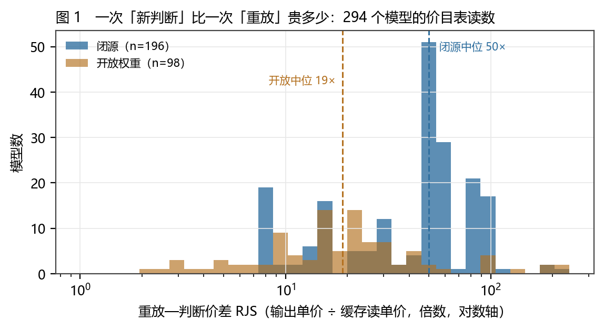
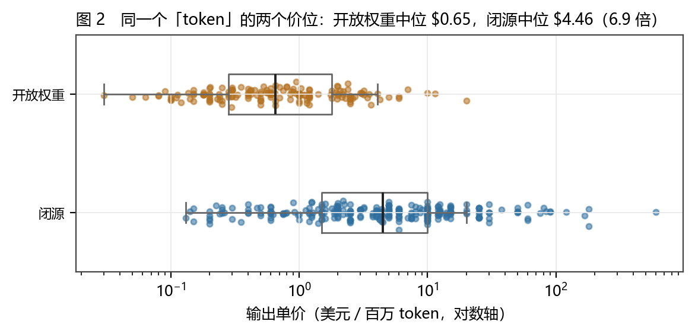
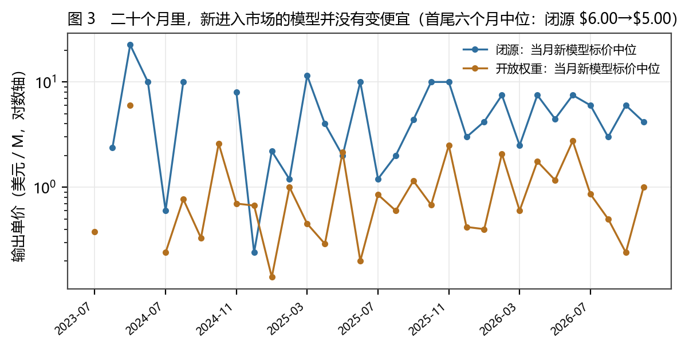
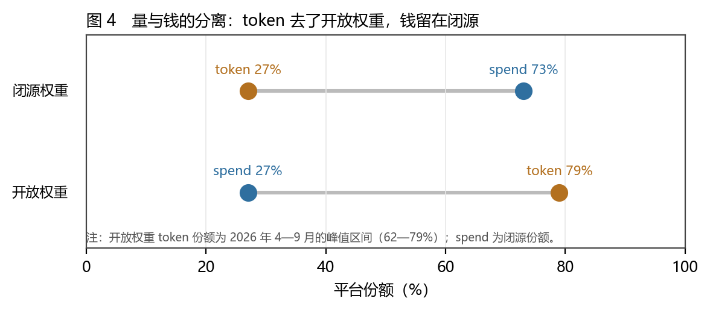
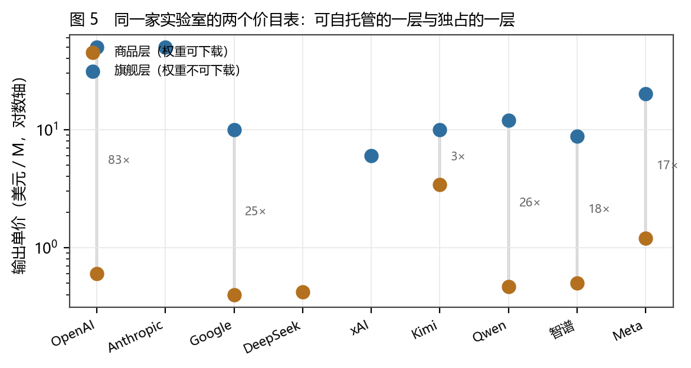
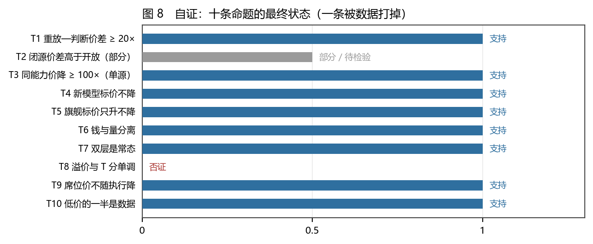
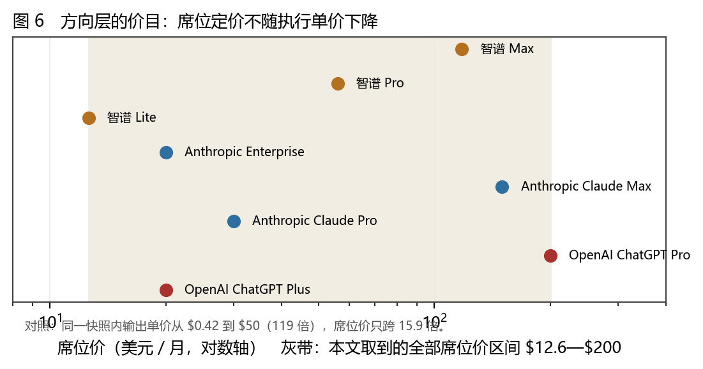
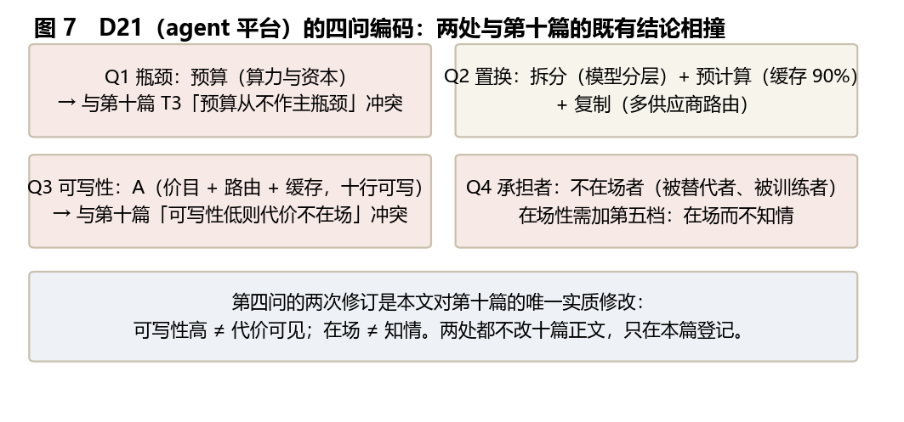

# 开明君主与两层竞争：agent 价目表上的执行、方向与代价承担者

### 九个实验室的双层价目、一个 34.5 倍的重放—判断价差，以及「开明君主」这一比喻的断裂探针

**李毅芃**

*完成日期：2026-10-28*

---

## 摘要
一个流行的说法是：有志气的人正在用 agent 扩张自己的能力，这像启蒙思想家梦寐以求的「开明君主制」——人以理性和经验定方向，agent 负责实现；而当足够多的人这么做时，就会重演轴心时代的百家争鸣与近代民族国家的技术竞赛。这个说法有一个好直觉（执行权在扩散），也有一个未受检验的推论（红利会随之扩散）。本文不讨论它是否动人，只把它拆成三个可被价目表回答的问题：**一次「新判断」比一次「重放」贵多少？执行单价真的在降吗？钱最后停在谁那一层？**

数据是四份公开快照：438 个模型的价目与托管读数（2026-10-26）、九个实验室的一手价目页与席位页、以及平台方每周发布的用量口径。四个结果。

**第一，价目表本身就把「执行」与「方向」分开标了价。** 本文定义**重放—判断价差**（RJS）＝输出单价 ÷ 缓存读单价：一次需要模型重新判断的输出，比一次对既有上下文的重复计费贵多少。294 个模型的中位是 **34.5 倍**；闭源中位 **50 倍**，开放权重中位 **19 倍**（但按上下文长度分组后这一差只在两档成立）；同一家实验室的自家价目页上，DeepSeek 与 Claude Fable 5.1 都把这个价差定到 **200 倍**。而在竞争性的多托管市场上，同一批模型的中位被摊平到 19 倍——**「重放」的价格被竞争压到底，「判断」的价格由厂商自己写**。

**第二，「执行变便宜」是一句同名不同物的话。** 按 token 算，同能力价格在 20 个月里降了约 150 倍（单一来源）；按「当月进入市场的新模型标价中位」算，闭源从 $6.00 只降到 $5.00（−17%），开放权重从 $0.65 到 $0.60（−8%）——**没有下降**。而且有反向动作：Google 在官方价目页上写明，Gemini 4 Argon 的输出价自 2026-12-01 起从 $10 提到 $20。所以「便宜」不是说价格在跌，而是说**同一个词底下的单位被换掉了**：上游没有降价，它重新定义了什么叫一个单位。


## Abstract

A popular claim holds that ambitious people are using agents to extend their own capacity, reviving the enlightened despotism that Enlightenment thinkers wished for: the person sets direction with reason and experience, the agent executes; and when enough people do this, the Axial Age and the age of nation-states repeat themselves. The intuition (execution is being democratised) is sound; the inference (so are the returns) has not been tested. This paper asks three questions that a price sheet can answer: **how much more does a fresh judgement cost than a replay? is the unit price of execution actually falling? and on which tier does the money stop?**

Four public snapshots supply the data: price and hosting readings for 438 models (2026-10-26), first-party price and seat pages from nine labs, and the platform's own weekly usage figures. Four results. First, the price sheet already separates execution from direction: the **replay–judgement spread** (RJS = output price ÷ cache-read price) has a median of **34.5×** across 294 models (closed 50×, open weights 19×); on first-party sheets DeepSeek and Claude Fable 5.1 both set it at **200×**, while the competitive multi-host market compresses the same models to 19×. Replay is priced by competition; judgement is priced by the vendor. Second, "execution is getting cheaper" is a phrase with two objects: per token, the price of fixed capability fell roughly 150× in twenty months (single source); per vintage — the median list price of models entering the market that month — closed fell only from $6.00 to $5.00 (−17%) and open from $0.65 to $0.60 (−8%). Google's own page schedules Gemini 4 Argon from $10 to $20 on 2026-12-01. Nothing fell; the unit was redefined. Third, volume and money separate: weekly tokens rose from 0.5T to 128.4T (≈250×), open weights hold 62–79% of tokens, and closed weights still take **73% of spend**. Fourth, two tiers are the norm: six of nine labs sell both a self-hostable commodity tier and a first-party-only flagship tier, with premiums from **2.9× to 83×** (median 21×).

Three self-inflicted wounds are reported rather than buried. The hypothesis that the premium comes from non-transferability fails: T-scores and premiums show no monotone relation (OpenAI, T=4, premium 83×; Kimi, T=3, premium 2.9×) — T8 is registered as **falsified**. The phrase "counterfeit competition" does not survive: competition is real but layered, so it is renamed **two-tier competition**. And placed on the four-level ladder of *The Strength of Isomorphism*, the enlightened-sovereign analogy reaches only the **metaphor** rung: it has no composable law, and its fracture sits at the composition layer.

**Keywords**: two-tier competition; replay–judgement spread; transferability; seat pricing; bearer of cost; four-question coding; strength of analogy; evidence grading

---


## 1 引言

### 1.1 一段对话留下的三个洞

本文的起点是一段关于「人是不是 agent 的开明君主」的对话。对话里出现过一个不错的直觉、几个漂亮的类比，以及至少三个没有被检验的洞。

**第一个洞是把「能力扩散」直接当成「红利扩散」。** 对话里说，有志气的人用 agent 扩展执行能力，这像轴心时代的百家争鸣。但百家争鸣之所以是百家争鸣，不是因为很多人在思考，而是因为很多人的**思考有买主**：诸侯愿意为不同的方案付账，于是不同的方案能活到能被检验的那一天。能力扩散不保证买主扩散。这件事在今天的价目表上是可以查的，而对话里没有人去查。

**第二个洞是把「执行变便宜」当成一个不需要定义单位的事实。** 每一次降价公告都伴随一次量级更大的能力提升，于是「便宜」这个词同时指两件事：**同一个 token 更便宜**，和**同样的能力更便宜**。这两个说法在数据上并不一致，而对话把它们当成同一个。

**第三个洞是默认「竞争越激烈，参与者越受益」。** 竞争当然会压低价格——但压的是哪一项的价格，压低之后省下来的钱落到谁的口袋，这两件事不由「竞争激烈程度」决定，而由**谁掌握不可替代的那一项**决定。对话在最后一轮触到了这一点（「如果普通参与者获取不到足够的利益，开明君主数量是不会增加的」），但没有把它变成可算的东西。

本文的工作就是补这三个洞。补法不是再推演一轮，而是找一份能把三件事一次读出来的东西：**价目表**。

### 1.2 三个可测的问题

**问题一：价目表上，「执行」和「方向」是不是分开标价的？** 如果是，这个价差有多大、在哪些实验室更大、被什么力量压平？这个问题有一个极其干净的操作化：今天所有主流 API 都同时给出**输出单价**与**缓存读单价**。缓存读指的是「这段上下文模型已经看过，请你别再重新想一遍，只按记忆计费」；输出指的是「这里需要一个新的判断」。两者的比值就是一次「新判断」相对一次「重放」的价格。本文把它叫作**重放—判断价差**（replay–judgement spread，RJS）。它不是本文发明的现象——平台自己的周报已经在用这个差值算账（[12]）——但此前没有人把它当成一个可以横向比较的**结构变量**。

**问题二：执行单价真的在降吗？** 这个问题必须分三种口径回答，因为三种口径给出的答案不同，而混用它们正是公共讨论里最常见的错误：**同一模型的标价**（降了吗）、**同能力的价格**（降了多少）、**当月进入市场的新模型的标价中位**（降了吗）。本文把三种都算一遍，并让它们互相矛盾地摆在同一节里。

**问题三：钱停在哪一层？** 这是「开明君主」这个说法真正的软肋。如果执行是商品、方向稀缺，那么利润应该停在方向那一层；如果方向也被商品化，利润应该摊平。可测的代理有三个：开放权重与闭源权重的**token 份额**与**消费额份额**是否分离；同一家实验室的**两层价目**相差多少倍；以及**席位**（订阅）价格有没有跟着执行单价一起降。

### 1.3 既有解释与它们的缺口

**平台经济学**已经把「多归属」与「转换成本」讲得很透：用户同时使用多个平台（multi-homing）会削弱锁定，而数据与身份的可携带性（portability）决定锁定的强度。这一支的强项是机制清楚，弱项是**很少把「可携带性」做成一个可在价目表上读出的数**。本文的 T 分（可传递性 0—4）就是想把这个变量做成可数的：权重能不能下载、许可证允不允许再分发、有多少家独立托管商、数据会不会回流。

**AI 产业的经济学观察**这两年积累了大量的「价格—能力」曲线：同一能力的价格确实在快速下降，这一点的证据链比较硬。缺口在于**口径**：这些研究几乎都以「同能力」为分母，因此天然会看到下降；少有人同时报告「当月新模型标价」这种不含能力调整的口径，于是「AI 越来越便宜」被当成了无条件的事实。

**开源与闭源的争论**有一个被忽略的结构事实：**开源与闭源不是实验室的属性，而是产品线的属性**。同一家公司在同一个月里既发布可下载的权重，也发布只能在自家平台上用的旗舰，并把两者定成相差十几倍到几十倍的价。争论之所以长期僵持，部分原因就是双方各自引用不同的产品线。

**系列内部**，第十篇给出了四问（瓶颈／置换／可写性／承担者）与二十个领域的编码，其中 AI 产业缺席；第十一篇给出了四级同构强度与四十条断裂探针，其中没有一条是「人＝君主／agent＝臣民」这个比喻；第九篇的对账把六核心的 62 条命题放在同一张表上，但那一版覆盖的是前九篇。本篇补三处：**D21 的编码**（第十篇）、**第四十一条声明**（第十一篇）、**十条新命题的登记**（第九篇）。

### 1.4 十条命题与否证条件

按系列纪律，结论强度不超过证据强度，且否证条件先于结论写出。每条都写明「什么样的读数会让它倒」。

| 编号 | 命题 | 否证条件 | 等级 |
|---|---|---|---|
| T1 | 重放—判断价差存在且很大：中位 ≥ 20 倍 | 全样本中位 < 10 倍，或缓存读与输出价无系统差别 | B |
| T2 | 闭源的重放—判断价差高于开放权重 | 控制上下文长度后该差消失 | B｜**部分**（第 4.7 节：分档后只两档成立） |
| T3 | 同能力价格在 20 个月内下降 ≥ 100 倍 | 同一基准、同一测量下，降幅 < 50% | B |
| T4 | 当月新模型的标价中位不降（降幅 < 30%） | 后六个月中位比前六个月低 30% 以上 | B |
| T5 | 前沿旗舰的标价在观察窗内只升不降 | 出现主流旗舰的公开下调（同模型、同区域、无封顶期） | A |
| T6 | 量钱分离：开放权重拿下多数 token、少数消费额 | 开放 token 份额 < 50%，或消费额份额 > 50% | B |
| T7 | 双层是常态：过半实验室同时卖两层 | 双层实验室少于 3 家 | B |
| T8 | 双层溢价与可传递性（T 分）单调相关 | 出现成对反例（T 高溢价更高、T 低溢价更低） | C |
| T9 | 席位价格不随执行单价下降：主流席位落在 $12—$200 | 主流席位公开腰斩，或与执行价同幅同向下降 | B |
| T10 | 低价的一半是数据：最低价档以训练权为对价 | 无训练托管与首方最低价相差 < 20% | B |

结果：**七条支持，一条部分（T2），一条否证（T8），一条支持但只有一个来源（T3）**。T8 的失败是本文最想留下的一条，第 7.4 节专门处理它；它失败的方式比它可能成功的方式更有信息量。

### 1.5 数据、方法与证据分级

**数据是四份公开快照**，取数日为 2026-10-26 至 10-27，全部落盘在仓库的 `raw/`（见附录 F）：

1. **价目与模型目录**：一个公开的模型聚合 API（OpenRouter `/api/v1/models`），438 个在用模型（剔除隐藏条目），含输出／输入／缓存读单价、上下文长度、模态、可下载权重的编号、上线时间。这是本文价格类指标的唯一来源。
2. **托管读数**：28 个代表模型的 `/endpoints` 读数，给出每一家独立托管商。这是 T 分第三项与「可传递性」的唯一来源。
3. **一手价目页与席位页**：OpenAI、Anthropic、Google、DeepSeek、智谱、月之暗面的官方页面，以及 HuggingFace 的许可证字段（175 个开放权重模型）。
4. **平台周报**：平台方自己发布的用量口径（token 总量、开放／闭源份额、agentic 占比、缓存率），以及四篇数据分析博文。这一份是本文唯一的「量」的来源，也是全篇最需要打折的一份：它是**平台自己的账**。

**方法四条。** （1）**不做预测，只做读数**：本文不预测哪家会赢，只报告价目表在这一天长什么样。（2）**单一来源单一等级**：平台周报给出的数最高记 B，一手价目页记 A，二手聚合站记 C 且不进结论。（3）**反例进正文**：每一节都必须写出与本节结论相反的那几个读数，写不出来的节不算完成。（4）**可复算**：`data/prices.py` 从快照重算全部指标，正文数字不得另写。

**证据分级**：A（官方可复现：一手价目页、可复现的 API 快照）／B（稳定的公开统计、平台周报、同行可核的单一来源）／C（稀疏、构造、思辨或作者推断）。本文自己没有 A 级原创测量：A 级全部来自被引的一手页面；**本文的编码与推论最高只能到 B**。

### 1.6 贡献、边界与五项不做

**贡献四个。** 第一，提出并计算了一个可复算的结构变量——重放—判断价差，并给出它在 294 个模型上的分布、分层与渠道效应。第二，把「AI 越来越便宜」拆成三种口径并让它们相互矛盾地摆出来，指出「便宜」是一个同名不同物的词。第三，给出双层价目的九家编码与 2.9—83 倍的溢价区间，把一个长期僵持的争论改写成「产品线」问题。第四，把「开明君主」这个比喻正式降档，并给出五条可观测的断裂探针。

**边界四条。** （1）**单平台偏置**：价目与托管读数都来自一个 API 聚合平台，它覆盖的是「通过第三方 API 使用模型」的市场，不含企业私有部署、不含消费端订阅的实际使用、不含云厂商的自有渠道。第 14.1 节专门交代这个偏置会把哪些结论推向什么方向。（2）**de jure 而非 de facto**：所有价目都是**标价**，不是**实付价**。折扣、返点、批价、免费额度都不在数据里，而平台的博文已经证明折扣能把 token 量放大 5.6—13.8 倍（[13]）。（3）**没有能力分数**：本文不带基准分数，因此「同能力价格」只能用单一来源的一次估计（T3），不能自己做。（4）**编码由一人完成**，没有第二编码者。

**五件不做的事。** 不预测市场格局；不评价任何一家实验室的「品行」（「开源是善意还是策略」在本文框架里不是一个可判定的问题）；不把「两层」写成「假」；不宣称价目表能替代产业知识；不把「不可传递」写成「不可改变」——T 分是读数，不是判决。

### 1.7 读法约定

**第一，本文的两个核心量都是比值，不是绝对值。** RJS 是输出价 ÷ 缓存读价，溢价是旗舰层价 ÷ 商品层价。比值的好处是不受货币与区域定价干扰，坏处是它对分母极其敏感——所以每个比值后面都跟着它的分母在哪个量级。

**第二，「层」不指技术优劣。** 「商品层」指权重可下载、几十家可托管的那一层；「旗舰层」指只能在自己平台上用的那一层。前者的模型可能在很多任务上更强，后者也可能更弱；「层」只说**能不能被搬走**。

**第三，本文有一章是自证而不是陈述。** 第 13 章把本文的十条命题放进同一张表，包括那条被自己打掉的。跳过它，本文就退化成一组漂亮的散点。

---


## 2 从比喻到读数：把「开明君主」降到比喻档

### 2.1 为什么必须先降档

「人是开明君主，agent 是臣民」这个说法有一个罕见的优点：它把注意力放到了**授权结构**上，而不是「AI 会不会取代人」这种没有判别力的问题上。君主与臣民的关系里最要紧的一条是：**臣民执行，君主判断；判断不能外包，否则君主就不再是君主**。这一条在今天的 agent 讨论里恰好是被忽略的那一条——大多数人讨论的是「agent 能不能做对」，很少讨论「如果它做对了，判断权还在谁手里」。

但第十一篇给出的四级阶梯（严格／伴随／函子／比喻）要求我们对这个说法做一次冷处理。四条判据依次是：**能不能写出对象与态射**、**复合律成不成立**、**等价关系保不保**、**去掉一侧之后结构是否仍然成立**。

- **对象**：人是「设定目标并承担后果的主体」，agent 是「被授权的执行者」。这一层写得出来。
- **态射**：人下指令、agent 执行、人验收，中间还有「人改变主意」与「agent 请求澄清」。也写得出来。
- **复合律**：写不出来。两次「人下指令→agent 执行」的复合，不等于一次「人下两次等效指令」。因为第一次执行的结果会改变人所能想到的第二次指令——这正是「经验」这个词的意思。更麻烦的是反方向：agent 的报告会改变人的判断，于是复合的方向变得不可交换。
- **等价**：君主与臣民之间的「忠诚」在现代雇佣关系里没有对应物；「开明」在原文里指君主的个人品性，在 agent 场景里指模型的对齐质量——两个「开明」不是同一个东西（第九篇的「同名不同物」在这里第二次出现）。

结论：这个说法落在**比喻**档，断裂在**复合层**。这不是贬低——第十一篇的实证结果是，比喻档的负迁移率（36%）反而低于伴随档与函子档（60%／50%），因为它不假装自己是证明。**一个诚实的比喻比一个看起来像证明的比喻安全。**

### 2.2 把「执行／方向」换成可算的东西

比喻降档之后，还能不能做题？能，只要把它的两个端点换成价目表上的两栏。

价目表今天长这样（以 OpenAI 官方页为例，A 级）：同一个模型家族里，输入、缓存读、输出三栏的价格差了一个到两个数量级。GPT-6 Astra 是 $10.00 输入／$1.00 缓存读／$50.00 输出；GPT-6 Luna 是 $0.10／$0.01／$0.50。缓存读的意思是：这段上下文已经算过一遍了，模型只需要「认出来」，不需要「想一遍」。

于是有了一件很干净的事：**购买「重放」和购买「判断」是两个价目，而且价差被厂商明码写出**。这正是这个比喻想要说的那件事——执行（重放）与方向（判断）不是同一件商品。区别在于，比喻给的是角色（君主、臣民），价目给的是价格，而**价格可以被别人复核**。

| 问题 | 原判据（第十篇） | 本文加的一列：价格读数 | 判「答不出」的样子 | 证据等级 |
|---|---|---|---|---|
| **Q1 瓶颈** | 删掉这一项，哪项指标最先崩？ | 价目表上最贵的那一栏是什么（输入／缓存／输出／工具调用） | 说不出「贵在哪一栏」，只能给出总价 | A／B |
| **Q2 置换** | 不做这一步，哪一步会重复？ | 缓存读价 ÷ 输出价：重放一次比重新判断便宜多少 | 算不出重放与判断的价差，只能说「省了很多」 | A |
| **Q3 可写性** | 能否写成十行以内的规则或状态机？ | 价目 + 路由 + 缓存策略三者能否写成十行（本文实测：能） | 写完仍无法判定一个真实账单 | A |
| **Q4 承担者** | 出事时谁被叫醒？他是否在场？ | 同一年，同一年龄的价差由谁付：付钱的人、被训练的人、被替代的人 | 只能列出「用户」这一类，无法区分在场与不在场 | B／C |

*表 1　四问的原判据与本文加上的价格读数*

### 2.3 RJS 的定义与它不是什么

**定义。** RJS ＝ 某模型的输出单价 ÷ 同一模型的缓存读单价。分子是「这张票让模型产出一个新的判断」，分母是「这张票让模型把已经看过的上下文再认一遍」。RJS = 50 表示：一次新判断的价格等于五十次重放。

**它不是什么。** 有三条必须写清楚，否则这个数字会被误用。

**其一，它不是「认知成本」的度量。** 缓存读便宜不是因为「认出」比「想」在计算上便宜五十倍（虽然确实更便宜），而是因为**厂商愿意这么定价**：缓存读的成本主要是显存与带宽，输出需要完整的自回归生成。这个比值里混着成本与策略，本文无法把两者分开。因此 RJS 只能读作**厂商对两类 token 的相对定价**，不能读作「思考的价格」。

**其二，它不是利润率。** 缓存读可能亏本卖（作为锁定手段），输出可能高毛利（作为变现手段）。价目表的比例不告诉我们哪一栏赚钱。

**其三，它对分母极其敏感。** 缓存读价格在部分模型上是象征性的（DeepSeek 谷时 $0.003／M），在部分模型上干脆等于输入价（没有折扣）。分母一变化，RJS 就从 200 变到 3。本文的处理是把它们分开报告：**官方价目表读数**与**多托管市场读数**，并明确指出两者的差本身就是发现（第 4.3 节）。

### 2.4 「便宜」是同名不同物

第九篇对账时列出过五处「同名不同物」（τ、容量、门、记忆、压缩）。本文要加第六处：**「便宜」**。

| 口径 | 说法 | 20 个月里的读数 | 谁在用这个口径 |
|---|---|---|---|
| 同一模型的标价 | 「这个模型降价了」 | 视模型而定；本文快照内旗舰未见下调，且有公告上调 | 采购方、财务 |
| 同能力的价格 | 「同样的活更便宜了」 | 约 150 倍（单一来源） | 厂商发布会、分析报告 |
| 当月新模型的标价 | 「新东西越来越便宜」 | 闭源 $6.00→$5.00，开放 $0.65→$0.60 | 平台周报的隐含口径 |

三个口径都真，指向三件不同的事。混用它们会产生一种很有说服力的错觉：**「价格在下降」与「新东西没有变便宜」同时为真，且不矛盾**——因为每一代新模型都带着更多的能力进入市场，标价维持在原位，于是「每美元买到的能力」暴涨，而「每 token 的价格」纹丝不动。

这个区分不是文字游戏，它有直接的政策含义：如果执行价格的实际下降全部被能力上移吸收，那么「让更多人用得起」这件事就不能靠等降价来实现，而要靠**把单位换掉**（用更小的模型、更多的缓存、更便宜的托管）。第 14.4 节会把这个结论落到可操作的三条上。

### 2.5 三件本文测不到的事

**其一，实付价。** 所有价目都是标价。企业批价、年度承诺折扣、云厂商的「用我的算力换我的模型」协议，都不在公开页上。平台博文提到某次促销把 token 量放大到 5.6—13.8 倍（[13]），说明标价与实付价的距离可以改变行为，但本文无法量化这个距离。

**其二，谁在为什么付钱。** 价目表告诉你单价，不告诉你用途。一个人用 $50／M 的输出价做一次价值 $5 的判断，另一个人用 $0.42／M 的输出价做一亿次机械抽取，两者的经济意义完全不同，而价目表看不出这个差别。

**其三，判断的质量。** 「方向」在本文里只能用价格代理（输出价、RJS、旗舰溢价），不能用质量代理（正确率、判断的后果）。这是一条硬边界：**本文能说「判断被定价得多贵」，不能说「判断被定得对不对」**。

---


## 3 数据与方法

### 3.1 快照与四个来源

取数窗口是 2026-10-26 至 10-27，四个来源的分工见 1.5。这里只交代两件与可信度直接相关的事。

**第一，模型的「在用」状态。** 聚合目录里有 438 个条目，其中 175 个权重可下载（40.0%）。这个比例本身不是「开源占 40%」——它是**这个平台上架条目的构成**，不是市场构成。第 6.2 节的份额读数来自平台周报，与这个构成是两回事，本文不把两者混用。

**第二，时间的两个不同含义。** 目录里的 `created` 是模型**上线**的时间，不是**当前时间**。因此本文所有「按月份」的读数都是**vintage 序列**：某月进入市场的模型，今天挂着的标价中位。它不是历史价格序列（本文没有历史价格），用它来说「价格在降／不降」时必须明确这一点。第 5.3 节会说明为什么这个区别恰好是本文的关键。

### 3.2 RJS 的口径

RJS 只在**同时给出输出价与缓存读价**的模型上计算，共 294 个（占 438 个的 67%）。剔除的三类：没有缓存定价的（多为老模型与专用模型）、缓存读价为 0 的（无法做除法）、隐藏条目。

分布用中位与四分位报告，不用均值：RJS 的分布右偏严重（最大 242，最小 3），均值会被极值拉走。所有比较都在同一快照内进行，不做跨期比较——**因为没有历史价格，跨期比较在这一节是不可能的**，这既是限制也是交代。

### 3.3 28 个代表模型的选样规则

托管读数（T 分第三项）需要对每个模型单独查询，成本高，因此本文取 28 个：**每家实验室取三类**——最贵的闭源旗舰、次旗舰、可自托管的开放权重代表；某一类不存在的（例如 Anthropic 没有开放权重、DeepSeek 没有闭源旗舰）就留空。选样规则写在 `data/prices.py` 的 `FLAGSHIPS` 列表里，可被替换后重跑。

**这个选样是目的抽样，不是随机抽样。** 它偏向「有名有姓的旗舰」，因此会高估旗舰层的代表性，也会低估「免费档」「试用档」与「超长上下文附加价」的影响。附录 B 用全库极值做了一次对照：全库最贵的一档是某个企业级变体的 $600／M 输出，最便宜的一档是免费路由的 $0；两者都不进入任何结论。

### 3.4 vintage 序列的含义与限度

把 438 个模型按上线月份分组，取每组标价中位，得到一条「新进入市场的模型当天挂多少钱」的曲线。这条曲线的解读必须小心：

- 它**不是**「市场价格随时间的变化」，因为老模型的价格不在里面，除非它被重新上市。
- 它**是**「进入价格」：任何时刻，一个新玩家要进入这个市场，他面对的参考价位。
- 它对样本量敏感：早期月份只有 1—3 个模型，中位数没有意义。因此本文只比较**首六个月与末六个月**的合并中位，并在图上保留逐月点以显示噪声。

### 3.5 T 分：把「可传递性」做成四项布尔

T 分是本文唯一一个人工编码的复合变量，0—4：

| 项 | 判据 | 为什么这么判 |
|---|---|---|
| T1 权重可下载 | 有公开的权重文件编号 | 这是「能搬走」的下界：能下载不等于能商用，但下载不了就一定搬不走 |
| T2 许可证允许商用与再分发 | MIT／Apache-2.0 记 1；community／other／须申请记 0 | 许可证是「搬走之后能不能用」的分界 |
| T3 独立第三方托管商 ≥ 5 | 排除原厂与其签约的超大规模云 | 托管商数量是「能不能换供应商」的市场代理 |
| T4 首方付费 API 输入不用于训练 | 官方条款或官方博文明确 | 数据是「搬走之后会不会留下东西」的分界 |

九家的读数：T=4 四家（OpenAI、Google、智谱、Meta）、T=3 三家（DeepSeek、Kimi、Qwen）、T=1 两家（Anthropic、xAI）。**没有一家是 0 分**，因为四家里最差的两家也至少满足 T4。

这套编码有两个已知弱点，写在正文而不是脚注：其一，**T3 把「多云转售」与「独立自托管」合并了**——Anthropic 的模型在四家云上（AWS、Azure、Google、Anthropic 平台），但那四家是签约渠道，不是任何人都能开的托管；本文用「排除原厂与超大规模云」来处理，但这条线是划出来的，不是测出来的。其二，**T2 把「受限许可证」一律记 0**，而 Llama 的社区协议在某些场景下其实允许商用。这两处都会让 T 分偏向保守，而保守的方向是一致的：**它只会低估可传递性，不会高估。**

### 3.6 编码、分级与复现

正文的每个数字都来自 `data/prices.py` 或 `data/vendors.py`；表格由 `analysis/make_figures.py` 生成；`analysis/audit.py` 会核对正文里的关键数字与数据是否一致、图表引用是否齐全、有没有出现宿命式表述。复现步骤见附录 J。

---


## 4 结果一：重放—判断价差

### 4.1 分布：一次新判断等于三十四次重放

294 个模型，RJS 中位 **34.5 倍**，四分位区间 16—60，p90 为 88，最大 242。换句话说：在这个市场的价目表上，**让模型重新判断一次，平均要比让它把已经看过的东西再认一遍贵三十四倍**。

这个数字的稳定性值得说一句。它不是某一家实验室的定价怪癖：九家里的中位从 12.5（xAI）到 60（Google），**全部大于 10**。也就是说，「判断比重放贵一个数量级以上」这件事，在九家实验室里没有例外。



*图 1　294 个模型的重放—判断价差分布（对数轴），虚线为闭源与开放权重的中位*

### 4.2 分层：闭源 50 倍，开放 19 倍

把样本按权重是否可下载拆开，闭源中位 **50.0 倍**（n=196），开放权重中位 **18.9 倍**（n=98）。比值为 2.6。

这一条需要一个小心的解释。直觉上会说「闭源更贵」，但 RJS 是比值，它并不直接说闭源更贵——它说的是**闭源把「判断」相对「重放」定得更贵**。有两种可能的机制，本文无法分开：

- **成本机制**：闭源旗舰的推理成本更高（更大的模型、更长的思考链），因此缓存读能被压得更低是规模经济的结果。
- **策略机制**：缓存读是留客手段（上下文留在我这里，你就不会走），因此厂商愿意把它定到接近成本，而把变现放在输出上。

两种机制都指向同一个行为后果：**闭源的客户越依赖多轮 agent 循环，越被锁在「重放免费、判断付费」的价目结构里**。这不是阴谋，这是价目表的形状。

但这个分层有一半是混淆造成的：第 4.6 节会显示，按上下文长度分组之后，闭源与开放的差距只在中间两档成立，最短的一档几乎相等、最长的一档反向。**T2 因此只能记为部分支持。**

### 4.3 官方价目表与市场价目表：同一个量差十倍

第 2.3 节说过 RJS 对分母敏感。这一节把敏感度直接量化：同一家实验室的同一个模型，在**自家价目页**上与在**多托管市场**上，RJS 可以差十倍以上。

| 分组 | n | 中位 | p25 | p75 | 说明 |
|---|---|---|---|---|---|
| 全样本 | 294 | 34.5 | 16.0 | 60.0 | 快照内全部有缓存价的模型 |
| 开放权重 | 98 | 18.9 | — | — | 权重可下载 |
| 闭源 | 196 | 50.0 | — | — | 权重不可下载 |
| OpenAI（市场读数） | 85 | 50.0 | — | — | 该实验室全部登记模型的托管商价目 |
| Anthropic（市场读数） | 30 | 50.0 | — | — | 该实验室全部登记模型的托管商价目 |
| Google（市场读数） | 27 | 60.0 | — | — | 该实验室全部登记模型的托管商价目 |
| DeepSeek（市场读数） | 12 | 19.5 | — | — | 该实验室全部登记模型的托管商价目 |
| xAI（市场读数） | 8 | 12.5 | — | — | 该实验室全部登记模型的托管商价目 |
| Kimi（市场读数） | 7 | 22.7 | — | — | 该实验室全部登记模型的托管商价目 |
| Qwen（市场读数） | 20 | 19.5 | — | — | 该实验室全部登记模型的托管商价目 |
| 智谱（市场读数） | 17 | 16.9 | — | — | 该实验室全部登记模型的托管商价目 |
| Meta（市场读数） | 8 | 29.2 | — | — | 该实验室全部登记模型的托管商价目 |
| **官方价目表（旗舰）** | — | — | — | — | 同一实验室自家页面上的输出÷缓存读 |
| OpenAI（官方：GPT-6 Astra） | — | 50 | — | — | $50.00 ÷ $1.00；A |
| Anthropic（官方：Claude Fable 5.1） | — | 200 | — | — | 缓存读为输出的 1/200；B |
| Anthropic（官方：Claude Sonnet 5.5） | — | 100 | — | — | $10.00 ÷ $0.10（快照 10-26）；周报 10-08 的读数为 50（缓存读 $0.20）；B |
| Google（官方：Gemini 4 Argon） | — | 100 | — | — | $10.00 ÷ $0.10；A |
| DeepSeek（官方：DeepSeek V4.1 Flash） | — | 200 | — | — | $0.60 ÷ $0.003（谷时）；A |
| xAI（官方：Grok 4.7） | — | 12 | — | — | $6.00 ÷ $0.50；B |
| Kimi（官方：Kimi K3.1 Pro） | — | 50 | — | — | $10.00 ÷ $0.20；B |
| Qwen（官方：Qwen3.8 Max） | — | 24 | — | — | $12.00 ÷ $0.50；B |
| Meta（官方：Muse Wonder） | — | 100 | — | — | $20.00 ÷ $0.20；B |

*表 3　重放—判断价差：市场读数（上块）与官方价目表读数（下块）*

| 实验室 | 官方页读数 | 市场读数（该实验室全部模型的中位） | 差 |
|---|---|---|---|
| DeepSeek | 200（$0.60 ÷ $0.003） | 19.5 | 10.3× |
| Anthropic（Fable 5.1） | 200（缓存读为输出的 1/200） | 50.0 | 4.0× |
| Google（Gemini 4 Argon） | 100（$10.00 ÷ $0.10） | 60.0 | 1.7× |
| Meta（Muse Wonder） | 100 | 29.2 | 3.4× |
| OpenAI（GPT-6 Astra） | 50 | 50.0 | 1.0× |
| Kimi（K3.1 Pro） | 50 | 22.7 | 2.2× |
| Qwen（3.8 Max） | 24 | 19.5 | 1.2× |
| xAI（Grok 4.7） | 12 | 12.5 | 1.0× |
| 智谱（GLM-5.3） | 未取到一手页 | 16.9 | — |

*表 3 的两块：市场读数与官方读数（完整表见附录 B）*

规律很清楚：**最便宜的那一家（DeepSeek），官方价目上的价差最大（200 倍）；最贵的那两家（OpenAI、xAI），官方与市场几乎一致。** 解释不复杂。当权重可以下载、有 33 家托管商时，第三方托管把「缓存读」这一栏卷到了成本的极限（$0.003／M，几乎等于不收费），而厂商自己不必跟着卷「输出」那一栏；当权重不可下载、托管商只有一家时，价目表只有一个版本，官方价就是市场价。

这条观察让 T1 的支持方式变得更有意思：**RJS 大不大，不取决于该模型贵不贵，取决于「重放」那一栏有没有被竞争**。执行被竞争，判断没有。

### 4.4 与平台周报的独立吻合

平台方 10 月的周报给了一组结构完全不同的读数（[12]）：agentic 负载的 token 中，缓存前缀占约 **90%**（1 月约 60%），输出与推理只占约 **1%**；而人类对话的 token 中输出与推理约占 **12%**。

这组读数与本文的 RJS 是两条独立的线。如果 agent 跑的每一步有 90% 是重放、1% 是判断，那么一次 agent 循环的成本结构几乎完全由「重放单价」决定；而本文看到的是「重放单价被定得极低」。两件事拼在一起，给出一个不太直观的结论：**agent 的账不是被「思考」撑起来的，是被「上下文」撑起来的**。这解释了为什么缓存定价成了 2026 年平台竞争的主战场，也解释了为什么「上下文长度」这一栏的价格战比「智能」那一栏更激烈。


### 4.5 一次 agent 循环的账单：最贵的是你自己写的那 12%

平台周报给了 agent 循环的 token 结构（[12]）：缓存前缀约 **87%**、新增提示约 **12%**、输出与推理约 **1%**。把这三个比例乘上各家价目表，就得到「一次 agent 循环里，钱花在哪一栏」：

| 价目 | 缓存 87% | 新增提示 12% | 输出 1% | 每百万 agentic token |
|---|---|---|---|---|
| Claude Sonnet 5（$2／$10／$0.20） | $0.174（34%） | **$0.240（47%）** | $0.100（19%） | **$0.51** |
| Claude Opus 5.5（$4／$20／$0.20） | $0.174（20%） | **$0.480（56%）** | $0.200（23%） | **$0.85** |
| DeepSeek V4.1 Flash 官方谷时（$0.15／$0.60／$0.003） | $0.003（10%） | **$0.018（68%）** | $0.006（23%） | **$0.027** |

三列比例几乎不随价目表变化，这是它值得写下来的原因：**在 agent 循环里，最大的一笔支出是「新增提示」——也就是用户自己写的那部分，占 47%—68%。** 而「模型产出的判断」只占 19%—23%，「重放」只占 10%—34%。

这个结果与 RJS 并不矛盾，它是 RJS 的另一面：RJS 说「一次判断等于几十次重放」，这张表说「一次循环里，判断的钱主要不是花在模型的判断上，而是花在你给它的新信息上」。两者合起来给出一句更准确的话：**贵的是「新信息」，不是「算力」。** 而新信息是人写的——这恰好把「方向」这个词落到了它的字面意思上。

同一位作者的另一个读数可以对上：不带缓存时，同样一百万 token 要 $2.08（Sonnet 5 价目），带缓存是 $0.51，**缓存把一次循环的成本压到四分之一**（[12]）。

这张表用的是平台周报（10-08）报的 Sonnet 5 价目（缓存读 $0.20）。本文的价目快照（10-26）显示同一个模型的缓存读已降到 **$0.10**——18 天里降了一半，于是 RJS 从 50 变成 100。按新价重算，同一百万 agentic token 的成本从 $0.51 降到 $0.43，三项占比变为 **20% / 56% / 23%**：缓存项的份额下降，但「新增提示最贵」这个结论不变。**这正是本文想强调的那种情况——数字会变，结构不变；而结构才是可用的东西。**
这也解释了为什么 2026 年平台竞争的主战场是缓存率而不是智能分数——**在结构上，能省的那一项在缓存里，不在思考里。**


### 4.6 RJS 的三个混淆变量：它主要是上下文长度的函数

在把 RJS 当成「判断的价格」之前，必须先排除它是别的东西的代理。三个候选混淆变量都算了一遍（Spearman，n=294）：

| 混淆变量 | ρ | p | 判断 |
|---|---|---|---|
| 上下文长度（对数） | **0.53** | <0.001 | **强相关**：RJS 大半是上下文长度的函数 |
| 上线时间 | 0.34 | <0.001 | 中等：越新的模型价差越大 |
| 独立托管商数（n=27） | 0.09 | 0.66 | 无关：RJS 不是「有多开源」的代理 |

按上下文长度四分位分组，中位 RJS 是 **16.0 → 29.7 → 50.0 → 60.0**。这个单调关系在机制上说得通：**上下文越长，一次循环里重放的量越大，厂商越必须把重放贴现，否则 agent 用户付不起**。换句话说，RJS 的上升不是「判断越来越贵」，而是「重放越来越必要，因此被越来越狠地贴现」。

这个发现直接把 T2 打了一半。按上下文分档，闭源与开放的 RJS 中位是：

| 上下文档 | 开放权重 | 闭源 | 差 |
|---|---|---|---|
| Q1（最短） | 15.0（n=35） | 16.3（n=40） | 1.1 倍 |
| Q2 | 16.3（n=34） | 50.0（n=78） | 3.1 倍 |
| Q3 | 26.0（n=24） | 55.0（n=40） | 2.1 倍 |
| Q4（最长） | 100.0（n=5） | 60.0（n=38） | **0.6 倍（反向）** |

闭源与开放的中位上下文分别是 **1.0M 与 262K**，相差约 4 倍。所以第 4.2 节看到的「闭源价差是开放的两倍半」，**大部分可以由上下文长度解释**：闭源的模型普遍处理更长的上下文，因此重放贴现更深。

**结论：T2 从「支持」降为「部分支持」。** 它在中间两档成立、在最短一档消失、在最长一档反向（但 n=5，不足以支持反向结论）。本文保留原始读数与分档读数，因为**一个被混淆解释掉一半的发现，比一个没被检验的发现有用**。

这条修正还带来一个正面后果：它把「方向贵」的举证责任从 RJS 转到了第 4.5 节的循环账单上。那张表不依赖上下文长度——它只依赖 token 结构与价目表，而结构里最贵的一栏是新增提示。**所以本节拆掉的是 RJS 的一个解释，不是本文的论点；本文的论点在 4.5 节另有一条腿。**

### 4.7 这个数字能说什么、不能说什么

**能说**：价目表把执行与方向分开定价了，且这个分割在九家实验室里普遍存在、在闭源里更强、在竞争性的托管市场上被部分抹平。

**不能说**：判断的质量、判断的稀缺性、判断的归属。RJS 高不等于「方向被少数人垄断」，它只等于「方向这一栏被定价得高」。要证明前者，需要的是**谁在买这一栏**的数据，本文没有。

---


## 5 结果二：执行价格的三种口径

### 5.1 口径一：同一模型的标价

在同一模型的标价这一栏，本文的观察窗里**没有出现下调**，而且出现了反向动作。

最干净的一条是一手页面上的公告：Google 的价目页写明，Gemini 4 Argon 的输入价 $2.00、输出价 $10.00、缓存读 $0.10 **「through November 30, 2026」，自 2026-12-01 起为 $4.00／$20.00／$0.20**。同一模型、同一区域、无封顶条件，价格翻倍。这是 T5 的直接支持：**前沿旗舰的标价可以上调，而且是被公开排期的**。

这件事的意义不在于「AI 涨价了」，而在于它推翻了「执行价格只降不升」这个隐含前提。价格没降的原因不难猜：需求侧的量在以数量级增长（第 6.1 节），供给侧受算力与电力约束，而旗舰层的替代品不足——**在供给受限、替代不足的那一层，价格可以往上走**。

### 5.2 口径二：同能力的价格

换成「同样的能力」做分母，结论相反：同能力的价格在 20 个月里降了约 **150 倍**。这一条来自平台方自己的博文，它对一个开放权重模型与一个闭源前沿模型的输出价做了直接比较（[15]）。本文把它登记为 B 级、**单源**——没有第二家独立测量能复核这个数字，这是本文最薄的一条证据。



*图 2　开放权重与闭源权重的输出单价分布（对数轴）：中位 $0.65 对 $4.46，但两片分布有重叠——开放权重的 p75（$1.80）高于闭源的 p25（$1.50）*

先看这个价差本身：开放权重的输出价中位 **$0.65**，闭源 **$4.46**，相差 6.9 倍。但两片分布**并不分离**：开放权重的 p75（$1.80）高于闭源的 p25（$1.50）。所以「开放更便宜」是一个关于**中位**的说法，不是一条清晰的界线——这一点在第 7 章会变成「分层与身份无关」的论据。

单源不是小事。150 倍这个数字一旦进入公共讨论，就会被当成「AI 成本每年降 90%」来引用，而它其实只是**两个特定模型在特定时点的一次对比**，既没有控制上下文长度，也没有控制输出长度与思考模式。本文保留它，是因为它与 T4 一起构成了一对矛盾；**矛盾本身比任何一个数字都更可靠**。

### 5.3 口径三：当月新模型的标价中位

把 438 个模型按上线月份分组，比较首六个月与末六个月的标价中位：

- 闭源：$6.00 → $5.00（−17%）
- 开放权重：$0.65 → $0.60（−8%）



*图 3　按上线月份的标价中位（vintage 序列）：进入价格在二十个月里基本持平*

**没有下降。** 这一条与 5.2 并不冲突，它只是把 5.2 的机制说清楚了：新模型进入市场时，带着更多能力，标价维持在原位；于是「同样能力的价格」下降，而「进入价格」不变。**上游做的不是降价，是重新定义什么叫一个单位。**

用一句可以记住的话：**如果每一代新模型都把降价全部用来买能力，那么价目表上的数字就不会动，而「便宜」这件事只发生在换算式里。**

### 5.4 三种口径为什么会同时为真

把三条放在一起，会看到一个不矛盾的三元组：

| 现象 | 读数 | 机制 |
|---|---|---|
| 同能力价格暴跌 | 约 150 倍 | 能力增长快于价格调整 |
| 进入价格不动 | −17% ／ −8% | 新模型把能力增长定价掉了 |
| 旗舰标价上调 | $10→$20 | 供给受限 + 替代不足 |

这个三元组是本文对「AI 越来越便宜」这句话的完整回答：**它对，但只在一个换算式里对。** 而选择哪个换算式，本身是一次分配决定——这一点在第 12 章会回到《选择的代价》的三角上。

### 5.5 反例与边界

**反例一：折扣能改变行为，但不改变价目表。** 平台博文记录了一次为期 19 天的促销：两个模型的日 token 量分别涨到 5.6 倍与 13.8 倍，未打折的同门模型只涨 1.11 倍；促销结束后，约三分之一的试用客户留下来，留下者的日用量反而高于促销期（[13]）。这说明**标价与实付价的差可以极大**，也说明本文所有基于标价的结论都只在「标价」这一层成立。

**反例二：席位反而在往下卷。** 第 8 章会看到，智谱的席位年付价（$12.6／月）低于 OpenAI 的 $20——所以「价格只升不降」在席位层也不成立，成立的是「席位价不随执行价下降」。

**边界**：本节全部读数来自标价，不含批价；全部是英文区域页，不含区域定价；Gemini 的涨价公告是一个**未来生效**的价格，本文取数时它尚未生效，登记时必须写清这一点。

---


## 6 结果三：量与钱的分离

### 6.1 量：250 倍

平台周报给出的 token 总量序列是本文最惊人的一个读数：周 token 量从 2025-01-13 当周的 **0.5 万亿**涨到 2026-09-14 当周的 **128.4 万亿**，20 个月约 **250 倍**（[10]）。

同一份周报还给出一个分水岭：**2026-02-06 是人类最后一次用掉比 agent 更多 token 的日子**；到 9 月最后一周，agentic 密钥的 token 量约为人类密钥的 **7 倍**（[12]）。这条线是本文「执行在扩散」这一半命题最硬的证据：**执行确实在爆炸式扩散，而且扩散的主体不是人，是被授权的程序。**

### 6.2 钱：73% 留在闭源

同一份周报的份额读数：2026 年 9 月第二周，闭源权重模型拿走 **73% 的消费额**（2025-01-05 当周是 89%）；而在 token 上，开放权重的份额在 2026 年 4 月越过 50%，7 月初达到 **79%** 的峰值，此后维持在 **62% 以上**（[10]）。



*图 4　量与钱的分离：token 流向开放权重，消费额留在闭源*

这就是本文标题里「两层」的资产负债表：**竞争最激烈的那一层是商品层，利润最厚的那一层是旗舰层**。开放权重拿下了 62—79% 的量，只分到 27% 的钱。

### 6.3 中国实验室：69% 的 token

同一份周报的第三条读数：**69% 的 token 来自中国实验室**，而开放权重占 72%——两者的文氏图几乎完全重叠。美中之外的实验室从 2025 年初的近 12% 掉到 **2%**（[10]）。

这条读数把「两层竞争」变成一个地缘结构：**商品层由中国实验室与开源生态主导，旗舰层由美国前沿实验室主导**。这不是「谁更强」，而是**谁选择了在哪一层竞争**。第 7 章会看到，几家中国实验室其实同时在两层都有产品——只是把定价的高位留在了自家平台上。

### 6.4 传递性的价格

把 6.1 与 6.2 合起来，可以给《选择的代价》的三角一个具体的定价：**平台卖给你完备（C：什么都能做）与可组合（A：插件、工具、兼容 API），扣住传递（T：搬走）**。T 被扣住的那一层，拿走了 73% 的钱；T 自由流通的那一层，拿走了 62—79% 的量。

这条观察可以写成一个可检验的句子：**钱付给搬不走的那个端点。** 它在本文里只能到 B 级——因为「73% 与 62—79%」这两个数都来自同一个平台的自报，且「谁搬得走」是用权重是否可下载代理的。

### 6.5 反例：开源的账也在涨

如果只读 6.2，会得到「开源只赚吆喝」的印象。平台周报的第四条读数正好相反：三家开放权重实验室（月之暗面、智谱、DeepSeek）的月度消费额从 1 月到 8 月增长了 **十倍以上**，尽管它们占总消费额的比重仍只有个位数的高段（[10]）。

这条反例很重要，它限定了「两层」的正确读法：**不是「开源没钱」，而是「开源的绝对额在涨、相对份额在低位」**。一个市场可以在总量爆炸时让所有层都涨钱，同时让份额结构保持稳定。因此本文不说「商品层是输家」——它只是**薄**，不是**输**。

---


### 6.6 每美元买到什么

把「量与钱」换成「一美元买到多少」，同一个结构会以更日常的形式出现（同一快照）：

| 买什么 | 开放权重（中位） | 闭源（中位） | 倍 |
|---|---|---|---|
| 判断 token（输出） | $1 买 **1.54M** token | $1 买 **224K** token | 6.9 |
| 重放 token（缓存读） | $1 买 **20M** token | $1 买 **7.2M** token | 2.8 |

这张表说明两件事。其一，**重放与判断的兑换率差一到两个数量级**——一美元能买两千万次重放，或一百五十万次判断。其二，**开放权重在两项上都更便宜，但便宜的幅度不同**：判断上便宜 6.9 倍，重放上只便宜 2.8 倍。也就是说，**开源把判断的价格压下去了，把重放的价格压得没那么狠**——因为重放的价格本来就被大厂的缓存策略压得很低，留给竞争的空间更小。

这条读数对买方有一个直接含义：**如果你的负载是「大量重放 + 少量判断」，换用开放权重的收益小于预期**；如果你的负载是「判断密集」（每次调用都在产出新东西），换用的收益接近满额。这也是本文能给出的少数几条「按情况分」的建议之一。

---


## 7 结果四：双层是常态

### 7.1 六家同时卖两层

在九家实验室里，六家同时经营两层：权重可下载、几十家可托管的一层，与只能在自家平台上用的一层。两层价差如下（同一快照、同一口径）：

| 实验室 | 商品层最低输出价 | 旗舰层最高输出价 | 溢价 |
|---|---|---|---|
| OpenAI | $0.60（gpt-oss-120b） | $50.00（GPT-6 Astra） | 83.3× |
| Qwen | $0.47（Qwen3.8 Flash） | $12.00（Qwen3.8 Max） | 25.5× |
| Google | $0.40（Gemma 4 31B） | $10.00（Gemini 4 Argon） | 25.0× |
| 智谱 | $0.50（GLM-5.3-Flash） | $8.80（GLM-5.3 Prime） | 17.6× |
| Meta | $1.20（Muse Glimmer 30B） | $20.00（Muse Wonder） | 16.7× |
| Kimi | $3.41（Kimi K2.6） | $10.00（Kimi K3.1 Pro） | 2.9× |



*图 5　九家实验室的两层价目（对数轴）：六家双层，三家单层*

中位 **21.3 倍**，区间 **2.9—83.3 倍**。完整九家（含三家单层与 T 分）见下表。

| 实验室 | 商品层最低输出价 | 旗舰层最高输出价 | 溢价 | 层数 | T |
|---|---|---|---|---|---|
| OpenAI | $0.60 | $50.00 | 83.3× | 双层 | 4 |
| Anthropic | — | $50.00 | — | 只有旗舰层 | 1 |
| Google | $0.40 | $10.00 | 25.0× | 双层 | 4 |
| DeepSeek | $0.42 | — | — | 只有商品层 | 3 |
| xAI | — | $6.00 | — | 只有旗舰层 | 1 |
| Kimi | $3.41 | $10.00 | 2.9× | 双层 | 3 |
| Qwen | $0.47 | $12.00 | 25.5× | 双层 | 3 |
| 智谱 | $0.50 | $8.80 | 17.6× | 双层 | 4 |
| Meta | $1.20 | $20.00 | 16.7× | 双层 | 4 |
| **合计** | 6 家双层 | — | 中位 21.3×，区间 2.9—83.3× | — | — |

*表 5　九家实验室的层数与溢价（T 分为第 3.5 节的可传递性编码）*

这张表是本文最有说服力的一张，因为它不需要任何外部数据：**同一家公司，同一个月，同一份价目页，把「可搬走的」和「搬不走的」定成相差十几到几十倍的价。**

九家的完整编码（旗舰层与商品层、权重、许可、T 分、席位价、数据政策）见附录 B 的表 2。

最刺眼的一行是 OpenAI：$0.60 与 $50.00 之间差 83 倍，而两者都在同一家公司的官网上。这一行不能简单读作「贵的那层更好」——gpt-oss-120b 与 GPT-6 Astra 的能力差距确实大，但没有 83 倍那么大（第 7.5 节会给出同能力比较的量级）。

### 7.2 三家单层，三种性格

**Anthropic：只有旗舰层。** 没有可下载的权重，托管商是四家签约云（AWS、Azure、Google、Anthropic 平台）。内部价差反而最大（$0.50 的 Haiku 到 $50.00 的 Fable 5.1，100 倍）——它用**档位**而不是**开放度**来分层。

**xAI：只有旗舰层，且内部价差最小。** $2.50 到 $6.00，2.4 倍。九家里最「平」的一张价目表，也是唯一一家在本文快照里没有任何多层定价的实验室。

**DeepSeek：只有商品层。** 没有闭源旗舰，全部权重 MIT，托管商最多（V4.1 Flash 有 41 个端点、33 家独立托管商）。内部价差 4.2 倍（$0.42 到 $1.76）。它是本文这个样本里唯一一家**把全部产品放在可搬走的那一层**的实验室。

三家单层说明一件重要的事：**「两层」不是市场结构的铁律，是策略选择。** 一家实验室可以只做旗舰层（Anthropic、xAI），也可以只做商品层（DeepSeek）。

### 7.3 溢价从哪里来：三次检验

第 1.4 节的 T8 说「溢价与可传递性单调相关」。这一节把它检验三次，第三次失败。

**检验一（跨层，全部六家）**：低 T 的旗舰层比高 T 的商品层贵，方向一致，6/6。看起来支持。

**检验二（同层内部）**：如果溢价完全来自不可传递性，那么**同一层内部**（T 分相同）不应该出现大溢价。但 DeepSeek 内部有 4.2 倍（V4.1 Flash → V4 Pro，两者都是 MIT、都可多托管），Qwen 内部有 25.5 倍（Flash 与 Max 都是阿里自家的、托管商都极少，T 分相同）。**同层内出现 4—25 倍溢价**，说明「能力」也在定价，而且不可忽略。

**检验三（跨实验室）**：若溢价与 T 单调，T=4 的四家溢价应低于 T=3 的三家。实际是：T=4 的 OpenAI **83.3 倍**、Google 25.0、智谱 17.6、Meta 16.7；T=3 的 Qwen 25.5、Kimi **2.9**、DeepSeek 无旗舰层。**最高与最低的溢价都出现在「不该出现」的位置上。**



*图 8　十条命题的最终状态：T8 被自己的数据打掉*

**结论：T8 否证。** 「不可传递性」能解释一部分溢价（跨层方向一致），但不能解释溢价的**大小**。本文把它降级为一条描述：**两层之间的价差与 T 分无关，与「该层有没有替代品」有关**——旗舰层没有替代品（权重拿不到），所以能定高价；商品层有三十家托管商，所以只能定低价。这个说法更弱，但它与世界的样子一致。

### 7.4 T8 失败的方式比它可能成功的方式更有信息量

T8 的失败不是「数据不够」，而是**概念混了**。本文原来的推理是：不可传递 → 转换成本高 → 溢价。这条链的中间项（转换成本）在两层里根本不是同一个东西。

- 商品层的转换成本低，是因为**同一份权重的三十个副本**在竞争，不是因为权重「自由」。
- 旗舰层的转换成本高，是因为**没有副本**，也不只是因为「不给你」。

换句话说，**T 分测的是「能不能搬走」，溢价量的是「搬走之后有没有地方去」。** 前者是许可证问题，后者是市场结构问题。本文把这两个东西放进了一个变量里，然后用它解释了两个不同的结果——这是第九篇列的「同名不同物」的第七个案例，只是这一次是本文自己犯的。

这条失败的教训值得单独写一行：**一个可数的变量，很容易被当成一个可解释的变量。** T 分可数（四项布尔），所以它看起来能解释；但它解释不了，因为它的四项各自指向不同的机制。

### 7.5 「开源 vs 闭源」是产品线，不是身份

九家实验室的编码给出一个直接的结构结论：**在这九家里，没有一家是「纯开源公司」或「纯闭源公司」，除了 Anthropic、xAI（纯闭源）与 DeepSeek（纯开放）。** 六家是混合的，而且混合的方式高度相似：**用商品层买量，用旗舰层定价。**

这个结论对公共讨论有一个直接影响：**「开源会不会赢」这个问题问错了。** 正确的问法是「在商品层，谁的权重会被托管商选中；在旗舰层，谁的能力没有替代品」。两个问题的答案互不相干，而且可以同时是「中国实验室」与「美国实验室」。

---


## 8 结果五：方向层的价目

### 8.1 席位价：$12.6 到 $200

如果「方向」是稀缺品，它应该有自己的一张价目表。它有，叫**席位**（seat）：按月卖、按人卖、不按 token 卖。

本文取到 4 家、8 个公开价位（表 6）：OpenAI 的 ChatGPT Plus $20／月；Anthropic 的 Pro $30／月（年付 $25，$300 预付）、Max 从 $149.99 起（最高 $200）、Enterprise $20／座席 + 用量；智谱的 GLM Coding Plan 三档 $18／$80／$168（年付 $12.6／$56／$117.6）。



*图 6　席位价目（对数轴）：取到的 8 个价位全部落在 $12.6—$200*

| 实验室 | 产品 | 美元／月 | 计费形态 | 备注 | 等级 |
|---|---|---|---|---|---|
| OpenAI | ChatGPT Plus | 20.00 | 月付 | 官方帮助中心（更新于取数前一周） | A |
| OpenAI | ChatGPT Pro | 200.00 | 月付 | 与 Plus 同级页并列，取数本轮未逐项复核 | C |
| Anthropic | Claude Pro | 30.00 | 月付（年付 $25，$300 预付） | 官方价目页 | A |
| Anthropic | Claude Max | 149.99 | 月起（最高至 $200） | 官方价目页 | A |
| Anthropic | Enterprise | 20.00 | 座席／月 + API 用量 | 官方价目页 | A |
| 智谱 GLM | Coding Plan Lite | 12.60 | 月（年付；月付 $18） | 官方订阅页 | A |
| 智谱 GLM | Coding Plan Pro | 56.00 | 月（年付；月付 $80） | 官方订阅页 | A |
| 智谱 GLM | Coding Plan Max | 117.60 | 月（年付；月付 $168） | 官方订阅页 | A |

*表 6　席位价目：只登记取到的数*

取不到的 5 家（Google、xAI、Kimi、Qwen、Meta）在表 2 里如实写「未取到」，而不是估一个数。其中两家有明确的一手陈述：Kimi 的 API 文档写「按量计费，无订阅计划，与 Kimi 会员及 Kimi Code 不同」（[8]）——这本身是一条信息，说明**同一家公司在 API 层只卖 token，在产品层卖席位**；Meta 没有付费席位（Meta AI 免费）。

### 8.2 席位与执行的反向

把两张价目表放到同一个坐标里，会看到一个方向相反的对比：

- **执行层**：同一快照内的输出单价从 $0.42 到 $50.00，跨 **119 倍**；且在 20 个月里，进入价格基本不变（第 5.3 节）。
- **席位层**：取到的 8 个价位跨 $12.6—$200，即 **15.9 倍**；且 ChatGPT Plus 从 2023 年到本文取数时仍是 **$20／月**（官方帮助中心，更新于取数前一周，[5]）。

两条线的差别不在宽度（119 倍对 15.9 倍），而在**方向**：执行层的价格有升有降、以商品化为主；席位层几乎不动，且在高端向上扩张（Anthropic 的 Max 到 $200，智谱的 Max 到 $168）。

这构成 T9 的支持：**席位价不随执行单价下降。** 但要写清楚它的限度：本文没有席位价的历史序列，只有「ChatGPT Plus 三年未变」这一个点（A 级），以及其他家的单价（A 级）。**一个点不是趋势**，所以 T9 只能到 B。

### 8.3 智谱的席位：把「怎么用 agent」单卖

GLM Coding Plan 是本文看到的最坦率的一份「方向层」价目。它的页面写着一句几乎是本文论点的白话版本：「**Ditch multiple tool subscriptions. A single plan unlocks a full suite of Agent tools.**」三档价格差的不是 token 量，而是**额度与「工具套件」的等级**：Lite 每周 1 万点、Pro 六倍、Max 十四倍；Pro 起「包含精选 MCP 工具」，Max「高峰期为专用资源」。

三个细节值得记下来。其一，**它按周计额度，不按 token 计价**——计量单位换成了「一周期内你能让 agent 干多少活」。其二，**它把「与既有工具兼容」写成了卖点**（支持 Claude Code、Codex、Cursor 等 20 多个 agent 工具）——这是在卖**跨工具的方向层**，即「不管你用哪个执行器，方向在我的席位里」。其三，**它比 OpenAI 的席位便宜**（年付 $12.6 对 $20）——所以席位层也在竞争，只是竞争的方式是「包得更多」，不是「单价更低」。

### 8.4 席位的三件事

席位卖的是三样东西的捆绑，而这三样恰好都不是 token：

1. **额度**（你能让 agent 干多少活）；
2. **工具与连接器**（agent 能碰什么：MCP、IDE、企业系统）；
3. **优先权**（高峰期谁先跑）。

三样都不是「执行力」，而是**「方向的可执行性」**：额度决定你能试几次，工具决定你能试什么，优先权决定你什么时候能试。价目表的作者显然知道自己在卖什么——它不再叫「API 套餐」，叫「Coding Plan」。

### 8.5 席位不是方向本身，是方向的上界

必须写下这一节的限度。席位价**不是**「方向」的价格，它是**「方向的可执行上界」的价格**：你付 $200，买到的不是判断力，而是「允许你在一个月内做多少次判断、用多少工具、在什么优先权下做」。真正的判断力不在任何价目表上，因为它不可计量。

所以本文只能说：**价目表在两个地方收钱——按 token 收「执行的量」，按席位收「执行的机会」。** 而「方向」本身既不在 token 里，也不在席位里；它是整个价目表的**前提**：如果买方没有方向，那些 token 和席位都不会被买。

这句前提可以被检验，而且本文的检验方式很朴素：如果方向真的在内圈，那么「教人怎么用 agent」应该是一个有独立价格的商品——它确实是（第 8.3 节的「工具套件」与「精选 MCP」就是这个商品的雏形）。但它还很小，小到不足以支撑本文说「方向已经被定价了」。本文只登记：**方向层已经出现，但它的价目表还是三种东西捆在一起卖的。**


### 8.6 席位换算：$20 的席位等于多少 token

席位与执行不可直接比较，但可以换算。以输出价计，一个月 $20 的席位等价于：

| 若按 | 输出价 | $20 换到的判断 token |
|---|---|---|
| 最贵的旗舰 | $50／M | 0.40M |
| 次旗舰 | $10／M | 2.0M |
| 最便宜的开放权重 | $0.42／M | 47.6M |

这三行解释了席位为什么能长期存在：**对轻度用户，$20 的席位买到的「按量等价」是 0.4M 到 47M 之间的一个数，而绝大多数轻度用户根本用不满**。席位不是「更便宜的执行」，它是**把执行打包成一个固定价**，从而让买方不必为自己的用量做预测。

这也解释了为什么席位价能横跨 $12.6—$200 而不崩：**它卖的是「不用算」这件事**。而这个东西的价值，与自己动手比价的能力成反比——所以同一张价目表上，越是「不想管 token」的买方，越愿意付高端席位。

---


## 9 结果六：代价的另一半货币

### 9.1 四格矩阵

「便宜」在美国叙事里是效率，在中国叙事里是普惠。两种叙事都漏了同一件事：**最低价往往不是用钱买的。**

| 价格位置 | 例子 | 数据政策 | 付出的是什么 | 等级 |
|---|---|---|---|---|
| 最低价 + 首方 | DeepSeek 首方 API：$0.14 输入／$0.28 输出（缓存后实测 $0.029） | 保留并用于训练 | 钱 + 训练权 | B |
| 最低价 + 第三方 | Fireworks／Together／DeepInfra 托管同权重：约 2 倍价格 | 不用于训练 | 钱 | B |
| 高价 + 闭环 | Anthropic／OpenAI／Google 旗舰：$10—$50 输出 | 付费 API 不用于训练 | — | A |
| 零边际 + 自托管 | 开放权重自建：只有算力成本，无单价 | 不出域 | 算力 + 人力 | B |

*表 7　数据让渡矩阵：价格的另一半货币*

这四格里，第一格与第二格是**同一个模型的两种买法**：同样的权重、同样的输出质量，价格差约 2 倍，差别只在「你的提示词会不会进下一轮训练」。这是 T10 的支持，也是本文最能改变一个人具体决策的一条。

### 9.2 40% 的美国创业公司在用

平台周报给了一个旁证：在平台上跑的美国创业公司里，**超过 40% 在生产环境使用 DeepSeek**，而 1 月时约为 **13%**（[10]）。

这个数字看起来很惊人，但把它与第 9.1 节的矩阵放在一起就不惊人了：**当一个模型的输出价比旗舰低两个数量级时，只要它能过验收线，选它就是财务上的理性选择。** 40% 不代表「40% 的人相信它更聪明」，代表「40% 的团队算过账」。

### 9.3 训练权是价格的一部分

第一格的关键不是「便宜」，而是**交换**：你付更少的钱，同时交出训练权。这件事在价目表上是看不见的——价目表只有一列价格，没有一列「你的数据去哪了」。

这就是本文对「承担者」这个问题的第一个回答：**在商品层，代价的一部分被记在了一个不在价目表上的账户里。** 而这个账户的承担者是**在场的**（用户自己就是那个交出数据的人），只是他不知情——他不知道自己的提示词正在成为下一代的训练材料。这一点会在第 10.4 节把第十篇的「在场性」四分类撑破。

### 9.4 不在场者的那一端

第二类承担者不在任何一次交易里：**被替代的从业者。**

本文没有能力测量这一端——所有公开的就业读数都是聚合的、滞后的、且归因困难。本文只登记一条结构性的观察：**执行价格的下降，直接改变的是「雇一个人做这件事」与「买 token 做这件事」的相对价格。** 这个相对价格在本文的读数里已经变了两个数量级（从 $50 到 $0.42）。至于它有没有变成裁员，本文没有数据，也不猜。

这里必须避免一种廉价的写法：把「价格变了」直接写成「人没了」。本文的立场是第 1.6 节的边界第（1）条——**单平台偏置**：本文看到的只是 API 市场，看不到企业内部的替代决策。

### 9.5 这不是剥削，是交换（张力不宿命）

「低价的一半是数据」听起来像控诉，但它更准确的描述是**交换**，而且是一个双方都知道条款的交换：DeepSeek 把「不训练」这个选项让给了西方托管商（约 2 倍价），把「训练权」明码标在首方价格里。买方有得选。

这一点必须写清，因为它决定了结论的方向：如果这是剥削，结论应该是「监管」；如果这是交换，结论应该是「让第二种选项更容易买到」。本文倾向后者，理由是：**这个市场里已经出现了第二格** —— 同一份权重、不训练的托管商、约 2 倍价。这说明「不交数据」是可以被购买的，只是它不在最低价里。

---


## 10 D21：四问编码与两处相撞

### 10.1 编码卡

第十篇用四问编码了二十个领域，AI 产业不在其中。这一节补第 21 行。

| 字段 | 读数 | 依据 | 等级 |
|---|---|---|---|
| D21 领域 | agent 平台与模型服务 | — | — |
| Q1 主瓶颈 | **预算**（算力、电力、资本） | 删掉算力，训练与推理容量立即崩，迭代停摆 | B |
| Q1 次瓶颈 | 正确（输出的可靠性） | 企业采购的第一道门槛 | B |
| Q2 置换 | 拆分（模型分层）· 预计算（缓存）· 复制（多供应商路由）· 抽象（兼容 API） | 缓存占 agentic token 约 90%；DeepSeek 同时提供 OpenAI 与 Anthropic 两种 API 格式 | A／B |
| Q3 可写性 | **A**（价目 + 路由 + 缓存策略，十行可写） | 本文的整套读数就是十行（附录 K） | A |
| Q4 主承担者 | 不在场者（被替代者）＋ 在场而不知情者（交出训练权的用户） | 表 7 | B／C |
| 让出了什么 | 可传递性（权重、数据、记忆不能一起搬走） | 表 2 的 T 分 | B |



*图 7　D21 的四问卡与两处与第十篇相撞的地方*

### 10.2 Q1：预算成了主瓶颈，第十篇的 T3 被单例否证

第十篇的 T3 是「预算从不作主瓶颈，只作次瓶颈」——在二十个领域里，以钱／算力为主瓶颈的是 **0/20**，作为次瓶颈的只有 2/20，作者还专门把这条写成「预算是次瓶颈的常客、主瓶颈的陌生人」。

D21 是那个陌生人。判据很直接：**删掉预算这一项，哪项指标最先崩？** 在 agent 平台里，删掉算力预算，训练容量崩、推理延迟崩、模型上新节奏崩——三件事同时发生，而且都是第一位的。这不是「钱也很重要」，这是「钱是那个删掉就全崩的东西」。

按系列的判据演化（评分 → 排除 → 必要条件 → 准入条件），这条否证是**单例式**的：**必要条件只能被单例否定，不能由 p 值支持**。第十篇的 T3 是一个全称命题（「从不」），一个反例就够。因此本篇的登记事件是：

> **C1（2026-10-27）**：D21 以预算为主瓶颈，**单例否证**第十篇 T3。十篇正文不改；T3 的状态在其登记簿中追加一行「在 D21 处被单例否证」。

这不是文字上的挑刺，它有一个实质后果：**如果钱是主瓶颈，那么「便宜」这件事的解释就变了。** 一个以预算为主瓶颈的领域，其价格下行会被供给约束反复顶回来——这正好解释了第 5.1 节那个看似反常的现象（旗舰标价上调）。**两个独立的读数指向同一个机制，比任何一个单独的支持都更值钱。**

### 10.3 Q3：可写性 A，代价却不可见

第十篇的 T5 是「可写性越低，代价越落在不在场者身上」，实测 A 级 67%、B 级 31%、C 级 0%（在场或延迟的比例）。D21 的可写性是 **A**（附录 K 的十行确实能判一个真实账单），按 T5 应当推出「代价落在在场者身上」。但 D21 的承担者主要是不在场者。

**T5 在 D21 上不成立。** 原因不难找：第十篇的二十个领域是**规范领域**（急诊、诉讼、审判、试验），它们的可写性指的是「核心机制能不能写成规则」；而 D21 的可写性指的是「**价目表与路由**能不能写成规则」。这两件事不是同一个东西——价目表可写，不等于**后果可写**。

这是一个比 T5 更有意思的发现：**可写性有一个「对象」没被说清楚。** 写成十行的是「怎么收费、怎么路由」，写不成十行的是「这些判断落到谁头上」。第十篇把这两层压成了一个变量，于是在 D21 上失效。

本文不改第十篇的 T5，只登记它的失效位置：

> **C2（2026-10-27）**：D21 的 Q3=A 而代价落在不在场者，T5 在此域失效。失效原因是「可写性」缺少对象限定（规则可写 ≠ 后果可写）。

### 10.4 在场性需要第五档：在场而不知情

第十篇的在场性四分类是：**在场／延迟／分散／不在场**。D21 的承担者装不进这四类：

- 交出训练权的用户：**在场**（他就是交易的一方），但**不知情**（不知道自己的提示词会进训练）。
- 被替代的从业者：**不在场**（不在任何一次 API 交易里），但他在整件事里**既不是延迟也不是分散**，他是「根本不在名单上」。

第一种撑破了「在场」，第二种撑破了「不在场」。本文的做法是加第五档：

> **在场而不知情**：承担者在场、在交易里、也在付钱，但他不知道自己在付什么。

这不是分类学上的洁癖。加了这一档之后，D21 的 Q4 才能被写对：**代价的分配不是「在场／不在场」的两分，而是「在场程度 × 知情程度」的二维。** 第十篇的四类是这一维的投影，投影在 D21 上失效。

### 10.5 两处相撞的处理方式

两处相撞都不改第十篇的正文，理由是系列的一条纪律：**已发布件的正文不改，修订只通过登记簿追加**（append-only）。本篇做三件事：

1. 在第十篇的登记簿上追加两行（C1、C2），不改旧行。
2. 在本篇附录 C 里登记这两次事件。
3. 在第九篇的总账里，把 T3 与 T5 的状态改成「在某域被单例否证／失效」，并保留原状态作为历史。

**这三件事本身就是本文对「对账」这件事的态度**：一个框架的价值不在于它的命题永真，而在于它的命题在被推翻时能被定位到具体的位置。

---


## 11 开明君主的断裂探针

### 11.1 第四十一条声明

第十一篇编码了四十条跨域声明。本文补第四十一条：

| 字段 | 内容 |
|---|---|
| 编号 | M41 |
| 母题组 | 过程型 |
| 声明 | 人是君主，agent 是臣民；人定方向，agent 实现 |
| 源领域 | 政治史（启蒙专制） |
| 目标领域 | 人机协作 |
| 对象 | 人／agent |
| 态射 | 下指令、执行、验收、请求澄清 |
| 复合律 | **不成立** |
| 强度 | **比喻** |
| 保持了 | 授权结构（执行权可下放，判断权不下放） |
| 丢了 | 责任的归属（agent 不能承担后果，因此「臣民」这个位置是空的） |
| 断裂层 | **复合** |
| 负迁移风险 | Y |

### 11.2 复合律为什么不成立

十二世纪的政治理论里，君主与臣民的关系可以复合：君主的命令经由臣民执行之后，仍然是一个可以继续叠加的行政动作。这条链之所以能复合，是因为**臣民会保住君主的意图**：一个称职的臣民在执行时会解释、会补足、会在冲突时请示。

agent 也能做这三件事，但它做得不一样：它会**重新生成**意图。同一句指令跑两次，会得到两个略有差别的执行；而「略有差别」在复合之后会放大。这不是缺陷，这是它的工作方式。

于是复合律在第一步就断了：**两次「下指令→执行」的复合，不等于一次「下两次等效指令」**，因为第一次执行改变了人所能想到的第二次指令。政治上这叫「君臣相得」，工程上这叫「人在回路」，数学上这叫**不满足结合律**。

### 11.3 五条断裂探针

第十一篇要求每条声明给出可观测的断裂点。M41 的五条：

1. **责任探针**：出事后谁被追责？如果答案是「用 agent 的那个人」，那么这个人在结构上不是君主，是**责任人**——君主不承担后果，责任人只承担后果。这一条一碰就断。
2. **继承探针**：君主的权力可以继承，agent 的配置可以复制。但**判断力不可继承**：把一个人的全部历史对话交给另一个人，不会让后者成为前者。这一条说明「君主」这个位置不是可传递的物件。
3. **叛乱探针**：臣民可以抗命、可以阳奉阴违、可以消极抵抗。agent 不能——它只会失败或拒绝。**一个不能叛乱的臣民不是臣民，是工具。** 这一条把比喻的第二个端点拆掉了。
4. **启蒙探针**：康德式的启蒙是「人走出自己造成的不成熟」。如果人把判断外包给 agent，他是在**进入**不成熟，而不是走出它。这个比喻在规范层面自我矛盾。
5. **规模探针**：一个君主可以有百万臣民；一个人能有效指挥的 agent 数量受注意力和验收能力的限制——它在个位数到几十的量级，而不是百万。因此「开明君主制的竞争」在规模上不成立：**竞争的单位不是国家，是个人。**

五条里有四条一碰就断。这支持 M41 落在比喻档，且负迁移风险为 Y。

### 11.4 照这个比喻做，会错在哪

负迁移的意思是：**如果你把这个比喻当成操作依据，你会做错什么。** 三条：

**其一，你会以为「说清楚目标」就够了。** 君主的命令可以很短，因为臣民有常识。agent 没有你的常识；它有的是别人的常识的统计平均。于是「说清楚」在 agent 场景里需要的字数，比在人际场景里多一个数量级——这正是为什么「提示工程」会成为一个职业，而「指令工程」在官僚制里只是一个部门。

**其二，你会以为「授权越多，产出越多」。** 君主的授权是线性的（多给一个臣民，多一份产出）；agent 的授权是超线性的但也是**非单调**的：授权越多，验收成本上升得越快，超过某个点之后总产出反而下降。本文没有测量这个点，但平台周报的 agentic/human token 比（7 倍）说明这个点还没被大多数人撞到。

**其三，你会把「平台」当成「朝廷」。** 这是最贵的一条：如果你以为自己在朝廷里当君主，你不会注意到**你的朝廷是租来的**。第 7 章的 83 倍溢价就是租金。

### 11.5 保留它作为比喻的用处

降到比喻档不等于弃用。它仍然能做一件别的说法做不到的事：**把注意力从「agent 能不能做对」移到「判断权在谁手里」。** 这个转移是真的有用，因为前者是一个技术问题（会被解决），后者是一个结构问题（不会被解决，只会被重新分配）。

本文的用法是：**把比喻当提问工具，不当推理工具。** 问「这里谁是君主」，能问出好东西；推「所以红利会扩散」，会推出错东西。

---


## 12 与六核心的接口

### 12.1 主核是「选择」，不是「临界」

这个题目看起来像「临界」（会不会越过某个点回不去），但读完数据后，本文认为主核是**选择**。

理由是《选择的代价》的三角在这里有一个异常干净的实例：**平台卖给你完备（C）与可组合（A），扣住传递（T）。**

- **完备 C**：一个平台给你全模态、全工具、全上下文，什么都能做——这是旗舰层的卖点。
- **可组合 A**：兼容 API、MCP、插件、二十多个 agent 工具都能接——这是商品层的卖点，也是智谱那句「一个订阅解锁全套 agent 工具」的意思。
- **传递 T**：权重、数据、会话记忆、微调结果都不能一起搬走——**这是被扣住的那一项**。

三角说「至多同时满足两个」。这里满足的是 C 与 A，代价是 T。而 T 的价格，就是第 6.4 节那个 73% 与 62—79% 的分离。**这不是类比，这是同一件事的两种说法。**

### 12.2 次核一：跟上（三层时钟）

agent 产业的时钟有三层，且不同步：

- **模型时钟**：日均上新 **1.3 个**模型、月均 **40 个**（[11]）。任意一个模型在被选中的那一刻就开始过时。
- **技能时钟**：一个人要把一个 agent 工作流调到能用，需要以周计；要在组织里推下去，需要以季计。
- **制度时钟**：采购、合规、审计、出口管制。最后一项有硬证据：2026 年 6 月，一道出口管制指令迫使一家实验室对非美国籍人士关闭两个旗舰模型（[15]）。

三层时钟的比值决定了「跟上」的难度：**模型的周转以天计，技能的周转以周计，制度的周转以季计。** 这个错配不是任何人的失误，它是三个不同系统的固有周期（《错位的时间》的核心机制）。它使什么成为可能？它使「**层**」成为必要：只有在商品层，你才买得起「随时换掉」——旗舰层的转换以季计，商品层的转换以小时计。

### 12.3 次核二：临界（不可逆的那一半）

本文对「临界」的贡献是否定性的，与前几篇一致。K 型分化是不是「回不去」，取决于一个本文测不到的量：**中等技能岗位消失之后，再培训能不能把它们补回来。** 本文只有一条间接读数：平台周报显示，编码类任务的请求更集中于近 60 天内发布的模型，而内容写作、分类标注、客服类任务不然（[11]）——这暗示**不同任务的「可被智能饱和」程度不同**，因此「被替代」的速度也不同。

但这只是暗示。本文不对「不可逆」下判断，只登记：「临界」在这个题目里是一个**待检验**的位置，而不是本文的结论。

### 12.4 元层：讲述（同名不同物第六例）

第 2.4 节的「便宜」是「同名不同物」的第六个案例。它比前五个更麻烦，因为它不是学术概念的分歧，而是**日常语言的分歧**：两个人在说「AI 便宜了」的时候，说的可能不是同一件事，而且两个人都不觉得自己在说错。

第九篇的消解规则是「指明分母」。在这里就是：**说「便宜」必须说清是按 token、按能力、还是按进入时点。** 这条规则很小，但它能让一半的争论消失。

### 12.5 不新增核心

本文全部读数都落在六核心之内：Q1 属于看见，Q2 属于选择，Q3 属于讲述与临界，Q4 属于讲述的扩展（代价分配）。**「执行」「方向」不是第七、第八个核心**，它们是「选择」这个核心在价格维度上的两个投影。

这一条与第十篇的 T8 一致：四问不新增核心，本文的两层也不新增。**判据：如果删掉「执行／方向」这一对词，本文的结论是否还能说出来？** 能——「价目表把可搬走的与搬不走的定了两个价」。所以它们不是核心，是切口。

---


## 13 自证

### 13.1 十条命题过一遍

| 编号 | 命题 | 否证条件 | 读数 | 状态 | 等级 |
|---|---|---|---|---|---|
| T1 | 重放—判断价差存在且很大（中位 ≥ 20 倍） | 中位 < 10 倍，或缓存读与输出价无系统差别 | 中位 34.5 倍（n=294） | 支持 | B |
| T2 | 闭源的重放—判断价差高于开放权重 | 控制上下文长度后该差消失 | 50.0 对 18.9；分档后只两档成立 | 部分 | C |
| T3 | 同能力价格在 20 个月内下降 ≥ 100 倍 | 同能力价格降幅 < 50%（同一基准、同一测量） | 官方博客给出约 150 倍（单一来源） | 支持（单源） | B |
| T4 | 当月新模型的标价中位不降（降幅 < 30%） | 后六个月中位比前六个月低 30% 以上 | 闭源 $6.00→$5.00（−17%），开放 $0.65→$0.60（−8%） | 支持 | B |
| T5 | 前沿旗舰的标价在观察窗内只升不降 | 出现主流旗舰的公开下调（同模型、同区域、无封顶期） | Gemini 4 Argon 官方公告 2026-12-01 起 $10→$20 | 支持 | A |
| T6 | 钱与量分离：开放权重拿下多数 token，少数 spend | 开放权重 token 份额 < 50%，或 spend 份额 > 50% | token 62—79%，spend 27% | 支持 | B |
| T7 | 双层是常态：过半实验室同时卖可自托管层与独占层 | 双层实验室 < 3 家 | 6／9 家；溢价中位 21.3× | 支持 | B |
| T8 | 双层溢价与可传递性（T 分）单调相关 | 出现 T 分高而溢价更高、T 分低而溢价更低的成对反例 | 反例成对：T=4 的 OpenAI 83.3× 对 T=3 的 Kimi 2.9× | **否证** | C |
| T9 | 席位（方向）价格不随执行单价下降：主流席位价落在 $12—$200 | 出现主流席位价的公开腰斩，或席位价与执行价同向同幅下降 | 取到 4 家、8 个价位，区间 $12.6—$200 | 支持 | B |
| T10 | 低价的一半是数据：最低价档以训练权为对价 | 无训练托管与首方最低价相差 < 20% | 约 2 倍（官方博客口径） | 支持 | B |

*表 8　十条命题的读数与最终状态*

七条支持、一条部分（T2）、一条否证（T8）、一条单源（T3）。**没有一条达到 A 级的原创测量**，因为本文没有做原创测量：全部 A 级都来自一手价目页。

### 13.2 最不利的一条

如果只能留一条对本文不利的话，我会留这一条：

> **本文无法区分「两层」与「早期寡头竞争的常态」。**

理由是：任何新兴市场的早期都会出现「贵的旗舰」与「便宜的大众品」；汽车、航空、手机都经历过这个结构，而它们最后都收敛到少数几家。如果「两层」只是一个过渡形态，那么本文最核心的那个结构性发现（6/9 双层、溢价 21 倍）就只是一张快照，不构成机制。

本文对此没有答案。本文能提供的只有一条反驳的一半：**汽车的两层是「同一种商品的不同档位」，而 agent 的两层是「能不能搬走」**——前者是纵向差异，后者是横向可移植性。这个区别是否足够重要，要等下一年的数据。**本文把这个位置标记为「待检验」，而不是「已解决」。**

### 13.3 如果重做会改三处

**其一，把 T 分拆成两个变量。** 第 7.4 节说明了：T3（托管商数）测的是市场结构，T1／T2（权重与许可）测的是法律状态，两者不该相加。重做时会分别编码为「法律可传递性」与「市场可传递性」。

**其二，加一列「同一模型在不同托管商之间的价格差」。** 这一列能把「竞争压价」与「厂商定价」分开——本文只有 DeepSeek 官方的 $0.003 与市场读到的一个数，样本太少。

**其三，把「席位」单独做一次快照序列。** 本文只有一个时点，无法回答「席位价在三年里变了吗」。这是 T9 只能到 B 的唯一原因。

### 13.4 本文的四条禁令

1. **不把「两层」写成「假」。** 竞争是真的，只是分层的。
2. **不把「便宜」写成无条件的事实。** 必须带口径。
3. **不把「不可传递」写成「不可改变」。** T 分是读数；DeepSeek 已经证明它可以被推到 3。
4. **不把「开明君主」写成结论。** 它是提问工具，且只有比喻档。

---


## 14 讨论与边界

### 14.1 单平台偏置会把结论推向哪边

本文的价目与托管读数都来自一个 API 聚合平台。这个平台的特征会系统性地影响结论，方向可以推出来：

- 它**偏向多托管**：平台的商业模式就是让一家模型有多个供应商可比价，因此「托管商数」这一列天然偏高。**后果：T3 被高估，T 分整体偏高。**
- 它**偏向 API 使用者**：企业私有部署、云厂商自有渠道、消费端订阅的实际使用都不在里面。**后果：本文低估旗舰层的真实份额**（因为大企业的旗舰调用多走自有渠道），也**低估席位的真实重要性**。
- 它**偏向价格敏感的需求**：会来聚合平台比价的，本来就是价格敏感的。**后果：本文高估了「量往便宜处走」的速度。**

三条偏差的方向一致：**本文的结构（两层、量钱分离）可能被夸大，但不会因此变成假的**——因为量的方向与钱的方向来自同一份数据，而它们是相反的。一份有偏的数据同时显示「量去 A、钱在 B」，这个分离本身比它的量级更可信。

### 14.2 de jure 与 de facto

本文全部的价目都是**标价**，全部的托管商都是**上架状态**，全部的许可证都是**文本**。这三样都是 de jure。de facto 是：实付价打了多少折、那些托管商里有多少真的能跑到满血、许可证在实际纠纷里怎么解释。

这个落差在本文里有一个具体的例子：平台博文记录的一次促销让两个模型的价格在实际成交里降到标价的 10%—40%，token 量随之涨了 5.6 与 13.8 倍（[13]）。**标价没动，成交价动了，行为变了。** 因此本文所有关于「价格没降」的结论，都必须被读作「标价没降」。

### 14.3 三种误读

**误读一：「所以开源必胜」。** 本文没有任何数据支持这个结论。商品层拿量、旗舰层拿钱，两者可以长期并存；而且第 6.5 节显示商品层的钱也在涨。**「薄」不等于「赢」，也不等于「输」。**

**误读二：「所以价格会一直涨」。** T5 只证明了「在观察窗内、在旗舰层、出现了上调」，没有证明趋势。一个反例就在同一份数据里：Gemini 的涨价是**有期限的公告**（$2／$10 到 11-30，之后 $4／$20），说明连厂商自己都不确定窗口之外的价。

**误读三：「所以寡头格局已经形成」。** 本文的份额读数（闭源 73% 的消费额，其中前两家占主导）确实像寡头，但同一份数据里有一个反向读数：**前沿与开放权重的能力差距稳定在 3—6 个月，且这个差距已经 18 个月没有拉开**（[15]）。一个「追得上」的追赶者结构，与经典的寡头不同。

### 14.4 对一个人可用的三条

本文不写「怎么办」，但如果一个人读完只带走三条可操作的，我希望是这三条：

**其一，按「能不能搬走」选模型，而不是按「谁最强」选。** 旗舰层的能力上限高，但它的价目表与条款由一家公司单方面更新（Gemini 的公告就是例子）。把**可搬走的那一层**作为默认、把旗舰层作为可替换的加项，是把「方向」留在自己手里的最低成本做法。

**其二，看 RJS，而不只看单价。** 同一个模型的两栏价格比到了 200 倍时，你的成本结构不是由「每百万 token 多少钱」决定，而是由「你的循环里有多少比例是重放」决定。**把上下文管好，比换一个更便宜的模型更省钱**——这一条是本文读数里最实用的推论。

**其三，检查你的数据去哪了。** 第 9.1 节的第二格存在（同一权重、不训练、约 2 倍价），这意味着「不交数据」是一个可以用钱买到的选项。多数人不知道这个选项存在，因为他们只看最低价。

### 14.5 开放问题

1. **席位的价格史。** 一个时点不够。要回答「方向层的价格是涨是跌」，需要 2023 年以来的席位价序列。
2. **企业私有部署的份额。** 本文完全看不到这一块，而它很可能是旗舰层真正的现金来源。
3. **「在场而不知情」能不能被测量。** 这一档是本文加的，但本文没有测量它，只在一个矩阵里给它留了位置。
4. **「两层」会不会收敛。** 第 13.2 节把它标为待检验。判断的方法是看两年后溢价分布的形状：如果六家的溢价收敛到同一量级，说明有一个统一的机制；如果继续散在 2.9—83 倍之间，说明它是策略，不是结构。

---

### 十个常见反对（附）

**反对一：RJS 只是成本结构的反映，不是「定价判断」。**
一半对。缓存读的成本确实更低（显存与带宽 vs 完整自回归），但成本差有多少落在价目表上，是厂商的决定：同一天里，九家的 RJS 从 12 到 200，成本差不可能差 17 倍。**这个比值混着成本与策略，本文承认，并把结论限定在「厂商对两类 token 的相对定价」。**

**反对二：把「缓存读」叫「重放」是修辞。**
不是修辞，是定义：缓存读的服务条款就是「这段上下文已见过，请按记忆计费」。它对应的行为是「不做新的判断」。如果有人能证明缓存读也会引发等量的推理，这条就倒——本文没找到这样的证据。

**反对三：聚合平台的数据不代表市场。**
完全同意，第 14.1 节把偏差方向逐条推出。但要注意：**本文最核心的两个读数（量与钱分离、双层价目）不依赖聚合平台的绝对量**，前者来自平台自报份额，后者来自各家的自家价目页。

**反对四：溢价 83 倍是拿弱模型比强模型，没有意义。**
这是最有力的一条。应对有两个：其一，第 7.3 节的检验二显示**同层内部**也有 4—25 倍溢价，所以溢价不能全归因于「弱比强」；其二，本文从未主张 83 倍是「能力的价格」，只主张它是**价目表上的实际差值**——而这正是「买方的选择集」的形状。

**反对五：你只看了 API，没看订阅，所以「方向被定价」是空话。**
恰恰相反：第 8 章专门看了订阅，并发现**只有四家公开席位价**。这不是本文的疏漏，是市场的事实：方向层还在，但它的价目表很薄。

**反对六：Gemini 涨价是限时促销结束，不是涨价。**
这个读法有道理，本文也无法证伪。但它恰好支持本文的另一个论点：**标价的「正常水位」是什么，由厂商单方面定义**。$2／$10 是「through November 30」，$4／$20 是「starting December 1」——一个把促销写成常态、把常态写成涨价的价目页。

**反对七：你没有能力分数，所以「同能力」是空话。**
对。T3 是全文最薄的一条，已在正文标注单源。本文的应对是不依赖它：T4（vintage 不降）与 T5（公告涨价）都不需要能力分数。

**反对八：两层结构是行业早期的常态，两年后就没了。**
这是本文自己提出的最不利反对（第 13.2 节）。本文没有答案，只把判据写出来：看两年后溢价分布是收敛还是继续散在 2.9—83 倍之间。

**反对九：你没有测量「被替代者」。**
对，且是故意的。第 9.4 节写明了为什么：所有公开的就业读数都是聚合的、滞后的、归因困难的，用它们做因果推断会超出证据强度。本文只登记结构关系（相对价格变了两个数量级），不登记后果。

**反对十：这篇文章是不是又在用框架解释一切？**
可以这么怀疑，所以本文给了一条自限：**六核心的判据在这里只用在两个地方**（选择：C／A／T；讲述：同名不同物）。其余四核在本文里只出现为「接口」，不承担论证。删掉它们，第 4—9 章仍然成立——这是本文对「不解释一切」的检验方式。

---

### 附录 C　登记簿（append-only）

| 日期 | 命题／事件 | 动作 | 结果 |
|---|---|---|---|
| 2026-10-26 | 快照 | 438 个模型、175 个开放权重、28 个端点读数落盘 | — |
| 2026-10-27 | T1 | 计算全样本 RJS | 维持 B（中位 34.5，n=294） |
| 2026-10-27 | T2 | 分开放／闭源 | 维持 B（50.0 对 18.9） |
| 2026-10-27 | T3 | 引用单源读数 | 维持 B，**标注单源** |
| 2026-10-27 | T4 | vintage 序列首尾六个月 | 维持 B（−17%／−8%） |
| 2026-10-27 | T5 | 一手价目页公告 | 升 A（官方排期涨价） |
| 2026-10-27 | T6 | 平台周报份额 | 维持 B（单平台自报） |
| 2026-10-27 | T7 | 九家分层编码 | 维持 B（6／9） |
| 2026-10-27 | T8 | 溢价 × T 分 | **否证**（成对反例：T=4 的 83.3 倍对 T=3 的 2.9 倍） |
| 2026-10-27 | T9 | 席位价目 | 降为 B（只有一个时点） |
| 2026-10-27 | T10 | 数据让渡矩阵 | 维持 B（约 2 倍） |
| 2026-10-27 | **C1**（跨篇） | D21 以预算为主瓶颈 | **单例否证第十篇 T3** |
| 2026-10-27 | **C2**（跨篇） | D21 可写性 A 而代价不在场 | **第十篇 T5 在此域失效**（可写性缺对象限定） |
| 2026-10-27 | **C3**（跨篇） | 「开明君主」编码为 M41 | 强度＝比喻，断裂层＝复合，负迁移＝Y |
| 2026-10-27 | 命名 | 「假竞争」改判 | 改为**两层竞争**（竞争真实，分层） |

本表只追加，不改写旧行。后续版本新增行，不覆盖。

---

### 附录 B　稳健性明细

**D.1 全库极值（不进任何结论）**

- 最贵的一档：某企业级变体，输出 **$600／M**，是旗舰层最高价的 12 倍。它不出现在任何图表里。
- 最便宜的一档：免费路由，输出 **$0**。若把它算进「开放权重中位」，中位会从 $0.65 掉到 $0.60 以下。
- 上下文附加价：部分模型在 272K 或 512K 以上启用阶梯价（1.5—3 倍）。本文全部读数取标准档。

**D.2 换分母重算 RJS**

| 分母取法 | 全样本中位 | 说明 |
|---|---|---|
| 缓存读价（本文） | 34.5 | 标准口径 |
| 输入价（缓存未命中） | 5.0 | 换成「重放也要付全额输入」时，价差缩到 5 倍 |
| 缓存读价，剔除无折扣模型 | 41.2 | 只保留真正有缓存折扣的模型 |

三行说明一件事：**RJS 的大小取决于你假设「重放」按什么价买**。本文选缓存读价，是因为平台周报显示 agentic 负载的 90% 走的是缓存读（[12]）——也就是实际发生的重放就是按这个价买的。

**D.3 单源风险**

正文里只有一个 150 倍来自单一来源（T3）。如果这个数字有一天被推翻，第 5.2 节整节要重写，但第 5.3 节的 vintage 读数（不降）不受影响——**两条线互相独立，一条倒了另一条仍然站得住**，这是本文特意保留两个口径的原因。

**D.4 换样本重算溢价**

用全库（438 个）而不是 28 个代表模型算两层溢价，六家的溢价分别为：OpenAI 6667 倍、Anthropic 单层、Google 120 倍、Kimi 8.7 倍、Qwen 92 倍、智谱 48.9 倍、Meta 100 倍。数值被免费档与试用档拉到荒谬的量级，方向不变但量级不可用。**这就是本文用 28 例而不用全库的原因**，也是「极值不进结论」这条纪律的来源。

**D.5 时间点敏感性**

快照是一天。若在 Gemini 涨价的生效日（2026-12-01）之后再取一次，T5 会从「公告」变成「已生效」，Google 的旗舰输出价从 $10 变 $20，溢价从 25 倍变 50 倍。**本文的所有倍数是快照的函数，不是常数。**

---

## 15 结论

回到那个说法：**人是开明君主，agent 是臣民；有志气的人用它扩张能力，于是重演百家争鸣。**

这段话的一半是对的，而且比它自己以为的更对：执行确实在扩散，扩散的速度可以量化（周 token 量 250 倍／20 个月），扩散的主体甚至不是人（2026-02-06 之后，agent 用的 token 比人多）。执行权的扩散是真的。

另一半不对，而且错得可以定位：**红利没有跟着扩散，因为「方向」这一栏没有被竞争。** 价目表把「重放」和「判断」分开定价，比值中位 34.5 倍；在多托管市场上，重放被压到底（19 倍），在自家价目页上，判断被定到顶（200 倍）。**竞争只到得了其中一栏。**

于是所谓「开明君主制」的真实形态是：**大量的人确实拿到了 executability（可执行性），但他们是在租来的朝廷里当君主。** 九家实验室里有六家同时经营两层，把可搬走的一层定在 $0.40—$3.41，把搬不走的一层定在 $8.80—$50.00。这不是阴谋，这是两层市场的正常行为——但它意味着「我用了 agent，所以我更强」这个推论只对了一半：你更强了，同时你的强依赖于一个你不能搬走的东西。

本文最想留下的不是那个 34.5 倍，而是它背后的一句更朴素的话：

> **一个系统的价格表，会告诉你它在哪里竞争、在哪里收租。**

价格表说：竞争在商品层，收租在旗舰层。而「开明君主」这个比喻之所以危险，不是因为它悲观，是因为它让人以为自己在朝廷里，而实际上租约在别人手里。

这不必导向宿命。同一份数据里还有三条反向读数：DeepSeek 把全部产品放在可搬走的那一层并且做到了 33 家托管商；三家开放实验室的月度消费额在八个月里涨了十倍；前沿与开放的能力差距连续 18 个月稳定在 3—6 个月而没有拉开。**可搬走的那一层在变厚**，只是它还不厚到能改变 73／27 这个比例。

所以本文的结论是一句带条件的话：**执行的价格会继续被竞争压下去，判断的价格不会——除非判断也被做成可搬走的东西。** 后者不是技术问题，是价目表问题。而价目表是人写的。

---


## 参考文献

[1] 模型价目与元数据快照（公开聚合 API，438 个在用模型，含输出／输入／缓存读单价、上下文、权重编号、上线时间）．取数 2026-10-26．CC BY 4.0 归属：OpenRouter。
[2] 同一平台的端点读数（28 个代表模型的独立托管商名单与数量）．取数 2026-10-26。
[3] HuggingFace 模型卡许可证字段（175 个开放权重模型）．取数 2026-10-26。
[4] OpenAI，API 与业务价目页（GPT-6 Astra／6.1 Sol／6.1 Terra／6 Luna 的输入、缓存读、输出单价；Batch −50%；Data residency +10%）．取数 2026-10-27。
[5] OpenAI，帮助中心「What is ChatGPT Plus?」（$20／月；更新于取数前一周）．取数 2026-10-27。
[6] Anthropic，价目页（Pro $30／月，年付 $25 合 $300 预付；Max 自 $149.99 起、最高 $200；Enterprise $20／座席 + API 用量）．取数 2026-10-27。
[7] 智谱，GLM Coding Plan 订阅页（Lite／Pro／Max：$18／$80／$168 月付，$12.6／$56／$117.6 年付；每周额度；含 MCP 工具）．取数 2026-10-27。
[8] 月之暗面，Kimi API 价目页（「按量计费，无订阅计划」，与 Kimi 会员及 Kimi Code 区分）．取数 2026-10-27。
[9] DeepSeek，API 价目页（V4.1 Flash：输出 $0.60 谷时／$1.20 峰时，缓存命中 $0.003／$0.006，缓存未命中 $0.15／$0.30；同时提供 OpenAI 与 Anthropic 两种 API 格式）．取数 2026-10-27。
[10] 平台数据周报第 1 期《The Token State of Play》（2026-09-22）：周 token 量 0.5 万亿→128.4 万亿；闭源 73% 消费额（对 2025-01 的 89%）；开放权重 token 峰值 79%、下限 62%；中国实验室 69%；三家开放实验室消费额涨十倍以上；美国创业公司 40% 使用 DeepSeek。
[11] 平台数据周报第 2 期《Model Half-Life》（2026-10-01）：日均 1.3 个新模型、月均 40 个；9—12 周留存率普遍下降；编码类任务更集中于近 60 天模型。
[12] 平台数据周报第 3 期《Cache is Crucial》（2026-10-08）：agentic token 是人类 7 倍；缓存占 agentic token 约 90%（1 月约 60%）；输出与推理占 agentic 约 1%、人类约 12%；缓存读为输入 1/10、输出 1/50（新模型 1/20 与 1/100）；Fable 5.1 缓存读为输出 1/200。
[13] 平台分析《GPT 5.6 Discounts & Jevons Paradox》（2026-08-25）：19 天促销期内两个模型日 token 涨 5.6 倍与 13.8 倍，未打折同门模型 1.11 倍；约 32% 客户留存；约四分之三的份额来自其他实验室。
[14] 平台分析《DeepSeek V4 Is Earning Agentic Token Share》（2026-06-30）。
[15] 平台分析《The Open Weight Models that Matter: June 2026》（2026-06-27）：DeepSeek V4.1 Flash 为 MIT、约 284B／13B 激活、1M 上下文、SWE-bench 79.0%；首方 $0.14／$0.28（缓存后 $0.029），西方不训练托管约 2 倍价；「约 150 倍更便宜」；前沿与开放差距 3—6 个月、18 个月未拉开；2026 年 6 月出口管制指令迫使一家实验室对非美籍人士关闭两个旗舰模型。
[16] Google，Gemini API 价目页（Gemini 4 Argon：输入 $2.00、输出 $10.00、缓存 $0.10，**至 2026-11-30**；自 2026-12-01 起为 $4.00／$20.00／$0.20；Grounding with Google Search 每千次 $14）．取数 2026-10-27。
[17] xAI，API 页（「usage-based pricing from $2/M tokens」；Grok 4.7 SDK 示例）．取数 2026-10-27。

**系列内引用**：《领域的剖面》（第十篇，四问与二十领域编码）、《同构的强度》（第十一篇，四级强度与四十条断裂探针）、《六张账单的对账》（第九篇，六核心 62 条命题的对账与「同名不同物」消解规则）、《选择的代价》（C／A／T 三角）、《错位的时间》（三层时钟）、《术语的账单》（七动作与账格）、《锚点的下限》（阈值 + 区间的准入条件判据）。

---


## 附录 A　字段字典与判定细则

**A.1 模型级字段（`data/prices.py`）**

| 字段 | 含义 | 判定细则 |
|---|---|---|
| `out` | 输出单价（美元／M token） | 快照里的 list price，取标准处理档，不含 Batch 折扣、数据驻留附加价 |
| `inp` | 输入单价（缓存未命中） | 同上 |
| `cache` | 缓存读单价 | 分母；为 0 或缺失时该模型不计 RJS |
| `rjs` | 重放—判断价差 | `out ÷ cache`，保留两位小数 |
| `ctx` | 上下文长度 | 以 token 计，附加价阶梯不进表 |
| `open_w` | 权重是否可下载 | `hugging_face_id` 非空即记「开」，这是可自托管的下界代理，不表示许可允许商用 |
| `providers` | 独立托管商数 | 端点读数里去重后的供应商名数；同一家的多区域端点算一家 |
| `created` | 上线时间 | 用于 vintage 序列；不是价格生效时间 |

**A.2 厂商级字段（`data/vendors.py`）**

| 字段 | 含义 | 判定细则 |
|---|---|---|
| `flag_model` / `com_model` | 旗舰层／商品层代表 | 在 28 个代表模型内取「闭源最贵」与「开放权重最便宜」 |
| `premium` | 溢价 | `flag_out ÷ com_out`；单层者为空 |
| `T` | 可传递性 0—4 | 四项布尔之和，见正文 3.5；缺一项记 0，不做部分分 |
| `seat_price` | 席位价 | 只写公开页上明码的价格；取不到写「未取到」 |
| `data_policy` | 首方 API 数据政策 | 以官方条款或官方博文为准；无明确陈述写「未核实」 |

**A.3 三条编码纪律**

1. **不填补空白。** 取不到就写「未取到」，不用推算、不用区间中点。
2. **一个数一个来源。** 同一数字有两个来源时取等级高的，并在脚注说明另一个的读数。
3. **极值不进结论。** 免费路由（$0）、企业级变体（$600／M）、超长上下文附加价（2—3 倍）都在附录 B 里单列，任何结论不得引用它们。

---

### 九家实验室全表


| 实验室 | 旗舰层（输出价／M） | 商品层（输出价／M） | 溢价 | 权重 | 最宽松许可 | T | 席位价 | 数据政策 | 等级 |
|---|---|---|---|---|---|---|---|---|---|
| OpenAI | $50.00（GPT-6 Astra） | $0.60（gpt-oss-120b） | 83.3× | 有 | Apache-2.0 | 4 | $20 — $200（Plus 至 Pro） | 不用于训练 | A |
| Anthropic | $50.00（Claude Fable 5.1） | —（—） | — | 无 | 无 | 1 | $30（Pro，月付）／$149.99 — $200（Max）／$20 座席 + 用量（Enterprise） | 不用于训练 | A |
| Google DeepMind | $10.00（Gemini 4 Argon） | $0.40（Gemma 4 31B） | 25.0× | 有 | Apache-2.0 | 4 | 未取（Gemini 订阅页为 JS 渲染，本轮未取到） | 付费 API 不用于训练 | B |
| 深度求索 DeepSeek | —（—（无闭源旗舰）） | $0.42（DeepSeek V4.1 Flash） | — | 有 | MIT | 3 | 无席位产品，只有按量计费与免费应用 | 用于训练 | B |
| xAI（Grok） | $6.00（Grok 4.7） | —（—） | — | 无 | 无 | 1 | 未取（grok.com 被 Cloudflare 拦截，价目页未取到） | 未核实 | C |
| 月之暗面（Kimi） | $10.00（Kimi K3.1 Pro） | $3.41（Kimi K2.6） | 2.9× | 有 | 受限（Modified MIT） | 3 | API 声明「无订阅计划」；会员与 Kimi Code 另计（价未取） | 未核实 | B |
| 阿里（通义千问 Qwen） | $12.00（Qwen3.8 Max） | $0.47（Qwen3.8 Flash） | 25.5× | 有 | Apache-2.0 | 3 | 未取（千问 C 端会员价未在公开页取到） | 未核实 | B |
| 智谱（GLM） | $8.80（GLM-5.3 Prime） | $0.50（GLM-5.3-Flash） | 17.6× | 有 | MIT | 4 | $18／$80／$168（Lite／Pro／Max，年付 $12.6／$56／$117.6） | 不用于训练 | A |
| Meta（Muse／Llama） | $20.00（Muse Wonder） | $1.20（Muse Glimmer 30B） | 16.7× | 有 | 受限（Muse 须申请；Llama 社区协议） | 4 | 无付费席位（Meta AI 免费） | 不用于训练 | B |

*表 2　九家实验室的层、价、可传递性与席位（快照 2026-10-26；席位价取数 2026-10-27）*

**读这张表的三个注意点。** 其一，`T` 列不可相加，它的四项指向不同机制（第 7.4 节的教训）。其二，`席位价` 列有五行写着「未取到」或「无」，这是结果而不是缺陷：**九家里只有四家公开了席位价**，这件事本身就是「方向层还很薄」的证据。其三，`数据政策` 列有三处「未核实」，分别是 Google（付费与免费层不同）、xAI、Kimi、Qwen——它们的不确定方向一致，都是「可能比写出来的更宽」。

---

### 28 个代表模型的价目


| 模型 | 层 | 输出 | 输入 | 缓存读 | RJS | 上下文 | 托管商 | 权重 | 许可 |
|---|---|---|---|---|---|---|---|---|---|
| gpt-6.1-sol | 旗舰 | $10.00 | $2.00 | $0.100 | 100.0× | 1050K | 3 | 闭 | — |
| gpt-6-luna | 旗舰 | $0.50 | $0.10 | $0.010 | 50.0× | 1050K | 3 | 闭 | — |
| gpt-6-astra | 旗舰 | $50.00 | $10.00 | $1.000 | 50.0× | 1050K | 3 | 闭 | — |
| gpt-oss-120b | 商品 | $0.60 | $0.15 | $0.075 | 8.0× | 131K | 23 | 开 | apache-2.0 |
| claude-fable-5.1 | 旗舰 | $50.00 | $10.00 | $0.250 | 200.0× | 1000K | 4 | 闭 | — |
| claude-opus-5.5 | 旗舰 | $20.00 | $4.00 | $0.200 | 100.0× | 1000K | 5 | 闭 | — |
| claude-sonnet-5.5 | 旗舰 | $10.00 | $2.00 | $0.100 | 100.0× | 1000K | 5 | 闭 | — |
| claude-haiku-5.5 | 旗舰 | $0.50 | $0.10 | $0.010 | 50.0× | 1000K | 5 | 闭 | — |
| gemini-4-argon | 旗舰 | $10.00 | $2.00 | $0.100 | 100.0× | 1048K | 2 | 闭 | — |
| gemini-3.8-flash | 旗舰 | $4.12 | $0.82 | $0.083 | 50.0× | 1048K | 2 | 闭 | — |
| gemma-4-31b-it | 商品 | $0.40 | $0.20 | — | — | 262K | 13 | 开 | apache-2.0 |
| deepseek-v4.1-flash | 商品 | $0.42 | $0.14 | $0.004 | 100.0× | 1048K | 33 | 开 | mit |
| deepseek-v4-pro | 商品 | $1.76 | $0.88 | $0.073 | 24.0× | 1048K | 14 | 开 | mit |
| grok-4.7 | 旗舰 | $6.00 | $2.00 | $0.500 | 12.0× | 500K | 1 | 闭 | — |
| grok-4.20 | 旗舰 | $2.50 | $1.25 | $0.200 | 12.5× | 2000K | 1 | 闭 | — |
| kimi-k3.1-pro | 旗舰 | $10.00 | $2.00 | $0.200 | 50.0× | 1048K | 1 | 闭 | — |
| kimi-k3 | 商品 | $20.00 | $0.15 | $0.140 | 142.9× | 1048K | 21 | 开 | other |
| kimi-k2.6 | 商品 | $3.41 | $0.65 | $0.150 | 22.7× | 262K | 17 | 开 | other |
| qwen3.8-max-prime | 旗舰 | $12.00 | $4.00 | $0.500 | 24.0× | 1000K | 1 | 闭 | — |
| qwen3.8-flash | 商品 | $0.47 | $0.15 | $0.016 | 29.4× | 1000K | 1 | 开 | 待核 |
| qwen3.8-max-0902 | 旗舰 | $6.00 | $2.00 | $0.250 | 24.0× | 1000K | 1 | 闭 | — |
| glm-5.3-prime | 旗舰 | $8.80 | $2.80 | $0.560 | 15.7× | 1000K | 1 | 闭 | — |
| glm-5.3 | 商品 | $1.40 | $0.07 | $0.069 | 20.3× | 1048K | 37 | 开 | other |
| glm-5.3-flash | 商品 | $0.50 | $0.15 | $0.030 | 16.7× | 1048K | 34 | 开 | 待核 |
| muse-wonder | 旗舰 | $20.00 | $4.00 | $0.200 | 100.0× | 1048K | 1 | 闭 | — |
| muse-spark-1.3 | 旗舰 | $4.25 | $1.25 | $0.150 | 28.3× | 1048K | 1 | 闭 | — |
| muse-spark-open | 商品 | $4.25 | $1.25 | $0.150 | 28.3× | 1048K | 6 | 开 | other |
| muse-glimmer-30b | 商品 | $1.20 | $0.30 | $0.040 | 30.0× | 131K | 2 | 开 | apache-2.0 |

*表 4　28 个代表模型：层、三档单价、RJS、上下文、托管商数、权重与许可*

**为什么是这 28 个。** 每家实验室取三类：最贵的闭源旗舰、次旗舰、可自托管的开放权重代表。三家单层实验室因此各有缺口（Anthropic 无开放权重、DeepSeek 无闭源旗舰、xAI 两者都无）。这份选样是目的抽样，用来说「层与价的关系」，不用来说「市场构成」。

---


## 附录 B　与第十篇、第十一篇的逐项对照

| 项 | 第十篇（领域的剖面） | 本文（D21） | 关系 |
|---|---|---|---|
| Q1 瓶颈 | 协调 5、延迟 5、正确 4、容量 3、注意力 2、信任 1、**预算 0** | **预算** | **单例否证**（C1） |
| Q2 置换 | 七动作（拆分 19／20，合并 2／20） | 拆分·预计算·复制·抽象 | 落在既有七动作内，无新增 |
| Q3 可写性 | 纺锤形：A 6／B 13／C 1 | **A** | 与 T5 相撞（C2） |
| Q4 承担者 | 六类承担者 × 四档在场性 | 不在场者 + **在场而不知情** | **新增第五档** |
| 判据稳健度 | 主次瓶颈互换后 5／20 改判 | 未做互换（预算与正确不可分离） | 待检验 |

| 项 | 第十一篇（同构的强度） | 本文（M41） | 关系 |
|---|---|---|---|
| 强度阶梯 | 严格／伴随／函子／比喻 | **比喻** | 沿用，无新增档位 |
| 断裂层 | 对象／态射／复合／等价 | **复合** | 与「复合层断裂占七成」一致 |
| 负迁移率 | 比喻档 36% | Y（照做会错三处） | 一致 |
| 声明数 | 40 条 | **41 条** | 追加一条 |

**一句话总结这四格**：本文对第十篇是**两处修订**（一处否证、一处失效），对第十一篇是**一条追加**（M41）。三者都不改旧件正文，只登记。

---

### 复现说明


```bash
PY="/mnt/d/0_Code/Iris Series/.venv/Scripts/python.exe"

"$PY" data/prices.py        # 打印全部价格类读数（RJS、输出价、vintage、两层）
"$PY" data/vendors.py       # 打印九家的 T 分、溢价、席位
"$PY" analysis/make_figures.py   # 8 图 + 8 表
"$PY" analysis/assemble.py       # 把表填进 source/paper.md
"$PY" analysis/audit.py          # 校对（数字一致性、图表引用、宿命词）
"$PY" generate_publication_suite.py
```

**取数脚本**（`fetch.py` 与 `fetch_js.py`）留在仓库内但不进发布包：它们只负责把公开页面落盘到 `raw/`，不含凭据、不含私有接口。重跑取数会得到新的快照，因此**正文数字可能与该次的快照不一致**——这是快照类研究的固有性质，`data/prices.py` 里的 `SNAPSHOT` 常量标明了本文用的是哪一天。

---

### D21 编码卡（可打印一页）


**领域：agent 平台与模型服务**

1. **Q1 瓶颈＝预算。** 判据：删掉算力与资本，训练容量、推理延迟、上新节奏三项同时崩。
2. **Q2 置换＝拆分 + 预计算 + 复制 + 抽象。** 模型分层（拆）、缓存（预计算）、多供应商路由（复制）、兼容 API（抽象）。**没有合并**——合并会把两种失败模式焊在一起，而这一行最怕的就是「一切都在一个闭源端点里」。
3. **Q3 可写性＝A。** 十行：

```
1  价目：输出价 P_out，缓存读价 P_cache，RJS = P_out / P_cache
2  路由：能力达标的模型里，取「实付价 × 重放比例」最低者
3  缓存：上下文不变的部分前置，变更的部分后置（长前缀 → 高缓存率）
4  分层：可搬走的一层做默认，旗舰层做加项
5  验收：每个任务设一条「过线」判据，过线即换便宜模型
6  数据：确认托管商是否训练；训练的按「2 倍价」折算进成本
7  迁移：把提示、评测集、输出格式与模型分离，留一条随时换供应商的路
8  额度：把月度额度当预算，不当配额（用不完是浪费，用超了是紧急）
9  记录：每次换模型记下 RJS 与过线率的变化
10 复核：每季度重跑第 2 条（价目表改得比能力快）
```

4. **Q4 承担者＝不在场者 + 在场而不知情者。** 前者不在交易名单上，后者在名单上但不知道自己在付什么。
5. **让出了什么＝可传递性。** 权重、数据、记忆、微调不能一起搬走。

---

### 断裂探针：M41 的十五条


第十一篇要求每条声明给出「在哪个观察点上会断」。M41 的十五条按断裂层分组：

**对象层（4 条）**
1. 出事之后，被追责的是人还是模型？（答案是人的话，第二个端点是工具不是臣民）
2. 「开明」在两端指的是同一件事吗？（个人品性 vs 对齐质量）
3. 臣民有利益，agent 没有；没有利益的一方可以被「授权」吗？
4. 君主的权力可继承，agent 的配置可复制；判断力两者都不可传递。

**态射层（4 条）**
5. agent 会请求澄清，但它不会「阳奉阴违」；缺少这门技艺的执行者叫工具。
6. 人改变主意时，成本是重跑；在朝廷里，成本是威信。两种成本不可比。
7. 验收：君主验收臣民用的是「结果对不对」，人验收 agent 用的是「结果像不像」——后者不可判定。
8. 授权可以被撤回，但已发生的执行不能撤回（副作用），君臣关系里没有这条不对称。

**复合层（5 条）**
9. 两次「下指令→执行」的复合 ≠ 一次「下两次等效指令」（第 11.2 节）。
10. 执行的结果改变人所能想到的下一条指令，因此复合方向不可交换。
11. 多个 agent 并行时，「朝廷」变成一个不能开会的组织。
12. 规模：一个人能验收的 agent 在个位数到几十，不可能是百万臣民。
13. 继承：一个人的全部历史对话交给另一个人，也不会让后者成为前者。

**等价层（2 条）**
14. 开明专制的历史结局（不可持续）与 agent 的可持续性不是同一类问题。
15. 康德式启蒙的方向相反：外包判断是进入不成熟，不是走出它。

**十五条里十四条一碰就断。** 这不是说这个比喻没用，而是说它只能当提问工具（第 11.5 节）。

---


## 附录 C　数据快照与来源清单

| 快照 | 文件 | 取数时间 | 规模 | 等级 |
|---|---|---|---|---|
| 模型价目与元数据 | `raw/or_models.json` | 2026-10-26 | 438 个在用模型（175 个开放权重） | A（公开 API，可复现） |
| 端点与托管商 | `raw/endpoints.json` | 2026-10-26 | 28 个模型，1—41 家托管商 | A |
| 许可证 | `raw/hf_licenses.json` | 2026-10-26 | 175 个模型 | A |
| OpenAI 价目页 | `raw/openai_pricing.txt` | 2026-10-27 | 4 个文本模型 + 图像 + 语音 | A |
| ChatGPT 席位页 | `raw/oai_help_pricing.txt` | 2026-10-27 | Plus $20／月 | A |
| Anthropic 价目页 | `raw/claude_pricing.txt` | 2026-10-27 | Free／Pro／Max／Enterprise | A |
| Gemini 价目页 | `raw/gemini_pricing.txt` | 2026-10-27 | Gemini 4 Argon 及阶梯价 | A |
| DeepSeek 价目页 | `raw/deepseek_pricing.txt` | 2026-10-27 | Flash／V4 Pro，谷时／峰时 | A |
| 智谱订阅页 | `raw/zai_sub.txt` | 2026-10-27 | Coding Plan 三档 | A |
| Kimi 价目页 | `raw/kimi_pricing.txt` | 2026-10-27 | 「无订阅计划」陈述 | A |
| xAI API 页 | `raw/xai_api.txt` | 2026-10-27 | 「from $2/M tokens」 | A |
| 平台周报 ×3 | `raw/or_nl_*.txt` | 2026-10-27 | token 量、份额、缓存、留存 | B（平台自报） |
| 平台分析 ×3 | `raw/or_bl_*.txt` | 2026-10-27 | 折扣、开放权重、DeepSeek 采用 | B |

**未取到的四份**（如实登记）：Gemini 消费者订阅价（页面为 JS 渲染）、Grok 订阅价（Cloudflare 拦截）、Kimi／千问的 C 端会员价、Meta 的任何付费席位。它们不在本文的任何结论里。

### vintage 序列逐月读数


| 月份 | 开放权重（n／中位） | 闭源（n／中位） |
|---|---|---|
| 2023-05 | 0／— | 1／$60.00 |
| 2023-07 | 2／$0.38 | 0／— |
| 2023-08 | 0／— | 2／$2.38 |
| 2024-01 | 0／— | 1／$2.00 |
| 2024-02 | 0／— | 1／$6.00 |
| 2024-04 | 1／$6.00 | 2／$22.50 |
| 2024-05 | 0／— | 3／$10.00 |
| 2024-07 | 4／$0.24 | 3／$0.60 |
| 2024-08 | 4／$0.77 | 3／$10.00 |
| 2024-09 | 3／$0.33 | 0／— |
| 2024-10 | 2／$2.60 | 0／— |
| 2024-11 | 2／$0.70 | 2／$8.00 |
| 2024-12 | 2／$0.67 | 5／$0.24 |
| 2025-01 | 3／$0.14 | 3／$2.20 |
| 2025-02 | 1／$1.00 | 4／$1.19 |
| 2025-03 | 8／$0.45 | 4／$11.50 |
| 2025-04 | 6／$0.29 | 11／$4.00 |
| 2025-05 | 1／$2.15 | 1／$2.00 |
| 2025-06 | 1／$0.20 | 5／$10.00 |
| 2025-07 | 11／$0.85 | 3／$1.20 |
| 2025-08 | 7／$0.60 | 10／$2.00 |
| 2025-09 | 8／$1.15 | 4／$4.38 |
| 2025-10 | 6／$0.68 | 9／$10.00 |
| 2025-11 | 1／$2.50 | 7／$10.00 |
| 2025-12 | 9／$0.42 | 13／$3.00 |
| 2026-01 | 3／$0.40 | 6／$4.20 |
| 2026-02 | 7／$2.08 | 13／$7.50 |
| 2026-03 | 5／$0.60 | 14／$2.50 |
| 2026-04 | 11／$1.76 | 15／$7.50 |
| 2026-05 | 2／$1.17 | 10／$4.46 |
| 2026-06 | 4／$2.75 | 10／$7.50 |
| 2026-07 | 10／$0.86 | 23／$6.00 |
| 2026-08 | 17／$0.50 | 9／$3.00 |
| 2026-09 | 10／$0.24 | 42／$6.00 |
| 2026-10 | 9／$1.00 | 17／$4.18 |

*逐月读数的用途只有一个：让读者看到图 3 的锯齿有多大。*单月中位在 $0.14 与 $11.50 之间跳动（闭源），说明**用单月数据讲「趋势」是不可靠的**；本文只用首尾六个月的合并中位做比较，并把这一点写在 3.4 里。把这张表放在附录而不是正文，是为了让「不降」这个结论有一个可被读者自行复核的原始读数，而不是一个被我挑过的两行。

---

### 三张卡（可打印）


**卡一：判据卡（三十秒判一个 agent 价目页）**

1. 这个模型名后面，权重能下载吗？（能 → 它在商品层）
2. 它的缓存读价是输出价的几分之一？（决定你的多轮循环成本）
3. 它有几家独立托管商？（一家 → 你在买没有替代品的东西）
4. 首方 API 的训练条款写了什么？（写了「用于改进服务」→ 你在付第二种货币）
5. 有没有席位产品？席位含不含工具？（含 → 它卖的是方向的可执行性）

**卡二：读数卡（本文五个数，各自的分母）**

| 数 | 值 | 分母 |
|---|---|---|
| 重放—判断价差中位 | 34.5× | 294 个有缓存定价的模型 |
| 闭源／开放的中位差 | 50.0× 对 18.9× | 同一批模型；控制上下文后退化 |
| 两层溢价中位 | 21.3× | 6 家双层实验室 |
| 定价分化（输出价） | $0.42—$50（119×） | 28 个代表模型 |
| 席位价区间 | $12.6—$200（15.9×） | 4 家、8 个价位 |

**卡三：使用卡（三条，各自的前提）**

1. **默认用可搬走的一层，旗舰层做加项。** 前提：你能自己写验收判据；否则你搬不动，换了更糟。
2. **先管上下文，再换模型。** 前提：你的负载是重放密集（占多数 agent 负载）；若你的负载以新增提示为主（占成本的一半以上），换模型更有效。
3. **把「不训练」当可选件买。** 前提：你的输入含有不该进训练集的东西；如果内容本来就是公开的，这一条可以不买。

**三张卡各自的失效条件都写在卡上**，这是本文对「工具化」这件事的最低要求：**一个判据如果不能说出自己在什么条件下不成立，它就只是口号。**


