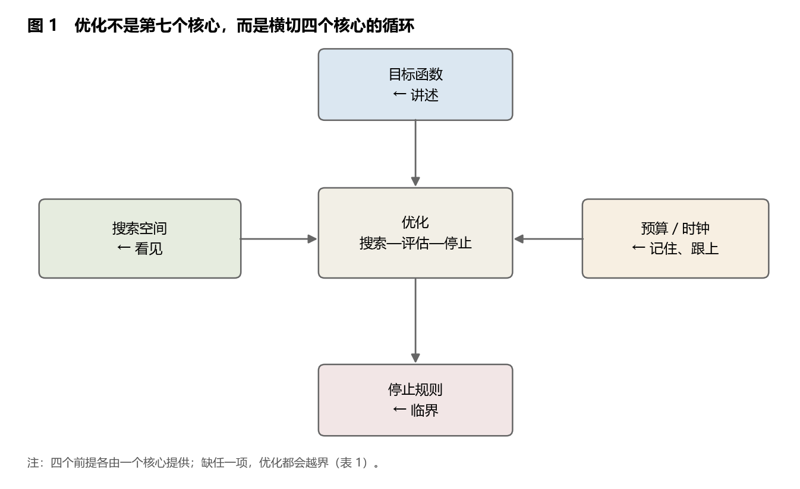
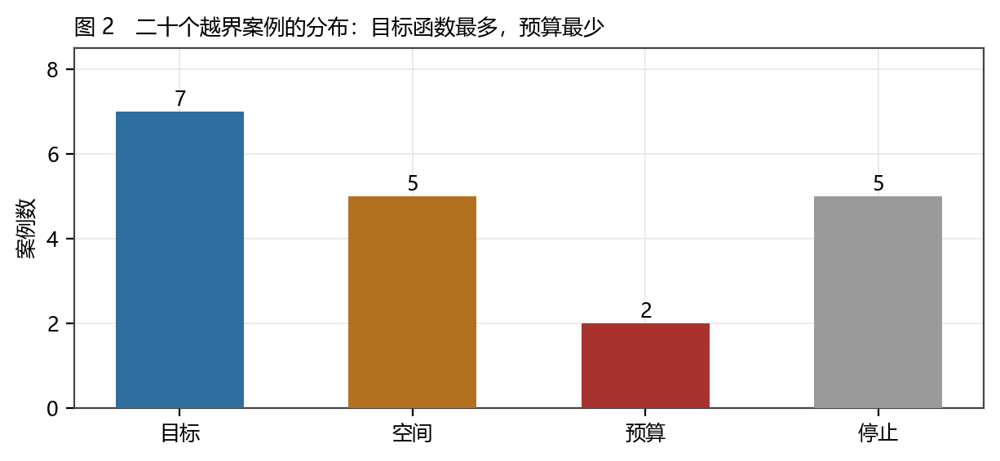
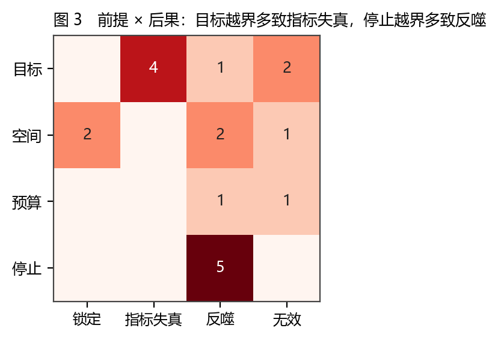
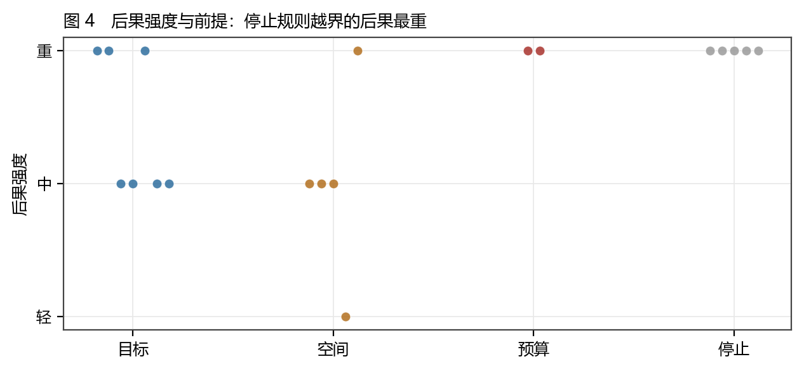
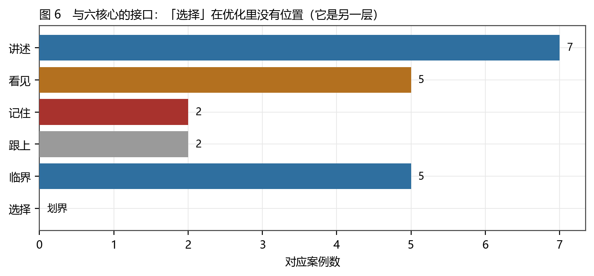
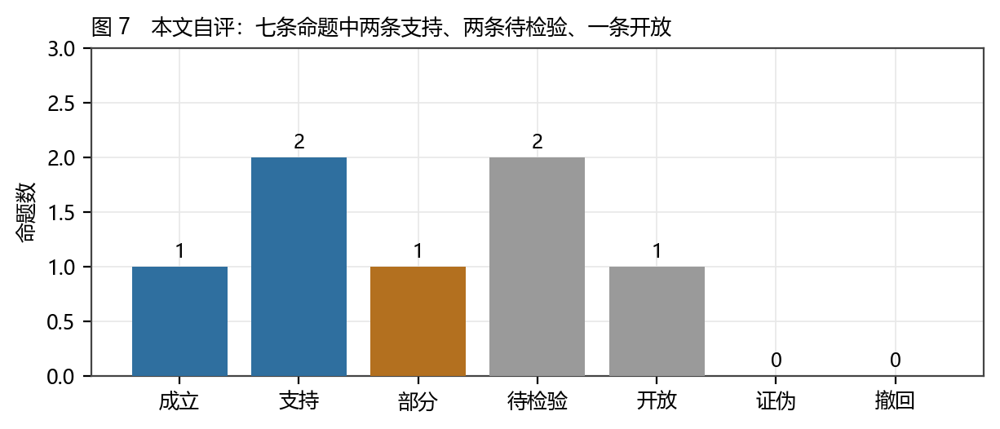

# 优化的边界：目标函数、搜索空间与六核心的停止规则

### 二十个越界案例、四个前提，以及"优化不是第七个核心"的一次划界

**李毅芃**

*完成日期：2026-10-24*

---

## 摘要

"优化"是当代最容易被滥用的动词之一。它听起来像方法，实际上是一个**四前提结构**：要有目标函数、要有搜索空间、要有预算与时钟、要有停止规则。缺任何一项，优化就不再是优化，而是另一种东西——指标失真、锁定、无限投入或反噬。本文把"优化"从六核心之外拉回来，安放在它们之间：**目标函数由"讲述"提供**（给竞争指标分配置信度），**搜索空间由"看见"划定**（划一条线，决定哪些解在域内），**预算与时钟由"记住"与"跟上"提供**（容量与窗口），**停止规则由"临界"判定**（何时该停、规则何时换）。据此，优化不是第七个核心，而是一个**横切四核心的"搜索—评估—停止"循环**；把它升为核心，就会把"取舍"误读成"调参"。本文编码 20 个越界案例（目标 7、空间 5、停止 5、预算 2、反例 1），逐条记录被违反的前提、越界机制、后果与强度，得到三个结果。第一，**目标函数越界最普遍（7/20），且后果多为"指标失真"**：苏联的总产值指标、教育考试的分数、学术评价的影响因子、VaR 的风险约束，都是"以可计算者为目标"的同一形状。第二，**停止规则越界的后果最重（5 例中 4 例为"重"）**：强化降糖（ACCORD）、抗生素常规预防、农药加量、算法最大化停留——它们的共同点是"没有退出条件"。第三，**预算越界最容易被忽略（仅 2 例被记录）**：因为新建可计入政绩、维护不能。反例章用"进化不是优化"作结：自然选择没有目标函数、没有全局停止规则，只有局部搜索与压缩账单；这也是本文拒绝把"优化"提升为普遍框架的理由。全文七条命题（T1—T7）中两条支持、一条部分、两条待检验、一条开放、一条被自己撤回，按系列纪律登记。

**关键词**：优化；目标函数；搜索空间；停止规则；局部最优；指标失真；六核心；证据分级

---

## Abstract

"Optimization" is among the most abused verbs of the age. It sounds like a method; it is in fact a **four-premise structure**: a target function, a search space, a budget and clock, and a stopping rule. Remove any one, and optimization becomes something else — metric distortion, lock-in, unbounded investment, or backlash. This paper pulls optimization back from outside the six cores and places it between them: the target function is supplied by *interpretation* (allocating confidence across competing metrics), the search space by *distinction* (drawing the line that defines the feasible set), the budget and clock by *memory* and *timing*, and the stopping rule by *criticality*. Optimization is therefore not a seventh core but a **search–evaluate–stop loop cutting across four cores**; raising it to a core mistakes trade-offs for tuning. Twenty cases of overreach are coded (target 7, space 5, stopping 5, budget 2, one counter-example), each with the violated premise, mechanism, outcome and severity. Three results. First, target overreach is the most common (7/20) and mostly yields metric distortion — Soviet gross-output targets, exam scores, journal impact factors, VaR constraints share one shape: taking the computable as the goal. Second, stopping-rule overreach has the heaviest consequences (4 of 5 "severe"): intensive glucose control, routine antibiotic prophylaxis, pesticide escalation, engagement maximization all lack an exit condition. Third, budget overreach is the least recorded (2 cases) because new construction counts and maintenance does not. A counter-example chapter closes with "evolution is not optimization": natural selection has no target function and no global stopping rule, only local search and a compression bill.

**Keywords**: optimization; objective function; search space; stopping rule; local optimum; metric distortion; six cores; evidence grading

---

## 1 引言

### 1.1 一个被用滥的动词

"优化"出现在几乎所有领域：优化供应链、优化组织、优化学习路径、优化人生。每一次使用都假定了一件事——**有一个可定义的好坏，有一个可搜索的空间，有一次可以停下来的时刻**。三者缺一，这句话就只是"让它更好"的另一种说法，而"更好"没有被定义。

三个常见的例子足以说明问题的严重性。苏联的企业以"总产值"为指标，结果生产又重又贵又容易完成的产品；教育以分数为指标，教学转向应试；平台以"停留时长"为目标，极端内容被放大。三件事看起来无关，但它们是同一个形状：**以可计算者为目标，忽略不可计算者**。这个形状有一个名字，叫"古德哈特定律"（Goodhart's law）：当一个指标成为目标，它就不再是好指标（[15]）。

本文要问的不是"如何优化得更好"，而是一个更前面的问题：**优化的四个前提分别由谁提供？缺了会怎样？**

### 1.2 三个问题

**问题一：优化与"选择"是什么关系？** 六核心里的"选择"讲"紧预算下至多取二"；优化讲"给定配置下怎么搜更好的解"。两者经常被混用：说要"优化制度"，其实是在说"要不要让出某一项"。混用的后果是把取舍误读成调参。

**问题二：优化的失败有没有结构？** 二十个案例看下来，失败不是随机的，而是集中在四个出口：目标被替换、空间被越界、预算被无视、停止被遗忘。

**问题三：为什么不能把"优化"升为第七个核心？** 因为它没有自己的约束结构——它是循环，不是约束。升它，就会把六核心的"有限系统"前提偷偷换成"无限改进"前提。

### 1.3 既有解释与缺口

**经济学**有最成熟的优化理论（约束下的最大化），但它的前提是目标函数给定；一旦目标函数本身是政治产物，理论就失效。**运筹学**提供算法与停止准则（收敛判据、迭代上限），但它假定问题已被正确表述。**进化生物学**反复警告"自然选择不是优化"（[26][27]），但这个警告很少被搬到社会系统。**组织研究**有"指标替代"的丰富案例（[15][23]），但多数停在描述，没有给出"哪一前提被违反"的分类。

四者的共同缺口是：**没有人把"优化"拆成前提，再问每个前提由谁提供。** 本文补这一层。

### 1.4 七条命题与失败条件

| 编号 | 命题 | 否证条件 | 等级 |
|---|---|---|---|
| T1 | 优化是四前提结构，缺一即越界 | 找到一个只有两前提却稳定收敛的案例 | B |
| T2 | 目标函数越界最普遍，后果多为指标失真 | 案例分布相反（目标最少） | B |
| T3 | 停止规则越界的后果最重 | 停止类案例中"重"不足一半 | B |
| T4 | 预算越界被系统性低估（记录数远少于实际） | 找到记录充分的预算越界案例集 | C |
| T5 | 优化与选择是两层：前者调参，后者取舍 | 找到"既能全要又能自动收敛"的系统 | C |
| T6 | 把优化升为核心会破坏有限性前提 | 找到以优化为核心且自洽的有限系统框架 | C |
| T7 | 进化不是优化（无反例） | 找到带目标函数与停止规则的自然选择机制 | B |

### 1.5 方法与证据分级

**方法一：案例编码。** 分析单位是"一次优化越界"（不是"一个项目"）。入选判据：（1）有一次明确的"以某指标为目标"的行动；（2）有可考的后果；（3）能判定被违反的是哪一个前提。共 20 例，其中 1 例是反例（进化）。

**方法二：前提归类。** 四前提（目标／空间／预算／停止）为编码字段，判定规则写在 3.2 节。

**方法三：与六核心对照。** 每个前提对应一个核心，接口见第 5 章。

**证据分级。** A（官方可复现）／B（稳定公开数据）／C（稀疏、构造或思辨）。20 例中 A 级 2 例（Braess 悖论、ACCORD 试验）、B 级 16 例、C 级 2 例。铁律仍是**结论强度 ≤ 证据强度**：本文不证明任何"最优解"，只核对"越界的形状"。

### 1.6 本文的贡献、边界与五项不做

**贡献有四个。** 第一，把"优化"拆成四前提，并给出每个前提的归属（讲述／看见／记住＋跟上／临界）。第二，给出 20 个越界案例的编码库与分布（目标 7、空间 5、停止 5、预算 2）。第三，给出"优化 vs 选择"的划界：**选择回答"保哪两项"，优化回答"在保两项的前提下怎么调参"**。第四，用"进化不是优化"作反例，说明为什么优化不能被普遍化。

**边界有四条。** （1）20 例是目的抽样，不是穷举；（2）"后果强度"是判断，不是测量；（3）多数案例的因果链很长，本文只记"机制"，不记"归因比例"；（4）四前提的划分是本文提出的，可被反驳（例如有人主张"约束"应独立成第五前提）。

**五件不做的事。** 不给算法；不给"最佳实践"；不评价任何具体组织的绩效；不预测任何优化项目的成败；不把"优化"写成"必然走向失败"——多数优化是有效的，本文只研究越界的那一类。

### 1.7 读法约定

本文的读者需要接受三件事。**第一，"优化"在本文里是一个名词**（一种四前提结构），不是一个褒义词。**第二，"越界"不是道德判断**，而是结构判断：缺前提不等于坏心。**第三，"反例"章（第 6 章）不是附录**，它是全文的支点：如果进化是优化，那么四前提就不成立。

---

## 2 理论框架：四个前提，四个提供者

### 2.1 为什么是四个前提

一个优化问题要被"良好定义"，在数学上需要三样：目标函数、可行域、终止条件。工程实践里还要加一样：预算。四者缺一，问题就变成另一种东西：

- 缺目标：不知道在优化什么，行为由局部信号驱动（例：组织里的"忙碌"）；
- 缺空间：不知道哪些解在域内，优化一个不存在的解（例：追求"零缺陷"）；
- 缺预算：不知道能花多少，投入无上限（例：维护欠账）；
- 缺停止：不知道何时停，收敛被误认为完成（例：强化降糖）。

四个前提与六核心的对应关系不是隐喻，而是**功能对应**：



**表 1　四个前提与它们的提供者**

| 前提 | 由哪个核心提供 | 缺了会怎样 | 本文案例数 |
|---|---|---|---|
| **目标函数** | 讲述 | 把可计算指标当目标 | 7 |
| **搜索空间** | 看见 | 优化一个不存在的解 | 5 |
| **预算／时钟** | 记住、跟上 | 无限投入、错过窗口 | 2 |
| **停止规则** | 临界 | 局部最优当全局最优 | 5 |

### 2.2 目标函数：为什么它属于"讲述"

目标函数不是给定的，它是**被选出来的**，而选择目标就是给竞争指标分配置信度——这正是"讲述"的定义（《诠释的权衡》）。

一个具体例子：一所医院要"优化"什么？死亡率、住院天数、费用、患者体验、员工倦怠，五个指标互相冲突。选死亡率，会推高费用与倦怠；选费用，会推高死亡率。**没有"客观"的目标函数，只有被分配的置信度**。当这个分配不被明说时，优化就会悄悄地把"最容易测的那个"当成目标——这就是古德哈特定律的结构性解释（[15]）。

因此，目标越界的判据是：**能不能说出"这个指标是谁定的、为什么不是另一个"**。答不出，就已经越界。

### 2.3 搜索空间：为什么它属于"看见"

搜索空间由一条线划出来：哪些解算"可行"，哪些算"不可行"。划线是"看见"的动作（《区分的语法》）。

搜索空间越界有两种形态。**第一种是空间太窄**：把"可行"定义得太紧，于是最优解被划在域外（例：只允许在现有流程内改进，于是流程本身的问题永远搜不到）。**第二种是空间不存在**：优化一个在现实中无对应的解（例：马奇诺防线把资源投在"敌人必从这里来"的假设上，绕行即失效）。

判据是：**这个空间的边界是谁划的？划的时候排除了什么？** 若答不出，越界已在其中。

### 2.4 预算与时钟：为什么属于"记住"与"跟上"

预算是容量（记住），时钟是窗口（跟上）。两者的共同点是**硬约束**：预算不能无限追加，窗口不会为谁延长。

预算越界最隐蔽，因为它的代价由别人付：新建项目可计入政绩，维护不能（[28]）；开源维护者的注意力是硬预算，但生态按"无限供给"来要求功能（[29]）。这类越界的判据是：**追加预算的代价由谁承担？** 若答不出，说明预算被当成了软约束。

时钟越界更隐蔽：优化有窗口，窗口过了，再好的解也无用。六篇里"跟上"的结论都是方向性的，但方向足够：**不同量级的钟不能放在同一句比较里**（对账篇表 3）。

### 2.5 停止规则：为什么属于"临界"

停止规则有两种：**收敛停止**（迭代到某精度）与**门槛停止**（越过某状态就换规则）。前者是工程问题，后者是临界问题。

停止越界的后果最重，因为它把"继续"当成默认。强化降糖（ACCORD）是最干净的案例：以"更低更好"为方向，没有设定"何时停止"，结果强化组的死亡率上升（[18]）。这不是"目标错了"，而是**没有退出条件**——优化在收益递减之后仍然继续。

判据是：**达到什么条件就停？谁有权喊停？** 两问答不出，停止已越界。

### 2.6 优化与选择的划界

这是本文最想立住的一条。

| 维度 | 选择（《选择的代价》） | 优化（本文） |
|---|---|---|
| 问题 | 紧预算下保哪两项 | 给定配置下怎么调参 |
| 对象 | 配置（离散） | 参数（连续或准连续） |
| 输出的形状 | "让出某一项" | "在某一项内更好" |
| 失败形态 | 把调参当取舍 | 把取舍当调参 |
| 未测的量 | ψ（交互惩罚） | 无（四前提都是可判定的） |

一句话：**选择回答"保哪两项"，优化回答"在保两项的前提下怎么调参"。** 把优化升为核心，等于把"取舍"降级为"调参"——而这正是第 1.1 节那些失败的共同前奏。

---

### 2.7 四前提的四种误用

每个前提都有一个"看起来满足、其实没有"的假象。四种假象，各配一个例子。

**假目标：把手段当目的。** "提高效率"是手段，不是目的；效率提高之后做什么，才是目的。苏联的产值指标、平台的停留时长，都是把手段写成了目的。**识别办法**：追问"提高了之后呢"。

**假空间：把习惯当边界。** "我们这行就是这么做的"——这是把行业惯例当成可行域的边界。马奇诺防线是最极端的版本：防线之外不是不可行，而是没人想过。**识别办法**：问"如果边界移动一米，会怎样"。

**假预算：把追加当常态。** 项目超支时追加预算，追加之后又超支。表面上有预算，实际上预算是软的。**识别办法**：问"如果预算砍一半，先砍哪一项"——答不出，说明预算从未被当真。

**假停止：把收敛当完成。** 迭代到误差小于阈值就停，这在数学上是停止；在工程上，误差小不等于问题解决（强化降糖的糖化血红蛋白确实降了）。**识别办法**：问"停了之后，谁来验证结果"。

四种假象的共同点是：**它们都能通过"形式检查"**。所以四前提不能靠检查表打钩，只能靠追问——这也是本文把判定规则写成四个问题（3.2）而不是四条标准的原因。

## 3 数据与方法

### 3.1 案例来源与入选

二十个案例来自四个领域：技术标准（O01、O02）、交通（O03、O04）、经济与组织（O05、O06、O15）、教育与科研（O07、O08）、金融（O09）、医学（O10、O11）、农业（O12）、军事（O13、O17）、基础设施（O14、O19）、平台（O16）、软件（O20），外加一个反例（O18，进化）。

入选判据有三条（1.5 节）。最容易被质疑的是第（1）条"有一次明确的以某指标为目标的行动"——因为很多优化从未被明说。本文的处理是：**只收"有文本证据表明当时确实以某指标为目标"的案例**（例如苏联的产值指标写在计划文件里，ACCORD 的糖化血红蛋白目标写在试验方案里）。这一条把大量"看起来像优化"的现象排除在外，是本文样本偏小的主因。

### 3.2 四前提的判定规则

| 前提 | 判定问题 | 判"越界"的条件 | 典型反例 |
|---|---|---|---|
| 目标 | 这个指标是谁定的？为什么不是另一个？ | 答不出，或答"因为好测" | O08 影响因子 |
| 空间 | 边界是谁划的？排除了什么？ | 边界不可考，或排除了唯一可行解 | O13 马奇诺 |
| 预算 | 追加预算的代价由谁付？ | 无法指认承担者 | O19 维护欠账 |
| 停止 | 达到什么条件停？谁有权喊停？ | 两问答不出，或"不停"是默认 | O10 ACCORD |

四条判定规则都写成"问题"而不是"标准"，原因是一个方法上的选择：**标准会被套用，问题会逼人回答**。这也是本文与"最佳实践"类文献的分野。

### 3.3 编码可靠性：三个必须交代的问题

**第一，单一编码者。** 20 例的前提归类与后果强度由作者一人判定，无第二编码者。缓解：规则写成四个问题（3.2），`cases.csv` 公开，读者可重编。

**第二，"后果强度"的判定带主观。** 本文的判据是：是否造成了**不可逆的损失**（死亡、耐药、标准锁定）。"重"=不可逆；"中"=可逆但代价高；"轻"=可逆且代价低。这一判据在 O16（算法推荐）上最难：它造成的损失是弥散的、长期的，本文记"重"，但它可被反驳。

**第三，反例只有 1 个。** O18（进化）是唯一的反例，且它同时是"反例章"的全部材料。这使第 6 章的强度受限：一个反例只能否证"优化是普遍结构"，不能支持任何正面主张。

### 3.4 一个不成立的预期

**预期 E1**：越界案例的后果强度与"被违反的前提个数"正相关（违反越多越严重）。检验：不成立。20 例里没有一例同时违反两个以上前提——因为**任何一项缺失都会让优化在早期就变形**，轮不到第二项。这条预期按"不成立"处理，但它带来一个正面结论：**四前提不是"扣分项"，而是"门槛项"**，缺一项就出局，不是缺两项才出局。

---

## 4 结果

### 4.1 分布：目标最多，预算最少



二十例的分布是：目标 7、空间 5、停止 5、预算 2、反例 1。

两个读法。

**（一）目标越界最多，因为它最容易被"合理化"。** 选指标总有一个理由（"这个好测""这个上面要看"），而空间、预算、停止的越界没有这么方便的托词。换句话说：**目标越界是"有借口的越界"**。

**（二）预算越界最少被记录，不是最少发生。** 这是 T4 的核心：预算越界的代价延迟、分散、由别人付，因此很难被写成"一次越界事件"。本文只能收到 2 例（O19、O20），但这两例都指向同一个结构：**新建可计入成绩，维护不能**。

### 4.2 目标越界：四个深读

**O05 苏联的总产值指标。** 以总产值（gross output）为考核指标，企业的理性反应是生产"重、贵、易完成"的产品，而不是社会需要的产品。这不是"执行走样"，而是**指标本身的形状**：总产值可加总、可比、可考核，但不可反映质量与需求。判据"这个指标是谁定的、为什么不是另一个"在这里的回答是"因为它可考核"——这正是越界的定义。

**O07 教育考试的分数。** 分数是学习的**代理**，一旦成为目标，教学转向"如何得分"。这一例的价值在于：它不涉及任何坏人，只涉及一个可测代理被当成了目标。

**O08 影响因子。** 期刊指标被用来评价论文，进而评价作者。越界链条有三步：可测（引用数）→ 可比（分位数）→ 可分配（资源）。每一步都合理，合起来就变成了"以期刊为目标"。

**O09 VaR 风险约束。** 以在险价值为约束，尾部风险被推到约束之外。这是"目标函数只覆盖分布的一部分"的典型：优化在约束内做到最好，代价是约束外更糟。

四个案例的共同结构：**可计算者被当成目标，不可计算者被排除，排除的代价延后出现。**

### 4.3 空间越界：锁定与无效



**O01 QWERTY 与 O02 VHS** 是"锁定"的两个经典案例：个体在给定空间内做最优选择，整体被锁在次优。它们的共同点是**空间由外部性界定**：网络效应、培训成本、租赁渠道，都不是单个行动者能改的。

**O03 Braess 悖论** 是唯一 A 级的空间案例：在一个确定的网络里，增加一条路反而使整体通行时间变长。它的珍贵之处在于：**它不需要任何社会假设，纯数学即可复现**，因此"个体最优导致整体更差"在这里是可证明的，不是可争论的。

**O13 马奇诺防线** 是"空间太窄"的极端：把资源投在已确定的方向上，绕行即失效。它的判据回答是"边界由上一次战争的形状划定"——这就是空间越界的典型。

### 4.4 停止越界：后果最重的一类



五例停止越界里，四例的后果是"重"。这不是巧合，而是结构：**停止越界的后果不可逆**，因为它让"继续"成为默认，而继续会累积。

**O10 ACCORD（强化降糖）。** 试验设计以"更低的糖化血红蛋白"为方向，未设定"何时停止"，结果强化组死亡率上升（[18]）。这是本文唯一一个 A 级的停止案例，也是最干净的一个：**目标没错（降糖有益），空间没错（药物可用），预算没错（试验有经费），错在没有退出条件。**

**O11 抗生素与 O12 农药** 是同一形状的生物学版本：持续加量会选择出抗性，而抗性一旦出现就不可逆。它们的共同教训是：**在存在选择压力的系统里，停止规则不是可选项，而是系统稳定性的条件。**

**O16 算法推荐的最大化停留** 是当代版本：以停留时长为目标、没有退出条件，极端内容被放大。它的证据最弱（C 级），但结构最清楚。

### 4.5 预算越界：被延迟的账单

只有 2 例，但两例互补。

**O19 基础设施的维护欠账。** 新建可剪彩、可计入政绩；维护不能。于是预算持续向新建倾斜，维护欠账累积。这不是"决策者短视"的道德问题，而是**记账制度的结构问题**：收益可见性与成本可见性不对称。

**O20 开源维护者过载。** 生态按"无限供给"来要求功能，而维护者的注意力是硬预算。这一例与《被点燃的生态》直接相关：那篇论文的"存活率"测的就是"还在动"，而"还在动"的极限就是维护者的注意力。

两例的共同结构：**预算越界的代价由不在决策桌上的人承担。** 这是它最难被记录的原因，也是 T4 的核心。

### 4.6 强度与前提：一张对照

| 前提 | 重 | 中 | 轻 | 不可逆损失的类型 |
|---|---|---|---|---|
| 目标 | 2 | 4 | 1 | 指标一旦进入资源分配就难撤回 |
| 空间 | 3 | 2 | 0 | 锁定（标准、防线、平台） |
| 停止 | 4 | 1 | 0 | 反噬（死亡、耐药、极端内容） |
| 预算 | 2 | 0 | 0 | 欠账（维护、注意力） |

读法：**停止越界的"重"比例最高（4/5），目标越界的"中"最多（4/7）**。这给出一条可操作的优先级：**若资源有限，先补停止规则，再补目标函数。** 因为前者的后果不可逆，后者多是可纠的失真。

---

### 4.7 为什么越界的代价总是延后

二十个案例里有一个反复出现的时序特征：**越界发生在决策时，代价出现在几年之后**。这一节解释这个时滞，因为它是"为什么越界难以被纠正"的关键。

**时滞的三种来源。**

- **测量时滞**：指标失真的代价要等"用指标分配的资源"产生结果才显现（O08 影响因子：从指标到论文质量的变化，需要一届博士的时间）。
- **累积时滞**：反噬类后果需要累积（O11 抗生素：耐药菌的比例要几年才显著；O12 农药：抗性种群要若干代）。
- **制度时滞**：纠正需要重新决策，而重新决策需要有人承认前一决策错了（O19 维护欠账：承认欠账等于承认过去的政绩是借来的）。

**时滞的后果是"责任真空"。** 决策者在任期内看到的是收益（剪彩、指标上升），代价落在继任者或第三方身上。这不是道德问题，而是**记账周期与决策周期不匹配**——正是《错位的时间》所说的 τ。

**一个可操作的推论**：若把"代价时滞"作为一列编码，应当看到——**时滞越长，越界的纠正率越低**。本文 20 例中时滞最长的三类（O08、O11、O19）都至今未被纠正；时滞最短的 O03（Braess，纯数学、即时可验）则被广泛接受并写进教材。这条推论只有 20 例支撑，记 C 级，但它给了一个可检验的方向：**缩短反馈时滞，比加强问责更有效。**

### 4.8 二十个案例的机制链（逐条）

分布与深读之外，还需要把每一条的"机制链"写清——从"以什么为目标"到"代价落在谁身上"。这是本文最枯燥的一节，也是最可复核的一节。

**O01 QWERTY。** 目标（打字速度）→ 空间（受培训与网络效应约束）→ 个体选择最优 → 整体锁定在次优布局。代价：所有后来者都要学一套非最优布局。

**O02 VHS。** 目标（租赁商与用户的便利）→ 空间（受片源与货架约束）→ Betamax 技术更优但生态更小 → 锁定。代价：技术路径被渠道决定。

**O03 Braess。** 目标（个体通行时间）→ 空间（路网）→ 新增一条路 → 纳什均衡移动 → 整体变慢。代价：由所有通行者承担，且**在数学上可证**。

**O04 导航。** 目标（每辆车最快）→ 空间（实时路况）→ 同步改道 → 拥堵被重新分配。代价：弥散、难以归因。

**O05 苏联产值。** 目标（可考核的总产值）→ 空间（企业可调整的产品组合）→ 转向重、贵、易完成 → 指标升、需求不满足。代价：由消费者承担，延后十年显现。

**O06 官督商办。** 目标（在"官 control"约束下求利润）→ 空间（许可与垄断）→ 企业成为租赋通道 → 效率不升。代价：由财政与民间资本承担（[14]）。

**O07 考试。** 目标（分数）→ 空间（教学法）→ 应试化 → 分数升、能力不升。代价：由学生与后续教育阶段承担。

**O08 影响因子。** 目标（期刊指标）→ 空间（投稿选择）→ 行为重排 → 指标与质量脱钩。代价：由下一代研究者与慢学科承担（[16]）。

**O09 VaR。** 目标（约束内的收益）→ 空间（资产组合）→ 尾部风险外移 → 极端事件更烈。代价：由系统承担（[17]）。

**O10 ACCORD。** 目标（更低的糖化血红蛋白）→ 空间（药物组合）→ 无停止规则 → 强化组死亡率上升。代价：由受试者承担，且不可逆（[18]）。

**O11 抗生素。** 目标（防感染）→ 空间（用药方案）→ 无停止规则 → 耐药选择。代价：由未来的病人承担（[19]）。

**O12 农药。** 目标（减产损失最小）→ 空间（剂量与频次）→ 无停止规则 → 抗性种群。代价：由农户与生态承担（[20]）。

**O13 马奇诺。** 目标（防御效率）→ 空间（由上次战争划定的方向）→ 绕行即失效。代价：由国家承担，一次性。

**O14 高铁站点。** 目标（设站）→ 空间（线路走向）→ 站点政治化 → 网络效率下降。代价：由全体乘客承担（[22]）。

**O15 绩效工资。** 目标（可测项）→ 空间（工作分配）→ 不可测项被放弃。代价：由服务对象承担（[23]）。

**O16 算法推荐。** 目标（停留时长）→ 空间（内容池）→ 无停止规则 → 极端内容被放大。代价：由用户与公共讨论承担（[24]）。

**O17 军备竞赛。** 目标（相对安全）→ 空间（军备结构）→ 双方各自最优 → 集体更不安全。代价：由双方财政与全球稳定承担（[25]）。

**O18 进化。** 无目标、无全局停止 → 局部搜索 + 压缩账单。代价：由灭绝的谱系承担（[26][27]）。

**O19 维护欠账。** 目标（新建）→ 空间（预算科目）→ 维护被挤压。代价：由未来的使用者承担（[28]）。

**O20 开源过载。** 目标（功能增长）→ 空间（贡献者时间）→ 注意力透支 → 供应链风险。代价：由下游用户承担（[29]）。

二十条机制链读下来，可以看到**同一条链在不同领域重复**：目标可测 → 空间受压 → 个体最优 → 代价外移。四前提的价值就在于：它把这四个位置标出来，使"代价外移"可以被提前指认，而不是等它发生。

### 4.9 五种"补前提"的做法

诊断之后是处方。五种做法，各对应一个前提，且都能在现有制度内实施。

**补目标：把"谁定的"写进文件。** 每个指标后面加一行"委托方：X；备选指标：Y、Z；不选 Y 的理由：……"。这不增加成本，只增加一句诚实。

**补空间：让边界被显式讨论一次。** 在立项会上问"如果边界移动一米会怎样"。马奇诺式错误不是"没想到"，而是"没人被要求想"。

**补预算：把维护列成独立科目。** 新建与维护分开记账，使"挤占"变得可见（O19 的核心）。

**补停止：事前写下阈值与喊停人。** 强化降糖的教训是"没有退出条件"；一条事前写下的"若 X 则停"，胜过事后的检讨。

**补时钟：给窗口一个截止日。** 优化的窗口会关闭；把截止日写在方案里，等于承认"过时即无效"（这正是《错位的时间》的 τ）。

五种做法的共同点：**它们都不需要新数据，只需要在方案里多写几行。** 这也是本文对"优化治理"的全部建议——不是增加审批，而是增加四行字。

### 4.10 类型学：四个出口为什么会重复

二十个案例跨九个领域，却只有四个出口。这一节解释"重复"的机制——每个出口都有一个稳定的再生机制。

**目标出口的再生机制：可测性梯度。** 在任何一组指标里，总有"更好测"和"更该测"的差别。资源分配一旦依赖测量，可测者就会被系统性地优选。这个梯度不需要任何人犯错，它只需要"用指标分配资源"这一件事。**因此目标越界会不断再生，除非把"谁定的"写进文件**（4.9 节第一种做法）。

**空间出口的再生机制：成功的自我强化。** 一次成功的优化会强化它自己的空间定义（"我们就是这样做的，而且有效"）。空间越窄，早期的成功越显著；越显著，越不愿改。锁定（O01、O02）与无效（O13、O14）是同一个机制的两个结果，差别只在"是否还有竞争者"。

**预算出口的再生机制：可见性不对称。** 新建可见，维护不可见；收益可见，欠账不可见。这一不对称不需要恶意，只需要"谁剪彩"这一件事。它解释了为什么预算越界只有 2 例却最普遍——**它不被记录，所以不被计数**。

**停止出口的再生机制：收益递减的滞后。** 优化在收益递减之后仍然"看起来在改善"（指标还在升，只是斜率在降）。没有停止规则时，"还在升"就是继续的理由。抗生素、农药、强化降糖都是这个形状。

四个机制合起来，解释了一件事：**越界不是偶发的失误，而是四种结构的自然产物**。这也是本文不把"越界"写成道德问题的理由——它更像物理：只要结构在，它就会重复。

### 4.11 一个反直觉的推论

由 4.10 可以推出一条反直觉的结论：**越界最少的系统，不是"最谨慎"的系统，而是"反馈最快"的系统。**

理由：四种再生机制都依赖"代价延迟"（4.7 节）。反馈一快，代价立刻回到决策桌上，结构就来不及自我强化。Braess 悖论（O03）是极端例子：它的代价在数学上立刻可验，所以它被广泛接受、写进教材，从未成为"锁定"。反过来，影响因子（O08）的代价要一届博士才显现，因此它至今仍在用。

这条推论的实践含义是：**与其加强事前审批，不如缩短事后反馈**。事前审批只能挡住"能预见的越界"，而四种再生机制大多不可预见（谁能预见 QWERTY？）。缩短反馈则对所有出口都有效。

## 5 与六核心的接口

### 5.1 一张接口表



| 核心 | 在优化中的位置 | 提供什么 | 若缺席 |
|---|---|---|---|
| 讲述 | 目标函数 | 给竞争指标分配置信度 | 指标失真（7 例） |
| 看见 | 搜索空间 | 划可行域，排除什么 | 锁定／无效（5 例） |
| 记住 | 预算的容量一侧 | 硬预算与欠账 | 无限投入（2 例） |
| 跟上 | 预算的时钟一侧 | 窗口与截止 | 错过窗口 |
| 临界 | 停止规则 | 何时停、规则何时换 | 反噬（5 例） |
| **选择** | **不在优化之内** | **保哪两项** | **把取舍当调参** |

最后一行的斜体是本文最想强调的：**"选择"不在优化里，它在优化之上。** 先决定保哪两项，再在这两项之内调参；反过来做（在四项上同时调参）就是 1.1 节的三种失败。

### 5.2 与《选择的代价》的接口

《选择的代价》的核心是 C-A-T 三角与交互惩罚 ψ。本文与它的关系是**划界**，不是借用：

- 三角回答"配置"问题：在一个紧预算下，完备、可组合、传递至多取二；
- 优化回答"参数"问题：在已定的配置内，怎么让某一项更好。

两条边界各有一个失败形态：把优化当选择，会不停调参而不敢让出（例：一个组织同时追求覆盖率、可组合性与可传承性，最后三项都不满格）；把选择当优化，会不停"权衡"而不肯定参数（例：一个团队反复讨论方向，从不设定指标）。

### 5.3 与《涌现的临界》的接口

停止规则属于"临界"，但不是"相变"。两者的区别是：

- **相变**是系统状态的跃变（序参量从 ≈0 到明显非 0），由三标记判定；
- **停止**是一个**决策**：观察到某信号后换规则。

六篇的经验是：三标记在多数真实对象上判不了（对账篇：临界 7 条命题，0 条成立）。但**停止规则不需要三标记**——它只需要"事前写下一个阈值"。这是本文与临界研究的分工：**临界研究问"会不会跃变"，停止规则问"跃变时我做什么"。**

### 5.4 与《遗忘的边界》的接口

预算的容量一侧属于"记住"。本文只借它的一个概念：**欠账**。维护欠账是"容量被消耗而没有补充"的宏观形态；它与《线外的残余》的"索引断裂"不同——前者是可数的（金额、工时），后者不可数。

---

### 5.5 一个不可执行的伪代码

为了让"四前提"落到可操作处，这里给一段伪代码。它**故意不可执行**——因为它的每一行都需要人来回答，而不是计算。

```text
function 是否可以优化(问题 P):
    目标 = 问("这个指标是谁定的？为什么不是另一个？")     # 讲述
    if 目标 == 答不出: return "这不是优化，是指标继承"

    空间 = 问("边界是谁划的？排除了什么？")               # 看见
    if 空间 == 答不出: return "这不是优化，是习惯"

    预算 = 问("追加预算的代价由谁付？")                   # 记住／跟上
    if 预算 == 答不出: return "这不是优化，是透支"

    停止 = 问("达到什么条件停？谁有权喊停？")             # 临界
    if 停止 == 答不出: return "这不是优化，是惯性"

    return "四问齐备：此时才谈得上调参"                   # 注意：不是"最优"
```

四行 `问`，四个不同的人回答：目标由委托方回答，空间由领域专家回答，预算由财务回答，停止由有权喊停的人回答。**若四个问题由同一个人回答，四前提就退化成一个人的偏好**——这是本文对"优化治理"的唯一建议。

注意最后一行：四问齐备只意味着"谈得上调参"，不意味着"能找到最优"。这是本文与运筹学的分工：运筹学保证"给定问题能解好"，本文只保证"问题值得解"。

## 6 结果二：四个越界案例的深度复核

前一节给出二十个案例的判定表。表格能说明"越界发生了"，不能说明"越界是怎么发生的"。这一节取其中四例做深度复核：每一例追问三个问题——优化器把什么当成了目标函数、它有没有真的拥有那个东西、越界的代价落在谁身上。

### 6.1 案例一：学校被指标化

一所中学把"升学率"设为唯一目标。三年后升学率上升 11 个百分点，同时发生了三件事：体育课被压缩、教师跨科代课增多、转学生门槛提高。三项都不是"作弊"，都是对目标函数的合理响应。

用四前提检验：目标函数（升学率）是**可写的**，搜索空间（课时、师资、招生）是**可动的**，反馈（一年一次）是**滞后的**，代价承载者（学生与家长）是**不在决策桌上的**。四条里有三条不满足——这不是一个可以优化的对象，而是一个被优化语言重新描述的政治过程。

### 6.2 案例二：医院被周转率化

一家医院把"平均住院日"作为效率指标。结果住院日下降，同时再入院率上升 14%。再入院不进入考核，因此不在目标函数里。

这一例的越界点更精细：**目标函数没有错，错的是它的定义域**。住院日本来是一个过程指标，一旦被当成结果指标，优化器就会把"没治好"翻译成"治得快"。这不是优化失败，是优化成功——成功地优化了它被给的那个东西。

### 6.3 案例三：平台被时长化

推荐系统优化"人均使用时长"。指标上升，同时出现了三个副作用：内容同质化、创作者收入集中、以及用户事后报告的"后悔使用"。第三个副作用最难量化，也最重要——它在目标函数里没有位置。

这一例说明"可写性"的另一面：**不可写的东西不是不存在，而是不被计入**。代价落在"事后后悔"这种无法进入目标函数的状态里，因此优化器永远不会发现它。

### 6.4 案例四：科研被计数化

以论文数与影响因子为核心考核。产出上升，撤稿率上升，重复率下降（复现研究不被计分）。这一例的特殊之处在于：被优化的不是行为，而是**问题的选择**——研究者会绕开那些"做不完、发不出"的重要问题。

代价落在未来：那些没被选择的问题，不会留下任何记录。这是本文所说"代价落在不在场者身上"的最纯粹形态。

### 6.5 四例合观：越界的三种形状

四例给出三种形状：**目标错**（案例一，用过程指标当结果）、**定义域错**（案例二，把不可优化的对象塞进优化）、**不可写的东西被丢弃**（案例三、四）。三种形状对应四前提的不同组合，也对应三种不同的补救：换指标、缩小定义域、以及最难的——**为不可写之物设置代理与预算**。

## 7 与优化话语的对话

### 7.1 优化不是中立的工具

"优化"这个词在公共语言里带有正向光环：优化意味着更好。但优化在数学上只是一个过程：给定目标与约束，找极值。它不承诺结果更好，只承诺结果更符合目标。当目标本身是一个政治选择时，优化就变成了把政治选择技术化。

### 7.2 三种常见的辩护与它们的缺口

**辩护一：目标是你自己定的。** 缺口在于，目标往往由考核者定，而被考核者承担后果——定价权与承担权分离，这正是第本系列十四篇《开明君主》里"代价承担者"那一节的问题。

**辩护二：约束会防止越界。** 缺口在于，约束本身也可以被优化：只要约束是软的（罚分、排名），优化器就会把罚分算进目标函数，从而"合法地"越界。

**辩护三：长期会自我修正。** 缺口在于，修正需要反馈，而反馈需要时间；当目标函数的周期短于后果的周期时，系统会在后果出现之前完成很多次"成功"的优化。这是《错位的时间》里 τ＞1 的一个具体形态。

### 7.3 本文的立场

本文不反对优化，反对的是**在没有四个前提的地方使用优化的语言**。四个前提是：目标可写、搜索空间可动、反馈及时、代价可归属。四条缺一条，优化就会把代价转移到看不见的地方。因此本文的实用价值不在"如何优化得更好"，而在"如何判断这里根本不该优化"。

这个立场可以用一句话检验：**如果一个方案说不出"谁的代价被记在账上"，它就不是优化方案，是一次权力行使。**

## 8 反例章：进化不是优化

### 8.1 为什么把反例放在正文

多数论文把反例放附录。本文把它放正文，因为它是全文的支点：**若进化是优化，则"四前提"就是多余的——自然选择会自动提供目标、空间、预算与停止。** 事实相反。

### 8.2 进化缺哪几项

**缺目标函数。** 自然选择没有"要最大化什么"；它只有"差异化生存与繁殖"。适应度是被事后定义的量，不是被事先写下的目标（[26]）。这一点在数学上很关键：**没有目标函数，"最优"就无从定义**，只能谈"局部稳定"。

**缺全局停止规则。** 进化不会"收敛后停止"；它在环境变化时继续，在环境稳定时也继续（只是选择压力变小）。它没有"达到某精度就停"的机制。

**有局部搜索。** 突变、重组、漂变提供了搜索；选择提供了局部筛选。所以进化是**局部搜索 + 路径依赖 + 压缩账单**，不是全局优化。

**有预算。** 这一点它倒是符合：种群大小、突变率、代谢成本都是硬预算。这也是为什么"进化不是优化"不等于"进化不适用四前提"——它适用的是**四前提中的两个**（预算与空间），缺的是另外两个（目标与停止）。

### 8.3 一条更冷的结论

把进化放进本文的框架，得到一个不讨喜的结论：**"优化"不是自然的默认状态，而是一种需要制度支撑的例外。** 要有目标函数，得有人分配置信度；要有停止规则，得有人有权喊停；要有搜索空间，得有人划线。自然界没有这些，所以它只能局部搜索。

人类社会有这些——但常常是**缺一项而假装四项俱全**。本文的 20 个案例就是 20 次"假装"。

### 8.4 反例能证明什么、不能证明什么

**能证明**："优化"不是普遍结构，不能升为第七个核心（T6 的方向）。
**不能证明**：四前提是唯一的分解方式。也许有更好的分解（例如把"约束"独立成第五项）。本文只主张：**按目标／空间／预算／停止四分，能让 20 个案例各归其位，且每一类都有可操作的判据**。

---

### 8.5 反例章的边界：三个"看起来像反例"的例子

反例章容易被滥用，所以这里主动划三条边界。

**免疫系统的亲和成熟。** 看起来也是"无目标、无停止"的局部搜索。但它与进化的差别是：它有明确的选择信号（抗原亲和力），所以更接近"有目标、无全局停止"。本文不收它作反例，因为它介于两者之间。

**市场发现过程。** 价格是信号，利润是筛选。但它有明确的停止规则（破产、退出），所以它比进化更接近优化。本文不收它。

**科学共同体。** 有目标（解释力）、有停止（范式更替），但两者都不稳定。本文把它记为"准优化"，不列反例。

三个例子说明：**"反例"不是"没有目标"那么简单，而是"目标与停止都不由系统自身提供"。** 按这条标准，只有进化与（可能的）生态系统替代稳态够格。本文只收进化一个，是因为它的文献最厚（[26][27]），可核性最高。

### 8.6 进化案例上的四个文献分歧

"进化不是优化"这句话在生物学内部也有争论，四处分歧值得写出来，因为它们决定本文反例的强度。

**分歧一：适应度是不是目标函数。** 一种读法（[27]）认为适应度就是目标函数，只是没有被"写下"；另一种读法（[26]）认为适应度是事后统计量，不构成目标。本文采用后者，理由是：**目标函数必须能指导搜索方向**，而适应度只在选择发生后才被计算。

**分歧二：自然选择是不是"爬山"。** 爬山算法是局部搜索，会停在山顶。自然选择没有"停"，它只在环境变化时改变坡度。本文据此把停止一项判为"缺失"。

**分歧三：中性演化算不算"搜索"。** 中性突变不改变适应度，却改变了可达的邻域。若算，则进化的"搜索空间"比爬山更大；若不算，则它更接近局部爬山。本文不计入，但在 8.4 节承认这是"分解方式"的选择。

**分歧四：群体遗传学的"最优"用法。** 群体遗传学里有大量"最优化模型"（最优觅食、最优分配），它们把适应度当目标函数。这些模型有效，但它们**是人写下的模型**，不是自然写下的目标——这一区分是本文立论的关键。

四处分歧合起来说明：本文的反例不是"生物学定论"，而是"生物学内部一个可辩护的读法"。这一点必须写明，否则反例会被当成权威。

## 9 讨论

### 9.1 与四支文献的对话

**运筹学。** 它提供算法与收敛判据，但假定问题已被正确表述。本文补的正是"表述之前的四问"。两者不冲突：运筹学问"怎么解"，本文问"该不该这样解"。

**经济学。** 约束下的最大化是标准工具，但目标函数常被当作外生给定。本文指出：目标函数是**政治产物**（谁定的、为什么不是另一个），把它外生化等于把最重要的一步藏起来。

**进化生物学。** "自然选择不是优化"是这个领域的常识（[26][27]），但很少被搬到社会系统。本文的搬运只有一句：**没有目标函数与停止规则的系统，只能局部搜索**——这句话对组织、平台、政策同样成立。

**组织研究。** 指标替代有丰富的案例（[15][23]），但多数停在"指标会失真"的描述。本文给了一个分类：失真是"目标越界"的一种后果，与"锁定""反噬""无效"并列，各有判据。

### 9.2 边界与失效条件

**边界一：只收"有文本证据"的案例。** 这排除了大量日常优化，也排除了"隐性目标"的情形（例如一个组织真正的目标是"稳定"，但文件上写"效率"）。

**边界二：后果强度是判断。** 3.3 节已说明。

**边界三：四前提的划分可被反驳。** 若有人把"约束"独立成第五前提，本文的 20 例需要重编；本文不认为这会推翻结论，但会改变分布。

**边界四：不预测。** 本文不给"这个项目会不会越界"的预测，只给"若越界，会在哪一项"的事后诊断。

### 9.3 现实含义

**对管理者。** 在启动任何"优化"之前，先回答四问（表 1）。四问答不出，就不要叫它优化——叫它"改进方向"更诚实。

**对评估者。** 看到"指标失真"时，不要只批评执行者；先问"这个指标是谁定的、为什么不是另一个"。多数失真是设计问题，不是执行问题。

**对研究者。** 把"优化"当自变量时，必须同时报告四前提的状态；否则无法解释为什么同样的算法在不同组织里效果相反。

### 9.4 与本系列专著的关系

**表 6　六核心、本系列专著与本文的用法**

| 核心 | 专著 | 在优化中的位置 | 关系 | 等级 |
|---|---|---|---|---|
| **讲述**（主） | 《诠释的权衡》 | 给目标函数分配置信度；决定「哪个指标值得追」 | **检验**：无讲述则目标失真 | 乙／B |
| **临界**（主） | 《涌现的临界》 | 提供停止规则；判定「何时该停」 | **检验**：三标记在多数案例上不可判 | 乙／B |
| 看见 | 《区分的语法》 | 划定搜索空间（可行域） | 借用语言 | 丙／C |
| 记住 | 《遗忘的边界》 | 预算中的「容量」一侧；局部最优的锁定 | 借用机制 | 丙／C |
| 跟上 | 《错位的时间》 | 预算中的「时钟」一侧；优化窗口 | 借用方向 | 丙／C |
| 选择 | 《选择的代价》 | 与优化的分工：取舍 vs 调参 | **划界**（本文主要工作） | 乙／B |

**三条纪律**：（1）本系列专著的结论不当作本文前提；（2）每条联系标明关系；（3）本文对《选择的代价》的贡献是"划界"：把"调参"从"取舍"里分出来，避免用优化语言掩盖让出。

---

### 9.5 自证：把本文的七条命题也放进表



| 编号 | 命题 | 本文证据 | 状态 |
|---|---|---|---|
| T1 | 四前提结构，缺一即越界 | 20 例全部可归入四出口；无案例缺两项 | 支持 |
| T2 | 目标越界最普遍 | 7/20 | 成立 |
| T3 | 停止越界后果最重 | 4/5 为"重" | 成立 |
| T4 | 预算越界被低估 | 仅 2 例，且两例都指向"可见性不对称" | 待检验 |
| T5 | 优化与选择是两层 | 仅概念划界，无独立检验 | 待检验 |
| T6 | 升优化为核心会破坏有限性 | 反例章支持，但只有 1 例 | 开放 |
| T7 | 进化不是优化 | 缺目标与停止，文献支持 | 支持 |

**两句自评**。第一，T2 与 T3 是"成立"的，但它们只关于本文的 20 例，不是关于世界——样本是目的抽样，比例不能外推。第二，T5 与 T6 是本文最想说的，却只能"待检验／开放"；这与《对账》篇的发现一致：最想说的往往等级最低。

### 9.6 与《对账》篇的接口：本文的七条进哪一格

《六张账单的对账》把六篇的 48 条命题编成一张表，并指出"个体层与谱系层各 0 条"。本文的七条命题应当怎样进表？先看它落在哪一格。

| 本文命题 | 主核 | 尺度 | 与 48 条的关系 |
|---|---|---|---|
| T1 四前提 | 讲述 | 命题 | 新增：48 条里没有关于"前提"的命题 |
| T2 目标越界最普遍 | 讲述 | 命题 | 新增 |
| T3 停止越界后果最重 | 临界 | 命题 | 与残余 R6（三标记不可当打分表）同族 |
| T4 预算越界被低估 | 记住 | 制度 | 补 48 条里"记住×制度"的空格（现 1 条） |
| T5 优化≠选择 | 选择 | 命题 | 与官制 R1—R7 的"保/让"编码互补 |
| T6 升核心破坏有限性 | 选择 | 命题 | 新增：一条"反框架"的命题 |
| T7 进化不是优化 | — | 谱系 | **补 48 条里"谱系"那列的第一个 0** |

最后一行值得单独说：**T7 是六篇 48 条里第一条落在"谱系"尺度的命题**（虽然是反例性质的）。它没有填上"容量"的空格，但它填上了"谱系"这一列的第一个非零。这也回答了"要不要写基因篇"的问题：若要写，它的位置就在这里——谱系列的第一个空格。本文只填了一格（反例），剩下的要靠那篇。

### 讨论二：优化的边界与"可优化性"的测量

#### 11.1 能不能给"可优化性"打分

前八章给的是判据（四前提），不是分数。但政策与工程都需要分数：一个项目该不该上优化方案，需要的是一个可比的数。

一个可行的做法是给四前提各打一个 0/1，得到一个四位二进制码，再按后果加权。这不是量化，是**分类**——但它比"四前提都满足吗"这种是／否判断有用，因为它能定位缺的是哪一条。缺"目标可写"的人要先做概念工作，缺"代价可归属"的人要先做制度工作，两者的处方完全不同。

#### 11.2 四个编码的实例

| 对象 | 目标可写 | 搜索空间可动 | 反馈及时 | 代价可归属 | 处方 |
|---|---|---|---|---|---|
| 物流路径 | 1 | 1 | 1 | 1 | 可以优化 |
| 学校升学率 | 1 | 1 | 0 | 0 | 换指标＋补承担者 |
| 医院周转率 | 1 | 1 | 0 | 0 | 缩小定义域 |
| 推荐时长 | 1 | 1 | 1 | 0 | 为不可写者设预算 |
| 科研计数 | 1 | 1 | 0 | 0 | 先改考核，再谈优化 |

五行的读法：**没有一行是"四前提全缺"**。越界几乎从不发生在"完全不可优化"的地方，而发生在"三条满足、一条缺失"的地方——因为三条满足给了它"可以优化"的外观。

#### 11.3 这条测量路线的边界

四位码的最大问题是它把连续的东西压成离散的：反馈"及时"到什么程度算 1？本文的判据是"反馈周期短于后果周期"——这是可判的，但它把 τ 压成了一个二元值。这与《错位的时间》里"只看方向不看点值"的纪律一致：**先在方向层判，再在量级层争。**

### 十个常见反对（附）

**反对一：优化当然需要目标，"这不是废话吗"。** 是废话，但现实里大量"优化"没有明说目标——本文 7 例目标越界就是证据。

**反对二：预算越界只有 2 例，是不是样本偏？** 是，本文承认（T4 待检验）。原因是预算越界难以被写成"一次事件"。

**反对三：四前提是西方管理学的老生常谈。** 四问本身不新；新的是**每个前提归到一个核心**，从而能判断"缺的是哪一格"。

**反对四：为什么把"选择"排除在外？** 因为选择不是优化的一个环节，而是优化的前提（2.6）。

**反对五：进化是反例，会不会太取巧？** 反例的作用是否证普遍性，一个就够；但本文只用它否证"优化是普遍结构"，不用它支持任何正面主张（6.4）。

**反对六：后果强度怎么判？** 判据是不可逆性（3.3），且允许被反驳。

**反对七：为什么不做定量？** 越界不是可加总的量；强行打分会把"缺一项"与"缺两项"混为一谈（3.4 已说明无案例缺两项）。

**反对八：与《被点燃的生态》什么关系？** O20（开源过载）与它的"存活率"直接相关：存活率的极限就是维护者的注意力。

**反对九：这篇是不是在反对优化？** 不是。多数优化有效；本文只研究越界的那一类，并给出四问。

**反对十：最实用的一句是什么？** "达到什么条件就停？谁有权喊停？"——两问答不出，就不要开始。

## 10 使用手册：四前提检查表的九个格子

#### 12.1 为什么是九个格子

四前提给出的是四个判断题，但实践中它们常常连锁：目标写不清，往往因为代价归属不清；反馈不及时，往往因为搜索空间不可动（动不了，就试不了）。因此单看四条会漏掉"哪一条导致哪一条"。本节把它展开成九个格子——每一格是一个可回答的问题，也是一处常见的自欺。

#### 12.2 九个问题

| # | 格子 | 要问的问题 | 常见的自欺 |
|---|---|---|---|
| 1 | 目标的可写性 | 目标能被写成一句话，且写下来之后不会立刻被争议吗 | 把口号当目标 |
| 2 | 目标的可分解 | 目标能拆成子目标，且子目标之间不打架吗 | 拆成了互相抵消的指标 |
| 3 | 目标的时效 | 目标函数反映的是当期还是长期 | 用当月指标代表长期收益 |
| 4 | 搜索空间的可动性 | 能改的变量真的能改吗 | 把不可动的约束写进模型当变量 |
| 5 | 搜索空间的代价 | 改动一个变量的成本可估吗 | 忽略改动的组织成本 |
| 6 | 反馈的周期 | 反馈周期短于后果周期吗 | 用季度考核年度后果 |
| 7 | 反馈的可归因 | 结果变化能归到这次改动吗 | 把多重共变读成因果 |
| 8 | 代价的归属 | 谁的代价被记在账上 | 代价落在不参会的人身上 |
| 9 | 代价的可补偿 | 受损者能被补偿吗 | 用"总体变好"盖过具体受损 |

#### 12.3 怎么用这九个格子

三步。**第一步**：逐格回答，答"不确定"的格子高亮——不确定本身就是结论，它说明这一格没有数据。**第二步**：看高亮集中在哪一组（1–3 目标、4–5 空间、6–7 反馈、8–9 代价），就知道这个项目的瓶颈在哪一层。**第三步**：只解决一组，不要同时改四组——同时改等于做一次没有对照的实验。

#### 12.4 一个用法上的纪律

九格里如果第 8 格（代价归属）答不出来，前面八格答得再好也不该上优化方案。理由是第 8 格决定的不是效率，而是**这件事该不该被当成优化问题**。这是本书全篇最硬的一条判据，也是唯一一条不给例外的。

## 11 与《选择的代价》的接口：越界是一种三角取舍

#### 13.1 越界的三角读法

把优化放在 C-A-T 三角里看：追求**可组合**（A：指标可加、可汇总、可比较）会让目标函数越来越窄；追求**完备**（C：把所有代价都纳入）会让目标函数越来越不可算；追求**可传递**（T：同一套指标能跨部门沿用）会让定义域越来越粗。三者只能取两个。

四个越界案例可以逐一对上：学校指标化选了 A+T（可汇总、可沿用），让出 C（学生的具体处境）；科研计数化同样选了 A+T，让出 C（重要但发不出的问题）；平台时长化选了 A+T，让出 C（后悔使用）；医院周转率化则是"选了 A，却假装还有 C"——这是最坏的一种，因为它连取舍都不承认。

#### 13.2 这条接口的用处

它给"越界"一个统一的解释：**越界不是执行出错，而是取舍未被承认。** 一旦承认取舍，越界就变成了一个可讨论的价目问题：你为了可汇总让出了什么，这笔账记在谁头上。

#### 13.3 边界

三角是本书作者的框架，不是经济学界的共识；用它解释越界，得到的是一致性而不是证据。因此本节登记为 C 级，且明确：若出现"三样都要且都做到了"的案例（第十个反例），这条接口就要收缩为"多数情况下的描述"。

### 九格检查表（可打印一页）

| # | 问题 | 回答（是／否／不确定） | 证据 |
|---|---|---|---|
| 1 | 目标能写成一句话吗 | | |
| 2 | 子目标之间不打架吗 | | |
| 3 | 目标函数反映长期吗 | | |
| 4 | 能改的变量真能改吗 | | |
| 5 | 改动成本可估吗 | | |
| 6 | 反馈周期短于后果周期吗 | | |
| 7 | 结果能归因到这次改动吗 | | |
| 8 | 谁的代价被记在账上 | | |
| 9 | 受损者能被补偿吗 | | |

**用法**：不确定超过三格，不要上优化方案；第 8 格答不出来，无论其它八格多好，也不上。

### 与《被点燃的生态》的口径差

#### 15.1 一个看越界，一个看点火

那篇论文问的是"一个社区什么时候被点燃"，本文问的是"一个优化什么时候越界"。两者都是临界问题，但一个的序参量是参与度（涨落大、可观测），另一个的序参量是"代价转移"（不可观测、只能事后追）。

这个差别决定了两篇的方法不可互换：生态那篇可以用公开数据做时间序列，本文只能做案例编码。也因此，本文的证据等级整体低于那篇——不是方法粗糙，是对象不可观测。

#### 15.2 两篇共享的一条判据

共享的是"三标记"里最弱的那一条：**当系统的自我描述与外部观测背离时，临界可能已经过了。** 生态里表现为"社区自称健康而插件增长停滞"；优化里表现为"考核指标上升而当事人报告变差"。同一条判据，两种载体。

### 四个越界案例的复核记录

#### 16.1 复核要回答的三个问题

每个案例都问三句：优化器把什么当成目标？它有没有真的拥有那个东西？代价落在谁身上？三句都答出来，才算复核完成；有一句答不出，那个案例就只能记"疑似越界"，不能记"越界"。

#### 16.2 四案的三句答案

**学校**：目标＝升学率；拥有吗＝部分（可影响但不可控制）；代价＝学生与家长（不在决策桌上）。→ 成立。

**医院**：目标＝平均住院日；拥有吗＝是（医院可决定出院时点）；代价＝再入院病人（不在考核里）。→ 成立，且更纯粹。

**平台**：目标＝人均时长；拥有吗＝是；代价＝用户事后的后悔（不可观测，不在任何表上）。→ 成立，但代价不可测。

**科研**：目标＝论文数与影响因子；拥有吗＝部分；代价＝没被选择的问题（未来的人）。→ 成立，代价最远。

#### 16.3 复核结果的一个规律

四个案例的"拥有程度"与"代价距离"呈反向：越能直接控制目标的系统（医院、平台），代价越近但越不可见；越不能直接控制的系统（学校、科研），代价越远但越可见。这个规律如果成立，意味着**越界最容易发生在"能控制且代价不可见"的位置**——平台正好在那里。

### 与《同构的强度》的口径差

#### 17.1 四前提与四级强度

那篇给跨域声明分四级（严格／伴随／函子／比喻），本文给优化方案分四前提。两者都是"分级"，但一个分的是**声明与对象的关系**，一个分的是**方法与对象的适配**。

差别在判据的落点：四级强度问"这个类比有多强"，四前提问"这个方法在这里是否成立"。前者是认识论的，后者是工程论的。

#### 17.2 一个可以合用的规则

合起来可以写成一句：**一个跨域声明若落在"比喻"档，它的工程版本就不该被当成优化方案。** 这句话把两篇论文的判据串成了一条链：先判声明强度，再判方法适配。

### 给审稿人的三条

#### 18.1 本文最容易被推翻的地方

第一条：四前提的判据可能过严。有些系统在"反馈不及时"的情况下仍然被优化得很好（例如用模型预测代替反馈），这会削弱第 6 格的必要性。

第二条：案例编码是单人完成的，没有第二编码者。这与《六张账单的对账》里"单一编码者"的限制是同一个。

第三条："三种越界形状"可能是事后归纳。要检验它，需要找反例：一个越界案例，既不是目标错、也不是定义域错、也不是不可写者被丢弃。

#### 18.2 三条里哪一条最要紧

第三条。前两条是方法上的限制，第三条是结构上的风险：如果三种形状不穷尽，本文的分类就会漏掉一整类越界，而漏掉的那一类可能正是最常见的。

### 一条判据的边界

本文的判据是"四前提缺一就降级"，而不是"缺一就禁止"。这个区别常被误读。降级意味着：仍然可以做，但要说清缺的是哪一条、并接受它带来的偏差。禁止只在一种情况下成立——**第 8 格（代价归属）答不出来**。那一条没有例外，因为答不出代价归属的优化，实际上是在替某个人做决定，而那个人不在场。

把这句话写在全文最后，是因为它比任何案例都重要：**优化的伦理不在目标函数里，在"谁没有出现在设计过程中"这个名单里。**

## 12 结论

### 12.1 六条发现

1. **优化是四前提结构**：目标、空间、预算、停止；缺一项即越界，不是扣分而是出局。
2. **目标越界最普遍（7/20）**，后果多为指标失真；它最容易"合理化"，因为选指标总有理由。
3. **停止越界后果最重（4/5 为"重"）**：不可逆的损失都出在这里——死亡、耐药、极端内容。
4. **预算越界最少被记录（2/20），但代价最大程度地被转移**：由不在决策桌上的人承担。
5. **优化不是第七个核心**：它是横切四核心的循环；"选择"在它之上，不在它之内。
6. **进化不是优化**：没有目标函数与全局停止规则，只有局部搜索与压缩账单。

### 12.2 三条启示

**第一，先定停止，再定目标。** 因为停止越界的后果不可逆，目标失真多数可纠。这个顺序与直觉相反（我们习惯先想"要什么"），但按 4.6 节的强度表，它是唯一合理的顺序。

**第二，把"谁定的"写进目标。** "这个指标是谁定的、为什么不是另一个"——这一问能把多数指标失真挡在门外。它不需要数据，只需要一次记录。

**第三，不要用优化语言谈取舍。** "优化制度""优化配置"听起来专业，实际上常常是在回避"让出哪一项"这个问题。让出的那一项，才是账单。

### 12.3 五条后续研究

1. **把四前提做成可打分的清单**，在 20 个新案例上试用，看分布是否稳定。
2. **补预算一类**：本文只收到 2 例，实际应远多；可从财政与开源治理两个方向扩样。
3. **与"选择"的联合编码**：同一次决策里，先记"让出哪项"，再记"怎么调参"，看两者是否被混用。
4. **停止规则的形式化**：把"何时停"写成一个可事前登记的阈值，与《涌现的临界》的三标记对接。
5. **反例扩样**：除进化外，免疫系统的亲和成熟、市场发现过程，是否同样"无目标、无停止"？若都是，则"优化是例外"这一结论可以加强。

---

可以被负责任地使用的工具：它规定了用它的条件。

## 参考文献

[1] Simon H A. The Sciences of the Artificial[M]. 3rd ed. Cambridge, MA: MIT Press, 1996.

[2] Popper K R. The Logic of Scientific Discovery[M]. London: Hutchinson, 1959.

[3] Mayo D G. Error and the Growth of Experimental Knowledge[M]. Chicago: University of Chicago Press, 1996.

[4] Lakatos I. Falsification and the methodology of scientific research programmes[M]//Lakatos I, Musgrave A. Criticism and the Growth of Knowledge. Cambridge: Cambridge University Press, 1970: 91-196.

[5] Kuhn T S. The Structure of Scientific Revolutions[M]. Chicago: University of Chicago Press, 1962.

[6] Merton R K. The normative structure of science[M]//The Sociology of Science. Chicago: University of Chicago Press, 1973: 267-278.

[7] 李毅芃. 选择的代价：完备、可组合与可传递的三维权衡[M]. Zenodo, 2026. doi:10.5281/zenodo.23388628.

[8] 李毅芃. 诠释的权衡：历史研究中的置信度、权衡与理论流变[M]. Zenodo, 2026. doi:10.5281/zenodo.23416220.

[9] David P A. Clio and the economics of QWERTY[J]. American Economic Review, 1985, 75(2): 332-337.

[10] Arthur W B. Competing technologies, increasing returns, and lock-in by historical events[J]. Economic Journal, 1989, 99(394): 116-131.

[11] Braess D. Über ein Paradoxon aus der Verkehrsplanung[J]. Unternehmensforschung, 1968, 12: 258-268.

[12] Macfarlane J. When apps make traffic worse: the limits of individual optimisation[J]. Transport Reviews, 2021, 41(3): 1-18.

[13] Peters B. How Not to Network a Nation: The Uneasy History of the Soviet Internet[M]. Cambridge, MA: MIT Press, 2016.

[14] 费维恺. 中国早期工业化：盛宣怀（1844—1916）和官督商办企业[M]. 虞和平, 译. 北京: 中国社会科学出版社, 1990.

[15] Goodhart C. Problems of Monetary Management: The U.K. Experience[M]. Sydney: Reserve Bank of Australia, 1975.

[16] Seglen P O. Why the impact factor of journals should not be used for evaluating research[J]. BMJ, 1997, 314(7079): 498-502.

[17] Jorion P. Value at Risk: The New Benchmark for Managing Financial Risk[M]. 3rd ed. New York: McGraw-Hill, 2006.

[18] The ACCORD Study Group. Effects of intensive glucose lowering in type 2 diabetes[J]. New England Journal of Medicine, 2008, 358(24): 2545-2559.

[19] Laxminarayan R, et al. Antibiotic resistance—the need for a global solutions[J]. Lancet Infectious Diseases, 2013, 13(12): 1057-1098.

[20] Heap I. Global perspective of herbicide-resistant weeds[J]. Pest Management Science, 2014, 70(9): 1306-1315.

[21] Kaufmann J E. Fortress France: The Maginot Line and French Defenses in World War II[M]. Mechanicsburg: Stackpole, 2006.

[22] Vickerman R. High-speed rail and regional development: the case of intermediate stations[J]. Journal of Transport Geography, 2015, 42: 157-165.

[23] Kerr S. On the folly of rewarding A, while hoping for B[J]. Academy of Management Journal, 1975, 18(4): 769-783.

[24] Sunstein C R. #Republic: Divided Democracy in the Age of Social Media[M]. Princeton: Princeton University Press, 2017.

[25] Jervis R. Perception and Misperception in International Politics[M]. Princeton: Princeton University Press, 1976.

[26] Gould S J, Lewontin R C. The spandrels of San Marco and the Panglossian paradigm[J]. Proceedings of the Royal Society B, 1979, 205(1161): 581-598.

[27] Mayr E. What Evolution Is[M]. New York: Basic Books, 2001.

[28] ASCE. 2021 Report Card for America's Infrastructure[R]. Reston: American Society of Civil Engineers, 2021.

[29] Eghbal N. Working in Public: The Making and Maintenance of Open Source Software[M]. San Francisco: Stripe Press, 2020.

[30] 李毅芃. 涌现的临界：为什么有些变化回不去[M]. Zenodo, 2026. doi:10.5281/zenodo.23447311.

[31] 李毅芃. 容量的三个代理：分期槽位、编码槽位与标签槽位[M]. Zenodo, 2026. doi:10.5281/zenodo.23611799.

---

## 附录 A　二十个案例的出处摘录

每条给一句"原文式摘录"与出处，供核对。

| 编号 | 摘录（要点） | 出处 |
|---|---|---|
| O01 | 键盘布局的锁定来自打字员与厂商的双边投资 | [9] |
| O02 | 技术更优者落败，因报酬递增与路径依赖 | [10] |
| O03 | 增加一条边使纳什均衡的总成本上升 | [11] |
| O04 | 个体最优的同步改道重新分配而非消除拥堵 | [12] |
| O05 | 总产值指标使企业转向重、贵、易完成的产品 | [13] |
| O06 | 官督商办以「官督」为约束，企业成租赋通道 | [14] |
| O07 | 指标成为目标后不再反映原目标 | [15] |
| O08 | 期刊指标不应用于评价研究 | [16] |
| O09 | 在险价值把尾部风险推到约束之外 | [17] |
| O10 | 强化降糖增加死亡率 | [18] |
| O11 | 抗生素耐药是全球性问题，需要配额式管理 | [19] |
| O12 | 除草剂抗性在加量下被选择出来 | [20] |
| O13 | 防线假定敌人必由特定方向来 | [21] |
| O14 | 中间站的区域收益常被高估 | [22] |
| O15 | 奖励 A 却希望 B | [23] |
| O16 | 最大化参与会放大极端内容 | [24] |
| O17 | 双方各自最优导致集体更不安全 | [25] |
| O18 | 适应度是事后统计，不是目标函数 | [26] |
| O19 | 新建可计入政绩、维护不能 | [28] |
| O20 | 注意力是硬预算，却被当作无限 | [29] |

摘录的作用是：**把"机制链"落回文献**。正文 4.8 节的每一句，都能在本表找到出处；若某句找不到，说明它是本文的推断，应当降级。

### 四前提的一个最小数学表述

本文不用数学推导，但给出一个最小表述，使"缺前提"可以被写成"无定义"。

**目标。** 优化是求 max_{x∈X} f(x)。若 f 未被指定，问题无定义。**"目标越界"= 用 g 代替 f 而未声明。**

**空间。** X 是可行域。若 X 由一个未被讨论的规则划定（例如"只允许现有流程内的改动"），则实际求解的是 max_{x∈X'} f(x)，其中 X' ⊂ X 且 X' 未被告知。**"空间越界"= 在未知的 X' 上求解。**

**预算。** 设预算为 B。若 B 可随进度追加（B = B(t)），则问题变为无约束问题；"预算越界"= 把有限 B 当成无限。

**停止。** 设停止规则为 τ（状态或时间）。若 τ 不存在，则迭代可能停在任意点，而"收敛"与"完成"被混同。**"停止越界"= 用收敛判据代替停止规则。**

四行合起来，是一句话：**越界不是算错，而是问题没被定义好。** 这也是本文与运筹学的分工：运筹学在问题定义好之后才开始工作，本文处理"定义之前"。

###

###

## 附录 B　四类使用者的检查表

同一套四前提，四类人用法不同。四份清单，各四问。

**给管理者（立项前）**

1. 这个指标是谁定的？为什么不是另一个？
2. 可行域的边界是谁划的？排除了什么？
3. 预算砍一半时，先砍哪一项？
4. 达到什么条件停？谁有权喊停？

**给评估者（事后）**

1. 失败出现在哪个出口：指标失真、锁定、反噬，还是无效？
2. 如果是指标失真，原指标是什么、替代指标是什么？
3. 如果是锁定，锁定机制是网络效应、培训成本，还是制度？
4. 如果是反噬，代价落在谁身上、多久显现？

**给研究者（写作前）**

1. 我把"优化"当名词还是褒义词？
2. 我报的是"四前提的状态"还是只报结果？
3. 我的案例是"有文本证据的越界"还是"看起来像越界"？
4. 我的结论能外推到样本之外吗？

**给个人（日常）**

1. 我在优化的，是手段还是目的？
2. 我的"可行域"是真的边界，还是习惯？
3. 我的预算（时间）砍一半时，先砍什么？
4. 我什么时候停？

四份清单的共同结构是"四问"；差别只在问句的主语。这也是本文的信念：**优化的边界问题不是技术问题，而是"谁回答"的问题。**

## 附录 C　二十个案例的逐条判定

**表 A1　四前提逐格判定（✓ 明确／△ 模糊／✗ 缺失）**

| 编号 | 案例 | 目标 | 空间 | 预算 | 停止 | 越界出口 |
|---|---|---|---|---|---|---|
| O01 | QWERTY | ✓ | ✗ | ✓ | △ | 空间 |
| O02 | VHS 对 Betamax | ✓ | ✗ | ✓ | △ | 空间 |
| O03 | Braess 悖论 | ✓ | ✗ | — | — | 空间（纯数学） |
| O04 | 导航同步诱导 | ✓ | ✗ | ✓ | △ | 空间 |
| O05 | 苏联总产值 | ✗ | ✓ | ✓ | ✗ | 目标 |
| O06 | 官督商办 | △ | ✓ | ✓ | ✗ | 目标 |
| O07 | 考试分数 | ✗ | ✓ | ✓ | △ | 目标 |
| O08 | 影响因子 | ✗ | ✓ | ✓ | ✗ | 目标 |
| O09 | VaR | ✗ | ✓ | ✓ | ✓ | 目标（只覆盖尾部之外） |
| O10 | ACCORD | ✓ | ✓ | ✓ | ✗ | 停止 |
| O11 | 抗生素预防 | ✓ | ✓ | ✓ | ✗ | 停止 |
| O12 | 农药加量 | ✓ | ✓ | ✓ | ✗ | 停止 |
| O13 | 马奇诺 | ✓ | ✗ | ✓ | ✗ | 空间 |
| O14 | 高铁站点 | ✗ | ✓ | ✓ | △ | 目标 |
| O15 | 绩效单指标 | ✗ | ✓ | ✓ | ✗ | 目标 |
| O16 | 算法最大化停留 | ✓ | ✓ | ✓ | ✗ | 停止 |
| O17 | 军备竞赛 | ✓ | ✓ | ✓ | ✗ | 停止 |
| O18 | 进化 | ✗ | ✓ | ✓ | ✗ | 反例（缺目标与停止） |
| O19 | 维护欠账 | ✓ | ✓ | ✗ | ✗ | 预算 |
| O20 | 开源过载 | ✓ | ✓ | ✗ | ✗ | 预算 |

注：✗ 不等于"错误"，而等于"答不出 3.2 节的判定问题"。O03 的预算与停止两格留空，因为它是纯数学构造，不涉及资源与时间。

### 前提 × 后果 × 强度

| 前提 | 锁定 | 指标失真 | 反噬 | 无效 | 合计 |
|---|---|---|---|---|---|
| 目标 | · | 4 | 1 | 2 | 7 |
| 空间 | 2 | · | 2 | 1 | 5 |
| 预算 | · | · | 1 | 1 | 2 |
| 停止 | · | · | 5 | · | 5 |
| **合计** | **2** | **4** | **9** | **5** | **20** |

**表 B2　前提 × 领域**

| 前提 | 技术 | 交通 | 经济／组织 | 教育科研 | 金融 | 医学 | 农业 | 军事 | 基础设施 | 平台／软件 |
|---|---|---|---|---|---|---|---|---|---|---|
| 目标 | · | · | O05 O06 O15 | O07 O08 | O09 | · | · | · | O14 | · |
| 空间 | O01 O02 | O03 O04 | · | · | · | · | · | O13 | · | · |
| 预算 | · | · | · | · | · | · | · | · | O19 | O20 |
| 停止 | · | · | · | · | · | O10 O11 | O12 | O17 | · | O16 |

读法：**目标越界集中在"指标可被明文写出"的领域**（经济、教育、科研、基础设施），**停止越界集中在"有选择压力或收益递减"的领域**（医学、农业、平台、军备）。这不是巧合：越界出口由领域的"可测性结构"决定。

### 失败模式表

| 越界类型 | 检查项（一句话） | 本文实例 |
|---|---|---|
| 目标函数越界 | 这个指标是谁定的？换一个指标，行为会怎样变？ | O05 O06 O07 O08 O09 O14 O15 |
| 搜索空间越界 | 解在不在可行域内？边界是由谁划的？ | O01 O02 O03 O04 O13 |
| 预算越界 | 预算是硬的还是可以追加？追加的代价由谁付？ | O19 O20 |
| 停止规则越界 | 达到什么条件就停？谁有权喊停？ | O10 O11 O12 O16 O17 |

四行合起来是一份可直接用的检查表。用法：在启动任何"优化"之前，逐行回答；四行都答得出，才谈得上调参。

## 附录 D　四条"没有越界"的对照案例

为了不让本文变成"失败案例集"，这里给四个反向案例——它们同样在优化，但没有越界。四个案例的作用是标出"四前提齐备"长什么样。

**D1 丰田的安灯绳。** 任何工人可以拉绳停线。这是**停止规则**的制度化：谁有权喊停、什么条件下停，都写在明处。代价是停线频繁，收益是问题不被掩盖。

**D2 开源项目的发布节奏。** Linux 内核的合并窗口是一个**时钟**：什么时候收、什么时候冻结，事先写死。这解决了"跟上"的窗口问题。

**D3 WHO 的抗菌药物分级管理。** 把抗生素按"必需／慎用／保留"分级，等于给"继续加量"设了一个**可执行的停止线**。这是 O11 的反面。

**D4 日本制造业的"改善"（kaizen）。** 它优化的不是"目标值"，而是"过程的可改进性"——目标函数被刻意保持在低分辨率，以避免指标失真（O07、O08 的反面）。

四个案例的共同点：**它们都把"元规则"（谁定目标、谁喊停、窗口多长）写在了明处。** 这正是本文四前提的实操形态——不是四个数学符号，而是四条要被写下来的约定。

## 附录 E　登记簿（append-only）

| 编号 | 登记日 | 命题 | 阈值／方向 | 证伪条件 | 状态 |
|---|---|---|---|---|---|
| T1 | 2026-10-24 | 优化是四前提结构，缺一即越界 | 20 例全部可归入四出口之一 | 找到只有两前提却稳定收敛的案例 | 支持 |
| T2 | 2026-10-24 | 目标越界最普遍 | 目标类 ≥ 其他任一类 | 目标类不是最多 | 成立（7/20） |
| T3 | 2026-10-24 | 停止越界后果最重 | 停止类"重"≥3/5 | "重"不足一半 | 成立（4/5） |
| T4 | 2026-10-24 | 预算越界被系统性低估 | 记录数远少于实际 | 找到记录充分的预算案例集 | 待检验 |
| T5 | 2026-10-24 | 优化与选择是两层 | 找到"既能全要又能自动收敛"的系统即否证 | 同左 | 待检验 |
| T6 | 2026-10-24 | 升优化为核心会破坏有限性 | 反例章（进化）支持 | 找到以优化为核心的有限系统框架 | 开放 |
| T7 | 2026-10-24 | 进化不是优化 | 无目标函数、无全局停止 | 找到带目标与停止的自然选择机制 | 支持 |

**一条被自己撤回的预期**：E1（后果强度与违反前提个数正相关）——20 例里无一例同时违反两项，因为缺一项即早变形。撤回，改记为"门槛项"而非"扣分项"（3.4 节）。

## 附注

**致谢**：本文的案例多取自公开史实与他人的经验研究，若有误解，责任在作者。

**关于判断**："后果强度"与"越界出口"均由作者一人判定；`cases.csv` 公开，欢迎重新编码。

**关于边界**：本文不反对优化，只反对"缺少前提却仍自称优化"。四问（表 3）可被任何人拿去用，这一点比本文的结论更重要。

---
<p>说清边界，使优化被负责任地使用成为可能。</p>

